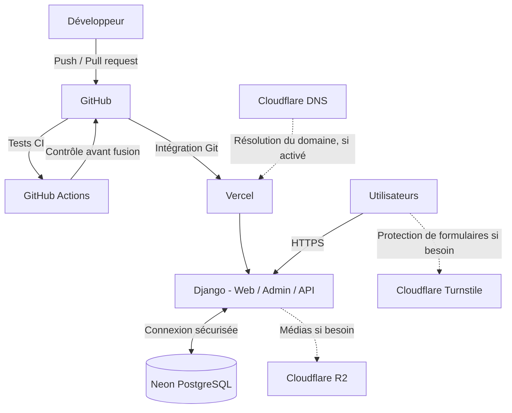

# 00 - Expression du besoin

## Socle Django + GitHub + Vercel + Neon + Cloudflare

| Attribut | Valeur |
|---|---|
| Identifiant | EDB-DGVNC-001 |
| Version | 1.0 |
| Date | 18 novembre 2026 |
| Statut | Proposition de cadrage, à valider avant implémentation |
| Type de document | Expression du besoin fonctionnel et non fonctionnel |
| Cible | Socle applicatif Django réutilisable, déployé automatiquement |
| Langue | Français |

> **Objet du document** : décrire le besoin, les résultats attendus, les contraintes et les critères de succès d'un socle applicatif Django moderne, simple à maintenir, connecté à GitHub, déployé automatiquement sur Vercel, utilisant PostgreSQL sur Neon et complété, lorsque cela présente un intérêt, par les services Cloudflare.
>
> Ce document formalise les attentes. Il ne constitue ni une architecture technique définitive, ni une autorisation de créer des ressources ou d'engager des dépenses.

---

## 1. Contexte et origine du besoin

Le développement d'applications Python repose fréquemment sur un arbitrage entre la vitesse de prototypage, la simplicité d'exploitation et les besoins d'industrialisation. Une application Django peut fournir un ensemble cohérent de fonctionnalités dès son démarrage : gestion des données, interface d'administration, authentification, vues web et API selon les besoins.

L'objectif est de disposer d'une chaîne de production comparable à celle couramment utilisée pour les applications React ou Next.js : le développeur travaille localement, publie son code sur GitHub et obtient automatiquement une version accessible en ligne après intégration des modifications.

L'écosystème envisagé réunit cinq briques aux responsabilités distinctes :

| Service | Responsabilité principale | Statut dans le besoin |
|---|---|---|
| **Django** | Logique métier, interface web et/ou API, administration, ORM, authentification | Obligatoire |
| **GitHub** | Code source, revues, historique, tests et événements de déploiement | Obligatoire |
| **Vercel** | Construction, hébergement, exécution Python et déploiements automatiques | Obligatoire |
| **Neon** | Base de données PostgreSQL persistante et administrée | Obligatoire pour les données persistantes |
| **Cloudflare** | DNS, domaine et services complémentaires tels que Turnstile ou R2 | DNS selon domaine, autres services optionnels |

La solution doit pouvoir servir à la fois de **démonstrateur fonctionnel** et de **modèle de départ réutilisable** pour plusieurs applications Python. Les fonctionnalités propres à chaque futur produit ne sont pas présumées dans ce cadrage.

## 2. Problématique

Comment créer et exploiter une application Django qui :

1. se développe rapidement et simplement en Python ;
2. se versionne et se révise dans GitHub ;
3. se déploie automatiquement sur Vercel après une modification validée ;
4. conserve ses données indépendamment des redéploiements ;
5. dispose d'une configuration sécurisée et reproductible ;
6. reste économique pendant l'expérimentation ;
7. peut évoluer vers des usages professionnels sans reconstruction systématique de l'architecture ?

**Problème central à résoudre** : supprimer les manipulations manuelles de mise en ligne tout en conservant la maîtrise du code, des données, de la configuration et de la qualité.

## 3. Vision et finalité

**Vision cible** : un dépôt GitHub constitue la source de vérité d'une application Django. Chaque pull request peut être testée et prévisualisée ; toute modification validée et intégrée dans la branche de production déclenche une mise à jour automatisée de l'application en ligne. Les données restent stockées dans PostgreSQL sur Neon. Cloudflare intervient uniquement pour les services qui apportent une valeur concrète.

### 3.1 Résultats attendus

- Réduire le délai entre une modification du code et sa mise en ligne.
- Éviter la configuration répétitive d'infrastructures pour chaque prototype.
- Obtenir des environnements de développement, de prévisualisation et de production clairement séparés.
- Assurer la persistance des données au fil des déploiements.
- Disposer d'une documentation permettant de reproduire l'installation.
- Fournir un socle réutilisable, mais sans créer prématurément une plateforme complexe.

### 3.2 Principe directeur

**Commencer par le minimum fiable, ajouter les composants lorsqu'un besoin mesurable le justifie.**

Le modèle initial privilégie un **monolithe Django**. React, Next.js, Django REST Framework, Cloudflare R2, les workers, les files de messages et les services d'authentification externes ne sont pas imposés dès le départ.

## 4. Parties prenantes et utilisateurs

| Acteur | Besoin principal |
|---|---|
| Développeur ou mainteneur | Développer, tester, publier, diagnostiquer et faire évoluer l'application |
| Administrateur applicatif | Consulter et administrer des données et des accès de manière contrôlée |
| Utilisateur final | Accéder à une application web fiable, sécurisée et disponible |
| Contributeur éventuel | Proposer des changements via pull request et contrôler leur impact |
| Exploitant du service | Surveiller les erreurs, les coûts, les performances et la sécurité |

Ces rôles peuvent être tenus par une seule personne au début, puis être séparés progressivement.

## 5. Périmètre du projet

### 5.1 Inclus dans le MVP

- Projet Django initialisé, exécutable localement et déployable.
- Dépôt GitHub structuré et fichier README complet.
- Gestion des dépendances et configuration par variables d'environnement.
- Base PostgreSQL Neon reliée à Django.
- Une interface de démonstration comportant une page publique, une zone d'administration protégée et un cas CRUD simple.
- Tests automatisés exécutés par GitHub Actions.
- Intégration GitHub-Vercel pour le déploiement continu.
- Déploiement de production à partir de la branche principale.
- Prévisualisation des pull requests, avec stratégie explicite d'isolation des données.
- Gestion des fichiers statiques et des erreurs de configuration courantes.
- Journalisation minimale et procédure de retour arrière applicatif.
- Documentation d'installation, de déploiement et d'exploitation.

### 5.2 Options après validation du MVP

- Domaine personnalisé et gestion DNS via Cloudflare.
- Cloudflare Turnstile pour limiter les abus sur les formulaires publics.
- Stockage des médias utilisateurs dans Cloudflare R2 ou une autre solution objet retenue.
- Branches Neon dédiées aux prévisualisations.
- API Django REST Framework et frontend React/Next.js séparé.
- Authentification fédérée, SSO ou fournisseur d'identité externe.
- Workers et orchestration pour des traitements asynchrones ou de longue durée.
- Monitoring avancé, alertes et suivi détaillé des coûts.
- Automatisation plus poussée des migrations, promotions et restaurations.

### 5.3 Hors périmètre initial

- Création d'un produit métier complet sans cahier des charges fonctionnel propre.
- Infrastructure Kubernetes, Docker en production obligatoire ou système distribué.
- Microservices par défaut.
- Développement d'une bibliothèque Python générique préalable au MVP.
- Gestion d'une activité commerciale sur une offre explicitement réservée à un usage non commercial.
- Engagement sur une disponibilité ou des performances contractuelles non vérifiées.

## 6. Parcours utilisateur et scénarios de référence

### UC-01 - Démarrer une application en local

**En tant que** développeur, **je veux** cloner le projet et lancer Django avec des instructions explicites **afin de** commencer sans configuration excessive.

**Résultat attendu** : un environnement local fonctionnel, des dépendances déterminées et un exemple de fichier `.env` sans secrets réels.

### UC-02 - Publier une modification de manière contrôlée

**En tant que** développeur, **je veux** ouvrir une pull request qui déclenche automatiquement les contrôles qualité **afin de** détecter les régressions avant fusion.

**Résultat attendu** : un statut de CI visible dans GitHub et une prévisualisation Vercel lorsque la configuration du projet l'autorise.

### UC-03 - Déployer la production automatiquement

**En tant que** mainteneur, **je veux** qu'une fusion validée sur `main` déclenche le déploiement de production Vercel **afin de** ne pas effectuer de publication manuelle.

**Résultat attendu** : une nouvelle version accessible en HTTPS, accompagnée d'un historique des déploiements.

### UC-04 - Conserver les données entre deux versions

**En tant qu'** administrateur, **je veux** retrouver les enregistrements créés avant le déploiement **afin de** garantir la continuité des données.

**Résultat attendu** : les données restent présentes dans PostgreSQL Neon après redéploiement, redémarrage ou remplacement d'instances applicatives.

### UC-05 - Administrer les données et les accès

**En tant qu'** administrateur, **je veux** accéder à l'administration Django avec des permissions adaptées **afin de** gérer les données autorisées.

**Résultat attendu** : la zone d'administration exige une authentification et n'expose pas d'informations sensibles aux visiteurs anonymes.

### UC-06 - Diagnostiquer une anomalie

**En tant qu'** exploitant, **je veux** retrouver la version déployée, les messages d'erreur et les événements importants **afin de** comprendre un incident.

**Résultat attendu** : accès aux journaux pertinents et possibilité de rétablir une version applicative antérieure selon la procédure documentée.

### UC-07 - Réutiliser le socle

**En tant que** développeur de nouveaux projets, **je veux** reprendre la structure et la chaîne de livraison **afin de** me concentrer sur les fonctionnalités métier.

**Résultat attendu** : un nouveau projet peut partir du modèle sans recopier manuellement les secrets ni dépendre des données d'un autre projet.

## 7. Exigences fonctionnelles

Convention de priorité : **P0 = indispensable pour le MVP**, **P1 = souhaitable rapidement**, **P2 = évolution optionnelle**.

| ID | Priorité | Exigence | Vérification attendue |
|---|---|---|---|
| EF-01 | P0 | Le projet fournit une application Django démarrable localement. | Démarrage reproductible à partir du README. |
| EF-02 | P0 | Le code est conservé dans un dépôt GitHub. | Dépôt et historique de commits accessibles aux personnes autorisées. |
| EF-03 | P0 | Les pull requests déclenchent des contrôles automatiques. | Statuts de tests et de qualité visibles dans GitHub. |
| EF-04 | P0 | Un changement intégré à `main` déclenche automatiquement un déploiement Vercel. | Nouveau déploiement identifié, sans commande manuelle de publication. |
| EF-05 | P0 | L'application utilise Neon PostgreSQL pour les données persistantes. | Écriture et lecture de données après redéploiement. |
| EF-06 | P0 | L'application expose au moins une fonctionnalité CRUD de démonstration. | Scénario création, lecture, mise à jour, suppression validé. |
| EF-07 | P0 | L'administration Django est accessible aux seuls utilisateurs autorisés. | Accès refusé pour les visiteurs non authentifiés. |
| EF-08 | P0 | L'application présente un fonctionnement HTTPS public. | URL Vercel opérationnelle avec HTTPS. |
| EF-09 | P0 | Les environnements n'exposent pas les secrets dans le dépôt. | Revue du dépôt et contrôle des variables d'environnement. |
| EF-10 | P0 | Les modifications du schéma sont gérées par migrations versionnées. | Migration reproductible sur une base de test isolée. |
| EF-11 | P1 | Chaque pull request dispose d'une prévisualisation Vercel exploitable. | URL de prévisualisation attachée à la PR. |
| EF-12 | P1 | Les données de prévisualisation sont isolées de la production. | La prévisualisation ne modifie aucun enregistrement de production. |
| EF-13 | P1 | Les erreurs applicatives sont consultables. | Incident volontaire détectable dans les journaux. |
| EF-14 | P1 | Une procédure de restauration applicative est documentée. | Exercice de retour à une version antérieure réussi. |
| EF-15 | P2 | Un domaine personnalisé est configurable via Cloudflare. | Résolution DNS et HTTPS validés. |
| EF-16 | P2 | Les formulaires publics peuvent être protégés par Turnstile. | Vérification du jeton côté serveur. |
| EF-17 | P2 | Les médias utilisateurs peuvent être stockés hors du système de fichiers local. | Téléversement, accès autorisé et suppression vérifiés. |
| EF-18 | P2 | Le projet peut exposer une API DRF ou servir un frontend distinct. | Contrat d'API et contrôle d'accès validés. |

## 8. Exigences non fonctionnelles

### ENF-01 - Simplicité et maintenabilité (P0)

- Préférer les fonctionnalités standard de Django et une arborescence lisible.
- Éviter les dépendances qui ne répondent à aucun cas d'usage identifié.
- Documenter l'architecture, les décisions et les procédures de mise à jour.
- Conserver une séparation claire entre configuration, logique métier et accès aux données.

### ENF-02 - Sécurité (P0)

- Toutes les communications publiques utilisent HTTPS.
- `DEBUG=False` dans les environnements publics.
- `SECRET_KEY`, accès PostgreSQL et clés externes stockés dans les variables sécurisées des plateformes, jamais dans Git.
- Paramétrage explicite de `ALLOWED_HOSTS` et de `CSRF_TRUSTED_ORIGINS`.
- Protection des pages d'administration, permissions minimales, sessions et cookies sécurisés.
- Dépendances suivies et corrections de sécurité applicables.
- Contrôle d'accès et validation des entrées pour les fonctions métier.
- Journaux ne contenant pas de mots de passe, de jetons, de secrets ni de données personnelles inutiles.

### ENF-03 - Fiabilité des données (P0)

- PostgreSQL représente la source de vérité persistante.
- Les déploiements applicatifs ne suppriment pas de données.
- Les migrations sont préparées, testées, tracées et exécutées de façon maîtrisée.
- Aucun build ou environnement de prévisualisation ne doit lancer des migrations destructrices sur la production.
- Une méthode de sauvegarde/restauration adaptée au niveau de risque est identifiée et testée avant un usage critique.

### ENF-04 - Reproductibilité (P0)

- Versions Python et dépendances définies explicitement.
- Configuration de développement documentée.
- Tests exécutables en local et en CI.
- Un déploiement peut être rattaché à un commit donné.

### ENF-05 - Performance et coût (P1)

- Limiter le temps de démarrage, les dépendances superflues et les appels à la base.
- Aligner autant que possible les régions d'exécution Vercel et Neon pour limiter la latence.
- Mesurer les temps de réponse des parcours critiques avant de fixer des objectifs chiffrés.
- Surveiller les quotas et éviter toute hypothèse selon laquelle une offre gratuite convient à tous les usages.

### ENF-06 - Observabilité (P1)

- Déploiements et erreurs consultables.
- Journalisation utile et structurée lorsque nécessaire.
- Identification de l'environnement et de la version dans les informations de diagnostic.
- Alertes à introduire lorsque l'usage ou la criticité le justifie.

### ENF-07 - Conformité et données personnelles (selon usage)

- Examiner les implications RGPD si des données personnelles sont traitées.
- Vérifier les lieux d'hébergement, contrats applicables, durées de conservation et habilitations.
- Ne pas utiliser de données personnelles de production dans les environnements de test ou de prévisualisation sans fondement et protections appropriées.
- Établir des exigences complémentaires pour les données financières ou sensibles.

## 9. Architecture fonctionnelle cible

> **Important concernant Cloudflare** : pour le MVP, l'architecture privilégie **Cloudflare DNS uniquement**, avec des enregistrements en mode **DNS-only** pointant vers Vercel si un domaine Cloudflare est utilisé. Le proxy Cloudflare, son WAF en frontal et le double CDN ne sont pas des prérequis. En mode DNS-only, le trafic de l'application ne transite pas par le proxy Cloudflare. Vercel conserve la responsabilité de servir l'application et son HTTPS.

### 9.1 Répartition des responsabilités

| Couche | Responsable cible | Remarque |
|---|---|---|
| Versionnement et collaboration | GitHub | Branches, PR, protections de branche |
| Tests et vérifications | GitHub Actions | Pipeline de qualité indépendant de l'hébergement |
| Construction et déploiement | Vercel | Intégration native au dépôt GitHub |
| Framework et métier | Django | Modèles, vues, templates, admin et API éventuelle |
| Données relationnelles | Neon PostgreSQL | Persistance indépendante des fonctions Vercel |
| Fichiers statiques | Chaîne Django/Vercel | À distinguer des fichiers téléversés par les utilisateurs |
| DNS et domaine | Cloudflare, si retenu | DNS-only par défaut |
| Médias utilisateurs | Stockage objet, si nécessaire | R2 candidat, une solution suffit au départ |
| Anti-bot | Turnstile, si nécessaire | Validation serveur obligatoire |

## 10. Workflow de livraison attendu

### 10.1 Développement et pull request

1. Créer une branche de travail.
2. Réaliser une modification et les tests associés.
3. Ouvrir une pull request GitHub.
4. Déclencher automatiquement les tests, le lint et les contrôles définis.
5. Générer une prévisualisation Vercel, lorsque configurée.
6. Vérifier que cette prévisualisation n'utilise pas de données de production modifiables.
7. Autoriser la fusion uniquement après les contrôles attendus.

### 10.2 Production

1. Fusionner la pull request sur la branche principale protégée.
2. L'intégration Git Vercel lance automatiquement le déploiement.
3. Les étapes de construction publient le code et les ressources statiques.
4. Les migrations nécessaires sont effectuées par une procédure contrôlée, distincte des déploiements de prévisualisation.
5. Les contrôles post-déploiement confirment le bon fonctionnement des parcours essentiels.
6. En cas d'incident, l'exploitant dispose d'un protocole d'investigation et de retour arrière.

**Critère majeur** : il ne doit pas être nécessaire de relancer manuellement une commande de déploiement pour chaque modification validée sur `main`.

## 11. Gestion des environnements et des données

| Environnement | Objectif | Données | Déclenchement |
|---|---|---|---|
| Local | Développement rapide | Base locale ou base de développement dédiée | Exécution du développeur |
| Preview | Valider une PR | Base Neon isolée ou solution de test sans écriture en production | Pull request |
| Production | Servir les utilisateurs | Base Neon de production | Fusion sur `main` |

### 11.1 Exigences de connexion PostgreSQL

- Utiliser une variable `DATABASE_URL` adaptée à l'environnement.
- Activer le chiffrement des connexions conformément à la configuration Neon.
- Étudier une connexion poolée pour les requêtes applicatives et une connexion directe pour certaines opérations d'administration ou de migration selon la documentation des services.
- Ne pas enregistrer de secrets ou d'URL de connexion nominative dans les logs.
- Vérifier la politique de branchement et de restauration disponible dans le plan Neon réellement utilisé.

### 11.2 Principes de migration

Les migrations Django sont versionnées dans Git. Elles doivent être vérifiées sur une base isolée avant leur application en production. Les modifications incompatibles doivent faire l'objet d'une stratégie de déploiement progressive. **Le succès d'un déploiement de code ne prouve pas la sûreté d'une migration de base.**

## 12. Principales variables de configuration

Liste indicative à adapter à l'implémentation :

| Variable | Objet | Sensibilité |
|---|---|---|
| `DJANGO_SECRET_KEY` | Clé secrète de Django | Secrète |
| `DJANGO_DEBUG` | Activation du débogage | Configuration |
| `DJANGO_ALLOWED_HOSTS` | Hôtes autorisés | Configuration |
| `DJANGO_CSRF_TRUSTED_ORIGINS` | Origines de confiance CSRF | Configuration |
| `DATABASE_URL` | Accès PostgreSQL Neon | Secrète |
| `DATABASE_URL_UNPOOLED` | Accès direct si requis par certaines opérations | Secrète |
| `APP_ENV` | Environnement courant | Configuration |
| `CLOUDFLARE_R2_*` | Accès au stockage objet optionnel | Potentiellement secrète |
| `TURNSTILE_SITE_KEY` | Identifiant public Turnstile optionnel | Publique |
| `TURNSTILE_SECRET_KEY` | Clé serveur Turnstile optionnelle | Secrète |

Un fichier `.env.example` ne doit contenir que des valeurs fictives ou documentaires.

## 13. Contraintes spécifiques aux plateformes

### 13.1 Vercel

- Le fonctionnement cible doit être compatible avec le modèle d'exécution Python/Django de Vercel.
- Le système de fichiers local d'une fonction n'est pas un support de stockage persistant pour les utilisateurs.
- Les limites de durée, de mémoire, de taille des requêtes et de quotas doivent être vérifiées selon le plan choisi.
- Les tâches longues, les traitements ETL lourds ou les agents persistants peuvent nécessiter une architecture d'exécution distincte.
- Les offres gratuites et les offres de production sont soumises à des conditions d'utilisation différentes. **L'offre Vercel Hobby est destinée aux usages personnels non commerciaux** : un produit professionnel ou commercial doit faire l'objet d'un choix de plan conforme avant son exploitation.

### 13.2 Neon

- Le dimensionnement de la base dépend des volumes, du nombre de connexions, des besoins de restauration et de la charge réelle.
- Les quotas et fonctionnalités gratuites peuvent évoluer.
- Une branche de base dédiée aux PR n'est pas automatique sans configuration explicite de l'intégration et des variables de prévisualisation.
- Django Auth est retenu comme solution initiale pour les comptes utilisateurs ; Neon Auth ne doit pas être ajouté sans décision d'architecture sur l'identité.

### 13.3 Cloudflare

- Le DNS-only constitue le point de départ recommandé en cas de domaine personnalisé.
- Activer le proxy Cloudflare nécessiterait une vérification de compatibilité et des responsabilités entre CDN, caches, TLS, en-têtes et mécanismes de sécurité.
- Turnstile et R2 restent indépendants du besoin d'activer un proxy Cloudflare devant Vercel.
- Le choix de stockage des médias doit prendre en compte les coûts, les permissions, les volumes et le cycle de vie des fichiers.

## 14. Stratégie de test et validation

| Niveau | Objectif | Minimum requis |
|---|---|---|
| Vérifications statiques | Détecter erreurs de style et de configuration | Lint, validation de syntaxe et contrôles des secrets |
| Tests unitaires | Vérifier les règles applicatives | Tests sur le cas CRUD et les composants critiques |
| Tests d'intégration | Vérifier Django + PostgreSQL | Création et lecture d'enregistrements sur base isolée |
| Tests de sécurité | Vérifier l'accès et les protections | Authentification, permissions, `DEBUG=False`, CSRF |
| Tests de déploiement | Vérifier la chaîne GitHub-Vercel | Pull request puis fusion sur `main` |
| Tests de persistance | Vérifier l'indépendance des données | Données conservées après redéploiement |
| Tests de migration | Réduire les risques du changement de schéma | Application sur base non productive |
| Tests de reprise | Vérifier la capacité de rétablissement | Retour arrière applicatif et procédure de restauration documentés |

Les mesures de performance et les objectifs de disponibilité seront définis après observation des premiers usages.

## 15. Critères d'acceptation du MVP

Le MVP est **accepté** uniquement si les critères suivants sont démontrés :

- [ ] **CA-01** : un nouveau développeur peut lancer l'application à partir des instructions du README.
- [ ] **CA-02** : l'application Django fonctionne sur une URL Vercel en HTTPS.
- [ ] **CA-03** : les données CRUD sont bien stockées dans Neon PostgreSQL.
- [ ] **CA-04** : les données créées avant un déploiement restent présentes après celui-ci.
- [ ] **CA-05** : une pull request déclenche les tests de GitHub Actions.
- [ ] **CA-06** : les contrôles bloquants sont définis sur la branche principale, selon les capacités du dépôt.
- [ ] **CA-07** : la fusion sur `main` produit automatiquement une nouvelle version en ligne.
- [ ] **CA-08** : une prévisualisation n'écrit pas dans la base de production.
- [ ] **CA-09** : l'administration et les opérations sensibles sont protégées.
- [ ] **CA-10** : aucun secret réel n'est commité dans le dépôt.
- [ ] **CA-11** : les migrations sont traçables et leur exécution en production est maîtrisée.
- [ ] **CA-12** : une procédure de diagnostic et de retour arrière est accessible.
- [ ] **CA-13** : le plan d'hébergement est compatible avec la nature réelle de l'utilisation (personnelle ou commerciale).

## 16. Indicateurs de succès

| Indicateur | Résultat recherché | Méthode |
|---|---|---|
| Automatisation de livraison | 100 % des fusions éligibles sur `main` déclenchent un déploiement | Historique GitHub/Vercel |
| Reproductibilité du démarrage | Installation réussie en suivant uniquement le README | Exercice de reprise depuis un clone vierge |
| Persistance | Aucune perte liée au seul redéploiement | Scénario de test CRUD avant/après |
| Qualité | Contrôles CI obligatoires opérationnels | Statuts GitHub |
| Isolation | Aucun effet de bord Preview vers la production | Tests de cloisonnement |
| Sécurité des secrets | Aucun secret réel dans Git | Revue automatisée et manuelle |
| Maîtrise des coûts | Consommation observable et plan adapté | Tableaux de bord fournisseurs |

Aucun objectif de SLA, de latence ou de coût mensuel chiffré n'est fixé sans hypothèses de charge ou plan souscrit.

## 17. Risques, arbitrages et mesures prévues

| Risque | Impact potentiel | Mesure de prévention |
|---|---|---|
| Offre d'hébergement incompatible avec un usage commercial | Non-conformité contractuelle ou coût imprévu | Vérifier l'usage et le plan avant production commerciale |
| Preview connectée à la base de production | Corruption ou exposition de données | Bases/branches et variables isolées |
| Migration lancée automatiquement au mauvais moment | Indisponibilité ou perte de données | Procédure explicite, tests et stratégie de reprise |
| Stockage local de médias | Disparition des fichiers entre exécutions | Stockage objet si téléversements requis |
| Fonctions serverless inadaptées aux traitements longs | Timeout, échec ou coûts | Externaliser les tâches longues si elles apparaissent |
| Accumulation prématurée de services | Complexité, incidents et coûts | Architecture progressive avec justification par besoin |
| Double proxy Cloudflare/Vercel sans configuration maîtrisée | Problèmes de cache, sécurité ou réseau | DNS-only initialement |
| Région de base éloignée du runtime | Latence accrue | Choix géographique cohérent |
| Restaurabilité supposée mais jamais testée | Perte de données en cas d'incident | Exercice de restauration selon criticité |

## 18. Roadmap de réalisation proposée

### Phase R0 - Cadrage et choix

- Valider ce document.
- Confirmer l'usage : prototype personnel, application interne ou application commerciale.
- Définir le cas CRUD de démonstration.
- Décider dépôt GitHub et nom du projet.
- Vérifier les offres, budgets, régions et contraintes de données.

**Livrable** : décisions d'architecture minimales et backlog validés.

### Phase R1 - Socle Django local

- Initialiser Django et la structure du dépôt.
- Ajouter configuration externalisée et dépendances reproductibles.
- Développer page d'accueil, administration et CRUD simple.
- Écrire les premiers tests et la documentation locale.

**Livrable** : application fonctionnelle et testée localement.

### Phase R2 - GitHub, CI et Vercel

- Publier le dépôt.
- Configurer GitHub Actions et les protections nécessaires.
- Connecter GitHub à Vercel.
- Démontrer le déploiement automatique sur `main` et les prévisualisations.

**Livrable** : boucle de livraison automatisée et vérifiée.

### Phase R3 - PostgreSQL Neon et fiabilisation

- Mettre en place PostgreSQL Neon et les secrets par environnement.
- Tester les migrations sur une base isolée.
- Démontrer la persistance après redéploiement.
- Isoler les prévisualisations de la production.
- Documenter le retour arrière et le diagnostic.

**Livrable** : MVP complet satisfaisant les critères d'acceptation.

### Phase R4 - Services Cloudflare selon besoin

- Configurer le domaine et le DNS si souhaité.
- Ajouter Turnstile si des formulaires publics le justifient.
- Ajouter un stockage objet si l'application gère des médias utilisateurs.
- Effectuer une revue sécurité, coûts et conformité.

**Livrable** : application enrichie uniquement des services pertinents.

### Phase R5 - Industrialisation ciblée

- Mesurer charge, erreurs, temps de réponse et coûts.
- Étudier DRF, frontend séparé ou workers si le produit l'impose.
- Extraire un modèle réutilisable pour de futurs projets.
- Intégrer des bibliothèques Python existantes seulement si elles apportent une valeur métier ou technique vérifiée.

**Livrable** : modèle d'application réutilisable, basé sur un premier cas réellement exploité.

## 19. Livrables documentaires attendus

| Document | Rôle | Moment |
|---|---|---|
| `00_DJANGO_GITHUB_VERCEL_NEON_CLOUDFLARE_EXPRESSION_DU_BESOIN.md` | Formaliser le besoin et les critères de succès | R0 |
| `01_ARCHITECTURE_ET_DECISIONS.md` | Décrire l'architecture retenue et ses arbitrages | R0/R1 |
| `02_BACKLOG_ET_USER_STORIES.md` | Décomposer les besoins en travaux traçables | R0/R1 |
| `03_STRUCTURE_PROJET_ET_CONFIGURATION.md` | Décrire l'organisation du code et les variables | R1 |
| `04_PLAN_IMPLEMENTATION_ET_CI_CD.md` | Planifier l'implémentation, GitHub Actions et Vercel | R1/R2 |
| `05_STRATEGIE_DONNEES_ET_MIGRATIONS.md` | Sécuriser PostgreSQL, les environnements et les migrations | R3 |
| `06_STRATEGIE_TESTS_ET_ACCEPTATION.md` | Organiser les validations et la recette du MVP | R2/R3 |
| `07_RUNBOOK_DEPLOIEMENT_ET_EXPLOITATION.md` | Documenter incidents, retour arrière et contrôles | R3 |
| `08_OPTIONS_CLOUDFLARE_ET_EVOLUTIONS.md` | Encadrer les ajouts ultérieurs | R4/R5 |

Il s'agit d'un **plan de documentation proposé**, pas d'une obligation de produire tous les fichiers avant de commencer l'implémentation.

## 20. Décisions à confirmer avant implémentation

| Référence | Question | Proposition par défaut | Statut |
|---|---|---|---|
| DEC-01 | Quel est le premier cas d'usage ? | Démonstrateur CRUD de gestion de projets ou d'enregistrements | À valider |
| DEC-02 | Interface utilisateur ? | Django Templates + Admin, HTMX uniquement si utile | À valider |
| DEC-03 | API REST dès le MVP ? | Non ; DRF lorsque des clients API existent | À valider |
| DEC-04 | Gestion des comptes ? | Django Auth natif | À valider |
| DEC-05 | Dépôt de référence ? | Dépôt GitHub distinct pour le socle | À valider |
| DEC-06 | Nature de l'exploitation ? | Prototype avant usage commercial | **À confirmer impérativement** |
| DEC-07 | Plan Vercel ? | Offre conforme à l'usage retenu | À confirmer |
| DEC-08 | Région Vercel/Neon ? | Régions proches, à choisir selon latence et contraintes | À confirmer |
| DEC-09 | Prévisualisation avec données ? | Base isolée, données synthétiques | À confirmer |
| DEC-10 | Domaine personnalisé ? | Optionnel après la première URL Vercel | À confirmer |
| DEC-11 | Stockage objet ? | Aucun tant que des médias ne sont pas requis | À confirmer |
| DEC-12 | Traitements longs ? | Hors MVP ; solution dédiée si besoin démontré | À confirmer |

## 21. Définition de terminé

Le travail est terminé pour le MVP lorsque :

1. le cas d'usage retenu fonctionne localement et en production ;
2. le code est versionné, testé et publié automatiquement ;
3. la base Neon conserve les données à travers les déploiements ;
4. les prévisualisations et la production sont correctement cloisonnées ;
5. les secrets et les accès sont protégés ;
6. la démarche d'installation, de migration et de reprise est documentée ;
7. la démonstration des critères CA-01 à CA-13 est consignée ;
8. le plan de service utilisé respecte la nature de l'exploitation.

**Le succès du MVP ne dépend pas de l'activation de tous les services Cloudflare, d'une architecture microservices ou de la mise en place d'un frontend JavaScript séparé.**

---

## Annexe A - Références techniques officielles

Les conditions commerciales et les limites des plateformes évoluent. Vérifier les versions applicables au moment de l'implémentation.

- Vercel, déploiement Django : https://vercel.com/docs/frameworks/full-stack/django
- Vercel, intégration GitHub : https://vercel.com/docs/git/vercel-for-github
- Vercel, limites des fonctions : https://vercel.com/docs/functions/limitations
- Vercel, plan Hobby : https://vercel.com/docs/plans/hobby
- Vercel, recommandation sur les proxys externes : https://vercel.com/kb/guide/can-i-use-a-proxy-on-top-of-my-vercel-deployment
- Vercel Marketplace, Neon : https://vercel.com/marketplace/neon
- Neon : https://neon.com/docs/introduction
- Cloudflare R2, tarification : https://developers.cloudflare.com/r2/pricing/
- Cloudflare Turnstile : https://developers.cloudflare.com/turnstile/get-started/
- Django, checklist de déploiement : https://docs.djangoproject.com/en/stable/howto/deployment/checklist/

## Annexe B - Synthèse de l'expression du besoin

> Concevoir un socle Django **simple, sécurisé et réutilisable**, dans lequel GitHub centralise le code et les validations, Vercel automatise la mise en ligne, Neon assure la persistance PostgreSQL et Cloudflare apporte des services complémentaires lorsqu'ils sont nécessaires. L'architecture doit permettre une évolution incrémentale sans imposer dès le départ une infrastructure complexe ou un ensemble de dépendances superflues.
