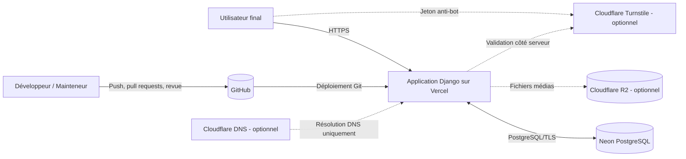
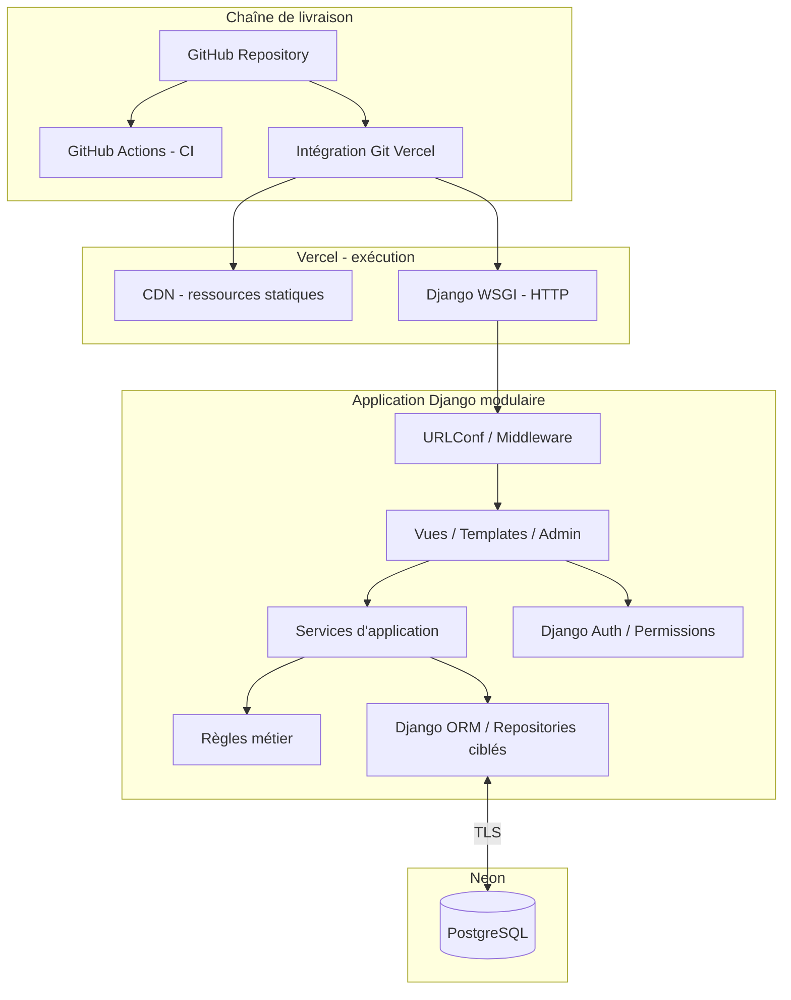
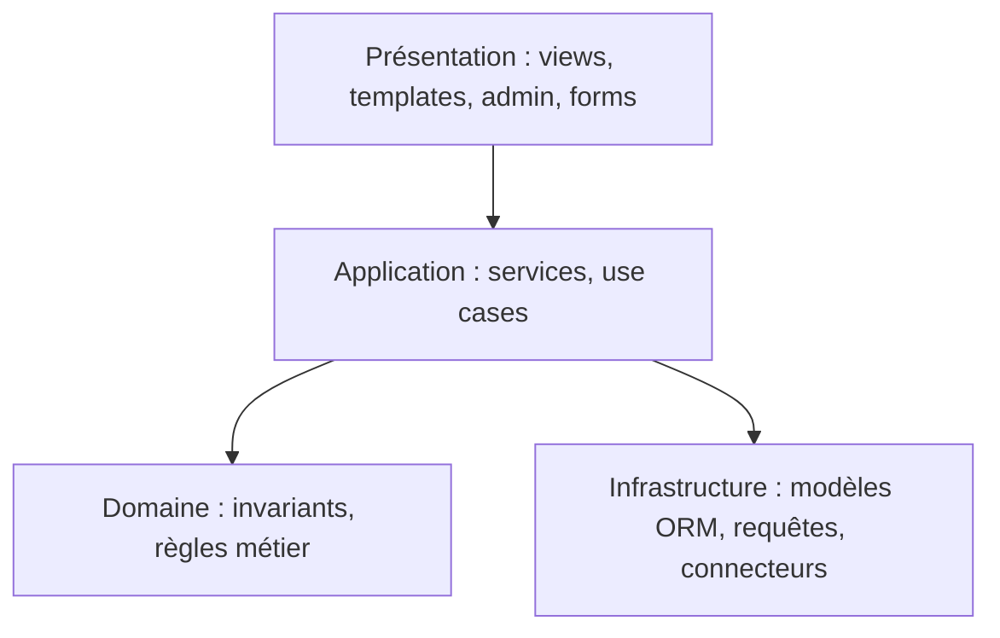
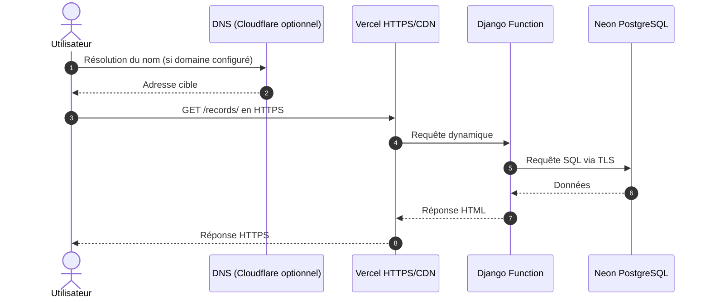
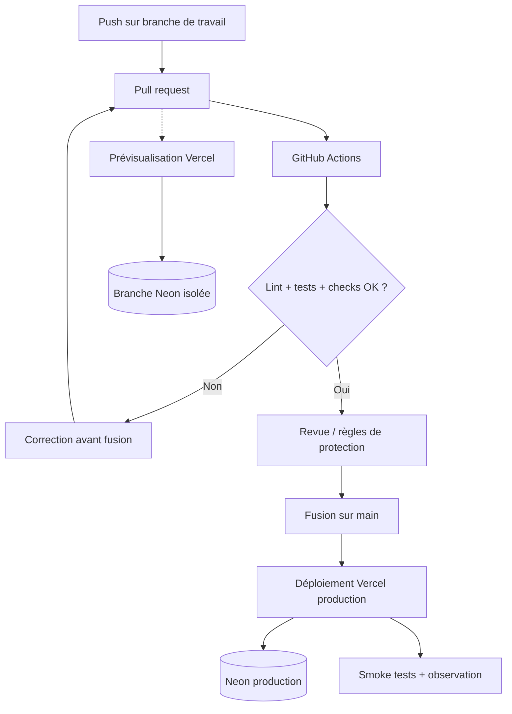
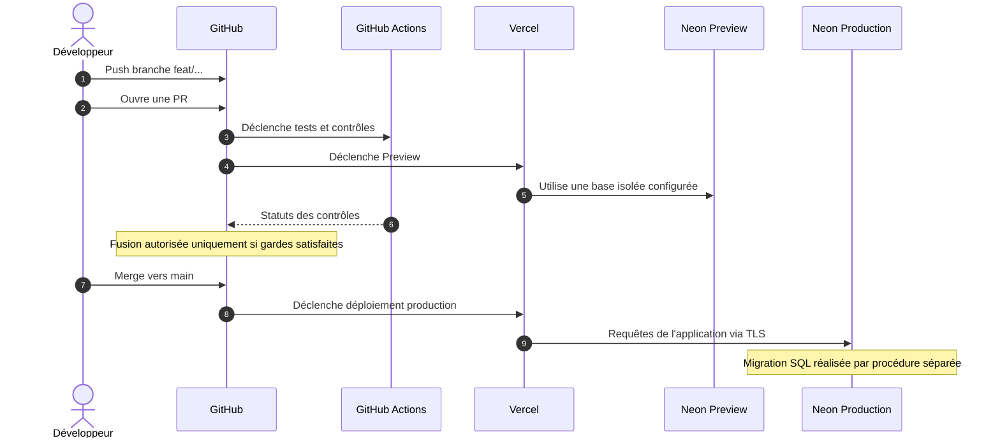

# 01 - Architecture technique et décisions

## Socle Django + GitHub + Vercel + Neon + Cloudflare

| Attribut | Valeur |
|---|---|
| Identifiant | ARC-DGVNC-001 |
| Version | 1.0 |
| Date | 18 novembre 2026 |
| Statut | Architecture cible proposée, à valider avant création des ressources |
| Nature | Architecture logique, physique, règles d'exploitation et journal des décisions (ADR) |
| Document amont | `00_DJANGO_GITHUB_VERCEL_NEON_CLOUDFLARE_EXPRESSION_DU_BESOIN.md` |
| Périmètre | MVP d'un socle Django réutilisable, non un produit métier complet |
| Langue | Français |

> **Décision architecturale principale** : commencer par un **monolithe Django modulaire**, placé dans un **dépôt GitHub**, déployé automatiquement sur **Vercel**, avec **Neon PostgreSQL** pour les données persistantes. Utiliser **Cloudflare** seulement pour le DNS ou pour des services additionnels justifiés, tels que Turnstile et R2.
>
> **Portée** : ce fichier propose des choix d'architecture. Il ne prouve pas que des ressources ont été provisionnées, qu'une application a été codée ou qu'un déploiement fonctionne déjà. Les plans, régions, budgets et noms définitifs restent à confirmer.

---

## 1. Synthèse de la décision

### 1.1 Architecture choisie pour le MVP

| Dimension | Choix cible | Justification |
|---|---|---|
| Architecture applicative | Monolithe Django modulaire | Une seule base de code, une seule unité de livraison, faible coût de coordination |
| Couche web | Django Templates + Django Admin | Interface et administration disponibles sans frontend JavaScript séparé |
| API externe | Non obligatoire | DRF seulement lorsqu'un consommateur API est identifié |
| Identité | Django Auth natif | Source d'identité unique, intégration directe aux permissions et à l'Admin |
| Accès aux données | Django ORM | Migrations et transactions explicites, faible complexité |
| SGBD | PostgreSQL administré chez Neon | Persistance indépendante de l'exécution serverless |
| Versionnement | GitHub, branches de travail et pull requests | Traçabilité et revue |
| Tests / CI | GitHub Actions | Garde-fous indépendants du fournisseur d'hébergement |
| Déploiements | Intégration GitHub native Vercel | Déploiements de production et de prévisualisation automatiques |
| Entrée Django | WSGI au départ | Adapté aux requêtes HTTP synchrones du MVP ; ASGI reste une évolution possible |
| Fichiers statiques | `collectstatic` et CDN Vercel | Mécanisme Django directement pris en charge par Vercel |
| Fichiers médias | Aucun stockage local persistant | Objet externe uniquement si téléversements nécessaires |
| DNS | Vercel directement ; Cloudflare DNS-only si domaine géré par Cloudflare | Limite le double proxy et les problèmes de cache |
| Traitements longs | Hors chemin HTTP du MVP | Ne pas assimiler une fonction requête-réponse à un worker permanent |
| Paquet de démarrage | Dépôt modèle applicatif réutilisable | Mutualiser le workflow sans industrialiser des abstractions prématurées |

### 1.2 Distinction obligatoire / optionnel

- **MVP requis** : Django, GitHub, GitHub Actions, Vercel et Neon.
- **À ajouter sur besoin** : Cloudflare DNS pour un domaine géré chez Cloudflare, Turnstile pour des formulaires publics exposés aux abus, R2 pour les médias, DRF pour un consommateur API, HTMX pour une interaction web plus riche.
- **Non imposé** : React, Next.js, conteneur Docker en production, Kubernetes, microservices, Redis, Celery, Neon Auth, Cloudflare Workers, Cloudflare proxy/WAF en frontal Vercel.

## 2. Principes architecturaux

1. **KISS et YAGNI** : privilégier l'implémentation la moins complexe qui couvre le besoin vérifié.
2. **Séparation des responsabilités** : GitHub conserve le code, Vercel exécute l'application, Neon conserve les données, Cloudflare fournit des services complémentaires.
3. **Monolithe modulaire** : organiser le code en applications Django cohérentes, pas en microservices artificiels.
4. **Stateless à l'exécution** : ne pas supposer qu'une instance Vercel conserve sa mémoire ou ses fichiers entre deux requêtes.
5. **Données durables externes** : la source de vérité est PostgreSQL ; les fichiers utilisateurs, s'ils existent, appartiennent à un stockage objet.
6. **Isolation par défaut** : développement, prévisualisation et production n'écrivent pas dans la même base.
7. **Sécurité de la chaîne de livraison** : secrets hors Git, tests avant fusion, migrations contrôlées, permissions minimales.
8. **Réversibilité** : garder Django et PostgreSQL aussi portables que possible, sans dépendance obligatoire aux primitives propriétaires.
9. **Observabilité progressive** : logs structurés utiles, diagnostics et métriques avant la sophistication.
10. **Dépendances fondées sur l'usage** : les bibliothèques Py**Kit ne sont intégrées que lorsque le produit en a réellement besoin.

## 3. Vue de contexte C4, niveau 1



**Lecture du diagramme** : la résolution DNS Cloudflare est un service de configuration du domaine, pas nécessairement un passage du trafic HTTP par Cloudflare. En mode *DNS-only*, Vercel reçoit directement le trafic HTTPS et gère sa couche réseau applicative.

## 4. Vue des conteneurs et responsabilités, niveau 2



### 4.1 Matrice des responsabilités

| Composant | Responsable | Ce qu'il ne doit pas faire |
|---|---|---|
| GitHub | Historique, PR, protection de branche et référentiel de code | Stocker les secrets de production dans les fichiers |
| GitHub Actions | Contrôles de qualité et sécurité, tests, prévalidation des migrations | Migrer automatiquement la base de production depuis une PR |
| Vercel | Construire, livrer, exécuter Django et servir les statiques | Servir de base durable ou de stockage durable de médias |
| Django | Routing, métier, interface, authentification, validation, ORM | Dépendre de fichiers temporaires comme d'une source de vérité |
| Neon | Stockage transactionnel PostgreSQL, séparation de branches, restauration selon plan | Héberger les fichiers statiques de build Django |
| Cloudflare DNS | Résolution du domaine personnalisé si retenu | Ajouter un proxy non documenté devant Vercel |
| Cloudflare Turnstile | Défi anti-bot, si besoin | Se substituer aux permissions, quotas et contrôles serveur |
| Cloudflare R2 | Stockage des fichiers médias, si besoin | Stocker les secrets d'application ou remplacer PostgreSQL |

## 5. Architecture interne de Django

### 5.1 Strates et direction des dépendances



Règles :

- Les **vues** restent minces. Elles valident les entrées, appellent le cas d'usage, choisissent la réponse et appliquent les permissions.
- Les **services d'application** coordonnent les opérations métier à étapes multiples et leurs transactions.
- Les **modèles Django** représentent les données persistées et portent les invariants simples ; ne pas créer de couches artificielles de DTO, repository ou CQRS sans motif.
- Les **formulaires** et l'Admin assurent validation de saisie et administration, sans introduire une seconde logique métier contradictoire.
- Les **transactions** entourent les changements cohérents ; les effets externes (e-mails, webhooks) doivent être coordonnés pour éviter les doublons après échec.
- Les **adaptateurs externes** sont encapsulés seulement lorsqu'une intégration réelle exige la séparation.

### 5.2 Module fonctionnel de démonstration

Pour valider le socle sans engager un domaine métier particulier, créer une application `records` avec un modèle de type `Record` : titre, description courte, statut, dates de création et de modification. Il s'agit d'un **cas d'essai**, pas d'une recommandation pour les futurs produits.

Parcours MVP : accueil public, connexion, liste protégée, création, modification, suppression contrôlée, consultation dans Django Admin. Les permissions d'accès sont définies explicitement.

### 5.3 Frontend

**Choix : Django Templates + CSS simple + JavaScript minimal.** HTMX est admissible si un besoin d'interactivité le motive. Une séparation React/Next.js + Django REST Framework constitue une évolution produit, et non une dépendance d'infrastructure.

## 6. Arborescence de référence

```text
django-cloud-starter/
├── .github/
│   ├── workflows/
│   │   └── ci.yml
│   └── dependabot.yml                   # optionnel
├── config/
│   ├── __init__.py
│   ├── settings.py                       # configurable par environnement
│   ├── urls.py
│   ├── wsgi.py                           # point d'entrée initial
│   └── asgi.py                           # conservé, non sélectionné par défaut
├── apps/
│   ├── __init__.py
│   ├── core/
│   │   ├── apps.py
│   │   ├── views.py
│   │   ├── urls.py
│   │   └── tests/
│   └── records/
│       ├── apps.py
│       ├── admin.py
│       ├── models.py
│       ├── forms.py
│       ├── views.py
│       ├── services.py                   # si besoin de cas d'usage
│       ├── urls.py
│       ├── migrations/
│       └── tests/
├── templates/
│   ├── base.html
│   └── records/
├── static/
│   └── css/
├── docs/
│   └── architecture/
├── manage.py
├── pyproject.toml
├── uv.lock                               # si uv retenu
├── .env.example
├── .gitignore
└── README.md
```

**Conventions** :

- Conserver `manage.py` détectable par Vercel. L'emplacement de la racine du projet doit rester cohérent avec la configuration Vercel.
- Un `vercel.json` n'est **pas** requis pour le déploiement Django standard. L'ajouter uniquement pour un paramétrage justifié, par exemple une durée de fonction explicite.
- Ne pas déclarer les deux applications WSGI et ASGI comme sélectionnées simultanément sans comprendre la règle de sélection Vercel : en présence des deux réglages, Vercel privilégie ASGI.
- Ne pas ajouter Docker, Redis, Celery ou un dossier `microservices/` uniquement pour anticiper une croissance hypothétique.

## 7. Architecture de déploiement et du réseau

### 7.1 Parcours HTTP en production



Le schéma ne suppose pas que le proxy HTTP Cloudflare est activé. Les requêtes de fichiers statiques sont servies depuis le CDN Vercel sans devoir exécuter systématiquement une vue Django.

### 7.2 Build Django sur Vercel

Depuis la prise en charge native de Django par Vercel :

1. Vercel détecte `manage.py` et la configuration WSGI/ASGI.
2. Vercel installe les dépendances Python déclarées dans le projet.
3. Avec `STATIC_ROOT` défini, Vercel peut exécuter `collectstatic` automatiquement et publier les fichiers statiques sur son CDN.
4. Le déploiement crée la version d'application correspondante au commit.

**Décisions importantes** : ne pas imposer une configuration historique avec réécriture générique vers `/api/`, ne pas appeler `collectstatic` deux fois dans un script custom, et **ne jamais confondre build statique et exécution de `manage.py migrate`**.

### 7.3 Contraintes de l'exécution serverless

- Les requêtes doivent pouvoir être traitées sans dépendance à un processus permanent dans la même instance.
- Le stockage local n'est pas pérenne : ne pas utiliser SQLite ou le répertoire `media/` comme stockage de production.
- Les limites Vercel de durée, mémoire, taille d'application et taille de corps HTTP varient selon le plan et la configuration. À la date du document, les fonctions ont notamment une limite standard de **4,5 Mo pour le corps des requêtes et des réponses non streamées**. Les médias volumineux nécessitent plutôt une stratégie d'upload direct vers un stockage objet.
- Les temps d'attente et la réinitialisation de la connexion PostgreSQL doivent être testés sur une instance déployée.
- Vercel prend en charge des capacités de WebSockets via Django Channels et des mécanismes de traitement en arrière-plan. Cela **n'impose pas** de les activer dans le MVP ; leur modèle de coûts et de fiabilité doit être évalué si un besoin apparaît.

## 8. Stratégie Git et CI/CD

### 8.1 Règle de branches

| Branche ou événement | Utilité | Effet attendu |
|---|---|---|
| `main` | Branche de référence | Production Vercel après intégration |
| `feat/*`, `fix/*`, `docs/*` | Travail isolé | Validation et éventuelle Preview |
| Pull request vers `main` | Revue et contrôles | Tests et Preview isolée |
| Tag `vX.Y.Z` | Repère de version, si utilisé | Traçabilité, pas de déploiement additionnel obligatoire |

### 8.2 Pipeline de référence



L'intégration Git de Vercel peut déclencher un déploiement indépendamment du résultat de CI. **La protection de `main` et, le cas échéant, les contrôles de déploiement Vercel doivent être configurés** afin d'éviter l'exposition d'une version non validée. La simple présence d'un workflow GitHub Actions ne constitue pas une garantie de blocage des déploiements.

### 8.3 Contrôles CI minimaux

| Contrôle | Stratégie | Politique |
|---|---|---|
| Qualité Python | `ruff check .` ou outil équivalent | Bloquant avant fusion |
| Tests applicatifs | `python manage.py test` ou `pytest` si retenu | Bloquant |
| Schéma Django | `makemigrations --check --dry-run` | Bloquant pour tout changement de modèles |
| Contrôle Django | `python manage.py check` | Bloquant |
| Vérifications de sécurité | Analyse de dépendances, recherche de secrets ; `check --deploy` en configuration adaptée | Bloquant selon criticité |
| Intégration PostgreSQL | Service PostgreSQL CI ou branche Neon de test strictement isolée | À inclure pour les chemins persistance |
| Smoke test déployé | Accueil, authentification testable, disponibilité, persistance | Obligatoire avant déclaration d'un jalon terminé |

**Politique sur les PR provenant de forks** : les secrets de production ne doivent pas être exposés aux workflows exécutant du code non approuvé. Toute prévisualisation utilisant des identifiants sensibles est soumise aux permissions et règles de confiance de la plateforme.

### 8.4 Déploiement automatique et migrations

Le **déploiement du code** est automatique après fusion ; les **migrations de schéma** sont orchestrées séparément.

- Avant déploiement incompatible : valider les migrations sur une copie de schéma ou une branche de données appropriée.
- Pour une migration simple et additive : exécuter une étape de migration explicitement autorisée par la procédure de release.
- Pour un changement destructeur : privilégier la stratégie **expand - migrate - contract**, avec compatibilité transitoire entre anciennes et nouvelles versions de code.
- Ne jamais lancer `manage.py migrate` automatiquement dans la phase de build de chaque Preview.
- Ne pas présumer qu'un rollback applicatif annule la migration SQL ; une restauration de base est une opération distincte, avec risque de perte d'écritures récentes.

## 9. Environnements, secrets et isolation

### 9.1 Matrice des environnements

| Caractéristique | Local | CI | Preview | Production |
|---|---|---|---|---|
| Code | Branche courante | Commit/PR | Commit/PR | Commit de `main` |
| Exécution | Django local | Runner GitHub | Vercel Preview | Vercel Production |
| Données | PostgreSQL local ou base de dev | PostgreSQL jetable isolé | Branche Neon isolée ou jeu synthétique | Neon production |
| Secrets | `.env` non commité | GitHub secrets si indispensables | Secrets spécifiques Preview | Secrets spécifiques Production |
| `DEBUG` | Possible en local | Contrôlé | `False` | `False` |
| Données personnelles réelles | À éviter | Non | Non par défaut | Uniquement selon besoin et cadre légal |
| Migrations | Développeur | Base jetable | Branche Preview exclusivement | Procédure de release explicite |

### 9.2 Branching Neon pour Preview

L'intégration Neon disponible sur Vercel peut créer des branches PostgreSQL par déploiement de prévisualisation lorsqu'elle est **effectivement activée et configurée**. Une variable `DATABASE_URL` statique et commune aux environnements n'apporte aucune isolation.

**Point sensible** : une branche Neon issue d'une base de production peut hériter du **contenu** de cette base, pas seulement de son schéma. Cela implique des risques pour les données personnelles et financières, même si les écritures de la branche n'impactent pas le parent.

Politique cible :

1. Préférer pour les previews un **jeu synthétique** ou une source nettoyée lorsque l'application traite des données sensibles.
2. Si les branchements automatiques sont utilisés, vérifier la source de branchement, les permissions, la durée de vie et la destruction des branches obsolètes.
3. Refuser explicitement une Preview dont `DATABASE_URL` est égal à l'URL de production.
4. Ne pas rendre une Preview contenant des données sensibles accessible sans protection.
5. Utiliser les données réelles en Preview uniquement après analyse des risques, habilitations et nécessité documentée.

### 9.3 Variables d'environnement

| Variable | Environnements | Classification | Usage |
|---|---|---|---|
| `APP_ENV` | Tous | Configuration | `local`, `ci`, `preview`, `production` |
| `DJANGO_SECRET_KEY` | Tous | Secret | Signature des sessions et fonctionnalités Django |
| `DJANGO_DEBUG` | Tous | Configuration | Jamais `True` dans un environnement public |
| `DJANGO_ALLOWED_HOSTS` | Tous | Configuration | Liste des noms d'hôte autorisés |
| `DJANGO_CSRF_TRUSTED_ORIGINS` | Tous | Configuration | Origines HTTPS autorisées pour les formulaires |
| `DATABASE_URL` | Tous | **Secret** | Connexion PostgreSQL de l'environnement |
| `DATABASE_URL_UNPOOLED` | Opérations DB | **Secret** | Connexion directe pour tâches administratives compatibles |
| `VERCEL_URL` | Vercel | Fournie par plateforme | Domaine du déploiement, à traiter avec validation |
| `TURNSTILE_SITE_KEY` | Si Turnstile | Public | Clé client |
| `TURNSTILE_SECRET_KEY` | Si Turnstile | **Secret** | Validation Siteverify côté serveur |
| `R2_ACCOUNT_ID` | Si médias | Configuration | Compte objet |
| `R2_ACCESS_KEY_ID` | Si médias | **Secret** | Accès objet, permissions minimales |
| `R2_SECRET_ACCESS_KEY` | Si médias | **Secret** | Accès objet |
| `R2_BUCKET_NAME` | Si médias | Configuration | Nom de bucket |

Règles : secrets jamais dans Git, README, captures d'écran, URLs publiques, logs ou messages d'erreur ; rotation en cas de divulgation ; séparation stricte des valeurs Preview/Production. Les noms exacts des variables générées par l'intégration Vercel/Neon doivent être **observés avant implémentation**, pas supposés universels.

## 10. Stratégie PostgreSQL

### 10.1 Connexion

- PostgreSQL chez Neon avec **TLS**.
- Connexion **poolée** recommandée pour les requêtes web fréquentes et les instances serverless ; tester le comportement Django/driver réel.
- Connexion **directe** recommandée pour certaines migrations, sauvegardes ou outils utilisant l'état de session PostgreSQL.
- PgBouncer Neon utilise notamment le *transaction pooling* : ne pas supposer que des commandes `SET` au niveau session, des tables temporaires ou des verrous de session se comportent comme sur une connexion directe.
- Placer Vercel et Neon dans des régions compatibles avec les besoins de résidence de données et de latence.
- Tester la reprise sur interruption de connexion et définir les limites de temps des requêtes selon le besoin.

### 10.2 Modèle de données et intégrité

- Migrations Django versionnées dans Git.
- Contraintes en base pour unicité, références et champs requis lorsque nécessaire.
- Transactions `atomic()` pour opérations nécessitant une cohérence globale.
- Pas de manipulation ad hoc du schéma en production sans changement tracé.
- Identifiants de test et de démonstration distincts des informations métiers réelles.

### 10.3 Sauvegarde, restauration et réversibilité

Les fonctions de branchement et de restauration proposées par Neon dépendent du plan, de la durée de rétention et de la configuration. Une capacité annoncée ne remplace pas un **test de restauration**.

Avant toute application critique : définir RPO et RTO, contrôler la restauration sur un environnement isolé, vérifier les droits d'accès et documenter l'export PostgreSQL (`pg_dump` avec connexion directe lorsque nécessaire). Le MVP expérimental n'a pas de SLA formel.

## 11. Authentification, autorisation et sécurité

### 11.1 Choix d'identité

**Un seul système d'identité au départ : Django Auth.**

- Utilisateurs et groupes conservés dans la base PostgreSQL.
- Accès Admin strictement réservé au personnel autorisé.
- Sessions sécurisées, cookie `Secure` en HTTPS et protections CSRF activées.
- Permissions applicatives par vue et par objet lorsque le cas métier l'exige.
- Protection contre les attaques par force brute et journal d'événements d'authentification selon exposition.

Neon Auth, OAuth/Social Login, SSO ou PyAuthKit n'entrent en jeu qu'après une **décision de remplacement ou d'intégration** décrivant l'autorité de référence des comptes, le provisioning, les rôles et les sessions.

### 11.2 Checklist de sécurité du déploiement

- [ ] `DEBUG=False` sur Preview et Production.
- [ ] Hôtes autorisés strictement contrôlés ; pas de wildcard global par facilité.
- [ ] Origines CSRF HTTPS définies pour les domaines réels de l'environnement.
- [ ] `SECRET_KEY` aléatoire, robuste et différente entre environnements.
- [ ] Transmission et validation HTTPS fonctionnelles jusqu'à Django.
- [ ] `SECURE_PROXY_SSL_HEADER` configuré uniquement après vérification des en-têtes réellement fournis et de leur fiabilité.
- [ ] Cookies de session et CSRF configurés pour HTTPS.
- [ ] Redirections et HSTS déployés prudemment après vérification du domaine.
- [ ] Aucune route de diagnostic ne divulgue de secrets ni de données personnelles.
- [ ] `python manage.py check --deploy` exécuté en configuration proche de la production.
- [ ] Dépendances surveillées et secrets scannés.
- [ ] Permissions minimales pour Neon, GitHub, Vercel et Cloudflare.

### 11.3 Protection des endpoints

Un formulaire public peut utiliser Cloudflare Turnstile, mais **la validation serveur du jeton avec Siteverify est obligatoire**. Continuer à appliquer les validations Django, le contrôle d'autorisation, les limites de débit et les mécanismes anti-abus adaptés ; Turnstile n'est pas un système d'authentification.

### 11.4 Données personnelles et financières

Pour des projets futurs de comptabilité, CRM ou traitement de documents : classification des données, résidence géographique, règles d'accès, journal d'audit métier, politique de conservation, chiffrement, restaurations et examen RGPD sont des exigences additionnelles. Le socle technique seul ne constitue **pas** une validation de conformité réglementaire.

## 12. Stratégie fichiers statiques et médias

### 12.1 Ressources statiques Django

- Source : dossier `static/` et ressources des applications.
- Publication : `STATIC_ROOT` configuré ; collecte effectuée automatiquement par le processus de build Vercel selon sa documentation actuelle.
- Distribution : CDN Vercel avec `STATIC_URL`, typiquement `/static/`.
- Le besoin de WhiteNoise doit être motivé ; pas d'installation automatique si CDN Vercel suffit.

### 12.2 Médias déposés par les utilisateurs

- Ne jamais considérer le disque local Vercel comme permanent.
- Si aucun fichier n'est téléversé dans le MVP, **aucun stockage objet nécessaire**.
- Si des médias apparaissent : choisir **une** solution de stockage objet, par exemple Cloudflare R2 ou Neon Object Storage selon les critères réels, pas les deux par défaut.
- Utiliser des URLs signées ou contrôles d'autorisation si les fichiers sont privés.
- Pour les fichiers dépassant la limite de corps HTTP des Functions : privilégier le téléversement direct avec autorisation temporaire et validation côté serveur.
- Documenter suppression, expiration, sauvegarde et protection contre l'upload de fichiers dangereux.

## 13. Cloudflare : frontière de responsabilité

### 13.1 DNS

Pour un domaine géré par Cloudflare : configurer les enregistrements recommandés par Vercel en mode **DNS-only** (`nuage gris`). Le TLS, le CDN et la couche de protection HTTP principale restent alors chez Vercel.

Une architecture Cloudflare **proxied** (`nuage orange`) devant Vercel n'est pas interdite par principe, mais reste **hors standard MVP** : elle peut introduire un double CDN, des incohérences de cache, des problèmes de visibilité des IP, d'en-têtes et de sécurité. Elle nécessite un ADR complémentaire et des tests d'intégration.

### 13.2 Services Cloudflare par déclencheur

| Service | Déclencheur d'adoption | Non-usage par défaut |
|---|---|---|
| DNS | Domaine personnel géré chez Cloudflare | URL `*.vercel.app` suffit initialement |
| Turnstile | Formulaire public exposé à des bots | Pas de formulaire public sensible |
| R2 | Fichiers téléversés persistants | CRUD textuel uniquement |
| Workers | Logique edge distincte mesurée | Aucune logique edge indispensable |
| Queues | Tâches découplées justifiées | Traitement uniquement synchrone court |
| Cloudflare proxy/WAF | Besoin spécifique documenté et compatible Vercel | Protection Vercel suffisante pour le MVP |

## 14. Observabilité, exploitation et incidents

### 14.1 Observabilité minimale

- Identifier la version déployée par son commit Git et l'environnement.
- Journaux Vercel consultables pour exceptions et erreurs HTTP.
- Logs applicatifs sans données sensibles et avec identifiant de requête lorsque disponible.
- Mesurer, après apparition de charge réelle, taux d'erreurs, latence HTTP, consommation des fonctions, requêtes DB et quotas.
- Pages de santé distinctes si besoin : *liveness* sans accès aux secrets et *readiness* avec vérification DB maîtrisée.

### 14.2 Reprise sur incident

| Incident | Première réponse | Point de vigilance |
|---|---|---|
| Déploiement défectueux | Diagnostiquer le commit, envisager le rollback Vercel | Un rollback du code n'annule pas une migration SQL |
| DB indisponible | Vérifier Neon, connectivité, région, quotas et pooling | Ne pas lancer de créations de bases ou migrations en urgence sans diagnostic |
| Secret divulgué | Révoquer, tourner le secret, auditer les accès | Supprimer le secret du dépôt ne suffit pas à annuler sa divulgation |
| Erreur de CSRF | Vérifier domaines, origines et en-têtes proxy | Ne pas désactiver globalement le middleware CSRF |
| Erreur de statiques | Vérifier `STATIC_ROOT`, collectstatic, manifest et build | Ne pas improviser une réécriture globale vers Django |
| Preview connectée à la prod | Suspendre la Preview, révoquer les accès, évaluer les écritures | Traiter comme incident de sécurité/données |

## 15. Séquences de développement et de livraison

### 15.1 Cycle de contribution



### 15.2 Registre des modifications

Chaque évolution structurelle importante s'accompagne d'une mise à jour de l'ADR concerné et, si nécessaire, d'une modification des tests ou du runbook. On évite de transformer tous les changements de code en décisions d'architecture.

## 16. Décisions ADR

Les décisions suivantes sont **retenues pour construire la proposition MVP**, mais ne constituent pas encore un accord sur l'achat ou la création de ressources. Statuts : **Proposée**, **Retenue pour MVP**, **Différée**, **À arbitrer**.

### ADR-001 - Monolithe Django modulaire

- **Statut** : Retenue pour MVP.
- **Contexte** : besoin d'itérations rapides, d'admin, d'authentification et de CRUD.
- **Décision** : un projet Django avec apps internes organisées par capacité métier.
- **Alternatives** : microservices, FastAPI + frontend séparé, BFF + SPA.
- **Conséquences** : déploiement plus simple ; modularité portée par les conventions internes ; évolution possible vers séparation ultérieure.

### ADR-002 - Django Templates et Admin d'abord

- **Statut** : Retenue pour MVP.
- **Décision** : templates et admin Django ; HTMX facultatif.
- **Alternatives** : React/Next.js dès J1.
- **Revoir si** : expérience frontend complexe, applications clientes multiples, besoin SPA démontré.

### ADR-003 - GitHub comme source de vérité

- **Statut** : Retenue pour MVP.
- **Décision** : PR, historique, branche `main` contrôlée, CI externe à Vercel.
- **Conséquences** : traçabilité et revue ; paramètres de protection à configurer effectivement.

### ADR-004 - Vercel pour Django HTTP

- **Statut** : Retenue pour MVP, sous réserve d'adéquation contractuelle et technique.
- **Décision** : intégration Django native Vercel, sans configuration de route historique non nécessaire.
- **Alternatives** : Render, Railway, Cloud Run, VPS, conteneurs dédiés.
- **Revoir si** : coûts, charge, traitement de longue durée, conformité ou contraintes de réseau dépassent le modèle retenu.

### ADR-005 - PostgreSQL Neon

- **Statut** : Retenue pour MVP.
- **Décision** : base persistante Neon par environnement, ORM et migrations Django.
- **Alternatives** : PostgreSQL managé chez un autre fournisseur.
- **Conséquences** : portabilité SQL préservée ; suivi obligatoire des connexions, branches, restaurations et quotas.

### ADR-006 - Isolation absolue des previews

- **Statut** : Retenue pour MVP.
- **Décision** : aucune Preview n'a d'accès en écriture à la base de production ; données synthétiques privilégiées.
- **Conséquences** : l'intégration Neon/Vercel doit être testée, pas seulement installée.

### ADR-007 - Migrations séparées du build

- **Statut** : Retenue pour MVP.
- **Décision** : tests préalables et release contrôlée des migrations ; aucune migration prod déclenchée par une Preview ou un simple build.
- **Conséquences** : légère étape de coordination supplémentaire, mais risques de corruption et de race condition réduits.

### ADR-008 - Authentification Django native

- **Statut** : Retenue pour MVP.
- **Décision** : ne pas combiner Django Auth, Neon Auth et PyAuthKit sans schéma d'identité unifié.
- **Revoir si** : connexion sociale, organisation multi-tenant, SSO ou politique d'identité externe requise.

### ADR-009 - WSGI pour l'entrée initiale

- **Statut** : Retenue pour MVP.
- **Décision** : application HTTP classique en WSGI.
- **Revoir si** : WebSocket, modèle ASGI spécifique ou fonctionnalités temps réel ; suivre les capacités Vercel actuelles.

### ADR-010 - Statiques CDN Vercel, médias externes

- **Statut** : Retenue pour MVP.
- **Décision** : `STATIC_ROOT` + `collectstatic` Vercel ; aucun stockage de médias avant un besoin réel.
- **Revoir si** : fichiers téléversés, images privées ou volumes importants.

### ADR-011 - Cloudflare DNS-only par défaut

- **Statut** : Retenue pour MVP si domaine Cloudflare.
- **Décision** : ne pas proxifier Vercel sans justification technique documentée.
- **Revoir si** : besoin mesuré d'une fonctionnalité proxy/WAF Cloudflare non satisfaite autrement.

### ADR-012 - Cloudflare Turnstile et R2 à la demande

- **Statut** : Différée.
- **Décision** : n'activer que si présence de formulaires publics vulnérables aux abus ou de médias persistants.
- **Conséquences** : réduction du nombre de composants et des clés à maintenir au départ.

### ADR-013 - Dépendances Python verrouillées

- **Statut** : Retenue pour MVP.
- **Décision** : `pyproject.toml` et gestionnaire unique, avec lockfile si pris en charge (par exemple `uv.lock`).
- **Conséquences** : reproductibilité locale/CI/build ; version Python fixée et testée.

### ADR-014 - Pas de workers avant besoin métier

- **Statut** : Différée.
- **Décision** : aucune file ou worker permanent requis pour le CRUD MVP.
- **Revoir si** : import de fichiers, ETL, génération de rapports longs, agents IA, e-mails volumineux, traitements planifiés.

### ADR-015 - Dépôt modèle réutilisable, sans framework maison préalable

- **Statut** : Retenue pour MVP.
- **Décision** : industrialiser l'application de référence avant d'extraire un outil générateur universel.
- **Conséquences** : réutiliser les conventions GitHub, Vercel, Neon et Django ; intégrer ensuite PyLLMKit, PyAccountingKit, PyCRMKit ou d'autres bibliothèques selon les besoins concrets des applications.

### ADR-016 - Plan d'hébergement compatible avec l'usage

- **Statut** : À arbitrer avant publication d'un service commercial.
- **Décision** : ne pas présumer que Vercel Hobby autorise la vente d'un SaaS ; cette offre est réservée à l'usage personnel non commercial.
- **Conséquences** : démonstrateur expérimental personnel possible selon conditions ; produit commercial à héberger sur un plan autorisé et économiquement validé.

### ADR-017 - Région et résidence des données

- **Statut** : À arbitrer avant provisionnement.
- **Décision** : co-localiser autant que possible les services, en tenant compte du public, de la latence et du cadre juridique.
- **Conséquences** : éviter de choisir arbitrairement une région ou d'affirmer la conformité UE sans vérification.

### ADR-018 - Critères d'acceptation prouvés par tests

- **Statut** : Retenue pour MVP.
- **Décision** : ne pas considérer le socle terminé parce que la page d'accueil fonctionne ; prouver déploiement, persistance, isolation, sécurité et rollback documentaire.
- **Conséquences** : livrable mesurable et réutilisable.

## 17. Arbitrages ouverts avant implémentation

| ID | Décision à prendre | Proposition | Risque en absence de décision |
|---|---|---|---|
| OA-01 | Usage réel de l'application | Démonstrateur personnel d'abord | Choix de plan non conforme à l'usage |
| OA-02 | Compte et dépôt GitHub cibles | Dépôt privé ou public selon contexte | Création au mauvais emplacement |
| OA-03 | Nom du starter | `django-cloud-starter`, provisoire | Collision ou confusion de nommage |
| OA-04 | Cas CRUD retenu | `Record` de démonstration | Éparpillement du périmètre métier |
| OA-05 | Python et Django | Versions stables compatibles, verrouillées | Écart entre local, CI et Vercel |
| OA-06 | Région Vercel/Neon | Cohérente avec public et exigences de données | Latence et résidence non maîtrisées |
| OA-07 | Politique Preview | Schéma/données synthétiques isolés | Copie ou exposition de données réelles |
| OA-08 | Migration de production | Étape de release dédiée | Déploiement non reproductible |
| OA-09 | Domaine personnalisé | Plus tard, après URL Vercel | Complexité DNS précoce |
| OA-10 | Budget et seuils d'alerte | Avant montée en charge | Coût imprévu |
| OA-11 | Politique de sauvegarde | Exercice simple pour MVP ; RPO/RTO avant usage critique | Restaurabilité inconnue |
| OA-12 | API, média et traitements longs | Hors MVP tant qu'aucun besoin n'est attesté | Surarchitecture |

## 18. Exigences vérifiables et critères de sortie de l'architecture

| ID | Scénario vérifiable | Preuve attendue |
|---|---|---|
| AT-01 | Un clone vierge permet de lancer Django en suivant le README | Reproductibilité locale |
| AT-02 | La page publique, l'Admin et le CRUD fonctionnent | Captures et tests automatisés |
| AT-03 | Les tests s'exécutent sur une PR GitHub | Run GitHub Actions réussi |
| AT-04 | Une PR présente une URL Preview opérationnelle | URL associée au commit |
| AT-05 | Une Preview ne peut pas modifier la DB de production | Test d'isolation avec marqueurs distincts |
| AT-06 | Fusionner sur `main` déploie la nouvelle version | Historique Vercel et commit correspondant |
| AT-07 | Une donnée subsiste après redéploiement | Test de persistance avec Neon |
| AT-08 | Les fichiers CSS/statics sont servis | Vérification HTTP et rendu page |
| AT-09 | Les secrets ne sont pas dans Git | Contrôle de recherche de secrets |
| AT-10 | L'Admin refuse un utilisateur non autorisé | Test d'accès |
| AT-11 | Un schéma changé est migré de façon contrôlée | Compte rendu de migration sur base isolée |
| AT-12 | Les erreurs applicatives sont diagnostiquables | Logs et identifiant de release |
| AT-13 | La procédure de retour arrière existe et est testée au moins sur le code | Simulation d'incident non destructrice |
| AT-14 | Le plan choisi autorise l'usage effectif | Vérification des conditions du plan |
| AT-15 | Les coûts et quotas pertinents sont identifiés | Registre de suivi initial |

**Critère de validation de l'ADR** : les choix proposés deviennent *acceptés* après confirmation des arbitrages OA, puis l'implémentation démontre les critères AT au fil des phases.

## 19. Risques et mesures préventives

| Risque | Gravité potentielle | Prévention principale |
|---|---|---|
| Déploiement Preview sur base production | Critique | Isolation et test automatique des URL DB |
| Copie de données personnelles dans une branche Neon | Élevée | Sources synthétiques, contrôle de la branche parente et protection Preview |
| Migration destructive pendant un build | Critique | Interdiction technique et procédure de migration indépendante |
| Usage commercial sur Vercel Hobby | Élevée | Choix de plan en fonction des conditions applicables |
| Dépendance au système de fichiers Vercel | Élevée | DB et stockage objet externes |
| Dépendances et versions non figées | Moyenne | Lockfile, CI, contrôle de versions |
| Proxy Cloudflare et Vercel superposés | Moyenne | DNS-only initialement |
| Surmultiplication des services | Moyenne | Seuil d'introduction par besoin concret |
| Trop de connexions PostgreSQL | Moyenne/élevée | Pooling adapté, observabilité, tests de charge |
| Restauration non éprouvée | Élevée | Exercice périodique adapté au niveau de risque |
| Coûts non anticipés | Moyenne | Alertes et vérification des quotas/plans |

## 20. Trajectoire d'implémentation

| Phase | Résultat | Décisions pertinentes | Sortie observable |
|---|---|---|---|
| **R0** | Cadrage et ADR | ADR-001 à ADR-018 ; OA-01 à OA-12 | Architecture et périmètre validés |
| **R1** | Django local et tests | Monolithe, templates, Auth, modèles, versions | CRUD local reproductible |
| **R2** | GitHub + Vercel | CI, protection de `main`, auto-déploiement | Preview et production démontrées |
| **R3** | Neon sécurisé | DB, isolation, pooling, migrations | Persistance et cloisonnement démontrés |
| **R4** | Cloudflare sur besoin | DNS, Turnstile, R2 après justification | Fonctionnalité optionnelle testée |
| **R5** | Industrialisation | Mesures, runbook, starter réutilisable | Premier projet reproductible et exploitable |

### 20.1 Ordre de production des documents

1. **Présent document** : `01_ARCHITECTURE_ET_DECISIONS.md`.
2. **Priorité suivante** : `02_BACKLOG_ET_USER_STORIES.md`, avec dépendances et preuves par jalon.
3. **Ensuite** : `03_STRUCTURE_PROJET_ET_CONFIGURATION.md` et `04_PLAN_IMPLEMENTATION_ET_CI_CD.md`.
4. **Avant toute donnée critique** : `05_STRATEGIE_DONNEES_ET_MIGRATIONS.md`.
5. **Au moment de la recette** : `06_STRATEGIE_TESTS_ET_ACCEPTATION.md` et `07_RUNBOOK_DEPLOIEMENT_ET_EXPLOITATION.md`.
6. **À l'apparition d'un besoin Cloudflare spécifique** : `08_OPTIONS_CLOUDFLARE_ET_EVOLUTIONS.md`.

Il n'est pas nécessaire de produire toutes les pièces avant de coder le premier module. Chaque document doit précéder l'action risquée qu'il encadre, pas servir de bureaucratie préalable.

## 21. Limites de la décision

- La capacité de déploiement Django par Vercel est documentée et publique ; la compatibilité de **l'application effective**, de ses dépendances et de ses régions doit être testée.
- Le *branching* Neon n'est pas automatiquement synonyme de données anonymisées ni de séparation opérationnelle sans configuration.
- L'accès à un service gratuit peut dépendre des conditions contractuelles et changer ; le choix précis des offres n'est pas présumé.
- L'architecture de base répond à la majorité des prototypes web/CRUD ; elle ne préjuge pas de l'hébergement final de moteurs d'exécution d'agents, d'import ETL lourds ou de traitements comptables à forte criticité.
- Un retour arrière du code, une restauration de la base et la correction d'une migration sont **trois procédures différentes**.

---

## Annexe A - Références officielles et points vérifiés

Sources consultées le **18 novembre 2026**. Les informations de plateforme peuvent évoluer ; revalider avant l'exécution.

| Sujet | Source officielle | Point utilisé |
|---|---|---|
| Django sur Vercel | https://vercel.com/docs/frameworks/full-stack/django | Détection `manage.py`, WSGI/ASGI, statiques, Channels et tâches de fond |
| Prise en charge Django sans configuration | https://vercel.com/changelog/zero-configuration-django-support | Support Django direct |
| Python Vercel | https://vercel.com/docs/functions/runtimes/python | Dépendances Python / `pyproject.toml` et lockfiles |
| Limites Vercel Functions | https://vercel.com/docs/functions/limitations | Durées, bundles et limites des payloads |
| GitHub sur Vercel | https://vercel.com/docs/git/vercel-for-github | Push, PR et déploiements automatisés |
| Vercel Hobby | https://vercel.com/docs/plans/hobby | Réservé à l'usage personnel non commercial |
| Neon sur Vercel | https://vercel.com/marketplace/neon | Intégration et branches Preview possibles |
| Django et Neon | https://neon.com/docs/guides/django | Configuration PostgreSQL Django |
| Pooling Neon | https://neon.com/docs/connect/connection-pooling | Pooling transactionnel ; connexion directe selon opérations |
| Proxy externe sur Vercel | https://vercel.com/kb/guide/can-i-use-a-proxy-on-top-of-my-vercel-deployment | Risques du double proxy / CDN |
| DNS domaine Vercel | https://vercel.com/docs/domains/set-up-custom-domain | Association domaine et DNS externe |
| Cloudflare Turnstile | https://developers.cloudflare.com/turnstile/get-started/server-side-validation/ | Validation Siteverify côté serveur obligatoire |
| Cloudflare R2 | https://developers.cloudflare.com/r2/pricing/ | Stockage objet et modèle de coût |
| Django deployment checklist | https://docs.djangoproject.com/en/5.2/howto/deployment/checklist/ | Prérequis de sécurité de production |
| Sécurité Django | https://docs.djangoproject.com/en/5.2/topics/security/ | Host, CSRF, cookies, proxy sécurisé |

## Annexe B - Glossaire

| Terme | Sens |
|---|---|
| ADR | *Architecture Decision Record*, fiche de décision et de justification |
| ASGI | Interface Python pour applications web asynchrones |
| CI/CD | Contrôles d'intégration et livraison automatisée |
| CRUD | Create, Read, Update, Delete |
| DNS-only | Cloudflare répond au DNS sans se placer comme proxy HTTP devant Vercel |
| `expand - migrate - contract` | Déployer des évolutions de schéma de façon compatible et progressive |
| Monolithe modulaire | Une application déployée comme un ensemble unique, structurée par modules métier |
| Preview | Déploiement temporaire associé à une branche ou une pull request |
| RPO / RTO | Objectifs respectifs de perte de données tolérée et de délai de reprise |
| WSGI | Interface Python traditionnelle de services web HTTP |

## Annexe C - Décision exécutable en une phrase

> Construire **un monolithe Django modulaire**, versionné et contrôlé dans **GitHub**, déployé automatiquement par **Vercel**, connecté en TLS à **Neon PostgreSQL**, avec **environnements isolés, migrations contrôlées et secrets externalisés** ; activer **Cloudflare** uniquement pour des besoins DNS, anti-bot ou stockage objectivés.

**Fin du document - Version 1.0.**
