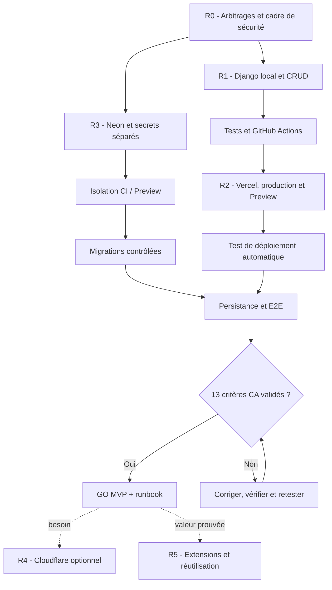

# 02 - Backlog produit et User Stories

## Socle Django + GitHub + Vercel + Neon + Cloudflare

| Métadonnée | Valeur |
|---|---|
| Identifiant | BL-DGVNC-002 |
| Version | 1.0 |
| Date | 18 novembre 2026 |
| Statut | **Backlog proposé, non implémenté et non approuvé** |
| Nature | Backlog exécutable, incréments, user stories, critères d'acceptation et traçabilité |
| Projet de travail | `django-cloud-starter` (nom provisoire) |
| Sources | `00_DJANGO_GITHUB_VERCEL_NEON_CLOUDFLARE_EXPRESSION_DU_BESOIN.md` et `01_ARCHITECTURE_ET_DECISIONS.md` |
| Périmètre principal | R0 à R3 : MVP opérationnel et sécurisé |
| Évolutions conditionnelles | R4 : Cloudflare ; R5 : industrialisation et extension |
| Langue | Français |

> **Intention :** transformer l'expression du besoin et les décisions d'architecture en travaux ordonnés, testables et susceptibles d'être transférés vers GitHub Issues / Projects ou tout autre gestionnaire de tâches.
>
> **Limite :** aucun dépôt, compte, service, déploiement ni base de données n'a été créé ou modifié pour ce document. Les user stories décrivent du travail à effectuer, et non des travaux réalisés.

---

## 1. Résumé exécutif

L'objectif du MVP est de prouver un cycle applicatif complet :

1. Cloner un dépôt et démarrer un monolithe Django localement.
2. Développer et tester une petite fonctionnalité métier de démonstration.
3. Proposer une modification via pull request.
4. Exécuter automatiquement les contrôles qualité.
5. Prévisualiser le changement sans exposer ni modifier les données de production.
6. Fusionner sur `main` et obtenir automatiquement une nouvelle version sur Vercel.
7. Conserver les données PostgreSQL sur Neon, indépendamment des redéploiements.
8. Pouvoir diagnostiquer une panne, rétablir le code applicatif et maîtriser les migrations.

**Produit attendu :** un starter Django reproductible, suffisamment robuste pour servir de point de départ à une nouvelle application, sans introduire immédiatement une architecture distribuée.

### 1.1 Vertical slice de démonstration

Le parcours transversal choisi par défaut est **Record Management** : une application avec une page publique, une connexion administrateur et un modèle simple `Record`, contenant par exemple un titre, une description, un statut, des dates de création et de modification.

Il s'agit d'une **hypothèse d'implémentation**, pas d'un besoin métier arrêté. Elle permet de vérifier l'ORM, les formulaires, les permissions, les tests, les migrations et la persistance.

### 1.2 Ce qui n'est pas requis initialement

- Frontend React / Next.js séparé.
- API Django REST Framework.
- Authentification externe ou Neon Auth.
- Cloudflare R2, Turnstile, Workers ou proxy HTTP Cloudflare.
- Kubernetes, microservices, conteneur de production obligatoire.
- Exécution de tâches longues ou workers dédiés.
- Création d'un nouveau package Py**Kit avant le premier cas réel.

---

## 2. Cadre de priorisation et conventions

### 2.1 Niveaux de priorité

| Niveau | Signification | Décision de livraison |
|---|---|---|
| **P0** | Indispensable au MVP ou à son exploitation sûre | Bloquant pour GO MVP |
| **P1** | Important pour la qualité ou la réutilisation, mais pouvant suivre la première démonstration | Planifié avant industrialisation, sauf risque avéré |
| **P2** | Option activée uniquement par besoin démontré | Hors MVP initial |
| **Spike** | Recherche bornée visant à lever une incertitude | Produit une décision et des preuves, pas une fonctionnalité |

**Alignement des sources :** certaines exigences `EF-11` et `EF-12` sont classées P1 dans l'expression du besoin, mais `CA-08` et `AT-04/AT-05` exigent une prévisualisation isolée. Le présent backlog traite donc **la sécurité de toute Preview activée comme un P0**. La création automatique de branches Neon est une technique possible, non une obligation : une base Preview dédiée avec données synthétiques peut suffire.

### 2.2 Format et identifiants

- `EP-xx` : epic, ensemble de résultats cohérents.
- `US-xxx` : user story vérifiable.
- `T-xxx` : tâche technique ou sous-tâche d'implémentation.
- `SP-xx` : spike de validation technique.
- `AC-xx` : critère d'acceptation d'une story.
- `EV-xx` : preuve conservée lors de la validation.
- `CA-xx` : critère du MVP, hérité du document `00`.
- `AT-xx` : scénario architectural vérifiable, hérité du document `01`.
- `ADR-xxx` : décision d'architecture documentée dans `01`.
- `OA-xx` : arbitrage restant ouvert.

Les états possibles sont `Proposé`, `Ready`, `In progress`, `In review`, `Blocked`, `Done`. **Toutes les stories ci-dessous démarrent à `Proposé`.**

### 2.3 Règle de dimensionnement

Les tailles sont relatives : `S` pour une story courte, `M` pour une story moyenne et `L` pour une story qui pourrait être découpée. Ces tailles **ne sont ni des jours de travail, ni des engagements de délai**. Une story `L` doit normalement être fractionnée avant développement.

### 2.4 Définition de Ready (DoR)

Une story passe à `Ready` uniquement lorsque :

- Le besoin et le résultat observable sont compréhensibles.
- Les dépendances sont identifiées et, si nécessaire, résolues.
- Les critères d'acceptation sont testables.
- Les décisions de sécurité et de données sont compatibles avec les ADR.
- Une preuve attendue est définie.
- Le périmètre peut être traité sans refonte majeure inconnue.

### 2.5 Définition de Done (DoD)

Une story peut être déclarée `Done` si :

- Le changement est intégré dans le dépôt cible et traçable par commit/PR.
- Les tests pertinents réussissent en CI, ou une justification documentée explique l'absence de test automatisé.
- Les éléments de sécurité et d'isolation concernés ont été contrôlés.
- La documentation utile et les variables d'environnement exemple sont actualisées.
- Les critères d'acceptation sont démontrés avec une preuve : test, log, capture, URL Preview, historique de déploiement ou runbook.
- Aucun secret ni donnée réelle non autorisée n'a été introduit.
- La story est validée sur l'environnement approprié.

> **Important :** `Done` sur une tâche de code ne signifie pas automatiquement `GO MVP`. Les critères de sortie transversaux restent à satisfaire.

---

## 3. Vue portefeuille du backlog

| Epic | Intitulé | Phase | Priorité | Stories | Résultat |
|---|---|---|---|---:|---|
| EP-00 | Cadrage et décisions exécutables | R0 | P0 | 4 | Contraintes et choix confirmés |
| EP-01 | Django local et fonctionnalité verticale | R1 | P0 | 7 | Application fonctionnelle en local |
| EP-02 | Qualité, tests et collaboration GitHub | R1/R2 | P0 | 6 | Livraison contrôlée par CI |
| EP-03 | Déploiement et Preview Vercel | R2 | P0 | 6 | CI/CD et HTTPS démontrés |
| EP-04 | PostgreSQL Neon, isolation et migrations | R3 | P0 | 8 | Données persistantes et sûres |
| EP-05 | Sécurité et confidentialité | R1/R3 | P0 | 4 | Accès, secrets et environnements protégés |
| EP-06 | Exploitation, reprise et maîtrise des coûts | R3/R5 | P0/P1 | 5 | Application exploitable |
| EP-07 | Recette, release et starter réutilisable | R3/R5 | P0/P1 | 4 | MVP accepté et réutilisable |
| EP-08 | Cloudflare à la demande | R4 | P2 | 4 | Domaine, anti-bot ou stockage selon besoin |
| EP-09 | Extensions applicatives conditionnelles | R5 | P2 | 4 | API, frontend, workers, Py**Kits si justifiés |
| **Total** | | | | **52** | |

La volumétrie est un inventaire d'options de travail, pas une recommandation d'ouvrir 52 chantiers simultanément. Les stories P0 doivent être traitées dans un **flux vertical**, puis les options introduites à partir de demandes réelles.

---

## 4. EP-00 - Cadrage et décisions exécutables

**Objectif :** empêcher l'implémentation sur des hypothèses non vérifiées relatives au dépôt, au modèle métier, au plan d'hébergement ou aux données.

### US-001 - Fixer le cas d'usage et la démonstration minimale

- **Priorité / Taille :** P0 / S.
- **Rôle / besoin :** en tant que responsable du projet, je veux définir un scénario CRUD minimal pour démontrer concrètement le socle.
- **Préconditions :** documents `00` et `01` disponibles.
- **AC-01 :** le modèle de démonstration, les rôles et les quatre opérations CRUD sont décrits.
- **AC-02 :** les données utilisées dans les tests et les previews sont synthétiques.
- **AC-03 :** le périmètre exclut clairement le développement d'un produit métier complet.
- **Livrable / preuve :** fiche de scénario et jeu d'exemples.
- **Traçabilité :** `DEC-01`, `OA-04`, `EF-06`, `AT-02`.

### US-002 - Valider les versions Python/Django et le mode de packaging

- **Priorité / Taille :** P0 / S.
- **Rôle / besoin :** en tant que mainteneur, je veux une combinaison de versions compatibles avec le runtime cible pour éviter les écarts d'environnement.
- **AC-01 :** les versions exactes sont choisies après vérification des contraintes de Django, Vercel, dépendances et CI.
- **AC-02 :** un gestionnaire de dépendances unique et un lockfile sont retenus.
- **AC-03 :** les mêmes versions sont utilisées en local, en CI et lors du build.
- **Livrable / preuve :** matrice de compatibilité et décisions versionnées.
- **Traçabilité :** `OA-05`, `ADR-013`, `ENF-04`.

### US-003 - Choisir le dépôt, les droits et les règles de contribution

- **Priorité / Taille :** P0 / S.
- **Rôle / besoin :** en tant que propriétaire, je veux connaître la destination GitHub et le modèle d'accès avant d'ouvrir ou de publier le dépôt.
- **AC-01 :** compte/organisation, nom, visibilité du dépôt et branche de production sont définis.
- **AC-02 :** les accès GitHub, Vercel et Neon nécessaires sont recensés, sans secrets dans les tickets.
- **AC-03 :** les possibilités réelles de règles de branche et de contrôles obligatoires sont vérifiées pour le plan du dépôt.
- **Livrable / preuve :** décision d'initialisation du dépôt.
- **Traçabilité :** `DEC-05`, `OA-02`, `OA-03`, `ADR-003`.

### US-004 - Vérifier la nature d'usage, la région et le budget

- **Priorité / Taille :** P0 / M.
- **Rôle / besoin :** en tant que responsable, je veux choisir des services et un plan conformes à l'usage et aux contraintes de données.
- **AC-01 :** usage personnel, expérimental ou commercial confirmé.
- **AC-02 :** le plan Vercel retenu autorise cet usage ; l'offre Hobby n'est pas supposée compatible avec un produit commercial.
- **AC-03 :** les régions applicative et PostgreSQL sont sélectionnées avec justification de latence/résidence des données.
- **AC-04 :** coûts et seuils de surveillance initiaux sont consignés.
- **Livrable / preuve :** fiche GO/NO-GO d'infrastructure et budget indicatif.
- **Traçabilité :** `CA-13`, `AT-14`, `AT-15`, `OA-01`, `OA-06`, `OA-10`, `ADR-016/017`.

**Gate R0 :** le MVP, le dépôt, les versions, la nature d'usage, les règles de Preview et le plan sont définis. Aucune création ou dépense involontaire n'est engagée.

---

## 5. EP-01 - Django local et fonctionnalité verticale

**Objectif :** produire une application Django compréhensible, testable et exploitable comme un monolithe.

### US-005 - Initialiser un projet Django modulaire

- **Priorité / Taille :** P0 / M.
- **Rôle / besoin :** en tant que développeur, je veux un squelette Django ordonné pour ajouter des modules sans restructuration immédiate.
- **AC-01 :** `manage.py`, `config/`, `apps/`, `templates/`, `static/` et `tests/` sont présents.
- **AC-02 :** un environnement propre installe les dépendances verrouillées et lance Django.
- **AC-03 :** aucune connexion à une base de production n'est nécessaire au simple démarrage local.
- **Preuve :** commande d'installation et `runserver` reproductibles.
- **Dépendances :** US-002.
- **Traçabilité :** `CA-01`, `AT-01`, `ADR-001/013`.

### US-006 - Séparer configuration, secrets et environnements

- **Priorité / Taille :** P0 / M.
- **Rôle / besoin :** en tant que développeur, je veux distinguer réglages applicatifs et secrets pour éviter les erreurs de publication.
- **AC-01 :** `.env.example` documente les variables sans valeur sensible.
- **AC-02 :** `DEBUG`, `SECRET_KEY`, domaines autorisés, CSRF et URL PostgreSQL utilisent une configuration appropriée à chaque environnement.
- **AC-03 :** l'application échoue explicitement lorsqu'une configuration critique de production manque.
- **AC-04 :** aucun secret n'est conservé dans Git.
- **Preuve :** tests de configuration et revue du dépôt.
- **Dépendances :** US-005.
- **Traçabilité :** `EF-09`, `CA-10`, `ADR-013`, `AT-09`.

### US-007 - Construire la page publique et les statiques

- **Priorité / Taille :** P0 / S.
- **Rôle / besoin :** en tant que visiteur, je veux accéder à une page web présentant l'application.
- **AC-01 :** une URL publique affiche un template Django.
- **AC-02 :** les fichiers CSS et les autres ressources statiques se chargent en local.
- **AC-03 :** les templates ne révèlent pas de configuration sensible.
- **Preuve :** test HTTP et rendu visuel.
- **Dépendances :** US-005.
- **Traçabilité :** `EF-01`, `AT-02/08`, `ADR-002/010`.

### US-008 - Implémenter le modèle Record et ses migrations

- **Priorité / Taille :** P0 / M.
- **Rôle / besoin :** en tant que développeur, je veux un modèle métier simple pour démontrer l'intégration ORM et les migrations.
- **AC-01 :** `Record` possède des champs documentés, des validations et des migrations versionnées.
- **AC-02 :** les contraintes de données sont testées.
- **AC-03 :** le modèle ne dépend ni d'un service externe ni d'un framework maison.
- **Preuve :** migrations présentes et tests du modèle.
- **Dépendances :** US-001, US-005.
- **Traçabilité :** `EF-06/10`, `AT-02/11`, `ADR-001`.

### US-009 - Implémenter un CRUD web complet

- **Priorité / Taille :** P0 / M.
- **Rôle / besoin :** en tant qu'utilisateur autorisé, je veux créer, consulter, modifier et supprimer mes enregistrements de démonstration.
- **AC-01 :** chaque opération possède un chemin fonctionnel et un test.
- **AC-02 :** les formulaires valident les champs et affichent des erreurs sans divulguer de données techniques.
- **AC-03 :** les opérations d'écriture respectent les droits définis.
- **AC-04 :** les tests vérifient également une demande invalide et une absence de permission.
- **Preuve :** suite CRUD automatisée et scénario manuel.
- **Dépendances :** US-008, US-010.
- **Traçabilité :** `EF-06/07`, `CA-03/09`, `AT-02`.

### US-010 - Configurer l'authentification et Django Admin

- **Priorité / Taille :** P0 / M.
- **Rôle / besoin :** en tant qu'administrateur, je veux gérer les enregistrements et les comptes autorisés sans interface supplémentaire.
- **AC-01 :** Django Auth natif et Django Admin sont utilisés.
- **AC-02 :** l'administration exige une connexion et les droits appropriés.
- **AC-03 :** un compte non autorisé reçoit un refus d'accès.
- **AC-04 :** création initiale du superutilisateur documentée sans mot de passe partagé.
- **Preuve :** tests d'autorisation et démonstration Admin.
- **Dépendances :** US-008.
- **Traçabilité :** `EF-07`, `CA-09`, `AT-10`, `ADR-008`.

### US-011 - Couvrir les vues et le parcours métier par les tests

- **Priorité / Taille :** P0 / M.
- **Rôle / besoin :** en tant que mainteneur, je veux détecter les régressions sur la vertical slice.
- **AC-01 :** tests de modèle, formulaire, routes, CRUD et permissions.
- **AC-02 :** les données de test sont générées sans dépendance à la production.
- **AC-03 :** la suite se lance par une commande documentée.
- **Preuve :** résultat de tests local.
- **Dépendances :** US-008 à US-010.
- **Traçabilité :** `ENF-04`, `CA-01/09`, `AT-02`.

**Gate R1 :** le parcours public + connexion + Admin + CRUD fonctionne localement ; les migrations et les tests sont reproductibles depuis un clone vierge.

---

## 6. EP-02 - Qualité, tests et collaboration GitHub

### US-012 - Publier le projet dans le dépôt GitHub choisi

- **Priorité / Taille :** P0 / S.
- **Besoin :** disposer d'une source de vérité et d'un historique contrôlé.
- **AC-01 :** dépôt initialisé sur la branche déterminée, contenu cohérent et `.gitignore` correct.
- **AC-02 :** aucun `.env` sensible, identifiant ou clé d'accès n'est versionné.
- **AC-03 :** README, licence si applicable et conventions de contribution sont visibles.
- **Preuve :** dépôt et commit initial.
- **Dépendances :** US-003, US-005/006.
- **Traçabilité :** `EF-02/09`, `ADR-003`, `CA-10`.

### US-013 - Établir les contrôles statiques et de dépendances

- **Priorité / Taille :** P0 / M.
- **Besoin :** détecter les problèmes de format, lint, configuration et dépendances avant fusion.
- **AC-01 :** commandes de vérification documentées, avec versions figées.
- **AC-02 :** un défaut volontaire fait échouer le job concerné.
- **AC-03 :** un scan des secrets et des fichiers interdits est présent.
- **Preuve :** run CI positif et run de défaut contrôlé.
- **Dépendances :** US-002, US-012.
- **Traçabilité :** `ENF-02/04`, `CA-05/10`, `ADR-013`.

### US-014 - Configurer GitHub Actions pour les pull requests

- **Priorité / Taille :** P0 / M.
- **Besoin :** lancer automatiquement lint, tests et contrôles de sécurité lors d'une PR.
- **AC-01 :** ouverture et modification d'une PR déclenchent la CI.
- **AC-02 :** les statuts réussis/échoués sont visibles dans la PR.
- **AC-03 :** la CI n'utilise aucune base de production ni secret de production.
- **AC-04 :** le workflow applique les permissions minimales nécessaires et maîtrise l'exécution de code non fiable.
- **Preuve :** deux exécutions contrôlées, succès et échec.
- **Dépendances :** US-011 à US-013.
- **Traçabilité :** `EF-03`, `CA-05`, `AT-03`, `ADR-003`.

### US-015 - Ajouter les tests d'intégration sur PostgreSQL isolé

- **Priorité / Taille :** P0 / M.
- **Besoin :** vérifier que les migrations et modèles Django fonctionnent sur le moteur utilisé en production.
- **AC-01 :** les tests utilisent PostgreSQL temporaire ou une branche/base Neon dédiée à la CI, jamais la production.
- **AC-02 :** le test installe les migrations dans cet environnement.
- **AC-03 :** le job échoue si le modèle ou la migration est incompatible.
- **Preuve :** run d'intégration reproductible.
- **Dépendances :** US-008, US-014 ; peut être finalisé avec US-025.
- **Traçabilité :** `EF-05/10`, `AT-11`, `ADR-005/007`.

### US-016 - Rendre la fusion conditionnelle aux contrôles

- **Priorité / Taille :** P0 / M.
- **Besoin :** réduire la probabilité d'un déploiement automatique d'une modification invalide.
- **AC-01 :** la politique de fusion inclut revue adaptée et vérifications requises selon les capacités du dépôt.
- **AC-02 :** un changement avec CI rouge n'est pas fusionné via le parcours normal.
- **AC-03 :** si les règles natives sont indisponibles, l'écart et la mesure de mitigation sont documentés ; le risque est arbitré avant GO.
- **Preuve :** essai de PR non conforme et capture/règle GitHub.
- **Dépendances :** US-003, US-014.
- **Traçabilité :** `CA-06`, `ADR-003`, `AT-03`.

### US-017 - Documenter l'onboarding et les commandes courantes

- **Priorité / Taille :** P0 / S.
- **Besoin :** permettre à un nouvel utilisateur technique de reproduire le projet.
- **AC-01 :** le README couvre prérequis, installation, `.env.example`, tests et lancement.
- **AC-02 :** les commandes sont testées depuis un clone vierge.
- **AC-03 :** les erreurs fréquentes et leur diagnostic sont indiqués.
- **Preuve :** exercice de bootstrap consigné.
- **Dépendances :** US-005/006/011.
- **Traçabilité :** `CA-01`, `AT-01`, `ADR-015`.

---

## 7. EP-03 - Déploiement Vercel et prévisualisations

### US-018 - Connecter le dépôt GitHub à Vercel

- **Priorité / Taille :** P0 / M.
- **Besoin :** héberger directement le Django HTTP sans configuration héritée inutile.
- **AC-01 :** le projet est reconnu comme Django par Vercel et la construction réussit.
- **AC-02 :** le point d'entrée Django est identifié et les dépendances sont installées.
- **AC-03 :** aucun secret n'apparaît dans les logs de build.
- **AC-04 :** les choix de runtime et région correspondent aux décisions R0.
- **Preuve :** URL de déploiement et logs de build sans secrets.
- **Dépendances :** US-004, US-012, US-017.
- **Traçabilité :** `EF-04/08`, `AT-06`, `ADR-004/009`.

### US-019 - Fournir une URL HTTPS de production

- **Priorité / Taille :** P0 / S.
- **Besoin :** donner accès publiquement à l'application via une URL Vercel.
- **AC-01 :** la page d'accueil répond en HTTPS.
- **AC-02 :** l'environnement Production fonctionne avec `DEBUG=False` et une politique de domaines cohérente.
- **AC-03 :** la page Admin ne contourne pas l'authentification.
- **Preuve :** requêtes HTTP et tests de sécurité sur URL de production.
- **Dépendances :** US-018, US-010, US-032.
- **Traçabilité :** `CA-02/09`, `AT-02/10`, `ADR-004`.

### US-020 - Déclencher le déploiement de production sur `main`

- **Priorité / Taille :** P0 / M.
- **Besoin :** publier une modification validée sans étape manuelle d'hébergement.
- **AC-01 :** une fusion éligible sur `main` produit un nouveau déploiement.
- **AC-02 :** la version déployée correspond au commit intégré.
- **AC-03 :** les tests bloquants de PR sont terminés avant fusion ; les contrôles de déploiement additionnels sont configurés si nécessaires et disponibles.
- **AC-04 :** un nouveau déploiement ne déclenche pas automatiquement une migration de production pendant le build.
- **Preuve :** PR fusionnée, SHA et journal Vercel correspondant.
- **Dépendances :** US-014/016/018.
- **Traçabilité :** `EF-04`, `CA-07`, `AT-06`, `ADR-003/004/007`.

### US-021 - Produire une Preview par pull request

- **Priorité / Taille :** P0 pour le parcours de recette retenu / M.
- **Besoin :** tester une fonctionnalité dans un environnement en ligne avant fusion.
- **AC-01 :** une PR crée une URL Preview associée au commit.
- **AC-02 :** la Preview est identifiable comme non productive.
- **AC-03 :** la configuration ne contient ni secrets de production ni connexion d'écriture à la base de production.
- **AC-04 :** la Preview n'est autorisée en recette qu'après validation de l'isolation définie dans US-026.
- **Preuve :** URL Preview, test d'isolation et configuration expurgée.
- **Dépendances :** US-018, US-026, US-031.
- **Traçabilité :** `EF-11/12`, `CA-08`, `AT-04/05`, `ADR-006`.

### US-022 - Servir les fichiers statiques Django en ligne

- **Priorité / Taille :** P0 / S.
- **Besoin :** obtenir une interface HTML/CSS complète lors du déploiement.
- **AC-01 :** `collectstatic` est exécuté dans le cadre du build configuré pour Django.
- **AC-02 :** `STATIC_ROOT`, chemins et comportement des assets sont compatibles avec Vercel.
- **AC-03 :** le CSS s'affiche sur Production et Preview sans dépendre d'un stockage local persistant.
- **Preuve :** requêtes HTTP sur les statiques, rendu visuel.
- **Dépendances :** US-007, US-018.
- **Traçabilité :** `AT-08`, `ADR-010`.

### US-023 - Rattacher logs et commit au déploiement

- **Priorité / Taille :** P0 / M.
- **Besoin :** retrouver rapidement la version active et comprendre un échec.
- **AC-01 :** chaque déploiement est corrélé à un commit SHA ou identifiant de release.
- **AC-02 :** les logs de build et d'exécution sont consultables.
- **AC-03 :** un échec contrôlé est identifiable sans divulgation de secret.
- **Preuve :** exemple de diagnostic sur un déploiement de test.
- **Dépendances :** US-018/020.
- **Traçabilité :** `EF-13`, `AT-12`, `ADR-018`.

> **Séquence Vercel/Neon :** pour une première preuve purement HTTP, Vercel peut être configuré avant le branchement final à Neon. Les écrans nécessitant PostgreSQL doivent rester inaccessibles ou explicitement non validés tant que leur configuration n'est pas prête. Il ne faut jamais masquer l'absence de base persistante derrière SQLite en production.

---

## 8. EP-04 - Neon PostgreSQL, données et migrations

### US-024 - Préparer le projet Neon et ses accès

- **Priorité / Taille :** P0 / M.
- **Besoin :** disposer d'une base PostgreSQL managée indépendante des instances Django.
- **AC-01 :** projet, base, région et rôles d'accès sont définis.
- **AC-02 :** secrets et URL de connexion ne sont pas présents dans Git.
- **AC-03 :** un accès de production est distinct des accès CI/Preview.
- **Preuve :** fiche de configuration expurgée et test de connexion.
- **Dépendances :** US-004/006.
- **Traçabilité :** `EF-05/09`, `ADR-005/017`.

### US-025 - Raccorder Django à PostgreSQL Neon

- **Priorité / Taille :** P0 / M.
- **Besoin :** remplacer la persistance de démonstration locale par un stockage PostgreSQL réel.
- **AC-01 :** Django utilise une `DATABASE_URL` appropriée à l'environnement.
- **AC-02 :** TLS, droits de connexion et éventuel pooling sont configurés conformément au fournisseur et au client Django.
- **AC-03 :** le modèle `Record` fonctionne après application contrôlée des migrations.
- **Preuve :** lecture/écriture sur base dédiée, sans exposer l'URL.
- **Dépendances :** US-008, US-024.
- **Traçabilité :** `CA-03`, `AT-07`, `ADR-005`.

### US-026 - Isoler strictement les données des Previews

- **Priorité / Taille :** **P0 bloquant** / L, à découper si nécessaire.
- **Besoin :** garantir qu'un environnement de PR ne peut ni modifier ni exposer la production.
- **AC-01 :** chaque Preview autorisée dispose d'une base/branche isolée ou d'une isolation équivalente réellement démontrée.
- **AC-02 :** l'URL DB de Preview ne pointe jamais vers l'environnement de production.
- **AC-03 :** les comptes et données de Preview sont synthétiques et sans données personnelles réelles.
- **AC-04 :** un test négatif avec sentinelles distinctes prouve l'absence d'écriture en production.
- **AC-05 :** les créations/suppressions de branches, expirations et droits sont maîtrisés.
- **AC-06 :** une branche Neon issue d'une branche contenant des données de production est interdite par défaut : le branching peut copier des données et doit être revu du point de vue confidentialité.
- **Preuve :** rapport de tests d'isolation et configuration expurgée.
- **Dépendances :** US-018, US-024/025, US-031.
- **Traçabilité :** `CA-08`, `AT-05`, `OA-07`, `ADR-006`.

### US-027 - Construire le processus de migration contrôlée

- **Priorité / Taille :** **P0 bloquant** / L, à découper.
- **Besoin :** faire évoluer le schéma sans migration destructrice ni exécution depuis les fonctions web.
- **AC-01 :** les migrations Django sont versionnées et testées sur une base isolée.
- **AC-02 :** aucune migration de production n'est exécutée dans `build`, `collectstatic`, une importation, ou au démarrage d'une instance web.
- **AC-03 :** la migration de production fait partie d'une étape de release explicite, autorisée et journalisée.
- **AC-04 :** les changements incompatibles suivent si nécessaire une stratégie `expand -> migrate -> contract`.
- **AC-05 :** le traitement d'un échec et le plan de reprise des données sont documentés ; un rollback du code n'est pas réputé annuler automatiquement une migration.
- **Preuve :** rapport de migration non productive et procédure de release.
- **Dépendances :** US-015, US-025/026.
- **Traçabilité :** `EF-10`, `CA-11`, `AT-11`, `ADR-007`.

### US-028 - Prouver la persistance après redéploiement

- **Priorité / Taille :** P0 / M.
- **Besoin :** vérifier que le déploiement d'une nouvelle version n'efface pas les données utilisateur.
- **AC-01 :** un `Record` est créé en Production dans Neon.
- **AC-02 :** un changement de code sans migration destructive est publié.
- **AC-03 :** le même identifiant et les mêmes valeurs sont retrouvés après publication.
- **AC-04 :** le test vérifie également la non-utilisation d'un fichier SQLite local en production.
- **Preuve :** journal E2E avant/après et identifiant expurgé.
- **Dépendances :** US-020, US-025, US-027.
- **Traçabilité :** `CA-03/04`, `AT-07`, `ADR-005`.

### US-029 - Tester sauvegarde, restauration et limites du service

- **Priorité / Taille :** P0 pour restaurabilité minimale / M.
- **Besoin :** ne pas supposer qu'une sauvegarde ou un point de restauration est utilisable sans exercice.
- **AC-01 :** capacités réelles de restauration Neon et limites du plan documentées.
- **AC-02 :** une restauration est exercée sur un environnement non productif lorsque le plan le permet.
- **AC-03 :** les limites de récupération (fenêtre, perte de données possible, rôle, responsabilités) sont consignées.
- **AC-04 :** aucun exercice destructeur n'est déclenché sur Production.
- **Preuve :** compte rendu d'exercice et runbook.
- **Dépendances :** US-024/027.
- **Traçabilité :** `OA-11`, `ENF-03`, `ADR-005`, `AT-13`.

### US-030 - Vérifier connexions, pooling et comportement serverless

- **Priorité / Taille :** P1, promu P0 si instabilité / M.
- **Besoin :** éviter un épuisement des connexions à PostgreSQL et maîtriser les requêtes.
- **AC-01 :** nombre de connexions, latence et erreurs sont examinés sur une charge de démonstration.
- **AC-02 :** stratégie URL poolée / directe et paramètres Django sont justifiés par l'usage.
- **AC-03 :** aucun secret de connexion n'est affiché dans les rapports.
- **Preuve :** compte rendu de mesure simple.
- **Dépendances :** US-025, US-036.
- **Traçabilité :** `ENF-05`, `ADR-005`.

### US-031 - Isoler et sécuriser la base de CI

- **Priorité / Taille :** P0 / S.
- **Besoin :** garantir que les jobs CI exécutent les tests et migrations sans droits sur Production.
- **AC-01 :** la CI utilise PostgreSQL éphémère ou une base dédiée.
- **AC-02 :** les credentials CI ne permettent pas l'accès en écriture à la base de production.
- **AC-03 :** les jobs ne consomment pas de données réelles sans justification explicite.
- **Preuve :** test de séparation et revue des permissions.
- **Dépendances :** US-014/015, US-024.
- **Traçabilité :** `CA-08`, `AT-05`, `ADR-006`.

---

## 9. EP-05 - Sécurité, accès et confidentialité

### US-032 - Durcir les réglages Django en production

- **Priorité / Taille :** P0 / M.
- **Besoin :** réduire les vulnérabilités courantes d'une application Django accessible sur Internet.
- **AC-01 :** `DEBUG=False`, `ALLOWED_HOSTS`, `CSRF_TRUSTED_ORIGINS`, cookies et redirections HTTPS sont adaptés aux domaines effectivement utilisés.
- **AC-02 :** `python manage.py check --deploy` et les tests pertinents sont exécutés et analysés.
- **AC-03 :** les erreurs publiques n'exposent pas de secrets ou de tracebacks sensibles.
- **Preuve :** rapport de contrôle sécurité.
- **Dépendances :** US-006, US-018.
- **Traçabilité :** `CA-09/10`, `ADR-008`, `AT-09/10`.

### US-033 - Contrôler permissions et opérations sensibles

- **Priorité / Taille :** P0 / M.
- **Besoin :** limiter chaque action CRUD aux profils autorisés.
- **AC-01 :** un utilisateur anonyme ne peut pas exécuter d'opération interdite.
- **AC-02 :** un utilisateur authentifié sans permission ne peut pas lire ou modifier des données hors de son périmètre.
- **AC-03 :** les contrôles sont effectués côté serveur et non seulement dans les templates.
- **Preuve :** tests d'autorisation positifs et négatifs.
- **Dépendances :** US-009/010.
- **Traçabilité :** `CA-09`, `EF-07`, `ADR-008`.

### US-034 - Protéger les variables et accès aux fournisseurs

- **Priorité / Taille :** P0 / M.
- **Besoin :** compartimenter les clés, tokens et droits d'administration.
- **AC-01 :** secrets distincts entre Production et Preview / CI.
- **AC-02 :** permissions minimales sur GitHub Actions, Vercel, Neon et comptes associés.
- **AC-03 :** règles de rotation et procédure de révocation décrites.
- **AC-04 :** contrôle automatique de non-présence de secrets dans les commits.
- **Preuve :** matrice de secrets expurgée et résultat du scan.
- **Dépendances :** US-006, US-012/014/024.
- **Traçabilité :** `CA-10`, `AT-09`, `ENF-02`, `ADR-006`.

### US-035 - Formaliser le traitement des données sensibles

- **Priorité / Taille :** P0 pour données réelles / S.
- **Besoin :** empêcher le transfert involontaire de données personnelles ou financières vers des environnements non autorisés.
- **AC-01 :** une politique explicite interdit l'usage de données réelles en Preview/CI sans revue et accord.
- **AC-02 :** la visibilité des URLs Preview et des journaux est prise en compte.
- **AC-03 :** toute évolution vers une application métier contenant des données sensibles déclenche une revue spécifique de résidence, rétention, habilitations, sauvegardes et obligations applicables.
- **Preuve :** politique des données et checklist de revue.
- **Dépendances :** US-004, US-026/031.
- **Traçabilité :** `OA-07`, `ADR-006/017`, `ENF-07`.

---

## 10. EP-06 - Exploitation, diagnostics et coûts

### US-036 - Rendre l'application diagnostiquable

- **Priorité / Taille :** P0 / M.
- **Besoin :** comprendre les échecs applicatifs à partir d'une version et de journaux exploitables.
- **AC-01 :** erreurs applicatives avec niveau, contexte utile et identifiant de déploiement lorsque disponible.
- **AC-02 :** logs sans mots de passe, tokens, URLs DB complètes ou données sensibles.
- **AC-03 :** une panne simulée est localisée et interprétée.
- **Preuve :** procédure de diagnostic et exemple expurgé.
- **Dépendances :** US-023, US-025.
- **Traçabilité :** `CA-12`, `AT-12`, `EF-13`.

### US-037 - Documenter et tester le retour arrière du code

- **Priorité / Taille :** P0 / M.
- **Besoin :** revenir à une version applicative fonctionnelle après une mauvaise release.
- **AC-01 :** procédure de rollback Vercel décrite pour le plan et les mécanismes disponibles.
- **AC-02 :** un incident non destructif est simulé sur une version de test.
- **AC-03 :** le document distingue rollback du code et restauration / compatibilité du schéma PostgreSQL.
- **AC-04 :** critères d'escalade et vérifications après reprise définis.
- **Preuve :** exercice de rollback et runbook.
- **Dépendances :** US-020/023/027.
- **Traçabilité :** `CA-12`, `AT-13`, `EF-14`, `ADR-007`.

### US-038 - Mettre en place un tableau de suivi des coûts et quotas

- **Priorité / Taille :** P0 pour choix de plan, P1 pour suivi approfondi / S.
- **Besoin :** éviter un coût imprévu ou un blocage de quota.
- **AC-01 :** plans réellement activés et principaux quotas de Vercel, Neon et Cloudflare sont consignés.
- **AC-02 :** le responsable sait où consulter usage et facturation.
- **AC-03 :** les seuils, alertes ou contrôles manuels pertinents sont définis selon les possibilités des offres.
- **Preuve :** registre de suivi mis à jour.
- **Dépendances :** US-004, US-018/024.
- **Traçabilité :** `CA-13`, `AT-14/15`, `OA-10`.

### US-039 - Définir la surveillance minimale du service

- **Priorité / Taille :** P1 / M.
- **Besoin :** détecter une anomalie avant que l'usage ne devienne critique.
- **AC-01 :** parcours de vérification de santé public sans fuite de secrets.
- **AC-02 :** erreurs, taux d'échec des déploiements et métriques élémentaires sont identifiés.
- **AC-03 :** alertes ajoutées uniquement si des événements utiles et leur destinataire sont définis.
- **Preuve :** tableau d'observation et test d'alerte si retenue.
- **Dépendances :** US-036.
- **Traçabilité :** `ENF-06`, `ADR-018`.

### US-040 - Prouver la reproductibilité du socle

- **Priorité / Taille :** P1, recommandée avant réutilisation / M.
- **Besoin :** pouvoir démarrer une deuxième application sans dupliquer des secrets ou données.
- **AC-01 :** un clone neuf permet un nouveau démarrage avec configuration propre.
- **AC-02 :** aucun identifiant de projet Neon/Vercel n'est codé en dur dans le starter.
- **AC-03 :** le nouveau projet dispose de ses propres secrets et d'une base distincte.
- **Preuve :** exercice de duplication documenté.
- **Dépendances :** US-017/034/038.
- **Traçabilité :** `UC-07`, `ADR-015`, `CA-01`.

---

## 11. EP-07 - Acceptation, release et réutilisation

### US-041 - Exécuter la campagne de recette MVP

- **Priorité / Taille :** P0 / M.
- **Besoin :** démontrer tous les critères `CA-01` à `CA-13` avant l'acceptation.
- **AC-01 :** chaque `CA` dispose d'un statut `Pass`, `Fail`, `Blocked` ou `Not tested`.
- **AC-02 :** une preuve datée et un environnement sont associés à chaque succès.
- **AC-03 :** les anomalies et risques résiduels sont enregistrés.
- **Preuve :** matrice de recette complétée.
- **Dépendances :** epics EP-00 à EP-06, suivant les critères concernés.
- **Traçabilité :** `ADR-018`, `CA-01` à `CA-13`, `AT-01` à `AT-15`.

### US-042 - Émettre une décision GO / NO-GO fondée sur les preuves

- **Priorité / Taille :** P0 / S.
- **Besoin :** éviter de qualifier le socle de prêt sur la seule base d'une page web en ligne.
- **AC-01 :** les treize critères CA sont examinés.
- **AC-02 :** les risques critiques de secrets, production/preview et migration ont un statut explicite.
- **AC-03 :** un `NO-GO` est prononcé si une condition bloquante n'est pas remplie.
- **AC-04 :** toute dérogation est signée par le responsable et ne contourne pas une mesure de sécurité obligatoire.
- **Preuve :** procès-verbal GO / NO-GO.
- **Dépendances :** US-041.
- **Traçabilité :** `ADR-018`, `CA-01` à `CA-13`.

### US-043 - Produire le runbook d'exploitation initial

- **Priorité / Taille :** P0 / M.
- **Besoin :** donner une procédure claire pour déployer, surveiller, diagnostiquer et restaurer.
- **AC-01 :** instructions de release, migration, diagnostic et retour arrière.
- **AC-02 :** références aux tableaux de bord et responsables, sans secrets stockés.
- **AC-03 :** checklists avant/après mise en production.
- **Preuve :** runbook revu et exercice de simulation.
- **Dépendances :** US-027/029/036/037.
- **Traçabilité :** `CA-11/12`, `AT-12/13`.

### US-044 - Préparer le starter pour une première réutilisation

- **Priorité / Taille :** P1 / M.
- **Besoin :** transformer le démonstrateur accepté en modèle de départ réellement utile.
- **AC-01 :** les éléments spécifiques à `Record` sont identifiés et simples à remplacer.
- **AC-02 :** conventions de modules, tests et configuration expliquées.
- **AC-03 :** l'onboarding a été éprouvé par un deuxième clone ou projet.
- **Preuve :** guide de réutilisation et matrice de points personnalisables.
- **Dépendances :** US-040/042.
- **Traçabilité :** `UC-07`, `ADR-015`.

---

## 12. EP-08 - Cloudflare sur besoin démontré

**Epic conditionnel P2.** Cloudflare n'est pas un passage obligé pour que Django fonctionne sur Vercel avec Neon.

### US-045 - Associer un domaine via Cloudflare DNS

- **Priorité / Taille :** P2 / S.
- **Déclencheur :** besoin explicite d'un domaine personnalisé.
- **AC-01 :** le domaine est ajouté dans Vercel et les entrées DNS sont configurées conformément à Vercel.
- **AC-02 :** Cloudflare est initialement en mode DNS-only pour les entrées concernées.
- **AC-03 :** résolution DNS et certificat HTTPS validés.
- **Preuve :** tests DNS/HTTPS.
- **Traçabilité :** `EF-15`, `ADR-011`, `OA-09`.

### US-046 - Protéger un formulaire avec Turnstile

- **Priorité / Taille :** P2 / M.
- **Déclencheur :** formulaire public exposé à des abus constatés ou raisonnablement anticipés.
- **AC-01 :** widget côté client et vérification serveur du token.
- **AC-02 :** requête refusée si vérification invalide ; les chemins de contournement sont testés.
- **AC-03 :** secrets, confidentialité et expérience utilisateur sont pris en compte.
- **Preuve :** tests positifs et négatifs.
- **Traçabilité :** `EF-16`, `ADR-012`.

### US-047 - Ajouter un stockage objet pour les médias utilisateurs

- **Priorité / Taille :** P2 / L.
- **Déclencheur :** besoin réel de fichiers uploadés par l'utilisateur.
- **AC-01 :** comparaison entre R2, Neon Object Storage ou autre solution, et sélection d'**un** stockage objet.
- **AC-02 :** politique de lecture, écriture, suppression et durée de conservation.
- **AC-03 :** aucun fichier utilisateur ne dépend du disque éphémère de Vercel.
- **AC-04 :** les téléversements volumineux évitent les limites de taille des Vercel Functions, par exemple par transfert direct sécurisé.
- **Preuve :** test upload, accès autorisé et suppression.
- **Traçabilité :** `EF-17`, `ADR-010/012`, `OA-11`.

### US-048 - Évaluer le proxy Cloudflare avant activation

- **Priorité / Taille :** P2 / Spike.
- **Déclencheur :** exigence démontrée de service edge non couvert par Vercel.
- **AC-01 :** bénéfice attendu mesuré et responsabilités CDN/WAF/TLS clarifiées.
- **AC-02 :** risque double proxy, cache, en-têtes IP et certificats analysé.
- **AC-03 :** décision `adopter`, `différer` ou `rejeter` documentée.
- **Preuve :** ADR complémentaire.
- **Traçabilité :** `ADR-011`, `OA-09`.

---

## 13. EP-09 - Extensions conditionnelles

### US-049 - Introduire Django REST Framework

- **Priorité / Taille :** P2 / M.
- **Déclencheur :** au moins un consommateur API identifié.
- **AC-01 :** ressources et contrats API définis ; authentification et permissions testées.
- **AC-02 :** réutilisation de la logique métier existante, sans duplication.
- **AC-03 :** aucune API publique ajoutée sans usage démontré.
- **Preuve :** contrat OpenAPI ou équivalent et tests.
- **Traçabilité :** `EF-18`, `OA-12`.

### US-050 - Ajouter un frontend React / Next.js séparé

- **Priorité / Taille :** P2 / L.
- **Déclencheur :** besoin UX/produit impossible à satisfaire raisonnablement avec Templates/HTMX.
- **AC-01 :** justification du frontend distinct.
- **AC-02 :** stratégie CORS, cookies, authentification et contrats API explicitée.
- **AC-03 :** choix mono-repo ou multi-repo formalisé.
- **Preuve :** ADR et premier parcours fonctionnel.
- **Traçabilité :** `ADR-002`, `OA-12`.

### US-051 - Externaliser les traitements longs

- **Priorité / Taille :** P2 / L.
- **Déclencheur :** tâches dont la durée, la reprise ou la fiabilité dépassent la requête HTTP sur Vercel.
- **AC-01 :** besoin, volumétrie et SLA estimés sur des données observables.
- **AC-02 :** moteur de jobs ou worker choisi selon les contraintes et les services disponibles.
- **AC-03 :** idempotence, retries, observabilité et gestion d'échec définis.
- **Preuve :** spike puis ADR d'exécution.
- **Traçabilité :** `ADR-014`, `OA-12`.

### US-052 - Intégrer un Py**Kit si son bénéfice est démontré

- **Priorité / Taille :** P2 / M.
- **Déclencheur :** un besoin métier correspondant existe effectivement dans le produit.
- **AC-01 :** contrat public du package identifié, version verrouillée et tests d'intégration.
- **AC-02 :** coûts de maintenance, surfaces d'erreur et valeur comparés à une implémentation Django native.
- **AC-03 :** aucune dépendance maison ajoutée uniquement par principe de réutilisation.
- **Preuve :** note de choix et test d'intégration.
- **Traçabilité :** `ADR-015`, `OA-12`.

---

## 14. Dépendances et ordre d'implémentation

### 14.1 Chemin critique recommandé



### 14.2 Séquencement par incréments verticaux

| Incrément | Contenu principal | Stories dominantes | Démonstration vérifiable |
|---|---|---|---|
| I0 - Décision | Usage, dépôt, versions, sécurité, région | US-001 à US-004 | Fiche d'arbitrage R0 |
| I1 - Application locale | Django, Record, Admin, tests | US-005 à US-011 ; US-032/033 | CRUD authentifié local |
| I2 - Contrôles de contribution | GitHub, CI, lint, protection `main` | US-012 à US-017 ; US-034 | PR verte / PR rouge |
| I3 - Première mise en ligne | Projet Vercel, HTTPS, statiques, release | US-018 à US-020 ; US-022/023 | URL HTTPS et SHA |
| I4 - Persistance et isolation | Neon, CI/Preview, migrations | US-021 et US-024 à US-031 ; US-035 | PR isolée et donnée conservée |
| I5 - Recette et exploitation | Logs, rollback, coûts, recette | US-036 à US-043 | GO / NO-GO documenté |
| I6 - Réutilisation et extensions | Starter, domaine, anti-bot, objet, API selon besoins | US-044 à US-052 | Démonstration ciblée, non obligatoire |

**Note de cohérence :** US-021 (Preview) est développée en coordination étroite avec US-026 et US-031. Une URL Preview techniquement accessible ne doit **pas** être déclarée prête ou utilisée avec des données réelles avant que l'isolation soit prouvée.

### 14.3 Travail parallélisable

- Une fois R0 validé, le développement Django local et la préparation du pipeline qualité peuvent avancer en parallèle.
- L'intégration Vercel et l'initialisation Neon peuvent avancer séparément, sans raccorder une Preview à Production.
- Les tests de permissions et le durcissement de la configuration peuvent être développés au fil du CRUD.
- Le runbook doit être enrichi pendant les exercices de migration/rollback plutôt que créé seulement à la fin.

---

## 15. Matrice de traçabilité des critères MVP

Chaque critère du document `00` a au moins une story responsable et une preuve attendue.

| Critère | Exigence de validation | Stories responsables | Preuve minimale |
|---|---|---|---|
| CA-01 | Lancement depuis README | US-005, US-017, US-040 | Clone vierge et commandes exécutées |
| CA-02 | Django accessible en HTTPS | US-018, US-019, US-022 | URL et requête HTTP |
| CA-03 | CRUD stocké sur Neon | US-008/009, US-025, US-028 | Test DB + CRUD |
| CA-04 | Persistance après redéploiement | US-020, US-028 | Record identique avant/après |
| CA-05 | CI lancée sur PR | US-013/014 | Run GitHub Actions |
| CA-06 | Contrôles bloquants sur `main` | US-016 | Test de PR non conforme |
| CA-07 | Déploiement automatique | US-018/020 | SHA GitHub et release Vercel |
| CA-08 | Preview sans écriture Production | US-021, US-026, US-031, US-035 | Sentinelles et test de cloisonnement |
| CA-09 | Admin et actions sensibles protégés | US-010, US-032/033 | Tests permissions |
| CA-10 | Aucun secret réel dans Git | US-006, US-012/013, US-034 | Scan et revue |
| CA-11 | Migrations maîtrisées | US-015, US-027 | Dry run + étape de release |
| CA-12 | Diagnostic et rollback | US-023, US-036/037, US-043 | Logs et exercice |
| CA-13 | Plan adapté à l'usage réel | US-004, US-038 | Décision de conformité plan |

**Matrice complémentaire AT :**

| Critères AT | Stories dominantes |
|---|---|
| AT-01/02 | US-005 à US-011, US-017 |
| AT-03/04 | US-014, US-016, US-021 |
| AT-05 | US-026, US-031, US-035 |
| AT-06/07/08 | US-020, US-028, US-022 |
| AT-09/10 | US-006, US-010, US-032 à US-034 |
| AT-11 | US-015, US-027 |
| AT-12/13 | US-023, US-029, US-036/037, US-043 |
| AT-14/15 | US-004, US-038 |

---

## 16. Tests de recette transversaux (scénarios BDD)

Ces scénarios sont indépendants de l'outil de test et pourront être transcrits en tests Django, tests HTTP et vérifications CI/CD.

### BDD-01 - Nouveau clone

```gherkin
Étant donné un clone vierge du dépôt
Et une configuration locale de développement valide
Quand le développeur installe les dépendances et applique les migrations locales
Et démarre Django
Alors la page publique répond
Et l'administration demande une authentification
Et les tests locaux s'exécutent selon le README
```

### BDD-02 - Échec de contrôle PR

```gherkin
Étant donné une pull request contenant un défaut de test volontaire
Quand la CI GitHub Actions s'exécute
Alors le contrôle concerné échoue
Et la contribution ne peut pas suivre le parcours de fusion normal
Et aucune publication de production n'est validée par cette contribution
```

### BDD-03 - Isolation Preview

```gherkin
Étant donné une base Production contenant la sentinelle PROD_ONLY
Et une base Preview séparée contenant la sentinelle PREVIEW_ONLY
Quand une Preview crée puis modifie un Record
Alors la base Production ne change pas
Et la Preview ne voit pas la sentinelle PROD_ONLY
Et aucune donnée réelle n'a été clonée dans la Preview
```

### BDD-04 - Déploiement après fusion

```gherkin
Étant donné une pull request validée sur main
Quand le commit est fusionné
Alors Vercel crée un déploiement de production
Et la version en ligne correspond au commit fusionné
Et la page répond en HTTPS
```

### BDD-05 - Persistance

```gherkin
Étant donné un Record écrit dans Neon Production
Quand un nouveau déploiement du code est publié
Alors le même Record existe toujours avec son identifiant
Et les valeurs attendues sont conservées
Et aucune dépendance à un fichier local éphémère n'est utilisée
```

### BDD-06 - Migrations sécurisées

```gherkin
Étant donné une migration Django versionnée
Quand la CI prépare une base PostgreSQL isolée
Alors la migration peut être appliquée et testée
Et aucun build Vercel ni démarrage web ne migre la production
Et une exécution Production nécessite l'étape de release prévue
```

### BDD-07 - Accès non autorisé

```gherkin
Étant donné un visiteur anonyme ou un utilisateur sans permission
Quand il demande une opération d'administration ou d'écriture interdite
Alors l'application refuse l'opération
Et aucun enregistrement n'est modifié
```

### BDD-08 - Retour arrière

```gherkin
Étant donné une version applicative saine et une nouvelle release de test défaillante
Quand la procédure de rollback du code est appliquée
Alors la version saine redevient accessible
Et l'état du schéma PostgreSQL est examiné séparément
Et aucune restauration destructive implicite n'est déclenchée
```

---

## 17. Gates de livraison et décision GO / NO-GO

### Gate G0 - Avant implémentation

- [ ] Cas CRUD et premier usage définis (`OA-01`, `OA-04`).
- [ ] Dépôt, visibilité et branche cible définis (`OA-02`, `OA-03`).
- [ ] Versions et lockfile décidés (`OA-05`).
- [ ] Nature d'usage, plan et région validés (`OA-01`, `OA-06`, `OA-10`).
- [ ] Politique Preview/données synthétiques retenue (`OA-07`).

### Gate G1 - Application locale

- [ ] CRUD et Admin disponibles.
- [ ] Authentification et permissions testées.
- [ ] Configurations et dépendances reproductibles.
- [ ] Aucun secret dans Git.

### Gate G2 - Chaîne CI/CD

- [ ] CI PR réussie et contrôle négatif démontré.
- [ ] Politique de fusion `main` opérationnelle.
- [ ] Déploiement Vercel HTTPS réussi.
- [ ] Version de production reliée au SHA Git.

### Gate G3 - Données et sécurité de release

- [ ] Base Production PostgreSQL Neon opérationnelle.
- [ ] CI et Preview isolées, sans connexion Production.
- [ ] Migrations indépendantes des builds et des instances HTTP.
- [ ] Persistance après déploiement démontrée.
- [ ] Gestion des secrets, permissions et configuration Production vérifiée.
- [ ] Capacités de sauvegarde/restauration connues et test non destructif réalisé selon possibilités.

### Gate G4 - Acceptation MVP

- [ ] `CA-01` à `CA-13` disposent tous d'un résultat `Pass`.
- [ ] Aucun risque critique non traité sur les données et l'authentification.
- [ ] Logs, rollback code et procédure d'incident démontrés.
- [ ] Plan et coûts compatibles avec l'usage réel.
- [ ] Procès-verbal GO / NO-GO et limitations publiés.

**Règle de NO-GO :** échec d'un critère CA, Preview connectée à Production, secrets divulgués, migration non contrôlée ou plan d'hébergement incompatible avec l'usage. Les fonctionnalités Cloudflare P2 n'entrent pas dans cette règle si elles ne sont pas requises par le produit.

---

## 18. Registre initial des risques et obstacles

| ID | Risque | Priorité | Prévention / story |
|---|---|---|---|
| RK-01 | Preview pointe sur la base Production | Critique | US-026, US-031, test sentinelles |
| RK-02 | Branches Neon dupliquant des données personnelles | Critique | US-026, US-035, données synthétiques |
| RK-03 | Migration destructive au build ou au démarrage | Critique | US-027, release séparée |
| RK-04 | Offre Vercel incompatible avec usage commercial | Élevée | US-004, US-038 |
| RK-05 | Secret commité ou affiché dans les logs | Élevée | US-006, US-013, US-034 |
| RK-06 | Déploiement automatique sans contrôle de qualité | Élevée | US-014, US-016, US-020 |
| RK-07 | Données/fichiers conservés sur disque éphémère | Élevée | US-025/028, US-047 si médias |
| RK-08 | Sauvegarde non restaurable ou reprise imprécise | Élevée | US-029, US-037 |
| RK-09 | Saturation des connexions PostgreSQL | Moyenne | US-030 |
| RK-10 | Proxies Cloudflare et Vercel superposés | Moyenne | US-045/048 |
| RK-11 | Architecture prématurément complexe | Moyenne | US-001/044/049 à US-052 |
| RK-12 | Coûts ou quotas non anticipés | Moyenne | US-004/038 |

---

## 19. Organisation opérationnelle dans GitHub

### 19.1 Labels recommandés

| Famille | Labels |
|---|---|
| Type | `type:epic`, `type:story`, `type:task`, `type:spike`, `type:bug` |
| Priorité | `priority:P0`, `priority:P1`, `priority:P2` |
| Domaine | `area:django`, `area:github`, `area:vercel`, `area:neon`, `area:security`, `area:cloudflare`, `area:ops`, `area:docs` |
| Flux | `status:ready`, `status:blocked`, `needs:decision`, `needs:evidence` |
| Phase | `phase:R0`, `phase:R1`, `phase:R2`, `phase:R3`, `phase:R4`, `phase:R5` |

### 19.2 Champs utiles pour un tableau GitHub Projects

`ID`, `Epic`, `Title`, `Priority`, `Status`, `Size`, `Phase`, `Owner`, `Dependencies`, `Acceptance evidence`, `PR`, `Environment`, `Decision needed`.

Éviter les sprints calendaires artificiels. Commencer par un tableau simple avec limitation du travail en cours, par exemple une ou deux stories actives à la fois pour un mainteneur unique, puis ajuster à l'organisation réelle.

### 19.3 Gabarit d'issue

```markdown
## Identifiant
US-XXX

## User story
En tant que [rôle], je veux [capacité], afin de [valeur].

## Contexte
Références EDB / ADR / CA / AT / OA.

## Critères d'acceptation
- [ ] AC-01 : ...
- [ ] AC-02 : ...

## Dépendances
- US-YYY

## Contrôles
- [ ] Tests
- [ ] Sécurité
- [ ] Documentation
- [ ] Données / migration si concerné

## Preuves
- PR / SHA :
- CI :
- Preview / Production :
- Exercice ou capture :
- Résultat :

## Hors périmètre
...
```

### 19.4 Exemple de découpage technique pour US-027

- `T-027A` : inventorier les migrations et dépendances.
- `T-027B` : vérifier les migrations dans la CI sur PostgreSQL isolé.
- `T-027C` : définir et implémenter le mécanisme explicite de release de migration.
- `T-027D` : tester l'absence d'exécution de migrations au build Vercel.
- `T-027E` : documenter rollback du code, compatibilité des schémas et reprise en cas d'échec.

Ce découpage reste indicatif, à ajuster en fonction du code réellement retenu.

---

## 20. Questions ouvertes et décisions qui conditionnent l'exécution

| OA | Question | Hypothèse courante | Impact sur le backlog |
|---|---|---|---|
| OA-01 | Expérimentation personnelle ou usage commercial ? | Personnel au départ | US-004 ; plan et GO |
| OA-02 | Quel compte et dépôt GitHub ? | À choisir | US-003, US-012 |
| OA-03 | Nom du starter ? | `django-cloud-starter` | US-003, US-040 |
| OA-04 | Quel CRUD de démonstration ? | `Record` | US-001, US-008/009 |
| OA-05 | Python / Django et lockfile ? | Stables et compatibles | US-002, US-005 |
| OA-06 | Régions Vercel / Neon ? | Cohérentes avec l'usage | US-004, US-024 |
| OA-07 | Previews et données ? | Isolées et synthétiques | US-021/026/035 |
| OA-08 | Comment exécuter les migrations Production ? | Release dédiée | US-027 |
| OA-09 | Domaine personnalisé ? | Après MVP | US-045 |
| OA-10 | Quel budget / quelles alertes ? | Selon offre retenue | US-004/038 |
| OA-11 | Sauvegarde et restauration ? | Exercice non productif d'abord | US-029/047 |
| OA-12 | API, média et traitement long ? | Hors MVP | US-047, US-049 à US-052 |

Les décisions OA non essentielles au prochain incrément peuvent rester ouvertes. En revanche, **ne pas lancer une tâche qui dépend directement d'un OA non arbitré**.

---

## 21. Ensemble documentaire et documents suivants

| Fichier | Objectif | Déclencheur |
|---|---|---|
| `00_DJANGO_GITHUB_VERCEL_NEON_CLOUDFLARE_EXPRESSION_DU_BESOIN.md` | Pourquoi et pour qui | Déjà rédigé |
| `01_ARCHITECTURE_ET_DECISIONS.md` | Frontières, ADR et contraintes | Déjà rédigé |
| **`02_BACKLOG_ET_USER_STORIES.md`** | Quoi construire, ordre et preuves | **Présent document** |
| `03_STRUCTURE_PROJET_ET_CONFIGURATION.md` | Codebase, modules et paramètres | Avant US-005/006 |
| `04_PLAN_IMPLEMENTATION_ET_CI_CD.md` | Séquence de développement, GitHub et Vercel | Avant US-014/018/020 |
| `05_STRATEGIE_DONNEES_ET_MIGRATIONS.md` | Neon, Preview, migration, reprise | Avant US-024/026/027 |
| `06_STRATEGIE_TESTS_ET_ACCEPTATION.md` | Recette BDD, evidence et GO/NO-GO | Avant US-041 |
| `07_RUNBOOK_DEPLOIEMENT_ET_EXPLOITATION.md` | Exploitation et incidents | Avant GO |
| `08_OPTIONS_CLOUDFLARE_ET_EVOLUTIONS.md` | Déclencheurs des services optionnels | Au besoin R4/R5 |

**Principe :** ne pas produire toute la documentation avant d'écrire une ligne de code. Chaque pièce est créée lorsqu'elle réduit réellement un risque ou permet une décision.

---

## 22. Prochaine action recommandée

**Préparer R0 et I1**, dans cet ordre :

1. Trancher l'usage réel, le dépôt, le cas CRUD, les versions, la région et le plan ; créer une courte fiche d'arbitrage.
2. Produire `03_STRUCTURE_PROJET_ET_CONFIGURATION.md` au niveau nécessaire au premier incrément.
3. Implémenter Django local, `Record`, Auth, Admin et les tests, avant de multiplier les intégrations.
4. Construire le pipeline GitHub/Vercel.
5. Intégrer Neon en protégeant les données Preview et les migrations.
6. Exécuter la recette des treize critères et prononcer GO / NO-GO.

**Premier résultat concret recherché :** un CRUD Django authentifié et testé, clonable, puis une démonstration complète `PR -> CI -> Preview isolée -> merge -> Vercel -> Neon` sans intervention manuelle de publication.

---

## Annexe A - Index compact des user stories

| ID | Epic | Résumé | P | Taille |
|---|---|---|---|---|
| US-001 | EP-00 | Cas CRUD de référence | P0 | S |
| US-002 | EP-00 | Versions et packaging | P0 | S |
| US-003 | EP-00 | Dépôt et droits | P0 | S |
| US-004 | EP-00 | Usage, plan, région, budget | P0 | M |
| US-005 | EP-01 | Django modulaire | P0 | M |
| US-006 | EP-01 | Configuration et environnements | P0 | M |
| US-007 | EP-01 | Page publique et statiques | P0 | S |
| US-008 | EP-01 | Modèle Record et migrations | P0 | M |
| US-009 | EP-01 | CRUD web | P0 | M |
| US-010 | EP-01 | Django Auth et Admin | P0 | M |
| US-011 | EP-01 | Tests de la vertical slice | P0 | M |
| US-012 | EP-02 | Dépôt GitHub | P0 | S |
| US-013 | EP-02 | Lint et contrôle des secrets | P0 | M |
| US-014 | EP-02 | GitHub Actions PR | P0 | M |
| US-015 | EP-02 | Tests d'intégration PostgreSQL | P0 | M |
| US-016 | EP-02 | Politique de fusion | P0 | M |
| US-017 | EP-02 | README et onboarding | P0 | S |
| US-018 | EP-03 | Connecter Vercel | P0 | M |
| US-019 | EP-03 | HTTPS Production | P0 | S |
| US-020 | EP-03 | Déploiement automatique main | P0 | M |
| US-021 | EP-03 | Preview PR sûre | P0 | M |
| US-022 | EP-03 | Statiques CDN | P0 | S |
| US-023 | EP-03 | Traçabilité release et logs | P0 | M |
| US-024 | EP-04 | Projet Neon | P0 | M |
| US-025 | EP-04 | Django vers PostgreSQL | P0 | M |
| US-026 | EP-04 | Isolation Preview | P0 | L |
| US-027 | EP-04 | Migrations de release | P0 | L |
| US-028 | EP-04 | Test de persistance | P0 | M |
| US-029 | EP-04 | Restauration | P0 | M |
| US-030 | EP-04 | Pooling et connexions | P1* | M |
| US-031 | EP-04 | Base CI isolée | P0 | S |
| US-032 | EP-05 | Durcissement Django | P0 | M |
| US-033 | EP-05 | Permissions | P0 | M |
| US-034 | EP-05 | Secrets et accès fournisseurs | P0 | M |
| US-035 | EP-05 | Politique de données | P0* | S |
| US-036 | EP-06 | Logs et diagnostic | P0 | M |
| US-037 | EP-06 | Rollback code | P0 | M |
| US-038 | EP-06 | Coûts et quotas | P0/P1 | S |
| US-039 | EP-06 | Surveillance minimale | P1 | M |
| US-040 | EP-06 | Reproductibilité / second clone | P1 | M |
| US-041 | EP-07 | Recette CA | P0 | M |
| US-042 | EP-07 | GO / NO-GO | P0 | S |
| US-043 | EP-07 | Runbook initial | P0 | M |
| US-044 | EP-07 | Starter réutilisable | P1 | M |
| US-045 | EP-08 | Domaine Cloudflare DNS | P2 | S |
| US-046 | EP-08 | Turnstile | P2 | M |
| US-047 | EP-08 | Stockage objet | P2 | L |
| US-048 | EP-08 | Spike proxy Cloudflare | P2 | Spike |
| US-049 | EP-09 | API DRF | P2 | M |
| US-050 | EP-09 | Frontend React/Next.js | P2 | L |
| US-051 | EP-09 | Workers et traitements longs | P2 | L |
| US-052 | EP-09 | Intégration Py**Kit justifiée | P2 | M |

`P0*` : condition de sécurité renforcée si données réelles ; `P1*` : reclasser P0 si le fonctionnement stable dépend du pooling.

---

## Annexe B - Références d'architecture

### Documents internes

- `00_DJANGO_GITHUB_VERCEL_NEON_CLOUDFLARE_EXPRESSION_DU_BESOIN.md` : UC-01 à UC-07, EF-01 à EF-18, ENF, CA-01 à CA-13, DEC-01 à DEC-12.
- `01_ARCHITECTURE_ET_DECISIONS.md` : ADR-001 à ADR-018, OA-01 à OA-12, AT-01 à AT-15.

### Sources techniques à revalider à la mise en œuvre

- Vercel Django : https://vercel.com/docs/frameworks/full-stack/django
- Vercel GitHub : https://vercel.com/docs/git/vercel-for-github
- Vercel Functions : https://vercel.com/docs/functions/limitations
- Neon + Vercel : https://vercel.com/marketplace/neon
- Neon documentation : https://neon.com/docs
- Django deployment checklist : https://docs.djangoproject.com/en/stable/howto/deployment/checklist/
- Cloudflare DNS : https://developers.cloudflare.com/dns/
- Cloudflare Turnstile : https://developers.cloudflare.com/turnstile/
- Cloudflare R2 : https://developers.cloudflare.com/r2/

> Les plans, quotas, fonctionnalités et conditions d'utilisation évoluent. Ils doivent être vérifiés au moment de configurer les comptes et de décider du passage à un usage commercial.

---

## Annexe C - Historique des révisions

| Version | Date | Changement |
|---|---|---|
| 1.0 | 18 novembre 2026 | Création du backlog à 10 epics et 52 stories, règles DoR/DoD, dépendances, critères de recette, matrice CA, gates et risques. |
