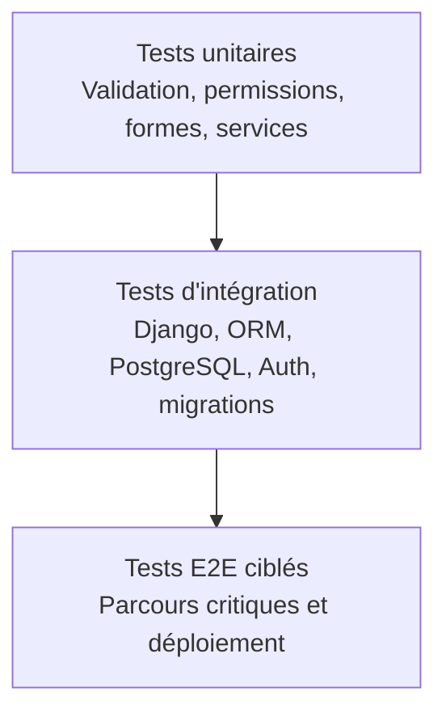
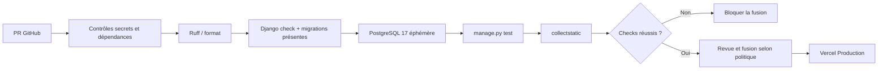
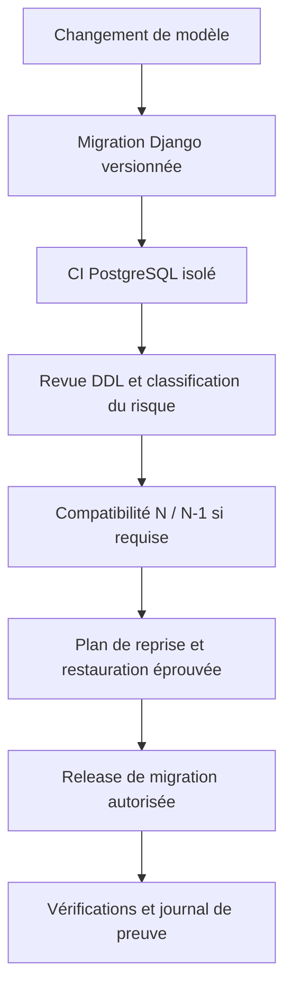

# 06 - Stratégie de tests et d'acceptation

## Socle Django + GitHub + Vercel + Neon PostgreSQL, Cloudflare conditionnel

| Métadonnée | Valeur |
|---|---|
| Document | `06_STRATEGIE_TESTS_ET_ACCEPTATION.md` |
| Version | 1.0 |
| Date | 18 novembre 2026 |
| Statut | **Stratégie proposée, à approuver et à exécuter** |
| Nature | Plan de vérification, exigences testables, matrices et décision de recette |
| Précurseurs | Documents `00` à `05` du même projet |
| Réalisation | Aucune suite de tests, aucun service ni déploiement n'est déclaré comme exécuté par ce document |
| Périmètre MVP | R0 à R3, Cloudflare uniquement si besoin réel |
| Responsables | Propriétaire technique, développeur, relecteur, opérateur habilité pour Production |

> **Objectif :** apporter des preuves traçables que le starter Django est fonctionnel, reproductible, sécurisé, déployable et capable de conserver ses données sans mettre la Production en danger.
>
> **Principe :** une capture de l'interface ou un statut « build réussi » ne prouve pas, à lui seul, la sécurité, l'isolation ou la résilience. Les tests doivent établir le comportement attendu, y compris dans les cas négatifs.

---

## 1. Positionnement et contrat documentaire

La série documentaire suit la chaîne :

1. `00_DJANGO_GITHUB_VERCEL_NEON_CLOUDFLARE_EXPRESSION_DU_BESOIN.md` : besoins, exigences et **13 critères d'acceptation CA-01 à CA-13**.
2. `01_ARCHITECTURE_ET_DECISIONS.md` : ADR-001 à ADR-018, arbitrages et **15 tests d'architecture AT-01 à AT-15**.
3. `02_BACKLOG_ET_USER_STORIES.md` : 10 epics, 52 user stories, critères détaillés et gates.
4. `03_STRUCTURE_PROJET_ET_CONFIGURATION.md` : modules, configuration, domaine de démonstration `records` et environnements.
5. `04_PLAN_IMPLEMENTATION_ET_CI_CD.md` : jalons, workflow GitHub Actions, Vercel et migration dédiée.
6. `05_STRATEGIE_DONNEES_ET_MIGRATIONS.md` : **12 invariants DATA-INV-01 à 12**, **23 tests DB-001 à DB-023**, sauvegardes et migrations.
7. **Présent `06`** : stratégie de vérification de bout en bout, outils, exécution, preuves, recette et GO / NO-GO.
8. `07_RUNBOOK_DEPLOIEMENT_ET_EXPLOITATION.md` : procédures opératoires, réactions aux incidents et continuité.

### 1.1 Hiérarchie des exigences

En cas de contradiction :

- Les invariants de sécurité et l'interdiction d'accès Preview/CI vers Production priment sur les optimisations de vitesse.
- Les critères CA validés par le responsable du projet priment sur un KPI indicatif.
- Les ADR effectivement acceptées prévalent sur les exemples techniques provisoires de ce document.
- Les contrats officiels des fournisseurs et la configuration réellement souscrite prévalent sur toute hypothèse de plan ou quota.
- Un désaccord non résolu est tracé comme un **risque / arbitrage**, jamais converti tacitement en succès.

### 1.2 Périmètre de vérification du MVP

| Domaine | Inclus dans le GO MVP | Non requis d'emblée |
|---|---|---|
| Django | Démarrage, templates, Admin, Auth, permissions, CRUD `Record` | API DRF, interface React |
| Qualité Python | Versions bloquées, lint/format, tests, analyse des risques | Jeux d'outils redondants |
| GitHub | PR, CI, règles de fusion effectivement applicables | Système de release complexe |
| Vercel | HTTPS, runtime Django, statiques, Preview, déploiement de `main` | Proxy Cloudflare, workers longs |
| Neon | PostgreSQL, secrets, isolation, persistance, migrations, restauration éprouvée | CDC, multi-région, entrepôt analytique |
| Exploitation | Logs, reprise du code, suivi des quotas et adéquation du plan | SLA chiffré non motivé |
| Cloudflare | Tests uniquement pour une option activée | Obligation d'activer DNS, Turnstile ou R2 |

La page d'administration n'est pas destinée à être ouverte sans contrôle d'accès. Le domaine `records` ne constitue **pas** une application comptable ou une application multi-tenant prête pour des données sensibles.

---

## 2. Objectifs qualité et risques prioritaires

### 2.1 Objectifs vérifiables

- **OQ-01 - Reproductibilité :** un clone vierge fonctionne avec un README, des versions déterministes et une configuration non sensible.
- **OQ-02 - Fonctionnalité :** les opérations CRUD attendues fonctionnent et les entrées invalides sont refusées.
- **OQ-03 - Autorisation :** un utilisateur anonyme ou insuffisamment habilité ne peut ni lire ni modifier une ressource protégée.
- **OQ-04 - Livraison :** la CI vérifie les PR et les fusions autorisées sur `main` correspondent à des déploiements Vercel identifiables.
- **OQ-05 - Isolation :** aucune Preview ni aucun job CI ne peut affecter la base de Production.
- **OQ-06 - Persistance :** les données stockées sur Neon survivent à un redéploiement applicatif.
- **OQ-07 - Schéma :** les migrations PostgreSQL sont versionnées, testées et autorisées hors du build web.
- **OQ-08 - Secrets :** pas de credential réel dans Git, logs, rapports ou éléments de recette.
- **OQ-09 - Reprise :** une panne de code est diagnostiquable et le rollback code est éprouvé ; restaurabilité DB évaluée sur une ressource isolée.
- **OQ-10 - Gouvernance :** le plan et les quotas sont compatibles avec l'usage personnel ou commercial réel.

### 2.2 Risques à tester en premier

| ID | Scénario redouté | Impact | Test prioritaire | Gate |
|---|---|---|---|---|
| QA-R01 | Preview connectée à Neon Production | Critique | `DB-009`, `TST-031`, sentinelles + droits | Bloquant |
| QA-R02 | Branche Neon Preview clonée de données personnelles | Critique | `TST-032`, provenance synthétique | Bloquant |
| QA-R03 | Migration exécutée dans un build Vercel | Critique | `TST-037`, inspection pipeline + run | Bloquant |
| QA-R04 | Code publié incompatible avec schéma | Critique | `DB-005`, `DB-020`, tests N/N-1 | Bloquant |
| QA-R05 | Secret réel dans PR ou logs | Élevé | `TST-020`, `TST-021`, scan et revue | Bloquant |
| QA-R06 | Contrôle permissions uniquement dans le template | Élevé | `TST-013` à `TST-018` | Bloquant |
| QA-R07 | Donnée perdue lors d'un redéploiement | Élevé | `DB-015`, `TST-036` | Bloquant |
| QA-R08 | Fonctionnement apparent sur SQLite en Production | Élevé | `TST-035`, contrôle de configuration | Bloquant |
| QA-R09 | Rollback code confondu avec restauration DB | Élevé | `TST-043`, `DB-019/020` | Bloquant |
| QA-R10 | Tests lancés contre une base non isolée | Élevé | `TST-028`, contrôle des URLs/roles | Bloquant |
| QA-R11 | Offre d'hébergement incompatible avec usage réel | Élevé | `TST-048`, preuve d'adéquation plan | Bloquant |
| QA-R12 | Couverture insuffisante d'une règle métier | Moyen | Cartographie exigences / tests | Correction ciblée |

---

## 3. Principes de test et choix des outils

### 3.1 Principes

1. **Testable by design** : chaque user story P0 possède au moins un oracle et une preuve.
2. **Risque avant métrique** : une vulnérabilité d'isolation ne peut pas être compensée par une couverture élevée.
3. **Indépendance** : fixture synthétique, état déterministe, nettoyage explicite et aucun accès Production en CI.
4. **Échec visible** : des tests rouges bloquent les fusions selon les mécanismes réellement configurés.
5. **Rejouabilité** : résultat, environnement, SHA, version de dépendances et test sont identifiables.
6. **Séparation des responsabilités** : CI de code, déploiement Vercel et migrations Production sont trois opérations distinctes.
7. **Fidélité technique** : tester les chemins PostgreSQL avec PostgreSQL, pas uniquement avec SQLite.
8. **Moindre privilège** : PR et forks ne reçoivent jamais les secrets Production.
9. **Progressivité** : les tests E2E ne remplacent pas les tests unitaires et d'intégration.
10. **Aucun effet destructeur sur la Production** : les scénarios de panne et restauration ciblent un environnement isolé.

### 3.2 Choix principal : runner Django natif

| Outil / capacité | Statut MVP | Usage |
|---|---|---|
| `python manage.py test` | **Retenu** | Tests Django natifs et exécution CI |
| `django.test.TestCase` / `TransactionTestCase` | **Retenu si pertinent** | ORM, vues, transactions, droits |
| `django.test.Client` | **Retenu** | HTTP côté serveur, redirections, accès |
| PostgreSQL 17 temporaire GitHub Actions | **Retenu par le plan `04`** | Test intégration DB sans Neon Production |
| Ruff lint + format | **Retenu** | Analyse statique et cohérence du code |
| `makemigrations --check --dry-run` | **Retenu** | Détecter les migrations oubliées |
| `migrate --noinput` en CI isolée | **Retenu** | Valider le schéma sur PostgreSQL |
| `check --deploy` | **Retenu**, configuration de simulation | Inspection des réglages Django de production |
| Scan des secrets | **Obligatoire**, outil à choisir | Détection de fuite de credentials |
| Analyse dépendances | **Recommandée** | Vulnérabilités connues et licences selon besoin |
| `coverage.py` | **Recommandé** | Mesurer la couverture des chemins critiques |
| Playwright | **P1 ou ciblé** | Parcours navigateur qui ne peuvent être prouvés sans navigateur |
| `pytest` / `pytest-django` | **Alternative, pas ajout obligatoire** | À introduire si un bénéfice concret le justifie |
| Locust / k6 | **P1/P2** | Mesures de charge, pas un prérequis au CRUD MVP |
| Test Cloudflare Turnstile / R2 | **P2** | Seulement si option activée |

**Important :** les versions figurant dans les documents `03` et `04` sont des candidates à verrouiller et à confirmer sur l'environnement d'exécution. Le choix de tester avec `manage.py test` évite d'imposer simultanément `pytest` tant que le projet n'en a pas besoin.

### 3.3 Pyramide de tests



Aucune proportion fixe entre niveaux n'est un critère d'acceptation. Privilégier la rapidité et la fiabilité des tests de proximité, puis un petit nombre de scénarios transversaux essentiels.

---

## 4. Environnements de test et données admises

| Environnement | Hébergement | Données | Tests permis | Interdictions |
|---|---|---|---|---|
| Local | Poste du développeur | Synthétiques | Unitaires, intégration, UI | Réutiliser des secrets Production |
| CI | GitHub Actions + PostgreSQL éphémère | Fixtures synthétiques | Lint, tests, migrations, check configuration | Accès à Neon Production |
| Preview | Vercel et base/branche Neon isolée | Synthétiques uniquement | Smoke, E2E, permissions, isolation | Cloner les données réelles ou écrire en Production |
| Staging (si ajouté) | Projet/environnement dédié | Synthétiques ou anonymisées validées | Répétition release, migration, restauration | Assimiler staging à Production |
| Production | Vercel + Neon Production | Données autorisées | Smoke **non destructif**, télémétrie, audit config | Lancer une suite Django créant une base de test sans garde, simuler une panne destructrice |
| Restauration | Base Neon de récupération indépendante | Jeu de restauration contrôlé | PITR et validation de cohérence | Écraser le projet Production |

### 4.1 Règle essentielle sur le branching Neon

Une branche Neon peut hériter du schéma **et des données** de sa branche parente. Ainsi :

- Une Preview du MVP est alimentée depuis une branche ou un projet **contenant uniquement des données synthétiques**, ou depuis une base vide initialisée par migrations et fixtures.
- Une stratégie « une branche par PR » ne garantit pas à elle seule la confidentialité.
- L'intégration Vercel/Neon, si utilisée, doit être configurée et contrôlée pour chaque environnement.
- L'isolation se vérifie à travers les **identités de ressource, droits DB, provenance et tests sentinelles**, jamais seulement par comparaison de la chaîne `DATABASE_URL`.
- Les tests ne doivent pas afficher les connexions complètes ni les mots de passe.

### 4.2 Jeu de données de référence

Le domaine `Record` proposé dans `03` comprend `id`, `title`, `description`, `status`, `created_by`, `created_at` et `updated_at`.

- Utilisateur `owner_a` avec un `Record` de statut `draft`.
- Utilisateur `owner_b` avec un `Record` distinct de statut `active`.
- Utilisateur `staff` avec permissions administratives adaptées.
- Utilisateur anonyme.
- Un objet archivé `archived`.
- Entrées invalides : titre vide, titre trop long, statut non reconnu, ID absent, CSRF absent, tentative de modification d'un objet tiers.
- Données sentinelles DB : `PREVIEW_ONLY`, `PROD_ONLY`, `CI_ONLY` créées et lues **seulement** selon une procédure de vérification autorisée.

L'éventuelle politique de propriété de `Record` (privé par créateur ou partagé selon droits) est un arbitrage `OA-04`. Les tests doivent être finalisés lorsque cette règle sera acceptée.

---

## 5. Taxonomie des scénarios et identifiants

| Famille | Identifiant | Finalité |
|---|---|---|
| Tests du présent document | `TST-001` à `TST-052` | Fonctionnel, qualité, livraison, sécurité, exploitation |
| Tests de données hérités de `05` | `DB-001` à `DB-023` | PostgreSQL, isolation, migrations, persistance |
| Critères métier MVP | `CA-01` à `CA-13` | Décision finale de recette |
| Contrôles d'architecture | `AT-01` à `AT-15` | Contrats architecturaux observables |
| Invariants DB | `DATA-INV-01` à `DATA-INV-12` | Sécurité non négociable |
| Backlog | `US-001` à `US-052` | Travail et critères de story |

Les identifiants ont un sens stable dans la documentation. Si un test est découpé en plusieurs scripts, les sous-variantes se nomment par exemple `TST-013.a` et `TST-013.b`, sans réassigner l'ID principal.

---

## 6. Catalogue des tests applicatifs et fonctionnels

### 6.1 Bootstrap, configuration et templates

| ID | Scénario | Niveau | Oracle | Priorité |
|---|---|---|---|---|
| TST-001 | Installer depuis un clone neuf | Reproductibilité | README suivi sans connaissance cachée | P0 |
| TST-002 | Lancer Django avec `.env.example` adapté | Intégration | Page disponible, pas de Production | P0 |
| TST-003 | Config secrète absente en mode Production | Sécurité | Échec explicite, pas de `DEBUG=True` silencieux | P0 |
| TST-004 | Charger la page d'accueil | HTTP | Réponse attendue et template complet | P0 |
| TST-005 | Charger CSS / assets locaux et Vercel | HTTP / E2E | Aucune erreur 404 bloquante | P0 |
| TST-006 | Exécuter `check` et `check --deploy` | Config | Résultats analysés, écarts documentés | P0 |
| TST-007 | Vérifier un `ALLOWED_HOSTS` invalide | Sécurité | Requête d'hôte rejetée | P0 |
| TST-008 | Vérifier HTTPS et attributs cookies | Config / HTTP | Comportement conforme aux settings acceptées | P0 |

### 6.2 Domaine Record : modèles, validations, CRUD

| ID | Scénario | Niveau | Oracle | Priorité |
|---|---|---|---|---|
| TST-009 | Créer un Record valide | Django/DB | Objet persisté avec propriétaire et statut | P0 |
| TST-010 | Rejeter les données métier invalides | Unitaire | Erreur de validation, aucune écriture attendue | P0 |
| TST-011 | Lire et lister les objets autorisés | HTTP/DB | Résultat cohérent avec la politique d'accès | P0 |
| TST-012 | Modifier, archiver et supprimer selon les règles | HTTP/DB | État final exact, aucune mutation non voulue | P0 |
| TST-013 | Interdire création anonyme | Sécurité | Redirection/401/403 conforme, aucune insertion | P0 |
| TST-014 | Interdire modification d'un Record tiers | Sécurité | Refus ou 404, donnée initiale inchangée | P0 |
| TST-015 | Interdire suppression d'un Record tiers | Sécurité | Refus ou 404, objet conservé | P0 |
| TST-016 | Empêcher la modification de `created_by` | Sécurité | Propriétaire défini côté serveur | P0 |
| TST-017 | Réserver l'administration aux comptes habilités | Sécurité | Anonyme / utilisateur standard refusé | P0 |
| TST-018 | Vérifier l'anti-CSRF pour écriture web | Sécurité | Soumission sans jeton valide refusée | P0 |
| TST-019 | Vérifier pages 404 et erreurs de formulaires | HTTP | Pas de fuite de stacktrace ou de secrets | P0 |

**Précision :** un utilisateur `staff` ou `superuser` peut disposer de permissions spéciales. Les oracles doivent correspondre à la matrice de droits réelle, pas à une règle générale supposant que tous les utilisateurs sont strictement isolés.

### 6.3 CI, supply chain et secrets

| ID | Scénario | Niveau | Oracle | Priorité |
|---|---|---|---|---|
| TST-020 | Scanner fichiers et historiques pertinents | Sécurité | Aucun secret actif connu, processus de remédiation | P0 |
| TST-021 | Vérifier que les logs n'exposent pas de credentials | Sécurité | Logs expurgés | P0 |
| TST-022 | Refuser une PR avec défaut Ruff | CI négatif | Job rouge, fusion normale bloquée | P0 |
| TST-023 | Refuser une PR avec test Django échoué | CI négatif | Job rouge, fusion normale bloquée | P0 |
| TST-024 | Refuser une migration Django non committée | CI négatif | `makemigrations --check --dry-run` échoue | P0 |
| TST-025 | Installer uniquement depuis un lockfile cohérent | CI | `uv sync --frozen` aboutit | P0 |
| TST-026 | Vérifier permissions des workflows PR | Audit | Jeton minimal, secrets Prod absents, forks sûrs | P0 |
| TST-027 | Vérifier les checks requis sur `main` | Audit / négatif | PR rouge non fusionnable selon capacités configurées | P0 |
| TST-028 | Vérifier les credentials et DB de CI | Audit / intégration | PostgreSQL temporaire ; aucune connexion Neon Prod | P0 |

La protection effective de `main` doit être prouvée. Une CI verte n'est pas à elle seule un mécanisme garantissant que Vercel n'a pas créé un déploiement avant la fin du contrôle ; si un contrôle de promotion est nécessaire, il doit être activé et testé explicitement.

### 6.4 Vercel, Preview et Neon

| ID | Scénario | Niveau | Oracle | Priorité |
|---|---|---|---|---|
| TST-029 | Publier une Preview de PR | Déploiement | URL, branche et SHA cohérents | P0 |
| TST-030 | Vérifier l'identité de l'environnement Preview | Config | Environnement distinct et explicite | P0 |
| TST-031 | Tenter d'écrire depuis Preview vers Production | Sécurité négatif | Aucune modification de Production, accès refusé | **Bloquant** |
| TST-032 | Vérifier la provenance synthétique des données Preview | Confidentialité | Aucune copie non autorisée de données réelles | **Bloquant** |
| TST-033 | Fermer une PR et vérifier le cycle de vie Preview | Exploitation | Branche/credentials supprimés ou expirés selon politique | P0 |
| TST-034 | Déployer depuis `main` | Déploiement | SHA visible sur Vercel, HTTP Production OK | P0 |
| TST-035 | Vérifier `DATABASE_URL` et moteur en Production | Config | PostgreSQL Neon, pas SQLite ou fichier persistant local | **Bloquant** |
| TST-036 | Redéployer sans perdre un Record | E2E / DB | Identifiant et champs conservés | **Bloquant** |

### 6.5 Migrations, rollback et sauvegardes

| ID | Scénario | Niveau | Oracle | Priorité |
|---|---|---|---|---|
| TST-037 | Vérifier absence de `migrate` dans build / runtime Vercel | Revue + négatif | Migration Production seulement dans procédure autorisée | **Bloquant** |
| TST-038 | Appliquer schéma vierge sur PostgreSQL isolé | DB | `migrate` réussit, tests OK | **Bloquant** |
| TST-039 | Tester migration additive avec compatibilité N/N-1 | DB/intégration | Ancien et nouveau code fonctionnent si requis | **Bloquant si changement de schéma** |
| TST-040 | Rejeter migration destructive sans revue | Sécurité release | NO-GO et aucune action Production | **Bloquant** |
| TST-041 | Appliquer migration en workflow autorisé | Release | SHA, opérateur, approbation et résultat traçables | **Bloquant si migration** |
| TST-042 | Restaurer une base isolée depuis l'historique | Reprise | Cohérence des données, RPO/RTO observés | P0 |
| TST-043 | Restaurer le code sans restaurer la DB | Reprise | Release saine accessible, schéma examiné séparément | P0 |
| TST-044 | Simuler migration interrompue hors Production | Résilience | État et reprise explicites, pas de retry aveugle | P0 |

### 6.6 Exploitation, conformité du plan et options

| ID | Scénario | Niveau | Oracle | Priorité |
|---|---|---|---|---|
| TST-045 | Diagnostiquer une erreur simulée | Observabilité | Échec repérable et rattachable au SHA | P0 |
| TST-046 | Vérifier informations sensibles des traces | Sécurité | Aucun mot de passe / token / dump dans les preuves | P0 |
| TST-047 | Documenter quotas et chemin de diagnostic fournisseur | Exploitation | Registre utile, liens et responsabilités | P0 |
| TST-048 | Vérifier conformité du plan à l'usage réel | Contractuel | Preuve de plan adapté, notamment si usage commercial | **Bloquant** |
| TST-049 | Tester nouveau clonage du starter | Reproductibilité | Nouveau projet sans identifiant ou secret partagé | P1 |
| TST-050 | Tester domaine Cloudflare DNS-only | Optionnel | DNS et HTTPS cohérents sans double proxy | P2 |
| TST-051 | Tester Turnstile côté serveur | Optionnel | Tokens invalides refusés côté Django | P2 |
| TST-052 | Tester stockage objet des médias | Optionnel | Permissions, conservation et suppression conformes | P2 |

---

## 7. Reprise intégrale des 23 tests de données du document `05`

Les tests de base de données sont conservés **avec leurs identifiants d'origine**. La matrice ci-dessous est la référence de couverture, tandis que la description détaillée et les procédures de restauration restent dans `05`.

| DB | Objet de contrôle | Résultat attendu | Test(s) associé(s) du `06` |
|---|---|---|---|
| DB-001 | Création du schéma à partir de zéro | Toutes migrations passent | TST-038 |
| DB-002 | Modification de modèle non migrée | CI rouge | TST-024 |
| DB-003 | Historique Django des migrations | Historique conforme | TST-038 |
| DB-004 | Reproduction du schéma depuis clone vierge | États identiques | TST-001, TST-038 |
| DB-005 | Migration additive | Compatibilité selon plan | TST-039 |
| DB-006 | Interruption de migration de données | Reprise sans double mutation | TST-044 |
| DB-007 | Migration destructive | Gate d'autorisation | TST-040 |
| DB-008 | Secrets absents en Production | Échec contrôlé | TST-003 |
| DB-009 | Preview avec cible DB Production | Rejet / aucune écriture | TST-031 |
| DB-010 | Privilèges DDL du rôle web | DDL interdit si séparation activée | TST-035, TST-041 |
| DB-011 | Droits CI | Aucun accès Prod | TST-028 |
| DB-012 | Connexions et pooling | Parcours représentatif sans erreur | TST-035 |
| DB-013 | Secrets mal typés ou journalisés | Échec sécurité | TST-020/021 |
| DB-014 | PR de fork non approuvée | Aucune fuite de secret Prod | TST-026 |
| DB-015 | Redéploiement de code | Record conservé | TST-036 |
| DB-016 | Échec d'écriture transitoire | Pas de doublon non maîtrisé | TST-012 |
| DB-017 | Migration en échec | État partiel reconnu, pas de rerun aveugle | TST-044 |
| DB-018 | Restauration isolée | Base cohérente | TST-042 |
| DB-019 | Rollback code après expand | Ancien code compatible | TST-039, TST-043 |
| DB-020 | Contract incompatible | Promotion refusée | TST-039/040 |
| DB-021 | Fermeture PR et branche | Nettoyage/expiration maîtrisés | TST-033 |
| DB-022 | Pic de connexions | Limite / comportement mesurés | TST-047 + test dédié R3 |
| DB-023 | Droits Django après migration | Accès non autorisé toujours refusé | TST-014/015/017 |

**Attention :** le test `DB-022` nécessite une campagne de performance **bornée** et non intrusive sur un environnement isolé. `TST-047` documente quotas/observations ; il ne remplace pas cette mesure si elle est promue en exigence bloquante par un problème de connexions.

---

## 8. Méthodologie des tests unitaires et d'intégration Django

### 8.1 Arborescence indicative

```text
django-cloud-starter/
  apps/
    records/
      models.py
      forms.py
      views.py
      tests/
        __init__.py
        test_models.py
        test_forms.py
        test_views.py
        test_permissions.py
  tests/
    __init__.py
    integration/
      __init__.py
      test_database.py
      test_migrations.py
    deployment/
      __init__.py
      test_security_settings.py
  .github/
    workflows/
      ci.yml
      release-migrate.yml
  release-evidence/
    README.md
```

L'emplacement exact doit rester cohérent avec `03_STRUCTURE_PROJET_ET_CONFIGURATION.md`. La présence d'un dossier ne doit pas créer automatiquement une double exécution du même test.

### 8.2 Exemple de tests de modèle

Cet extrait repose sur le modèle `Record` et son champ `created_by` présentés dans le document `03`. **Il devra être adapté si ce modèle évolue**.

```python
# apps/records/tests/test_models.py
from django.contrib.auth import get_user_model
from django.core.exceptions import ValidationError
from django.test import TestCase

from apps.records.models import Record


class RecordModelTests(TestCase):
    @classmethod
    def setUpTestData(cls):
        cls.owner = get_user_model().objects.create_user(
            username="owner_a",
            password="synthetic-test-password-only",
        )

    def test_record_persists_with_expected_owner(self):
        record = Record.objects.create(
            title="Dossier fictif",
            status=Record.Status.DRAFT,
            created_by=self.owner,
        )
        stored = Record.objects.get(pk=record.pk)
        self.assertEqual(stored.created_by_id, self.owner.pk)
        self.assertEqual(stored.status, Record.Status.DRAFT)

    def test_invalid_status_is_rejected_by_full_clean(self):
        record = Record(
            title="Dossier fictif",
            status="not-a-real-status",
            created_by=self.owner,
        )
        with self.assertRaises(ValidationError):
            record.full_clean()
```

`full_clean()` est un contrat de validation du modèle ; Django n'appelle pas automatiquement `full_clean()` à chaque `save()`. Les tests doivent également couvrir les formulaires et chemins applicatifs par lesquels les valeurs arrivent au modèle.

### 8.3 Tests de permissions HTTP

Pour des tests HTTP sur des routes réelles :

- utiliser `reverse()` avec les noms d'URL réellement implémentés ;
- créer deux utilisateurs et des objets appartenant à chacun ;
- tester la réponse **et l'état de la base après la requête** ;
- pour CSRF, utiliser un client explicitement construit avec `enforce_csrf_checks=True` ou un navigateur équivalent ;
- refuser les transitions non autorisées même si un utilisateur forge une URL ou le champ `created_by` ;
- ne pas faire dépendre les droits d'un simple bouton masqué dans le template.

### 8.4 Répartition `TestCase` / tests transactionnels

- `TestCase` fournit l'isolation transactionnelle adaptée à la plupart des tests ORM/HTTP.
- `TransactionTestCase` s'utilise quand le comportement réel des transactions, commits ou rollback doit être observé.
- Les tests de migration peuvent avoir besoin d'instancier un exécuteur Django et de restaurer proprement l'état du schéma ; ils doivent être séparés, déterministes et limités à une base dédiée.
- Éviter la réutilisation aveugle d'un cache ou d'un schéma persistant entre suites.

### 8.5 Commandes locales de référence

```bash
# Dépendances verrouillées selon le choix retenu dans 03/04
uv sync --frozen --group dev

# Qualité Python
uv run --frozen ruff check .
uv run --frozen ruff format --check .

# Django
uv run --frozen python manage.py check
uv run --frozen python manage.py makemigrations --check --dry-run

# Base locale ou CI ISOLÉE uniquement
uv run --frozen python manage.py migrate --noinput
uv run --frozen python manage.py test

# Statiques
uv run --frozen python manage.py collectstatic --noinput
```

Ces commandes sont un contrat d'exécution **local/CI**, pas une autorisation à les lancer depuis Production ou vers une connexion DB incertaine.

---

## 9. Stratégie d'automatisation CI GitHub Actions

### 9.1 Pipeline de référence



Le pipeline de `04_PLAN_IMPLEMENTATION_ET_CI_CD.md` sert de source pour `.github/workflows/ci.yml`. Il configure notamment un service PostgreSQL **dans le runner CI**, un `DATABASE_URL` jetable, un `DJANGO_SECRET_KEY` factice et des permissions `contents: read`.

### 9.2 Contrats des jobs

| Contrôle | Déclencheur | Succès | Échec |
|---|---|---|---|
| Lockfile | PR / `main` | Installation déterministe | Modifier lockfile et relancer |
| Ruff | PR / `main` | Aucune erreur selon configuration | Bloquer PR |
| Django `check` | PR / `main` | Aucun problème bloquant | Bloquer PR |
| Migrations présentes | PR / `main` | Aucun changement de modèle non migré | Bloquer PR |
| Migration DB CI | PR / `main` | Base PostgreSQL vierge migrée | Bloquer PR |
| Tests Django | PR / `main` | Tous les tests requis passent | Bloquer PR |
| Statiques | PR / `main` | `collectstatic` réussit | Bloquer si frontend affecté |
| Scan secrets | PR / `main` | Aucune fuite active | Bloquer PR et révoquer si secret exposé |
| Analyse de vulnérabilités | PR / périodique selon politique | Pas de vulnérabilité non arbitrée | Triage de criticité |

### 9.3 Tests négatifs du pipeline

La campagne de validation de CI doit provoquer, **sur une branche de test** et sans secret réel :

1. Une erreur de lint.
2. Un test unitaire volontairement rouge.
3. Une modification de modèle sans migration correspondante.
4. Une tentative de fusion normale avec check obligatoire rouge.
5. Un contrôle du comportement d'une PR depuis un fork, si les contributions externes sont autorisées.
6. Un redéploiement simulé où la migration ne doit pas partir au build.

Ne pas créer de fausses clés ressemblant à des secrets actifs afin de tester un scan dans un dépôt public sans démarche contrôlée. Utiliser les fixtures et conventions du scanner choisi.

### 9.4 Branch protection, GitHub et Vercel

- **Règle minimale :** revue et statuts requis configurés selon l'offre et la visibilité réelles du dépôt, avec preuve de blocage.
- La seule présence d'un workflow `ci.yml` ne suffit pas à garantir l'absence de fusion d'un code rouge.
- Une action déclenchée par `pull_request_target` ne doit pas exécuter du code non fiable avec secrets privilégiés. Le workflow de `04` utilise `pull_request`.
- Les Vercel Preview deployments sont des exécutions indépendantes des jobs CI. Éviter d'assumer que toute Preview est sûre avant validation de ses secrets et données.
- Si la politique exige que le déploiement ne soit rendu public qu'après vérifications spécifiques, étudier les **Vercel Deployment Checks** et les fonctions du plan, puis en tester le comportement exact ; ne pas les déclarer actifs par défaut.

---

## 10. Tests de configuration et sécurité Django

### 10.1 Configuration attendue

Vérifier au minimum :

- `DEBUG=False` pour Production.
- `SECRET_KEY` chargée depuis un secret protégé.
- `ALLOWED_HOSTS` et `CSRF_TRUSTED_ORIGINS` correspondant aux domaines réellement servis.
- TLS/HTTPS, cookies et redirections cohérents avec Vercel et les proxys réellement utilisés.
- `SecurityMiddleware`, protections CSRF et en-têtes de sécurité adaptés.
- Aucun diagnostic détaillé affiché au visiteur.
- Interdiction d'utiliser une URL de Production dans une Preview/CI.
- Permissions serveur sur les vues et l'Admin.
- Les fichiers statiques sont accessibles ; les médias utilisateurs, s'ils apparaissent, passent par un stockage persistant distinct.

### 10.2 `check --deploy` : mode opératoire

Exécuter la commande dans **un contexte de configuration de Production simulée**, avec secrets factices et valeurs réalistes pour les domaines, sans accès en écriture à Neon Production :

```bash
uv run --frozen python manage.py check --deploy
```

Les avertissements Django doivent être étudiés individuellement. Certains réglages HSTS ou proxy demandent une décision d'architecture ; il ne faut pas simplement désactiver les contrôles pour obtenir une sortie verte. En particulier, `check --deploy` ne remplace pas les tests d'autorisations ou un audit complet de sécurité.

### 10.3 Matrice minimale des rôles

| Action | Anonyme | Utilisateur A | Utilisateur B (objet A) | Admin habilité |
|---|---|---|---|---|
| Voir page publique | Oui | Oui | Oui | Oui |
| Accéder à Django Admin | Non | Non, sauf droit explicite | Non, sauf droit explicite | Oui |
| Créer `Record` protégé | Non | Selon droits | Selon droits | Selon droits |
| Lire `Record` A | Selon règle de partage | Oui | Refus si objets privés | Selon droits |
| Modifier `Record` A | Non | Oui si propriétaire et autorisé | Non si objets privés | Selon droits |
| Supprimer `Record` A | Non | Selon droits | Non si objets privés | Selon droits |

La politique « objets privés par auteur » est proposée par le modèle `created_by`. Si le responsable décide que les objets sont partagés, cette matrice doit être mise à jour avant d'implémenter les tests.

---

## 11. Tests Neon, isolation des environnements et sentinelles

### 11.1 Preuves attendues

1. Identité logique du projet et de la branche Neon affectés à chaque environnement, sans credentials dans la preuve.
2. Différence effective des rôles, permissions et périmètres Production / Preview / CI.
3. Confirmation de l'origine des données synthétiques des Previews.
4. Démonstration que Preview ne peut pas modifier Production.
5. Démonstration que CI n'a pas d'accès Production.
6. Comportement après clôture d'une PR documenté.

### 11.2 Scénario sentinelle TST-031

```gherkin
Feature: Isolation des données Preview
  Scenario: Une PR ne peut pas modifier Production
    Given une Production contenant une sentinelle PROD_ONLY
    And une Preview indépendante issue d'une source synthétique
    And les identités et permissions des deux environnements sont vérifiées
    When un test exécute des lectures et écritures de démonstration depuis Preview
    Then les changements sont confinés à la ressource Preview
    And la sentinelle Production reste inchangée
    And les identifiants de Production ne sont pas disponibles en Preview
    And les logs de test ne contiennent aucun secret
```

**Méthode de preuve :** combiner inspection des variables expurgées, identifiants de ressources, rôles de DB et observations du contenu. Ne jamais inscrire dans les artefacts la valeur intégrale des URLs de connexion.

### 11.3 Échecs bloquants

- Même cible DB ou mêmes credentials entre Preview et Production.
- Provenance de branche contenant des données réelles non autorisées.
- Possibilité d'écrire en Production avec des privilèges Preview ou CI.
- URL de PR ouverte à des personnes non autorisées alors qu'elle expose des données sensibles.
- Absence de preuve sur la politique de nettoyage ou rotation des accès éphémères.

---

## 12. Tests de migrations, compatibilité et reprise

### 12.1 Séquence de validation d'une migration



### 12.2 Classes de changement

| Classe | Exemple | Vérifications requises |
|---|---|---|
| Additif | Table, colonne nullable, nouvel index | Migrations CI, compatibilité, coûts/locks selon cas |
| Migration de données | Backfill ou recalcul | Idempotence, reprise, lots, intégrité, vérification d'après-migration |
| Changement contraignant | Nouvelle contrainte NOT NULL, unicité | Prévalidation des données et séquencement |
| Destructif | Suppression de champ / table | Autorisation explicite, phase contract retardée, reprise |
| Modification de rôle/extension | DDL/permissions PostgreSQL | Matrice de privilèges et tests de conformité |

### 12.3 Règle de release

Aucune migration de Production dans :

- les imports Python de Django ;
- le chargement de `settings.py`, `wsgi.py`, `asgi.py` ;
- le build ou `collectstatic` Vercel ;
- une vue HTTP ou un middleware ;
- une PR ou un runner non autorisé.

L'exécution Production suit un workflow dédié, explicitement déclenché par un opérateur autorisé, avec journal de SHA, approbation et vérifications avant/après. Les protections GitHub Environment réellement disponibles doivent être testées et non supposées.

### 12.4 Scénario de migration contrôlée

```gherkin
Feature: Migration contrôlée du schéma
  Scenario: Application d'une migration compatible
    Given une version de code validée par la CI
    And une migration testée sur PostgreSQL isolé
    And une release autorisée et liée à un SHA
    When l'opérateur exécute le workflow de migration protégé
    Then le changement de schéma est appliqué une fois
    And son résultat et sa durée sont tracés
    And les parcours HTTP critiques restent conformes
    And aucune migration n'a été exécutée par le build Vercel
```

### 12.5 Rollback et restauration

- **Rollback du code** : retour à une version Vercel connue, sous réserve de compatibilité avec le schéma actuel.
- **Reprise de migration** : analyse de l'état atteint, plan de correction, éviter de relancer aveuglément.
- **Restauration de données** : créer une branche / base de récupération isolée, contrôler le schéma et les données, documenter l'instant de récupération.
- Les métriques **RPO** et **RTO** ne sont pas décrétées à `5` ou `30` minutes sans exigence métier et mesure réelle. Les temps observés dans les exercices servent à fixer des objectifs appropriés plus tard.
- Un test de restauration réalisé hors Production n'autorise pas un remplacement de la base Production sans procédure d'incident distincte.

---

## 13. Tests E2E et validation du déploiement

### 13.1 Parcours E2E minimum

| Parcours | Environnement | Données | Preuve |
|---|---|---|---|
| E2E-01 - Accueil HTTPS | Preview puis Production | Aucune | Réponse, certificat, URL |
| E2E-02 - Authentification / refus anonyme | Preview isolée | Comptes synthétiques | Capture ou log de test |
| E2E-03 - CRUD complet | Preview isolée | `Record` fictif | ID, état avant/après |
| E2E-04 - Permissions objet | Preview isolée | Deux propriétaires fictifs | Accès refusé, DB inchangée |
| E2E-05 - Statiques | Preview puis Production | Aucune | CSS/assets servis |
| E2E-06 - PR vers déploiement | GitHub + Vercel | Aucune donnée métier réelle | URL Preview et SHA |
| E2E-07 - Redéploiement | Production contrôlée | Enregistrement de recette approuvé ou équivalent | Identité de la donnée avant/après |
| E2E-08 - Isolation Preview | Preview/Production | Sentinelles convenues, accès restreints | Rapport d'absence d'effet sur Prod |

### 13.2 Production : précautions

- Privilégier les vérifications de lecture non destructives : `/`, pages publiques, endpoint de santé sans fuite.
- Pour **CA-04**, organiser une donnée de recette explicitement autorisée et traçable, ou une méthode de vérification équivalente, avec nettoyage contrôlé et supervision. Ne pas injecter arbitrairement de données fictives dans une base métier réelle.
- Les tests de charge, de failover, de restauration et les scans agressifs ne sont pas exécutés contre Production dans le MVP.
- Une URL Preview peut être protégée par une authentification de déploiement : les tests d'accès doivent tenir compte de cette protection sans la désactiver dangereusement.

### 13.3 Preuve de déploiement GitHub / Vercel

Conserver au minimum :

- PR et statut CI.
- Commit SHA fusionné.
- URL Preview et identifiant de déploiement correspondant.
- Identifiant de déploiement Production correspondant au SHA.
- Résultat du smoke test HTTPS.
- Diagnostic des échecs le cas échéant.

---

## 14. Matrice d'acceptation du MVP : CA-01 à CA-13

Cette table est **normative pour le GO MVP**. Chaque ligne doit être accompagnée d'une preuve datée et d'un verdict ; aucune case n'est précochée.

| CA | Condition exacte à démontrer | Tests principaux | Stories concernées | Preuve attendue |
|---|---|---|---|---|
| **CA-01** | Démarrer depuis un clone vierge selon README | TST-001/002/025 | US-005, US-017, US-040 | Journal de bootstrap |
| **CA-02** | Django accessible sur une URL Vercel HTTPS | TST-004/005/008/034 | US-018/019/022 | URL + smoke test |
| **CA-03** | CRUD stocké dans Neon PostgreSQL | TST-009/012/035, DB-001 | US-008/009/025 | Preuve ORM/DB |
| **CA-04** | Donnée préservée après redéploiement | TST-036, DB-015 | US-020/028 | Valeurs avant/après |
| **CA-05** | PR déclenche les tests GitHub Actions | TST-022/023/024 | US-013/014 | Run GitHub Actions |
| **CA-06** | Contrôles bloquants sur `main` selon les capacités du dépôt | TST-027 | US-016 | Tentative PR rouge bloquée |
| **CA-07** | Fusion `main` déclenche nouvelle version | TST-034 | US-018/020 | SHA Git et deployment |
| **CA-08** | Preview ne peut écrire dans Production | TST-028/031/032, DB-009/011 | US-021/026/031/035 | Sentinelles + permissions |
| **CA-09** | Admin et opérations sensibles protégés | TST-013 à TST-018 | US-010/032/033 | Tests d'accès négatifs |
| **CA-10** | Aucun secret réel commité | TST-020/021/026 | US-006/012/034 | Scan + revue |
| **CA-11** | Migrations tracées et Production maîtrisée | TST-024/037 à TST-041, DB-001/007 | US-015/027 | CI + run migration |
| **CA-12** | Procédure de diagnostic et retour arrière accessible | TST-042/043/045 | US-023/036/037/043 | Runbook et exercice |
| **CA-13** | Plan conforme à l'usage réel | TST-047/048 | US-004/038 | Fiche plan + quotas |

### 14.1 Statuts de recette

- `PASS` : l'oracle est satisfait, preuve datée fournie.
- `FAIL` : l'oracle n'est pas satisfait.
- `BLOCKED` : une dépendance ou décision empêche la vérification.
- `NOT_RUN` : scénario prévu, non exécuté.
- `NOT_APPLICABLE` : uniquement pour une extension **non requise** et avec justification ; jamais pour supprimer arbitrairement un critère `CA` du MVP.

### 14.2 Cas d'acceptation partielle

Une démonstration technique peut être déclarée « démonstration R2 validée » si GitHub et Vercel fonctionnent sans encore avoir intégré Neon. En revanche, **elle ne peut pas être déclarée « MVP accepté »**, puisque CA-03/04/08/11 restent non prouvés.

---

## 15. Matrice de traçabilité des tests d'architecture AT-01 à AT-15

| AT | Preuve principale | Cas / CA liés |
|---|---|---|
| AT-01 | Clone et README | TST-001/002, CA-01 |
| AT-02 | Page, Admin, CRUD | TST-004, TST-009 à TST-018, CA-03/09 |
| AT-03 | Tests automatiques PR | TST-022/023, CA-05 |
| AT-04 | Preview associée à la PR | TST-029, CA-08 |
| AT-05 | Isolation Preview / Prod | TST-031/032, CA-08 |
| AT-06 | Fusion et commit en Production | TST-034, CA-07 |
| AT-07 | Persistance après redéploiement | TST-036, CA-04 |
| AT-08 | Statiques disponibles | TST-005, CA-02 |
| AT-09 | Aucun secret réel dans Git | TST-020/021/026, CA-10 |
| AT-10 | Admin refuse accès non autorisé | TST-017, CA-09 |
| AT-11 | Migration testée et contrôlée | TST-024/037 à TST-041, CA-11 |
| AT-12 | Logs et identifiants de version | TST-045/046, CA-12 |
| AT-13 | Procédure de retour arrière exercée | TST-042/043, CA-12 |
| AT-14 | Plan compatible avec l'usage | TST-048, CA-13 |
| AT-15 | Coûts et quotas identifiés | TST-047, CA-13 |

---

## 16. Couverture des 12 invariants de données

| Invariant `05` | Contrôle à conserver | Tests pivots |
|---|---|---|
| DATA-INV-01 | Pas de credentials partagés Preview / Prod | TST-030/031 |
| DATA-INV-02 | CI ne peut accéder à Prod | TST-026/028 |
| DATA-INV-03 | Preview sans écriture Prod | TST-031 / DB-009 |
| DATA-INV-04 | Données Preview synthétiques | TST-032 |
| DATA-INV-05 | Pas de `migrate` au build/runtime Vercel | TST-037 |
| DATA-INV-06 | Migration Prod liée à SHA et autorisation | TST-041 |
| DATA-INV-07 | Migrations versionnées/testées en PostgreSQL isolé | TST-024/038 |
| DATA-INV-08 | Rollback code distinct du schéma | TST-039/043 |
| DATA-INV-09 | Restauration testée hors Production | TST-042 |
| DATA-INV-10 | Secrets hors Git, logs et scopes partagés | TST-020/021/026 |
| DATA-INV-11 | Pas de stockage persistant sur disque Vercel | TST-035/036 |
| DATA-INV-12 | Compatibilité code/schéma contrôlée | TST-039/040 |

**Règle :** si un invariant marqué bloquant dans `05` ne dispose pas d'une preuve positive, le GO du MVP n'est pas possible.

---

## 17. Couverture des epics et user stories

| Epic | Objectif principal | Bloc de tests du `06` | Exigences de sortie |
|---|---|---|---|
| EP-00 (US-001 à 004) | Cadrage et compatibilité | TST-001, TST-025, TST-047/048 | Arbitrages acceptés |
| EP-01 (US-005 à 011) | Application Django CRUD | TST-001 à 019 | CA-01/03/09 |
| EP-02 (US-012 à 017) | GitHub, qualité, CI | TST-020 à 028 | CA-05/06/10 |
| EP-03 (US-018 à 023) | Vercel + Preview | TST-005, TST-029 à 034 | CA-02/07/08 |
| EP-04 (US-024 à 031) | Neon et migrations | TST-031/032/035 à 044, DB-001 à 023 | CA-03/04/08/11 |
| EP-05 (US-032 à 035) | Sécurité | TST-003/007/008/013 à 021/026/031/032 | CA-09/10 |
| EP-06 (US-036 à 040) | Observabilité/reprise/coûts | TST-042 à 049 | CA-12/13 |
| EP-07 (US-041 à 044) | Recette et réutilisation | TST-001/049, matrice CA | GO / NO-GO |
| EP-08 (US-045 à 048) | Cloudflare optionnel | TST-050 à 052 | Gate optionnel |
| EP-09 (US-049 à 052) | API, React, workers, Py**Kits | Tests futurs à spécifier | Hors MVP |

Les critères d'acceptation internes de chaque story dans `02` complètent ces tests pivots. Une story ne peut pas passer `Done` sur la seule base de la couverture par un epic.

---

## 18. Mesures de qualité et indicateurs

### 18.1 Indicateurs obligatoires à **observer**

| Indicateur | Définition | Source | Politique initiale |
|---|---|---|---|
| Réussite CI | Jobs requis verts / runs éligibles | GitHub Actions | 100 % des checks requis sur release candidate |
| Résultat des 13 CA | Nombre de CA `PASS` | Matrice de recette | **13 / 13** pour GO MVP |
| Invariants de données | Preuves positives / 12 | Dossier R3 | **12 / 12** conformes si applicables, sinon arbitrage sans dérogation aux bloquants |
| Tests critiques rouges | Échecs bloquants ouverts | CI + registre défauts | **0** au GO |
| Couverture des stories P0 | P0 avec preuve / P0 dans périmètre | GitHub Projects | 100 % de celles requises à la release |
| Persistance | Égalité Record avant/après déploiement | E2E | Aucun écart non autorisé |
| Isolation Preview | Tentatives refusées / succès d'écriture Prod | Test sentinelles | Aucune écriture Preview vers Prod |
| Temps de CI | Durée mediane et P95 | GitHub Actions | Mesurer puis optimiser |
| Couverture de code | Branches / lignes selon outil | Coverage | Mesurer, prioriser chemins critiques |
| Bugs après release | Défauts détectés après publication | Issues / logs | Analyser tendance |
| Restauration | Temps et état de reprise observés | Exercice isolé | Mesurer, fixer ensuite RPO/RTO cible |
| Coûts et consommation | Usage par ressource, évolutions | Portails fournisseurs | Définir les seuils en fonction du plan |

### 18.2 Ce qui n'est **pas** un seuil validé

- Une couverture de code de **80 %** peut servir de cible d'amélioration future, mais elle n'est **pas** fixée comme critère contractuel par les documents `00` à `05`.
- Une CI sous **5 minutes** est un objectif d'optimisation éventuel, pas une condition de GO.
- Un RPO **5 minutes**, un RTO **30 minutes** ou un taux de réussite des migrations **99 %** ne doivent pas être présentés comme engagements sans mesure, plan de service et validation métier.
- Les pourcentages d'une pyramide de tests ne sont pas des objectifs de conformité.

Une métrique quantitative sans vérification des risques prioritaires peut donner une fausse impression de sécurité.

---

## 19. Gestion des défauts, flaky tests et exemptions

### 19.1 Gravité

| Sévérité | Description | Traitement |
|---|---|---|
| S0 - Critique | Accès Preview à Prod, fuite active, corruption DB, migration incontrôlée | Stop release, incident et NO-GO |
| S1 - Majeur | CRUD ou Auth critique cassé, CI contournée, impossibilité de restaurer selon plan | NO-GO MVP |
| S2 - Modéré | Parcours secondaire défaillant, observabilité partielle | Correction avant release si CA affecté |
| S3 - Mineur | Libellé, style, documentation sans conséquence sur CA | Arbitrage et backlog |

### 19.2 Un défaut recevable comprend

- Identifiant et titre.
- Version / SHA / environnement.
- Préconditions et jeu de données **non sensible**.
- Étapes de reproduction.
- Résultat attendu / résultat observé.
- Gravité et critère CA/AT/DATA-INV affecté.
- Capture/log expurgé, responsable et état.

### 19.3 Politique de flaky tests

Un test instable ne doit pas être silencieusement relancé jusqu'au succès puis déclaré conforme. Documenter la fréquence, les conditions, les causes possibles et la correction. Une mise en quarantaine n'est envisageable que pour un test non bloquant, avec une date d'expiration et une couverture compensatoire. **Un test de sécurité P0 ne peut pas être neutralisé pour obtenir un GO.**

### 19.4 Dérogations

- Jamais de dérogation à un invariant critique de `05` pour obtenir le GO MVP.
- Une exception P1/P2 doit être justifiée, datée, attribuée à un responsable et accompagnée d'un plan de traitement.
- Si un fournisseur ou plan rend un contrôle P0 impossible, la release est `NO-GO` ou l'architecture doit être modifiée.

---

## 20. Gates qualité par phase R0 à R5

### G0 - Cadrage (R0)

- [ ] Cas métier de démonstration et politique de propriété des Record définis.
- [ ] Versions/runtime, repo et branche `main` arrêtés.
- [ ] Usage personnel ou commercial et plan compatibles.
- [ ] Politique de données Preview/CI synthétiques acceptée.
- [ ] Responsable de la recette et des migrations identifié.

**Sortie :** critères de test stables pour le premier incrément.

### G1 - Django local (R1)

- [ ] Démarrage depuis clone vierge.
- [ ] CRUD fonctionnel avec contrôles de formulaire.
- [ ] Auth/Admin et permissions démontrés.
- [ ] Tests unitaires / intégration locaux verts.
- [ ] `check` et contrôles de configuration exécutés.

**Sortie :** vertical slice locale reproductible.

### G2 - GitHub + Vercel (R2)

- [ ] Pull request avec CI positive et expérience négative contrôlée.
- [ ] Contrôles de fusion `main` vérifiés.
- [ ] Preview déployée sans accès Production.
- [ ] HTTPS, statiques, SHA et logs disponibles.
- [ ] Déploiement à la fusion sur `main` constaté.

**Sortie :** livraison automatisée et traçable, sans revendication prématurée sur Neon.

### G3 - Neon et migrations (R3)

- [ ] Base PostgreSQL cible et rôles identifiés.
- [ ] `DB-001` à `DB-023` évalués, tests bloquants tous validés.
- [ ] Douze invariants DATA-INV vérifiés, chacun avec preuve.
- [ ] CI et Preview isolées physiquement/logiquement et par privilèges.
- [ ] Origine synthétique des Previews confirmée.
- [ ] Migrations contrôlées et indépendantes du build.
- [ ] Persistance après déploiement démontrée.
- [ ] Test de restauration isolée et runbook de retour arrière réalisés.

**Sortie :** données et releases suffisamment sécurisées pour la recette complète.

### G4 - GO / NO-GO MVP (R3)

- [ ] **CA-01 à CA-13 : 13 PASS sur 13**.
- [ ] **0 défaut S0 ou S1 ouvert**.
- [ ] Aucun invariant critique non prouvé.
- [ ] Dossier de preuves horodaté et vérifiable.
- [ ] Procédure d'incident, responsabilités, quotas et coûts documentés.
- [ ] Décision explicite signée ou approuvée par le responsable.

**Sortie :** GO uniquement si toutes les conditions sont satisfaites.

### G5 - Evolutions R4/R5

Activer les suites Cloudflare, API, frontend, worker ou Py**Kit **uniquement** en réponse à un besoin fonctionnel réel, avec de nouveaux critères d'acceptation propres aux fonctionnalités introduites.

---

## 21. Orchestration de la campagne de recette

### 21.1 Ordre conseillé

1. Revue documentaire et arbitrages ouverts.
2. Installation locale vierge et tests du domaine.
3. CI / PR avec contrôle négatif.
4. Preview et vérification des identités de base.
5. Scénarios PostgreSQL et invariants de sécurité.
6. Validation des migrations et test non productif de reprise.
7. Déploiement Vercel `main` et corrélation SHA.
8. Vérification persistance et smoke Production autorisé.
9. Consolidation des 13 CA et des 15 AT.
10. Revue de risques, décision GO / NO-GO et publication du dossier de preuve.

### 21.2 Responsabilités RACI simplifiées

| Activité | Propriétaire projet | Développeur | Relecteur | Opérateur DB |
|---|---|---|---|---|
| Cadrage CA | **A** | R | C | C |
| Tests unitaires/CI | I | **R** | **A** | C |
| Autorisation et droits | **A** | R | R | C |
| Preview / Prod isolation | **A** | R | C | R |
| Migration Production | **A** | C | C | **R** |
| Restauration isolée | A | C | C | **R** |
| GO / NO-GO final | **A/R** | C | C | C |

`R` = réalise ; `A` = valide / assume la responsabilité ; `C` = consulté ; `I` = informé. Pour un projet individuel, une même personne peut cumuler plusieurs rôles ; les actions sensibles restent séparées conceptuellement et journalisées.

### 21.3 Preuves minimales

Une preuve acceptable indique **quoi**, **où**, **quand**, **avec quel SHA** et **quel résultat**, sans exposer de secrets. Conserver l'URL du run ou de la PR plutôt qu'un collage massif de logs.

---

## 22. Organisation des artefacts de recette

### 22.1 Arborescence

```text
release-evidence/
  README.md
  REL-YYYYMMDD-NN/
    00_release-context.md
    01_test-inventory.csv
    02_ci-and-lint.md
    03_django-tests.md
    04_permission-checks.md
    05_preview-isolation.md
    06_neon-migrations.md
    07_persistence.md
    08_restore-drill.md
    09_smoke-and-rollback.md
    10_costs-and-plan.md
    11_ca-at-matrix.md
    12_go-no-go.md
```

Le dossier peut être versionné **uniquement** si les éléments qu'il contient sont publics ou internes non sensibles, correctement expurgés. Une archive de preuve contenant des données confidentielles doit être conservée dans un espace d'accès adapté, pas dans un dépôt public.

### 22.2 Modèle d'entrée pour `01_test-inventory.csv`

```csv
id,level,requirement,environment,sha,status,evidence_url,executed_at,owner,defect_id
TST-001,repro,CA-01,local,,NOT_RUN,,,,
TST-031,security,CA-08,preview,,NOT_RUN,,,,
DB-001,database,DATA-INV-07,ci,,NOT_RUN,,,,
```

Les champs `evidence_url`, `sha`, `executed_at` et `owner` sont requis pour déclarer `PASS` dans la version finale de la matrice, lorsque leur nature est pertinente au test.

### 22.3 Rapport Markdown de test

```markdown
# TST-031 - Isolation Preview

- Release : REL-YYYYMMDD-NN
- Environnement : Preview PR-XX
- Commit : <SHA>
- Exécutant : <rôle>
- Horodatage : <UTC>
- Prérequis : branche issue de données synthétiques
- Action : tentative autorisée dans l'environnement Preview
- Résultat attendu : aucune écriture en Production
- Résultat observé : <à compléter>
- Vérification des rôles / sentinelles : <résumé expurgé>
- Preuve : <lien contrôlé>
- Verdict : NOT_RUN | PASS | FAIL | BLOCKED
- Risque / anomalie : <ID ou aucun>
```

### 22.4 Rapport d'anomalie et triage

```markdown
# BUG-XXX - <titre>

- Sévérité : S0 | S1 | S2 | S3
- Constat : <écart observable>
- Environnement et SHA : <valeurs non sensibles>
- Étapes : <reproductibles>
- Résultat attendu / obtenu : <...>
- Critères affectés : CA-XX, AT-XX, DATA-INV-XX
- Mesure immédiate : <...>
- Correctif / responsable : <...>
- Test de non-régression : <TST / DB>
- État : Open | Fixed | Verified | Closed
```

---

## 23. Modèle de décision GO / NO-GO

```markdown
# GO / NO-GO - REL-YYYYMMDD-NN

## Contexte
- Dépôt : <url>
- Branche : main
- SHA cible : <sha>
- Vercel Production : <deployment id / url>
- Neon Production : <projet / branche, sans secrets>
- Type d'usage et plan : <personnel ou commercial, plan autorisé>
- Responsable de décision : <rôle>
- Date et heure UTC : <date>

## Résultats
- CA-01 à CA-13 : <13 PASS / 0 FAIL / 0 BLOCKED / 0 NOT_RUN requis>
- DATA-INV-01 à 12 : <12 résultats, détails dans dossier>
- AT-01 à AT-15 : <15 résultats>
- Défauts S0 : <nombre>
- Défauts S1 : <nombre>
- Reprise DB isolée : <PASS / FAIL>
- Rollback code : <PASS / FAIL>
- Contrôles coûts/plan : <PASS / FAIL>

## Risques résiduels
- <risque, décision, action, responsable>

## Décision
- [ ] GO
- [ ] NO-GO
- Motif : <justification>
- Conditions de levée du NO-GO : <si applicable>
- Approbation : <identité/rôle, date>
```

**Interdiction de faux positif :** ne jamais préremplir `GO`, `PASS` ou une signature de validation sur la base d'un document de conception. Les données de recette doivent provenir d'exécutions réelles et de contrôles effectifs.

---

## 24. Plan d'implémentation de la stratégie QA

| Lot | Travaux | Précondition | Livraison observable |
|---|---|---|---|
| QA-00 | Décider scénario CRUD, permissions, critères | R0 | Matrice et oracles validés |
| QA-01 | Mettre les tests de modèle et formulaire | R1 Django | Tests locaux rouges/verts contrôlés |
| QA-02 | Tester Auth/Admin/CRUD/CSRF | Vues et modèles | Matrice de permissions validée |
| QA-03 | Ajouter tests PostgreSQL CI et migration | CI GitHub | Run PostgreSQL isolé vert |
| QA-04 | Tester négatifs CI et règles de fusion | Repo GitHub | PR rouge effectivement bloquée |
| QA-05 | Automatiser Preview et smoke | Vercel déployé | Preview vérifiable, SHA identifié |
| QA-06 | Prouver isolation Neon | Secrets par environnement | Sentinelles et provenance attestées |
| QA-07 | Tester évolution de schéma et reprise | Workflow migration protégé | Exercice sans action destructrice Prod |
| QA-08 | Prouver persistance et rollback code | Neon/Prod prêtes | CA-04/11/12 étayés |
| QA-09 | Exécuter matrice CA complète | Tous P0 pertinents | 13 verdicts et preuves |
| QA-10 | Prononcer GO / NO-GO | Dossier complet | Décision datée et tracée |

**Principe de réalisation :** développer les tests en parallèle des fonctionnalités et migrations. La stratégie QA ne doit pas être reportée à la fin de R3 ; seule la recette finale le sera.

---

## 25. Vérifications de cohérence avant passage au document `07`

- [ ] Les 13 critères `CA-01..13` du document `00` disposent tous de tests et d'une preuve attendue.
- [ ] Les 15 tests `AT-01..15` du document `01` sont cartographiés.
- [ ] Les 52 user stories du document `02` sont représentées par epic et tracées au niveau pertinent.
- [ ] Les settings et modèles testés correspondent au document `03`, sans supposer des routes non définies.
- [ ] Le runner et le pipeline correspondent au document `04` : Django natif, PostgreSQL CI, migrations Production séparées.
- [ ] Les 23 `DB-001..023` et 12 invariants `DATA-INV` du document `05` sont repris sans renumérotation.
- [ ] Aucune exécution de migration, restauration ou test de charge destructeur n'est prévue sur Production.
- [ ] Les quotas et plans ne sont pas traités comme des garanties intemporelles.
- [ ] Le document `07` détaillera les runbooks que `06` utilise comme preuves.

---

## 26. Questions encore ouvertes

| Référence | Question | Décision provisoire | À trancher avant |
|---|---|---|---|
| QA-OA-01 | `Record` privé par auteur ou partagé ? | Privé par créateur pour tester les droits | Tests HTTP P0 |
| QA-OA-02 | Outil de scan de secrets ? | Choix de l'outil selon dépôt | CI requise |
| QA-OA-03 | Faut-il Playwright dès le MVP ? | Non, seulement si parcours navigateur irremplaçable | E2E UI |
| QA-OA-04 | Quelle stratégie de protection GitHub disponible ? | Vérifier plan, visibilité, règles | Gate G2 |
| QA-OA-05 | Preview avec base par PR ou Preview mutualisée ? | Préférer isolation vérifiable et données synthétiques | Gate G2/G3 |
| QA-OA-06 | Comment automatiser les preuves de release ? | CSV/Markdown d'abord | Gate G4 |
| QA-OA-07 | RPO/RTO requis pour premier usage réel ? | Mesurer exercice, puis négocier | Mise en usage critique |
| QA-OA-08 | Faut-il fixer une cible de couverture ? | Après première mesure | Industrialisation R5 |
| QA-OA-09 | Quelle politique de données tests Production ? | Smoke read-only par défaut | Gate G4 |
| QA-OA-10 | Cloudflare doit-il être activé ? | Non tant qu'aucun besoin démontré | R4 |

---

## 27. Livrables et prochain document

À l'issue du travail de qualité et de recette, les livrables attendus sont :

1. Tests Django versionnés, couvrant modèles, formulaires, vues, droits et sécurité.
2. CI GitHub Actions réellement opérante sur PostgreSQL isolé.
3. Vérification des secrets, migrations et protections de branche.
4. Scénarios d'isolation Preview/Production et de provenance des données.
5. Exercice de persistance, de migration, de rollback code et de restauration non productive.
6. **Matrice CA-01..13 complète avec preuves**, matrice AT et invariants DATA-INV.
7. Registre des anomalies et décision GO / NO-GO signée.

### Suite recommandée

`07_RUNBOOK_DEPLOIEMENT_ET_EXPLOITATION.md`

Ce document précisera les gestes de mise en service et d'exploitation : opérations de déploiement, procédure de migration autorisée, incident, rollback, restauration isolée, rotation des secrets, quotas, responsabilités, vérifications post-release et escalade.

---

## Annexe A - Références officielles

Les mécanismes et politiques techniques doivent être vérifiés au moment de l'implémentation :

- Django 5.2, tests : https://docs.djangoproject.com/en/5.2/topics/testing/overview/
- Django 5.2, outils de test : https://docs.djangoproject.com/en/5.2/topics/testing/tools/
- Django 5.2, sécurité / déploiement : https://docs.djangoproject.com/en/5.2/howto/deployment/checklist/
- Django 5.2, system checks : https://docs.djangoproject.com/en/5.2/ref/checks/
- GitHub Actions security : https://docs.github.com/en/actions/security-for-github-actions
- GitHub : dangers `pull_request_target` : https://docs.github.com/en/actions/reference/security/securely-using-pull_request_target
- GitHub : required status checks : https://docs.github.com/en/pull-requests/how-tos/merge-and-close-pull-requests/troubleshooting-required-status-checks
- Vercel + Git : https://vercel.com/docs/git/vercel-for-github
- Vercel deployment checks : https://vercel.com/docs/deployment-checks
- Vercel environnements : https://vercel.com/docs/deployments/environments
- Neon branching : https://neon.com/branching
- Neon documentation : https://neon.com/docs
- OWASP Web Security Testing Guide : https://owasp.org/www-project-web-security-testing-guide/

---

## Annexe B - Modèle de checklist de pull request

```markdown
# Checklist PR

- [ ] User story(s) et critère(s) CA/AT liés
- [ ] Données et fixtures synthétiques
- [ ] Tests nouveaux ou mis à jour
- [ ] Permissions serveur testées si applicable
- [ ] Tests PostgreSQL sur base CI isolée
- [ ] Migrations Django versionnées et classifiées
- [ ] Pas de migration Production dans le build
- [ ] Aucun secret ou donnée personnelle dans Git / logs
- [ ] Preview validée sans accès Production
- [ ] Risques de compatibilité N/N-1 évalués si schéma modifié
- [ ] Documentation / runbook impactés mis à jour
- [ ] Checks CI verts et revue obtenue avant fusion
```

---

## Annexe C - Historique des versions

| Version | Date | Description |
|---|---|---|
| 1.0 | 18 novembre 2026 | Stratégie QA détaillée ; 52 tests TST ; reprise des 23 DB, 12 DATA-INV, 13 CA et 15 AT ; matrices, modèles de preuve et gates GO / NO-GO. |

---

**Statut de fin de document :** prêt pour revue de conception. **Pas de validation opérationnelle anticipée** : le résultat des tests et l'acceptation du MVP restent à démontrer sur l'implémentation réelle.
