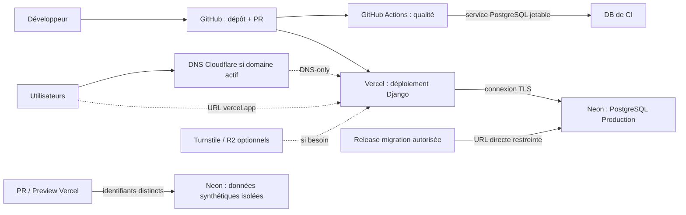
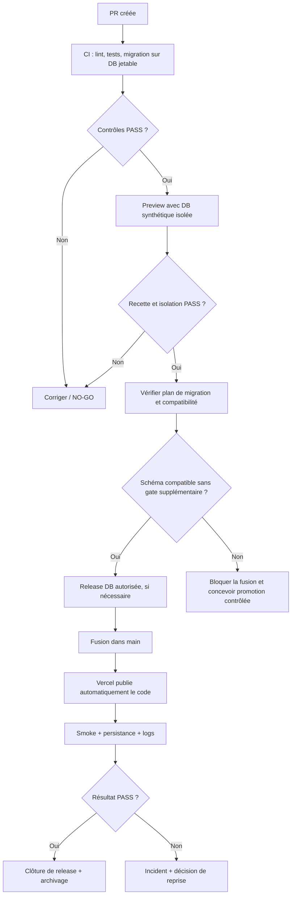
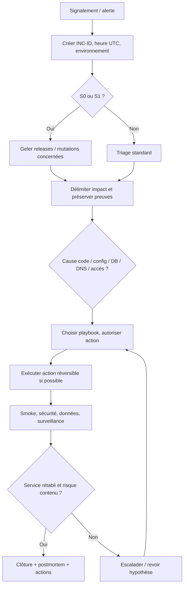
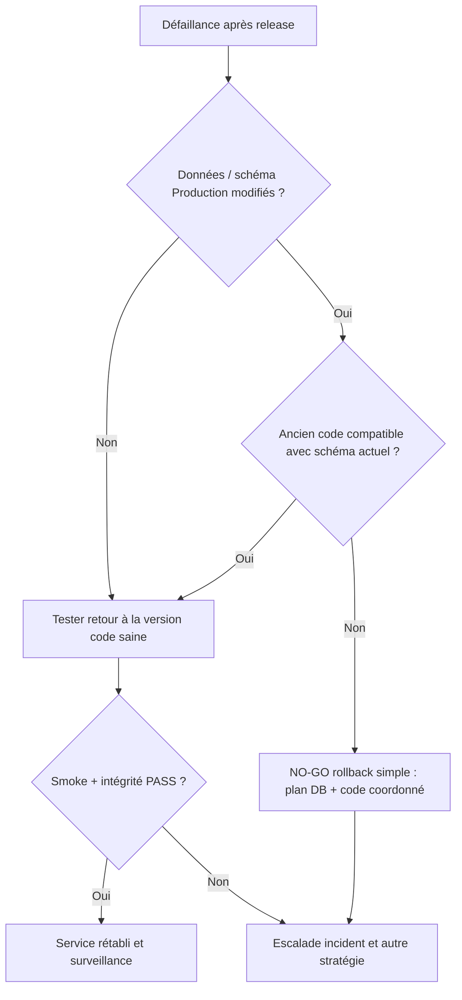

# 07 - Runbook de déploiement et d'exploitation

## Django + GitHub + Vercel + Neon PostgreSQL, Cloudflare conditionnel

| Champ | Valeur |
|---|---|
| Document | `07_RUNBOOK_DEPLOIEMENT_ET_EXPLOITATION.md` |
| Version | 1.0 |
| Date | 18 novembre 2026 |
| Statut | **Procédures proposées, non déployées et non éprouvées en Production** |
| Domaine | Exploitation, release, observabilité, migrations, incidents, sécurité et continuité |
| Architecture de référence | Python 3.12, Django 5.2 LTS, `uv`, GitHub Actions, Vercel, Neon PostgreSQL |
| Cibles | Local / CI / Preview / Production ; Cloudflare seulement si un besoin le justifie |
| Documents sources | `00` à `06` de la série Django / GitHub / Vercel / Neon / Cloudflare |
| Responsable du runbook | **À désigner** |
| Dernier exercice opérationnel | **Non réalisé** |
| Classification | Document partageable sans secrets ni données réelles |

> **But :** permettre à un opérateur autorisé de livrer et de maintenir ce socle Django avec des étapes sûres, des points d'arrêt, des preuves d'exécution et des mécanismes de reprise. Ce manuel est un modèle de travail et **ne constate aucune ressource configurée, aucune permission vérifiée et aucun déploiement effectué**.
>
> **Règle fondamentale :** les déploiements de **code** Vercel et les migrations de **schéma** PostgreSQL sont des événements séparés. Une restauration du code ne restaure pas la base de données. Une Preview ne peut jamais utiliser les identifiants, accéder en écriture ou hériter de données réelles de Production.
>
> **Mode d'emploi :** avant tout premier usage réel, remplacer les champs `[À compléter]`, confirmer les capacités des plans, répéter les opérations sur des environnements isolés, faire approuver les actions sensibles et réunir les preuves décrites ci-dessous. Ne jamais appliquer directement les exemples de commande sur la Production.

---

## 1. Contrat documentaire et hiérarchie des décisions

| Source | Objet réutilisé dans le runbook |
|---|---|
| `00_DJANGO_GITHUB_VERCEL_NEON_CLOUDFLARE_EXPRESSION_DU_BESOIN.md` | `CA-01` à `CA-13`, besoins MVP et contraintes de plan |
| `01_ARCHITECTURE_ET_DECISIONS.md` | `ADR-001` à `ADR-018`, `AT-01` à `AT-15`, arbitrages `OA` |
| `02_BACKLOG_ET_USER_STORIES.md` | EP-00 à EP-09, US-001 à US-052, gates et preuves |
| `03_STRUCTURE_PROJET_ET_CONFIGURATION.md` | Arborescence Django, dépendances, configuration et variables |
| `04_PLAN_IMPLEMENTATION_ET_CI_CD.md` | `ci.yml`, modèle `release-migrate.yml`, séquencement R0 à R5 |
| `05_STRATEGIE_DONNEES_ET_MIGRATIONS.md` | `DATA-INV-01` à `DATA-INV-12`, `DB-001` à `DB-023`, `ISO-01` à `ISO-10`, PITR |
| `06_STRATEGIE_TESTS_ET_ACCEPTATION.md` | `TST-001` à `TST-052`, matrices de recette, statut `PASS/FAIL/BLOCKED/NOT_RUN` |
| **Présent document** | Exécution contrôlée, runbooks d'incident et preuve opérationnelle |

### 1.1 Ordre de préséance

1. Une interdiction de sécurité sur les données, credentials ou environnements prévaut sur le confort opérationnel.
2. Une décision d'architecture explicitement **acceptée** prévaut sur un exemple de fichier provisoire.
3. Un critère de recette du MVP prévaut sur un KPI indicatif ou un délai de livraison.
4. Une fonctionnalité annoncée par un fournisseur n'est pas présumée disponible sur le **compte** ni sur le **plan** réellement utilisé.
5. En cas de doute sur la cible d'une opération mutante : **STOP, identifier, confirmer, demander approbation**.

### 1.2 Périmètre effectif

- **Inclus pour le MVP :** démarrage local, CI GitHub, PR, Preview isolées, Django Vercel, PostgreSQL Neon Production, migrations autorisées, diagnostics, incidents, rollback code, restauration testée, coût et sécurité.
- **Inclus seulement sur activation :** DNS Cloudflare pour un domaine, Turnstile, R2 ou un autre stockage objet.
- **Exclus du MVP :** jobs longs, architecture microservices, fédération d'identité, React/Next séparé, Neon Auth, traitements de données clients comptables ou financières réelles et reprise multi-région contractuelle.
- **Limites :** le présent runbook ne remplace pas une étude de risques RGPD, la politique de sécurité d'une société, un contrat de support ni un PRA testé dans l'environnement réel.

---

## 2. Rôles, habilitations et gouvernance d'exploitation

### 2.1 Rôles opérationnels

| Rôle | Mission | Actions permises par la procédure | Point de vigilance |
|---|---|---|---|
| **Owner** | Approuver l'usage, le risque et le GO / NO-GO | Décider de la mise en Production et d'une restauration ayant un impact sur les données | Ne remplace pas les contrôles techniques |
| **Mainteneur Django** | Développer, tester et analyser le code | PR, tests, corrections, analyse des logs | N'a pas besoin d'accès DDL Production au quotidien |
| **Opérateur de release** | Contrôler la livraison | Vérifier SHA, CI, schéma, release et smoke | Doit pouvoir arrêter la livraison |
| **Opérateur de données** | Administrer Neon et les migrations | Migration autorisée, récupération, analyse du schéma | Accès DDL restreint, responsabilité des pertes possibles |
| **Responsable incident** | Coordonner les urgences | Classifier, communiquer, préserver les preuves, diriger la reprise | Évite les actions simultanées non coordonnées |
| **Relecteur indépendant** | Vérifier changements sensibles | Revue PR, migrations risquées, secrets et dérogations | Indépendance selon taille de l'équipe |

Un mainteneur unique peut cumuler plusieurs rôles lors d'un prototype. Pour toute opération sensible, distinguer explicitement l'auteur de l'action, l'approbateur et l'exécutant dans le registre. Si une double validation n'est pas réellement disponible, documenter ce déficit et refuser les opérations dont le niveau de risque dépasse cette capacité.

### 2.2 RACI simplifié

| Activité | Owner | Mainteneur | Release | Data / DB | Incident |
|---|---|---|---|---|---|
| Décision de mise en ligne | A | C | R | C | I |
| Tests et PR | I | R/A | C | C | I |
| Exécution du déploiement auto | I | C | A / surveillance | C | I |
| Migration Production | A | C | R | R | I |
| Révocation secret compromis | A | R | C | R si DB | R / coordination |
| Rollback du code | A selon gravité | C | R | C | R si incident |
| Restauration de données | A | C | R | R | R / coordination |
| Postmortem | A | R | R | R si pertinent | R |

`R` : exécute ; `A` : répond de la décision ; `C` : consulté ; `I` : informé. Les attributions exactes sont à confirmer avant le premier GO.

### 2.3 Annuaire et escalade à remplir

| Fonction | Titulaire | Canal primaire | Canal de secours | Couverture |
|---|---|---|---|---|
| Owner / décision GO | `[À compléter]` | `[À compléter]` | `[À compléter]` | `[À compléter]` |
| Mainteneur Django | `[À compléter]` | `[À compléter]` | `[À compléter]` | `[À compléter]` |
| Administrateur GitHub | `[À compléter]` | `[À compléter]` | `[À compléter]` | `[À compléter]` |
| Administrateur Vercel | `[À compléter]` | `[À compléter]` | `[À compléter]` | `[À compléter]` |
| Administrateur Neon | `[À compléter]` | `[À compléter]` | `[À compléter]` | `[À compléter]` |
| Administrateur Cloudflare, si activé | `[À compléter]` | `[À compléter]` | `[À compléter]` | `[À compléter]` |
| Responsable incident | `[À compléter]` | `[À compléter]` | `[À compléter]` | `[À compléter]` |

**Interdiction :** ne pas placer d'adresse personnelle, de mot de passe, de token ou de contenu de tickets privés dans la version publique du runbook.

---

## 3. Inventaire opérationnel et sources de vérité

### 3.1 Carte des flux



**Attention :** si Cloudflare reste en mode **DNS-only**, son proxy HTTP et son WAF ne se trouvent pas sur le chemin des requêtes applicatives. Le HTTPS, le CDN et les protections côté hébergement relèvent alors de Vercel. Turnstile et R2 restent indépendamment utilisables si nécessaire.

### 3.2 Registre des ressources à établir avant exploitation

| Ressource | Identifiant public / interne non secret | Région | Environnement | Responsable | État |
|---|---|---|---|---|---|
| Repo GitHub | `[repo à choisir]` | Sans objet | Tous | `[à désigner]` | À configurer |
| Branche Git prod | `main` **proposée** | Sans objet | Production | `[à désigner]` | À confirmer |
| Projet Vercel | `[project à choisir]` | `[à choisir]` | Preview / Production | `[à désigner]` | À configurer |
| URL Vercel prod | `[URL à relever]` | Sans objet | Production | `[à désigner]` | À configurer |
| Projet Neon | `[project à choisir]` | `[à choisir]` | Données | `[à désigner]` | À configurer |
| Branche Neon prod | `[branch à identifier]` | `[à choisir]` | Production | `[à désigner]` | À configurer |
| Base CI | PostgreSQL jetable dans GitHub Actions | CI runner | CI | `[à désigner]` | À configurer |
| Base Preview | `[source synthétique/branches]` | `[à choisir]` | Preview | `[à désigner]` | À configurer |
| Environnement GitHub migration | `production-db` **proposé** | Sans objet | Production | `[à désigner]` | À configurer |
| Zone DNS Cloudflare | `[domaine si nécessaire]` | Sans objet | Optionnel | `[à désigner]` | Non requis MVP |

### 3.3 Classification des paramètres

| Paramètre | Consommateur | Type | Stockage recommandé |
|---|---|---|---|
| `DJANGO_SECRET_KEY` | Django | **Secret** | Variables Vercel / GitHub protégées, chacune selon scope |
| `DATABASE_URL` | Django web | **Secret** | Vercel Production ou Preview uniquement, URLs isolées |
| `DATABASE_URL_UNPOOLED` | Migration DDL | **Secret à accès restreint** | Environnement de migration autorisé, pas PR |
| `DJANGO_DEBUG` | Django | Réglage | `false` Production ; valeur propre à chaque environnement |
| `DJANGO_ALLOWED_HOSTS` | Django | Paramètre sécurité | Liste de domaines explicite, séparée par environnement |
| `DJANGO_CSRF_TRUSTED_ORIGINS` | Django | Paramètre sécurité | Origines HTTPS réelles et précises |
| `APP_ENV` | Django / workflow | Indicateur d'environnement | Production, preview, CI, local |
| `RELEASE_SHA` (si ajouté) | Observabilité | Traçabilité | Métadonnée de déploiement non secrète |
| `CLOUDFLARE_TURNSTILE_SECRET_KEY` | Serveur Django | **Secret** | Scope ciblé, seulement si Turnstile activé |
| Clés de stockage objet | Django si uploads | **Secret** | Scope ciblé, seulement si stockage activé |

Les noms de paramètres reprennent les conventions des documents `03` à `05` ; l'implémentation doit en vérifier la lecture exacte. Ne jamais créer un mot de passe d'exemple qui pourrait être réutilisé en Production. Ne pas afficher la valeur d'une URL Postgres dans un log ou une capture.

### 3.4 Identification non ambiguë de la cible DB

Avant une écriture, conserver **hors secret** l'empreinte attendue de la cible : projet, branche Neon, environnement, nom logique de base et rôle attendu. Comparer l'inventaire aux métadonnées consultables dans Neon et à la configuration du job, sans exposer le hostname ou la chaîne de connexion complète lorsque leur confidentialité le déconseille. Un simple suffixe de variable d'environnement n'est **pas** une preuve suffisante d'identité.

---

## 4. Contrat de disponibilité, surveillance et reprise

### 4.1 Définitions utiles

- **SLO** : objectif mesurable de qualité du service, distinct d'un SLA contractuel.
- **SLI** : mesure observable utilisée pour évaluer le SLO.
- **RPO** : quantité maximale de données qu'une restauration pourrait perdre, exprimée en durée ou en volume.
- **RTO** : durée maximale acceptable pour retrouver le service après incident.
- **MTTR** : durée constatée de résolution d'un incident.
- **Erreur budget** : marge d'indisponibilité liée au SLO, si une telle politique est retenue.
- **Rollback code** : remise en service d'un ancien déploiement Django ; **ne restaure pas PostgreSQL**.
- **PITR** : restauration/branche à un point dans le temps dans les limites et modalités du plan Neon.

### 4.2 Objectifs à arbitrer

| Indicateur | Valeur proposée pour le MVP | Mesure / preuve | Statut |
|---|---|---|---|
| Disponibilité de la page publique | **À définir après mesure** | Sondes HTTP et journal d'incident | Ouvert |
| Temps de réponse | **À définir après mesure** | Latence représentative / percentiles | Ouvert |
| Délai de détection | **À définir** | Événement -> alerte | Ouvert |
| Durée de CI | **À mesurer** | Journaux GitHub | Indicateur, non gate arbitraire |
| Couverture des tests | **À mesurer** | Rapport de tests | Non substituable aux tests critiques |
| RPO | **À décider** après validation de la fenêtre de restauration | Exercice Neon et évaluation des pertes | Bloquant avant données critiques |
| RTO | **À décider** après exercice | Chronomètre incident -> retour au service | Bloquant avant usage sensible |
| Rétention des logs | **À déterminer selon offre et sensibilité** | Paramétrage observabilité | Ouvert |
| Budget / seuils | **À définir selon plan réel** | Tableau fournisseur | Bloquant pour choix de plan |

Ne pas reprendre automatiquement les valeurs RPO/RTO illustrées sur une infographie : **aucun RPO de 5 minutes ni RTO de 30 minutes n'est garanti** par cette architecture ou démontré ici.

### 4.3 Signaux à suivre

1. Build Vercel en échec ; Production active liée au SHA attendu.
2. Taux de réponses HTTP 5xx et erreurs Django répétées.
3. Échecs d'authentification, de CSRF et anomalies de permissions.
4. Erreurs PostgreSQL, temps de réponse DB, saturation des connexions.
5. Migration en échec, délai ou verrouillage anormal.
6. Quotas et coût des fonctions Vercel, stockage/compute Neon, services Cloudflare activés.
7. Nombre de Preview actives, parent Neon autorisé et expiration des ressources.
8. Échecs de tests, anomalies de sécurité ou fuite de données.

### 4.4 Convention d'événements et de preuve

Une trace opérationnelle non sensible doit permettre de rapprocher : `horodatage UTC`, `environnement`, `release_id`, `commit_sha`, `Vercel deployment ID`, `GitHub workflow run`, `migration ID`, `incident_id`, `résultat`. Ne pas joindre la totalité des en-têtes HTTP, cookies, tokens ou chaînes de connexion.

---

## 5. Routines d'exploitation

### 5.1 Avant une release, systématiquement

- [ ] Identifier le responsable de release et le canal d'incident.
- [ ] Vérifier l'état de la CI, des PR et des contrôles de branche.
- [ ] Vérifier l'état des deployments Vercel et la dernière version saine.
- [ ] Contrôler les accès à Neon, les quotas et toute alerte DB.
- [ ] Examiner les migrations du commit et la compatibilité N/N-1.
- [ ] Vérifier l'isolation des Previews et l'absence de données réelles dans les branches temporaires.
- [ ] Confirmer les secrets, les noms d'environnement et la région attendue sans afficher leur contenu.
- [ ] Confirmer que la procédure de reprise applicable est accessible.

### 5.2 Routines quotidiennes ou par journée d'activité

| Contrôle | Action | Prouver par | Si échec |
|---|---|---|---|
| Production | Vérifier page publique et parcours léger autorisé | Statut HTTP / note horodatée | OPS-INC-01/02 |
| Versions | Comparer SHA attendu et version en ligne | GitHub / Vercel | OPS-INC-03 |
| Erreurs | Revoir logs et incidents ouverts | Journal expurgé | Triage |
| DB | Examiner connectivité et erreurs si disponibles | Dashboard Neon | OPS-INC-04 |
| Quotas | Examiner alertes d'usage si pertinentes | Tableau des fournisseurs | OPS-INC-10 |
| Previews | Vérifier durée de vie et suppression des branches liées aux PR fermées | Inventaire | OPS-INC-08 |

**Cadence :** pour un prototype sans trafic, les contrôles quotidiens peuvent être adaptés à l'activité réelle. Pour un service utilisé en continu, prévoir une surveillance compatible avec l'impact attendu. Ne pas prétendre à une surveillance 24h/24 sans dispositif effectif.

### 5.3 Chaque semaine d'exploitation active

- Réconcilier les déploiements, SHA, incidents et migrations de la semaine.
- Vérifier les changements de dépendances et alertes de sécurité connues.
- Revoir permissions administratives et tâches en attente.
- Contrôler le nettoyage des Previews et branches temporaires Neon.
- Revoir usages Vercel/Neon/Cloudflare et éventuels écarts budgétaires.
- Actualiser les actions techniques dans le backlog.

### 5.4 Périodiquement, selon une cadence approuvée

- Exercer un rollback de code sur environnement de test.
- Exercer une restauration Neon vers une **nouvelle branche isolée**.
- Revoir le registre des secrets, leurs propriétaires et dates de rotation.
- Revalider les contrôles de branche GitHub et la protection de l'environnement `production-db`.
- Réévaluer l'adéquation de l'offre Vercel à l'usage personnel ou commercial.
- Tester le canal d'escalade et l'accessibilité des preuves d'exploitation.

La périodicité réelle dépendra du risque, du trafic, du plan et des contraintes contractuelles. Elle doit être inscrite dans un calendrier opérationnel, pas inférée du présent document.

---

## 6. Types de changements et modes de release

### 6.1 Matrice de décision

| Type | Exemple | Chemin de mise en ligne | Gate principal |
|---|---|---|---|
| A - Code seul | Correction de template, test, logique compatible | CI verte -> PR -> merge `main` -> Vercel auto | `CA-05/06/07` |
| B - Configuration | Réglage Django, domaine, variable Vercel | Changement versionné ou paramètre approuvé + redéploiement si requis | Revue des scopes et secrets |
| C - `expand` compatible | Ajouter champ nullable / table | Migration validée et autorisée, code N/N-1 compatibles, release coordonnée | `DATA-INV-05/06/07/12` |
| D - Migration de données | Backfill contrôlé | Test de volume, idempotence, procédure de reprise, autorisation | `DB-006/017` |
| E - `contract` / destructif | Supprimer/renommer champ utilisé | **NO-GO en auto-déploiement simple** sans barrière de promotion ou fenêtre maîtrisée | Compatibilité schéma + restauration |
| F - Incident / hotfix | Erreur de prod ou régression | Triage -> stratégie de correction/rollback -> smoke | Impact données vérifié |
| G - Extension Cloudflare | DNS, Turnstile, R2 | Procédure spécifique conditionnelle | Contrôles SSL, droits et sécurité |

### 6.2 Flux principal du MVP



### 6.3 Contradiction à résoudre avant toute migration à risque

**Auto-déployer `main` et migrer manuellement la base ne garantit aucun ordre atomique.** Les schémas doivent donc rester compatibles avec les versions ancienne et nouvelle pendant la fenêtre de bascule. Une migration incompatible exige un véritable mécanisme de promotion contrôlée et testé sur le plan Vercel choisi, ou une modification de la stratégie de livraison. Ne pas qualifier le workflow d'exemple `release-migrate.yml` de gate complet.

---

## 7. Procédure OPS-REL-01 - Préparer une release de code

### 7.1 Déclencheur, rôles et préconditions

- **Déclencheur :** PR candidate au merge dans `main`.
- **Responsable :** mainteneur, relecteur, opérateur de release.
- **Entrées :** référence PR, SHA immuable, matrice des tests, risque de migration, environnement de test, dernier deployment sain.
- **Préconditions :** politiques d'accès effectives, version connue du code, aucune alerte critique non résolue, état des bases contrôlé.
- **Opérations interdites à cette étape :** migration Production, restauration, changement silencieux d'URL DB, rotation de secret ad hoc.

### 7.2 Checklist d'entrée (REL-PRE)

- [ ] `REL-PRE-01` : le titre et la portée métier de la PR sont documentés.
- [ ] `REL-PRE-02` : le SHA candidat est fixé et visible.
- [ ] `REL-PRE-03` : le branchement `main` est autorisé uniquement via le flux de revue retenu.
- [ ] `REL-PRE-04` : CI lint/tests/migrations PostgreSQL jetable est verte.
- [ ] `REL-PRE-05` : aucun secret ou `.env` réel n'est commité.
- [ ] `REL-PRE-06` : test d'autorisation négatif vert si le changement touche Auth/permissions.
- [ ] `REL-PRE-07` : aucune Preview n'est connectée à Production, preuve d'isolation disponible.
- [ ] `REL-PRE-08` : la Preview comporte des données synthétiques uniquement.
- [ ] `REL-PRE-09` : la PR liste ses migrations Django et leur classification.
- [ ] `REL-PRE-10` : stratégie compatible N/N-1 ou véritable barrière de release validée.
- [ ] `REL-PRE-11` : référentiel des dépendances figé et cohérent avec la cible Vercel.
- [ ] `REL-PRE-12` : les fichiers statiques et templates sont validés sur Preview.
- [ ] `REL-PRE-13` : domaine/HTTPS et règles Django configurées pour l'environnement.
- [ ] `REL-PRE-14` : la release n'est pas un usage commercial incompatible avec le plan.
- [ ] `REL-PRE-15` : la procédure de diagnostic et la version saine précédente sont accessibles.
- [ ] `REL-PRE-16` : un opérateur et un destinataire des alertes sont identifiés.
- [ ] `REL-PRE-17` : la preuve de recette Preview et les anomalies résiduelles sont consignées.
- [ ] `REL-PRE-18` : si données sensibles, accord de gestion des données documenté.

**Décision :** une case critique non vérifiée entraîne `BLOCKED` ou `NO-GO`, jamais une validation implicite.

### 7.3 Commandes de lecture / contrôle en environnement local ou CI

```bash
# Exemple de consultation dans un clone du dépôt ; ne modifie aucune base Production.
uv sync --frozen
uv run --frozen python manage.py check
uv run --frozen python manage.py makemigrations --check --dry-run
uv run --frozen python manage.py test
uv run --frozen ruff check .

# Contrôle de sécurité Django à exécuter avec une configuration de recette
# reflétant Production, mais sans réutiliser ses secrets ni ses données.
uv run --frozen python manage.py check --deploy
```

**Attention :** la commande `check --deploy` suppose des paramètres Production-like réellement injectés. Un succès dans des settings de développement ne valide pas les settings Production. Les commandes `makemigrations --check` et `test` doivent utiliser une base explicitement non productive selon les settings en vigueur.

### 7.4 Preuves à archiver

- `release_id`, SHA de commit et lien de PR.
- Résultat CI, test sécurité, run de migration en DB jetable.
- URL Preview et preuve de séparation de la base.
- Liste des migrations et résultat de compatibilité.
- Décision GO / NO-GO de l'étape de code.

---

## 8. Procédure OPS-REL-02 - Qualifier la Preview

### 8.1 Préconditions

Une Preview Vercel n'est pas automatiquement sûre parce qu'elle dispose d'une URL distincte. **Le nom du déploiement et l'identité de la base sont deux choses différentes.** L'association Vercel/Neon doit être démontrée, que l'on utilise une branche par PR ou une base de test partagée contrôlée.

### 8.2 Checklist

- [ ] La Preview correspond au SHA de la PR, non à un commit antérieur.
- [ ] La configuration de la Preview ne contient aucune valeur de secret Production.
- [ ] La branche/base Neon est dérivée d'une **source synthétique validée**, jamais d'une branche avec données personnelles réelles.
- [ ] Le rôle de connexion de Preview ne peut pas écrire dans Production.
- [ ] Le nom et l'identité de la branche/source sont visibles dans l'inventaire expurgé.
- [ ] Les migrations de Preview sont appliquées uniquement à son environnement.
- [ ] Les tests de sentinelles `PROD_ONLY` et `PREVIEW_ONLY` sont réalisés avec des données de test autorisées, suivant `05`.
- [ ] Les URLs Preview exposant des contenus sensibles sont protégées selon les capacités du plan retenu.
- [ ] CRUD, permissions et templates passent la recette prévue.
- [ ] Les assets statiques fonctionnent.
- [ ] L'URL Preview et les logs ne divulguent aucun secret.
- [ ] La durée de vie de la branche et la procédure de suppression sont enregistrées.

**NO-GO immédiat** si la cible DB de Preview n'est pas prouvée. Il faut suspendre l'accès à la Preview et traiter le cas comme un incident de sécurité potentiel.

### 8.3 Nettoyage d'une Preview

1. Vérifier la clôture ou la fusion de la PR et l'absence de test en cours.
2. Identifier uniquement les ressources associées à la PR concernée.
3. Confirmer qu'aucune ressource temporaire n'est une branche partagée ni Production.
4. Révoquer les credentials temporaires selon la politique.
5. Supprimer ou faire expirer la branche Preview si cette opération est autorisée et sans dépendants.
6. Archiver seulement les identifiants et preuves nécessaires, sans données synthétiques superflues.

**Dépendances :** `US-021`, `US-026`, `US-031`, `DB-009`, `DB-014`, `DB-021`, `ISO-02/03/05/07/10`.

---

## 9. Procédure OPS-REL-03 - Migration PostgreSQL autorisée

### 9.1 Catégories

| Catégorie | Exemple | Autorisation et stratégie |
|---|---|---|
| Additive compatible | Ajout de table ou colonne nullable | CI + compatibilité N/N-1 + validation release |
| Modification de données | Backfill ou recalcul de valeurs | Test d'idempotence, plan de reprise et revue du volume |
| DDL coûteux | Index important, contrainte, type | Étude de verrous, timeout, fenêtre et reprise |
| Contract / destructive | DROP, suppression de colonne, renommage incompatible | **NO-GO avec simple auto-déploiement**, coordination dédiée |

### 9.2 Préflight sans mutation (MIG-PRE)

- [ ] `MIG-PRE-01` : ticket de release et demande de changement identifiés.
- [ ] `MIG-PRE-02` : SHA exact approuvé, non seulement « branche main ».
- [ ] `MIG-PRE-03` : l'exécutant confirme que le SHA effectif du workflow est identique.
- [ ] `MIG-PRE-04` : schéma actuel et historique `django_migrations` consultés.
- [ ] `MIG-PRE-05` : plan de migration produit, relu et sans commande inattendue.
- [ ] `MIG-PRE-06` : migration vérifiée sur PostgreSQL isolé.
- [ ] `MIG-PRE-07` : test de compatibilité code N/N-1 validé.
- [ ] `MIG-PRE-08` : cible Neon Production vérifiée dans l'inventaire et console.
- [ ] `MIG-PRE-09` : rôle DDL spécifique, URL directe si applicable, secrets non affichés.
- [ ] `MIG-PRE-10` : aucun autre opérateur / workflow ne migre Production.
- [ ] `MIG-PRE-11` : état de service et volume estimés, absence d'incident critique en cours.
- [ ] `MIG-PRE-12` : niveau de risque, verrous et éventuels timeouts évalués.
- [ ] `MIG-PRE-13` : fenêtre de changement et communication déterminées.
- [ ] `MIG-PRE-14` : point de récupération et capacité de restauration disponibles et compris.
- [ ] `MIG-PRE-15` : conséquences RPO, données à réconcilier et temps de retour prévus.
- [ ] `MIG-PRE-16` : environnement GitHub protégé effectif **confirmé pour le plan / visibilité du dépôt**.
- [ ] `MIG-PRE-17` : autorisation documentée par un responsable habilité.
- [ ] `MIG-PRE-18` : chemin de reprise en cas de migration interrompue connu.

### 9.3 Exécution proposée

1. Créer le `REL-ID` et figer le SHA à migrer.
2. Charger uniquement les variables de l'environnement **migration Production** protégé.
3. Exécuter les inspections non mutantes sur le schéma et le plan.
4. Faire approuver le plan final par le responsable compétent.
5. Déclencher **une seule fois** le workflow de migration autorisé pour le SHA cible.
6. Suivre en direct le résultat et les signes de verrouillage ou de saturation.
7. Vérifier `showmigrations`, la compatibilité de la version courante et les invariants applicatifs.
8. Autoriser le merge / la promotion de code **seulement dans la séquence compatible prévue**.
9. Consigner statut, durée, SHA, identité expurgée de la DB, résultat et plan de reprise.

> **Avertissement :** le workflow fourni dans `04` est un gabarit `workflow_dispatch`, non une preuve d'un verrou global, d'une revue obligatoire ou d'une promotion atomique. Les options GitHub Environments varient selon plan et visibilité du dépôt. Un changement incompatible doit rester bloqué tant qu'une protection techniquement démontrée n'existe pas.

### 9.4 Commandes de lecture du plan

```bash
# Exemples NON MUTANTS, uniquement après vérification indépendante de la cible.
uv run --frozen python manage.py showmigrations --plan
uv run --frozen python manage.py migrate --plan
uv run --frozen python manage.py makemigrations --check --dry-run

# ATTENTION : la commande suivante MODIFIE le schéma ; ne jamais la lancer
# dans un terminal improvisé, dans le build Vercel ou depuis une PR.
# Elle appartient exclusivement à la procédure de release autorisée :
# uv run --frozen python manage.py migrate --noinput
```

### 9.5 Si une migration échoue

1. Ne pas relancer à l'aveugle : des opérations précédentes peuvent avoir été validées.
2. Suspendre les nouvelles releases et les autres migrations.
3. Préserver les logs et constater exactement les opérations réussies / échouées.
4. Vérifier les changements de schéma partiels et l'état `django_migrations`.
5. Évaluer si le code déjà déployé reste compatible et si des transactions sont bloquées.
6. Choisir entre correction incrémentale, migration compensatoire, fenêtre de maintenance ou restauration contrôlée.
7. Faire approuver la reprise ; documenter chaque nouvelle tentative avec un nouveau run ID.

**Interdit :** utiliser `--fake`, modifier manuellement `django_migrations` ou forcer une restauration dans l'urgence sans diagnostic et autorisation spécifiques.

### 9.6 Contrôle `expand -> migrate -> contract`

- `expand` : introduire un élément compatible avec N et N+1.
- `migrate` : déployer la logique compatible, déplacer les données de manière rejouable et observer.
- `contract` : après vérification qu'aucun code encore servi ne dépend de l'ancien champ, supprimer le chemin ancien dans une release distincte protégée.

Dans un service Django sur Vercel, la coexistence d'anciennes instances/déploiements et le passage d'un alias imposent de contrôler **effectivement** la compatibilité. Le simple fait de constater que la nouvelle version démarre ne suffit pas.

**Dépendances :** `DATA-INV-05/06/07/08/12`, `CA-11`, `DB-001` à `DB-007`, `DB-017/019/020` et `TST-037` à `TST-044`.

---
## 10. Procédure OPS-REL-04 - Fusion et mise en Production sur Vercel

### 10.1 Déclencheur et limites

La fusion de la branche approuvée dans `main` déclenche le déploiement de production Vercel **si** l'intégration GitHub et les paramètres Vercel sont configurés pour cela. Le workflow GitHub Actions `ci.yml` est un contrôle de qualité ; Vercel reste responsable de la construction et de la publication dans le mode Git intégré.

Ne pas supposer que le déploiement est bloqué automatiquement si une CI échoue **après** la fusion. Le parcours normal doit empêcher l'intégration d'une PR non validée au moyen de règles GitHub effectivement appliquées. Des contrôles de promotion avancés peuvent nécessiter un plan ou une configuration supplémentaires.

### 10.2 Étapes

1. Lire et archiver la décision de recette de la PR et le SHA cible.
2. Vérifier l'état de l'instance de Production et l'absence d'incident critique.
3. Confirmer que toute migration requise a été exécutée dans le bon ordre et que N/N-1 sont compatibles.
4. Fusionner la PR selon les règles de branche adoptées ; ne pas contourner le gate CI.
5. Observer la création du nouveau déploiement dans **Vercel -> Project -> Deployments**.
6. Comparer le commit lié au déploiement au SHA effectivement fusionné.
7. Vérifier que le statut de build et la publication ont réussi.
8. Inspecter les journaux de build en cas d'erreur ; ne pas recopier les secrets dans le compte rendu.
9. Vérifier le domaine public, les statiques, l'authentification et la connexion PostgreSQL.
10. Consigner le résultat de smoke tests dans le registre de release.
11. Clôturer la release seulement après la période de surveillance définie.

### 10.3 Informations à relever

| Identifiant | Où le retrouver | Contrôle |
|---|---|---|
| `REL-ID` | Registre de release | Unicité |
| PR et SHA | GitHub | SHA exact |
| Workflow run ID | GitHub Actions | Succès de la CI |
| Déploiement ID / URL | Vercel Deployments | Relié au SHA |
| Domaine servi | Vercel Domains | HTTPS correct |
| Projet et branche Neon | Registre infrastructure | Production, non Preview |
| Migration ID / run ID | GitHub migration / registre | Conforme au code servi |
| Test smoke | Dossier de preuve | `PASS`, horodatage, environnement |

### 10.4 Points d'arrêt

- SHA Production différent du SHA approuvé sans explication contrôlée.
- CI non vérifiable ou règles de fusion contournées.
- Migration en échec ou code incompatible avec le schéma.
- Settings Production absents, `DEBUG=True` ou erreur CSRF/hosts non maîtrisée.
- Serveur OK en HTML mais backend PostgreSQL inaccessible sur un parcours critique.
- Fuite d'information sensible dans les logs ou contenus publics.

**Dépendances :** `CA-02/05/06/07`, `AT-03/06/08`, `US-018` à `US-023`.

---

## 11. Procédure OPS-REL-05 - Smoke tests post-déploiement

### 11.1 Catégories de vérification

| Contrôle | Environnement | Action | Résultat attendu |
|---|---|---|---|
| SMK-01 | Production | Requête HTTPS de la page publique | Réponse conforme, certificat valide |
| SMK-02 | Production | Charger CSS / fichiers statiques | Assets sans erreur de chemin |
| SMK-03 | Production | Accès anonyme à `/admin/` | Redirection vers login ou refus attendu |
| SMK-04 | Production | Connexion d'un compte de test explicitement autorisé, si retenue | Auth fonctionne, aucune fuite d'identifiants |
| SMK-05 | Production | Requête de lecture DB non sensible via un parcours prévu | DB PostgreSQL disponible |
| SMK-06 | Production | Inspecter erreurs applicatives | Absence de régression critique détectée |
| SMK-07 | Production | Relier déploiement au SHA | Correspondance exacte |
| SMK-08 | Production | Vérifier absence de migration automatique au build/runtime | Pas de DDL non autorisée |
| SMK-09 | Production | Vérifier une donnée de référence non sensible présente avant release | Persistance constatée |
| SMK-10 | Preview / CI | Test sentinelle, permissions et base synthétique | Aucune écriture vers Production |
| SMK-11 | Optionnel | Domaine Cloudflare DNS-only, si activé | DNS et HTTPS corrects |
| SMK-12 | Optionnel | Turnstile / stockage objet, si activés | Parcours fonctionnel et permissions contrôlées |

**Politique Production :** les smoke tests sont **non destructifs** par défaut. Aucun test ne doit créer/supprimer des enregistrements réels. Un test d'écriture de démonstration nécessite une décision spécifique, une identité technique autorisée, un marquage clair, un nettoyage vérifié et un contrôle d'absence d'effet sur les autres données.

### 11.2 Exemples de requêtes non mutantes

```bash
# Ne pas mettre de cookie de session ni de token dans l'historique shell.
# Substituer un vrai domaine autorisé et vérifié :
export APP_BASE_URL='https://example-app.vercel.app'

# Entêtes HTTP, puis code de statut ; peut afficher 302 si l'URL redirige.
curl --fail-with-body --silent --show-error --head "$APP_BASE_URL/"

# Vérifier que l'admin n'est pas directement accessible sans session.
# La réponse précise dépend de la configuration Django ; examiner Location.
curl --silent --show-error --head "$APP_BASE_URL/admin/"
```

Les URLs et réponses doivent être vérifiées par l'opérateur : certaines implémentations peuvent refuser `HEAD`, appliquer une protection de déploiement ou des redirections. Ne pas déclarer un échec DNS sur le seul constat d'un code HTTP différent de 200.

### 11.3 Résultat

- `PASS` : comportement attendu et preuve disponible.
- `FAIL` : comportement incorrect démontré.
- `BLOCKED` : vérification impossible pour un motif documenté.
- `NOT_RUN` : vérification non exécutée.

En cas de `FAIL` sur un critère critique, déclencher l'incident, suspendre les nouvelles releases et choisir la stratégie de reprise. Un smoke `PASS` ne remplace pas les 13 critères de recette du MVP.

---

## 12. Procédure OPS-OBS-01 - Diagnostic et journaux

### 12.1 Où enquêter

| Symptôme | Première source | Deuxième source |
|---|---|---|
| Build échoue | Logs de build Vercel | CI GitHub / dépendances |
| HTTP 500 en Production | Vercel Runtime Logs | Logs Django / accès Neon |
| Pages sans CSS | Build `collectstatic`, URL statique | Fichiers versionnés / config `STATIC_ROOT` |
| Connexion utilisateur échoue | Logs Django, cookies/CSRF | Domaines et settings |
| Requête DB échoue | Logs d'erreur Django | Projet/branche et métriques Neon |
| Migration échoue | Run `release-migrate.yml` | Historique `django_migrations` / locks |
| Preview inattendue | Vercel Deployment + variables scope | Neon branches / credentials |
| Coût augmente | Tableaux d'usage fournisseurs | Logs, branches temporaires, trafic |

### 12.2 Processus d'investigation

1. Identifier l'environnement impacté et l'heure de début, en UTC.
2. Identifier la release et le SHA actif, puis comparer avec le dernier état sain.
3. Déterminer si le défaut apparaît au build, à l'exécution, dans PostgreSQL ou dans le réseau/DNS.
4. Délimiter l'impact : public/admin/CRUD/une PR/tous les utilisateurs.
5. Consulter logs et indicateurs sur une fenêtre ciblée, sans télécharger inutilement de données privées.
6. Formuler une hypothèse et la tester avec une action non destructive.
7. Définir le plan de correction et le point d'arrêt en cas d'aggravation.
8. Après correction, répéter les smoke tests et documenter le résultat.

### 12.3 Exemples CLI optionnels

```bash
# Requiert une installation et une authentification CLI déjà validées.
# Commandes de consultation uniquement ; les options doivent être
# confirmées par la version de la CLI réellement installée.
vercel inspect <deployment-id-or-url>
vercel logs --environment production --level error --since 1h

# CLI GitHub, facultatif :
gh run list --branch main --limit 10
```

Pour les logs Vercel, vérifier les filtres réels de la version de la CLI et des plans. Les logs de build et les logs d'exécution sont des sources distinctes. Les journaux peuvent avoir des limitations de rétention et de consultation selon l'offre.

### 12.4 Confidentialité des logs

Ne jamais journaliser : `DJANGO_SECRET_KEY`, URL complète de Postgres, mot de passe, token d'API, contenu de cookie de session, valeurs de carte bancaire, email personnel ou données métier sensibles sans base légitime. Une trace structurée doit privilégier identifiant de requête, type d'erreur, durée, SHA et identifiant technique non sensible.

---

## 13. Gouvernance des incidents

### 13.1 Sévérité et urgence

| Niveau | Définition proposée | Exemples | Réponse |
|---|---|---|---|
| **S0 - Critique** | Risque de fuite, mutation Production depuis Preview/CI ou perte de données étendue | Credentials Production dans une PR, Preview écrivant dans Production, suppression de données | Suspendre mutation/exposition, mobiliser Owner + Incident + DB |
| **S1 - Majeur** | Parcours métier critique indisponible, migration Production bloquante ou faille d'accès active | Application inutilisable, CRUD fortement dégradé, auth vulnérable | Stopper releases, restaurer le service selon procédure |
| **S2 - Significatif** | Fonction partielle défaillante avec contournement maîtrisé | CSS cassé, page secondaire en panne | Triage, correctif planifié et suivi |
| **S3 - Mineur** | Anomalie sans impact significatif ou signal préventif | Avertissement isolé, amélioration documentaire | Backlog normal |

La sévérité exacte et les délais de réponse doivent être adaptés à l'utilisation réelle. Ne pas annoncer un engagement de support que l'équipe ne sait pas tenir.

### 13.2 Flux générique OPS-INC-00



### 13.3 Protocole immédiat

1. Ouvrir un ticket incident avec un identifiant `INC-YYYYMMDD-NN` et un responsable.
2. Fixer l'heure initiale en UTC et le périmètre impacté.
3. Pour S0/S1, demander le gel des opérations de mutation ou de release susceptibles d'aggraver l'impact.
4. Préserver les logs, SHA, identifiants de déploiement, runs CI et événements DB ; expurger les valeurs sensibles.
5. Ne pas mener plusieurs réparations concurrentes sans coordination.
6. Définir une hypothèse, la preuve et l'action de reprise la moins risquée.
7. Informer les personnes ou services concernés si nécessaire, selon les obligations applicables.
8. Constater la reprise, l'intégrité des données, l'absence de faille active et la surveillance stabilisée.
9. Lancer un postmortem proportionné à la gravité.

### 13.4 Politique de communication

Une communication doit distinguer **ce qui est observé**, **ce qui est encore suspecté**, **les actions réellement exécutées** et **la prochaine décision**. Ne jamais annoncer « données intactes » tant que les contrôles d'intégrité n'ont pas été effectués. Pour les incidents de confidentialité, suivre les obligations de notification applicables avec l'intervenant compétent.

---

## 14. Playbooks d'incident applicatif et de déploiement

### OPS-INC-01 - Erreurs HTTP 500 / application Django indisponible

**Détection :** hausse de 5xx, page publique ou CRUD injoignable, exception Django.

1. Identifier le SHA et le premier événement anormal.
2. Consulter les Runtime Logs Vercel et les logs Django pour la fenêtre concernée.
3. Vérifier paramètres indispensables, import Python, templates, dépendances et état Neon sans divulguer de secrets.
4. Comparer à la release précédente et tester un parcours sans écriture.
5. Si le code est la cause et que le schéma reste compatible, appliquer OPS-ROLL-01.
6. Si le problème est DB, appliquer OPS-INC-04 et ne pas lancer de rollback automatique de schéma.
7. Vérifier service, auth, CRUD lecture et statiques après reprise.

**Ne pas faire :** redémarrer ou redéployer en boucle sans hypothèse, afficher les settings en log ou réinitialiser la base.

**Preuve :** logs expurgés, SHA, disponibilité après correction, résultat des smokes.

### OPS-INC-02 - Build Vercel ou fichiers statiques en échec

**Détection :** échec de construction, erreur de résolution du module Python, fichiers CSS/JS absents.

1. Ouvrir les logs du déploiement candidat (et non uniquement ceux de Production).
2. Comparer versions Python, Django et `uv.lock` à celles approuvées.
3. Vérifier `manage.py`, `config/wsgi.py` ou `asgi.py` et settings effectivement lus.
4. Contrôler `STATIC_ROOT`, `STATIC_URL`, les dépendances et le résultat `collectstatic`.
5. Corriger dans une nouvelle PR, tester en Preview.
6. Laisser la dernière Production saine intacte ; ne pas promouvoir le candidat défaillant.

**Ne pas faire :** ajouter sans justification une ancienne configuration `api/` ou supprimer le lockfile pour masquer une incompatibilité.

### OPS-INC-03 - Mauvaise version ou déploiement inattendu

**Détection :** version servie ne correspond pas au commit attendu, release non autorisée, alias pointant vers le mauvais déploiement.

1. Vérifier l'historique GitHub, les règles de branche, l'intégration Git/Vercel, les événements de promotion/rollback.
2. Relever SHA réellement servi et URL exacte de déploiement.
3. Évaluer si un changement de schéma a été appliqué entre les versions.
4. Geler les merges et les migrations tant que la cause n'est pas comprise.
5. Remettre en service la version saine **seulement si compatible DB**, via OPS-ROLL-01.
6. Corriger les permissions et protections ayant permis la publication inattendue.

**Ne pas faire :** supposer qu'un rollback de code suffit si une migration destructive a eu lieu.

### OPS-INC-04 - Connexion ou performance PostgreSQL Neon dégradée

**Détection :** erreurs de connexion, timeout, nombre de connexions élevé, CRUD indisponible.

1. Vérifier si la défaillance est limitée à une Preview ou concerne Production.
2. Vérifier l'état du projet/compute/branche/endpoint Neon et le bon environnement.
3. Consulter les métriques, logs et erreurs sans afficher `DATABASE_URL`.
4. Examiner pooling, connexions Django, latence de région, charge et éventuelle requête lente.
5. Éviter de multiplier les redéploiements et d'ouvrir des connexions de diagnostic en masse.
6. Appliquer une correction réversible validée, par exemple configuration ou charge, sans modifier les permissions de production au hasard.
7. Si risque de perte/corruption de données, passer au playbook OPS-INC-07.

**Ne pas faire :** basculer silencieusement en SQLite ou dans une base de Preview.

### OPS-INC-05 - Échec de migration / verrou SQL

**Détection :** job migration rouge, opération SQL suspendue, verrou et impact sur les requêtes.

1. Stopper autres migrations et nouvelles releases.
2. Consulter logs et historique DB pour reconnaître un état partiel.
3. Identifier SQL, transaction, durée, requêtes bloquées et impact sur les utilisateurs.
4. Préserver un état de preuve avant toute nouvelle commande.
5. Vérifier si la migration est transactionnelle, idempotente et si des données ont changé.
6. Choisir reprise contrôlée, migration compensatoire ou restauration isolée avec l'opérateur DB.
7. Refaire tests N/N-1 et smokes après la résolution.

**Ne pas faire :** tuer des connexions PostgreSQL arbitrairement, faire `migrate --fake`, nettoyer `django_migrations` ou relancer sans diagnostic.

### OPS-INC-06 - Authentification, CSRF ou permissions défaillantes

**Détection :** connexion impossible, `DisallowedHost`, 403 CSRF, accès Admin non autorisé.

1. Vérifier les domaines, origines HTTPS, cookies, proxy effectivement utilisé, `ALLOWED_HOSTS`, `CSRF_TRUSTED_ORIGINS` et `DEBUG`.
2. Identifier si le problème est limité au domaine personnalisé ou présent également sur `vercel.app`.
3. Tester les parcours anonymes et authentifiés sans diffuser de mot de passe.
4. Si un accès non autorisé a été possible, classer S0/S1 selon l'impact et préserver les preuves.
5. Corriger la configuration via le canal approprié, contrôler session/cookie/CSRF, redéployer si requis.
6. Tester que les refus d'accès restent effectifs et que les comptes ne sont pas exposés.

**Ne pas faire :** désactiver `CSRF` ou `DEBUG=False` pour contourner l'incident, exposer temporairement `/admin/` à tous.

---

## 15. Playbooks d'incident données, sécurité et infrastructure

### OPS-INC-07 - Suppression accidentelle, corruption ou écriture indue en Production

**Détection :** intégrité métier compromise, table supprimée, mutation injustifiée.

1. Classer l'incident S0 ou S1 selon sa gravité ; nommer un incident commander.
2. Suspendre ou restreindre les écritures **selon une méthode validée**, sans laisser un processus critique continuer à altérer les données.
3. Préserver horodatage, SHA, opération suspecte, métriques et journaux.
4. Identifier la dernière version saine de la donnée et la fenêtre de restauration disponible.
5. Créer une **branche de récupération isolée** à un point sélectionné, avec accès restreint.
6. Vérifier cohérence du schéma et des données sur cette branche.
7. Comparer les changements valides intervenus depuis le point de restauration et définir leur réconciliation.
8. Choisir entre correction ciblée, restitution partielle contrôlée ou bascule/restauration complète, avec approbation.
9. Exécuter seulement ensuite la procédure de reprise autorisée, conserver les preuves et informer les parties concernées.

**Ne pas faire :** restaurer directement Production en écrasant des écritures récentes ou sélectionner arbitrairement un point sans mesurer la perte.

### OPS-INC-08 - Preview connectée à Production ou branche avec données réelles

**Détection :** environnement Preview partage credentials/endpoint Production, contient des données réelles ou dispose de droits d'écriture vers Production.

1. **S0 par défaut jusqu'au diagnostic :** suspendre la Preview et révoquer les accès temporaires concernés.
2. Geler toutes les migrations et tests en cours sur cet environnement.
3. Relever la fenêtre d'exposition, les droits effectifs, les données potentiellement accessibles et les opérations effectuées.
4. Préserver les logs sans les diffuser publiquement ; vérifier les accès selon les règles de confidentialité.
5. Rotater les credentials potentiellement exposés, en coordonnant avec les connexions légitimes.
6. Ne recréer de Preview qu'avec une source synthétique indépendante et une politique d'isolation testée.
7. Exécuter `ISO-02/03/04/05/10`, `DB-009/011/014` et `TST-030/031/032`.
8. Déterminer s'il existe un incident de données personnelles nécessitant un traitement spécifique.

**Ne pas faire :** considérer « branchée en lecture seule » comme intrinsèquement acceptable pour une Preview contenant des données sensibles, ou supprimer les journaux avant enquête.

### OPS-INC-09 - Fuite de token, mot de passe ou variable d'environnement

**Détection :** secret commité, affiché dans un run GitHub, log Vercel, ticket ou capture.

1. Qualifier le niveau de portée et traiter le secret comme **compromis**.
2. Restreindre immédiatement les accès exposés lorsque cela n'aggrave pas un incident en cours.
3. Révoquer ou faire tourner le secret sur le fournisseur concerné.
4. Mettre à jour les environnements autorisés avec une nouvelle valeur, sans la copier dans Git ou un ticket.
5. Redéployer les instances qui doivent utiliser la nouvelle valeur, puis vérifier la connectivité et les permissions.
6. Contrôler les logs et activités pour détecter un usage abusif.
7. Purger ou restreindre les artefacts contenant le secret selon les possibilités ; ne pas considérer la suppression d'un commit comme suffisante.
8. Ajouter une règle de prévention (scan, permissions, secret scoping, revue des logs).

**Ne pas faire :** partager l'ancien secret dans le canal d'incident ou réutiliser l'identifiant compromis après « nettoyage » du dépôt.

### OPS-INC-10 - Quotas dépassés, coûts anormaux ou abus de trafic

**Détection :** dépenses inattendues, consommation de fonctions, stockage, branches/compute Neon ou requêtes réseau anormales.

1. Examiner les données d'usage du fournisseur et l'historique d'événements récents.
2. Identifier la ressource ou le chemin applicatif responsable de la hausse.
3. Contrôler les branches Preview orphelines, boucles d'appel et fonctions exécutées trop souvent.
4. Si abus applicatif, envisager rate limiting, Turnstile ou protection adaptée aux besoins.
5. Stopper les ressources temporaires uniquement après preuve qu'elles ne sont pas utilisées.
6. Mettre à jour les seuils d'alerte et le budget, puis réévaluer le plan si l'usage devient commercial.

**Ne pas faire :** supprimer Production ou un objet de stockage sans vérification sous prétexte de réduire la facture.

### OPS-INC-11 - Domaine DNS ou HTTPS défaillant (si Cloudflare activé)

**Détection :** domaine personnalisé ne résout pas, erreur de certificat, redirections ou caches incohérents.

1. Tester l'URL native `vercel.app` pour isoler application et DNS.
2. Vérifier que le domaine est déclaré dans Vercel et que les enregistrements DNS correspondent aux instructions du projet.
3. Si la stratégie reste DNS-only, vérifier que les entrées pertinentes ne sont pas proxifiées.
4. Examiner délégation DNS, propagation, certificat et règles de redirection.
5. Ne pas activer le proxy Cloudflare/WAF sans ADR et tests spécifiques.
6. Documenter résolution effective et contrôle HTTPS sur le domaine personnalisé.

**Ne pas faire :** ajouter des couches proxy au hasard ; elles peuvent compliquer cache, adresse IP et certificats.

---

## 16. Procédure OPS-ROLL-01 - Rollback du code Vercel

### 16.1 Applicabilité

**Admissible sous conditions :** erreur attribuée au code ou à sa configuration ; ancienne version identifiée ; schéma PostgreSQL toujours compatible ; état des secrets et données pris en compte. Le rollback peut être effectué par les mécanismes de promotion/Instant Rollback réellement disponibles sur le plan Vercel ou par une release corrective selon la stratégie de production.

**Non admissible comme solution unique :** migration destructive, corruption de données, secret compromis non révoqué, modification irréversible externe, problème de disponibilité Neon indépendant du code.

### 16.2 Préflight ROLL-PRE

- [ ] Incident ID et responsable de reprise identifiés.
- [ ] Déploiement actuel et dernier déploiement sain identifiés par leurs IDs et SHA.
- [ ] Historique des migrations intervenues depuis la version saine contrôlé.
- [ ] Compatibilité code précédent / schéma courant prouvée.
- [ ] Effets de bord et éventuelles écritures créées par la nouvelle version évalués.
- [ ] Aucune donnée ne nécessite une restauration simultanée implicite.
- [ ] Méthode exacte de rollback et capacité de l'offre Vercel confirmées.
- [ ] Opérateur habilité et décision approuvée.

### 16.3 Étapes

1. Geler les merges et interventions concurrentes pendant l'incident.
2. Relever l'URL de déploiement sain et son SHA.
3. Vérifier le contrat de compatibilité avec le schéma actuel Neon.
4. Choisir le mécanisme Vercel autorisé : rollback instantané depuis le dashboard ou commande CLI validée, selon le projet.
5. Exécuter une seule action de retour arrière ; ne pas redéployer en boucle.
6. Vérifier que les domaines Production pointent vers la version voulue.
7. Exécuter les smoke tests publics, droits, DB lecture et statiques.
8. Surveiller erreurs et comportements métier après rétablissement.
9. Enregistrer la décision, le déploiement final et les actions correctives futures.

### 16.4 Exemple CLI indicatif, **à ne pas exécuter sans autorisation**

```bash
# Documentation seulement ; ne pas exécuter dans un environnement inconnu.
# Confirmer préalablement l'identité du projet, les droits et la compatibilité DB.
# vercel rollback <deployment-id-or-url>
```

Vercel documente le rollback des déploiements de Production ; sa disponibilité et son comportement exact peuvent dépendre de la configuration et du plan. Privilégier l'interface officielle pour confirmer visuellement le projet, la cible et la version.

### 16.5 Exemple d'arbre de décision



**Références :** `CA-12`, `AT-13`, `DATA-INV-08/12`, `DB-019/020`, `TST-039/043`.

---

## 17. Procédure OPS-DATA-01 - Restauration Neon non destructive

### 17.1 Objectif et périmètre

Tester ou préparer une restauration à partir d'un point antérieur dans les limites de conservation réellement offertes par Neon. La première étape de récupération **crée une nouvelle branche de comparaison** ; elle ne remplace pas et n'efface pas Production.

Toute opération de *reset*, restauration en place, repointage de l'application ou réécriture de Production est une **action distincte à risque élevé** qui nécessite un plan d'approbation et d'intégrité, non une sous-étape automatique.

### 17.2 Préconditions

- [ ] Incident ou exercice identifié, Owner et opérateur DB disponibles.
- [ ] Projet et branche source connus, vérifiés indépendamment.
- [ ] Fenêtre de restauration, plan et limites Neon consultés à la date d'exécution.
- [ ] Horodatage du point candidat et justification technique établis.
- [ ] Impacts métier et données apparues depuis le point candidat identifiés.
- [ ] Nouvelle branche de récupération prévue sous un nom distinct et non ambigu.
- [ ] Accès à cette branche limité aux opérateurs autorisés.
- [ ] Compte rendu contient la décision de non-mutation de Production.

### 17.3 Exercice de reprise

1. Accéder au projet Neon dans un espace d'administration autorisé.
2. Confirmer la branche source, sa région et la fenêtre de restauration possible.
3. Choisir un point cohérent, guidé par les journaux de l'incident ou par un jeu de données fictives pour l'exercice.
4. **Créer une branche historique / récupération isolée** selon les mécanismes disponibles sur le compte.
5. Confirmer la création et vérifier que Production n'a pas été modifiée.
6. Connecter un environnement d'analyse dédié à cette branche et seulement avec des credentials temporaires adaptés.
7. Vérifier présence des tables attendues, cohérence de `django_migrations`, invariants du modèle `Record` et échantillons de référence autorisés.
8. Mesurer le délai réel de récupération, l'écart de données et les opérations supplémentaires requises.
9. Évaluer l'adéquation au RPO/RTO défini ; noter explicitement tout écart.
10. Révoquer les accès temporaires et nettoyer la branche selon la politique approuvée, une fois les preuves conservées.

### 17.4 En cas de reprise effective Production

**Arrêt obligatoire avant mutation.** Produire un plan de remédiation contenant :

- L'étendue des utilisateurs et écritures affectées.
- Les données valides enregistrées après le point de restauration.
- Les pertes attendues, les données à rejouer et les reconciliations métier.
- Les migrations incompatibles et la version de code cible.
- Les contrôles d'intégrité, clés étrangères, contraintes et sessions utilisateurs.
- La stratégie de bascule, de sauvegarde de l'état courant, de vérification et d'échec.
- Les décisions et approbations du responsable de données.

Ne jamais prétendre qu'un PITR « ne perd rien » par principe : restaurer un état antérieur peut omettre des écritures légitimes postérieures. Les mécanismes de Neon varient selon l'historique conservé et les fonctionnalités du compte.

### 17.5 Cas particuliers

| Incident | Approche préférée initiale | Point de contrôle |
|---|---|---|
| Mauvaise migration avec perte de colonne | Branche au point antérieur et analyse | Compatibilité schéma/code |
| Suppression d'enregistrements | Branche historique, comparaison et restitution ciblée si possible | Réconciliation des écritures valides |
| Données altérées depuis plusieurs jours | Plusieurs points candidats analysés | Identifier le dernier état sain |
| Panne sans corruption de données | Rétablir la disponibilité avant toute restauration | Éviter de créer une perte inutile |
| Compromission de credentials | Rotation et analyse d'accès | Ne pas utiliser la restauration à la place de la révocation |

**Références :** `DATA-INV-09`, `DB-018`, `TST-042`, `CA-12`, `US-029`.

---

## 18. Procédure OPS-SEC-01 - Rotation des secrets et révocation

### 18.1 Typologie

| Type | Rotation / action | Impact à anticiper |
|---|---|---|
| Mot de passe du rôle web Neon | Nouveau credential et mise à jour du `DATABASE_URL` ciblé | Redéploiement/reconnexion Django ; pool de connexions |
| Credential de migration Neon | Nouveau credential DDL dédié au canal de release | Jobs de migrations ; séparation web/DDL |
| `DJANGO_SECRET_KEY` | Rotation coordonnée, stratégie Django si fallback adapté | Sessions, tokens ou signatures dépendantes de la clé |
| Token GitHub ou Vercel | Révocation, nouveau token minimal | Workflows, intégrations, CLI |
| Cloudflare API token | Révocation / nouvelle clé de scope limité | DNS ou services edge optionnels |
| Clé Turnstile | Rotation et nouvelle vérification serveur | Formulaires publics si activés |
| Clés R2 | Rotation progressive | Uploads/downloads autorisés |

**Important Django :** changer `SECRET_KEY` peut invalider les sessions et autres valeurs signées. La possibilité d'utiliser `SECRET_KEY_FALLBACKS` dépend du contexte, de la version et de la tolérance au risque ; une clé **compromise** ne doit pas rester acceptée aveuglément comme fallback.

### 18.2 Procédure standard

1. Déclencher une demande de changement ou un incident en cas de fuite.
2. Identifier le secret concerné, tous ses consommateurs et les environnements dans lesquels il est présent.
3. Vérifier les droits nécessaires pour créer une nouvelle valeur sans l'exposer.
4. Générer / renouveler le secret dans le gestionnaire approprié, avec accès minimal.
5. Mettre à jour les scopes ciblés et redéployer/relancer les services concernés si nécessaire.
6. Vérifier le fonctionnement de Production/Preview sans afficher le secret.
7. Révoquer définitivement l'ancienne valeur ; ne pas la laisser en circulation dans un fallback non justifié.
8. Tester qu'aucun workflow PR ou Preview ne peut récupérer un secret Production.
9. Enregistrer la date et le propriétaire sans la valeur du secret.

### 18.3 Incident de rotation échouée

Si une nouvelle clé brise la Production, ne pas simplement réactiver une clé potentiellement compromise. Faire un diagnostic des connexions/cookies, restaurer la disponibilité par une voie conforme au niveau de compromission, puis effectuer un contrôle d'accès indépendant.

### 18.4 Registre de rotation

| Rotation ID | Type | Scope | Déclencheur | Approbateur | Statut | Preuve de révocation |
|---|---|---|---|---|---|---|
| ROT-EXEMPLE | `[secret]` | `[prod / preview / CI]` | `[planifiée / incident]` | `[rôle]` | `NOT_RUN` | `[lien expurgé]` |

Ne pas stocker l'identifiant complet du credential lorsqu'il constitue une information sensible. Le registre ne doit jamais conserver la valeur elle-même.

---

## 19. Procédure OPS-CF-01 - Cloudflare, si le besoin est établi

### 19.1 Activer un domaine avec DNS-only

- [ ] Le domaine possède un titulaire et un administrateur identifiés.
- [ ] Le domaine est déclaré dans Vercel et l'état de validation est consulté.
- [ ] Les records DNS requis proviennent des instructions du **projet Vercel** réel.
- [ ] Les enregistrements gérés par Cloudflare sont configurés en **DNS-only** pour la première mise en ligne.
- [ ] Les éventuels CAA, sous-domaines et records concurrents sont revus.
- [ ] Résolution DNS, certificat HTTPS et redirections testés.
- [ ] Les variantes `www` et apex reçoivent un traitement explicite.
- [ ] Les settings Django `ALLOWED_HOSTS` et `CSRF_TRUSTED_ORIGINS` sont mis à jour.
- [ ] Un plan de retour au domaine Vercel est documenté si une panne DNS survient.

**Précision :** Cloudflare DNS-only ne fournit pas le WAF Cloudflare sur les requêtes vers Vercel. L'activation du proxy orange relève d'un ADR distinct, avec analyse des doubles proxys/CDN/TLS.

### 19.2 Ajouter Turnstile

1. Confirmer que le formulaire est réellement public et exposé à un risque d'automatisation.
2. Ajouter le widget côté frontend et le contrôle du token **côté serveur** Django.
3. Stocker la clé secrète exclusivement côté serveur.
4. Exercer les cas token absent, invalidé, expiré ou réutilisé selon le comportement du service.
5. Mesurer les faux positifs et définir une procédure de support.

### 19.3 Ajouter du stockage objet

1. Confirmer les usages de médias utilisateurs et les volumes.
2. Comparer **R2**, **Neon Object Storage** et alternatives ; choisir **un** stockage initial selon les besoins.
3. Définir les droits, durées de conservation, chiffrement, restrictions d'upload et suppression.
4. Prévoir les transferts directs ou adaptés pour les fichiers dépassant les limites de payload des Vercel Functions.
5. Ne pas conserver les uploads dans le système de fichiers éphémère de Vercel.
6. Tester accès, refus, suppression, reprise et coûts.

### 19.4 Quand ne rien activer

Si l'application utilise uniquement un domaine `vercel.app`, des templates Django et des enregistrements PostgreSQL sans uploads publics, **aucun service Cloudflare n'est requis** pour valider le MVP. L'absence de Cloudflare ne constitue pas un échec des 13 critères `CA`.

---

## 20. Mesures, observabilité et tableaux de bord

### 20.1 Dashboard opérationnel minimal

| Carte / indicateur | Source | Granularité suggérée | Action si anomalie |
|---|---|---|---|
| Déploiement Production actuel + SHA | Vercel / GitHub | À chaque release | OPS-INC-03 |
| CI `main` et PR candidates | GitHub Actions | À chaque PR / merge | Bloquer fusion ou release |
| Erreurs HTTP 5xx | Vercel Runtime Logs | Fenêtre récente disponible | OPS-INC-01 |
| Durée et erreurs des fonctions Django | Vercel | Fenêtre disponible | Diagnostic performance |
| État des bases et connexions | Neon | Selon métriques de l'offre | OPS-INC-04 |
| Historique et résultat des migrations | GitHub / Django | À chaque migration | OPS-INC-05 |
| Branches Preview et provenance | Neon + GitHub | Fermeture PR / revue périodique | OPS-INC-08 |
| Tests d'isolation Preview / Prod | Dossier QA | À chaque configuration majeure | NO-GO si non prouvés |
| Usage et quotas | Fournisseurs | Revue périodique | OPS-INC-10 |
| Incidents ouverts | Registre interne | Lorsqu'un incident existe | Escalade selon sévérité |

### 20.2 Contrat de logs JSON applicatifs

Champs suggérés :

```json
{
  "timestamp_utc": "[ISO-8601]",
  "severity": "ERROR",
  "environment": "production",
  "service": "django-web",
  "release_sha": "[sha-public-ou-partiel]",
  "request_id": "[id-technique-opaque]",
  "event_type": "db_connection_failure",
  "duration_ms": null,
  "error_class": "[classe-non-sensible]",
  "message": "[description-expurgee]"
}
```

Ne pas considérer ce JSON comme le schéma natif imposé par Vercel : il s'agit d'une **convention applicative proposée**. Un logger Django, un middleware de corrélation et la collecte côté plateforme doivent être configurés et testés séparément.

### 20.3 Alertes conditionnelles

Une alerte doit posséder au minimum un signal observé, une condition, un propriétaire, un canal de notification et un playbook associé. Si le plan fournisseur ne permet pas une alerte automatique, inscrire une revue manuelle explicite. Éviter d'annoncer « alerte activée » sur la seule base de sa présence dans le tableau.

---

## 21. Sécurité permanente de l'exploitation

### 21.1 Accès

- Comptes administrateurs individuels de préférence, authentification multifacteur lorsque possible.
- Permissions minimales par fournisseur et par environnement.
- Aucun secret de Production dans les jobs `pull_request` non fiables.
- Protection des environnements de déploiement si réellement disponible sur le plan GitHub.
- Revue des collaborateurs et des tokens à la sortie d'un membre ou d'une prestation.
- Journalisation proportionnée des opérations mutantes, sans divulgation de secret.

### 21.2 Données

- Aucun clone de Production vers Preview sans décision explicite sur la confidentialité ; pour le MVP, **interdit**.
- Aucune donnée personnelle réelle dans les fixtures de CI ou de Preview.
- Suppression contrôlée des branches temporaires pour éviter coûts et exposition.
- Accès DBA et opérations de restore limités aux personnes autorisées.
- Politique de résidence géographique et de conservation à réviser avant données clients réelles.

### 21.3 Application

- `DEBUG=False` Production ; contrôles Django `check --deploy` réellement exécutés.
- HTTPS, cookies, CSRF, `ALLOWED_HOSTS` et permissions côté serveur.
- Contrôles des dépendances et changements de configuration par PR lorsque possible.
- Fonction `/admin/` protégée, accès anonyme refusé.
- Pas de dépendance à un système de fichiers persistant sur Vercel pour les données métier.

### 21.4 Changement d'usage vers un SaaS commercial

Avant une application commerciale ou comptable traitant des utilisateurs ou données sensibles : réévaluer le plan Vercel et ses conditions d'usage, la confidentialité, la sauvegarde, la traçabilité d'audit, la gestion des accès, l'isolation des tenants, le support et les mécanismes de récupération. Le starter n'est pas automatiquement apte à un service financier critique.

---

## 22. Politique de conservation et d'audit

| Artefact | Contenu autorisé | Lieu proposé | Durée |
|---|---|---|---|
| Rapport de release | SHA, PR, résultats et validations | Dossier privé versionné ou espace documentaire adapté | À définir |
| Rapport d'incident | Chronologie, mesures, impact et corrections | Registre incident privé | À définir |
| Run de CI | Résultats tests / contrôles sans secrets | GitHub Actions + export minimal | Selon plan / politique |
| Logs runtime | Erreurs techniques expurgées | Vercel + destination approuvée si besoin | Selon plan / politique |
| Registre DB | Branches, migrations, restauration et tests | Espace technique privé | À définir |
| Registre des secrets | Types, scopes, propriétaire, dates de rotation | Gestionnaire documentaire à accès restreint | À définir |
| Captures d'écran | Informations non sensibles uniquement | Dossier de preuves | À définir |

**Règle de minimisation :** les preuves doivent permettre de vérifier une décision sans dupliquer les secrets ni aspirer toutes les données d'un utilisateur. Une URL Preview protégée n'est pas une preuve pérenne si le déploiement peut être supprimé : conserver le résultat du test et ses métadonnées expurgées.

---
## 23. Matrice de couverture des 13 critères MVP

**Ce tableau est un plan de preuve, pas un bilan de tests.** Les résultats restent tous `NOT_RUN` tant que l'implémentation et les exercices n'ont pas eu lieu.

| Critère | Résultat opérationnel à prouver | Procédure ou contrôle | Référence de test | Statut initial |
|---|---|---|---|---|
| **CA-01** | Clone vierge fonctionnel et documentation reproduite | OPS-REL-01 / checklist README | TST-001/002 | NOT_RUN |
| **CA-02** | Django accessible via HTTPS | OPS-REL-04/05, SMK-01/02 | TST-004/005/034 | NOT_RUN |
| **CA-03** | CRUD stocké dans Neon PostgreSQL | OPS-REL-05, SMK-05, contrôle ORM | TST-009/012/035, DB-001 | NOT_RUN |
| **CA-04** | Données conservées après redéploiement | OPS-REL-04/05, SMK-09 | TST-036, DB-015 | NOT_RUN |
| **CA-05** | CI sur PR déclenchée automatiquement | OPS-REL-01 | TST-022/023/024 | NOT_RUN |
| **CA-06** | Règles de fusion bloquent PR non conforme | OPS-REL-01/04 | TST-027 | NOT_RUN |
| **CA-07** | Merge `main` publie SHA correspondant | OPS-REL-04 | TST-034 | NOT_RUN |
| **CA-08** | Preview ne peut modifier Production | OPS-REL-02, OPS-INC-08 | TST-028/031/032, DB-009/011 | NOT_RUN |
| **CA-09** | Admin et opérations sensibles refusent les accès indus | OPS-REL-05, OPS-INC-06 | TST-013 à TST-018 | NOT_RUN |
| **CA-10** | Aucun secret réel dans Git | OPS-REL-01, OPS-SEC-01 | TST-020/021/026 | NOT_RUN |
| **CA-11** | Migrations isolées, autorisées et traçables | OPS-REL-03, OPS-INC-05 | TST-024/037 à TST-041, DB-001/007 | NOT_RUN |
| **CA-12** | Diagnostic et rollback exploitables | OPS-OBS-01, OPS-ROLL-01, OPS-DATA-01 | TST-042/043/045 | NOT_RUN |
| **CA-13** | Plan conforme à l'usage et coûts identifiés | OPS-REL-01, OPS-INC-10 | TST-047/048 | NOT_RUN |

### 23.1 Preuves minimales requises

Un critère `CA` ne devient `PASS` que si le registre comporte : `date_UTC`, `environnement`, `test/contrôle`, `attendu`, `observé`, `preuve accessible`, `responsable`, `statut`. Un lien vers une capture de déploiement sans la preuve du comportement ne suffit pas pour les contrôles de persistance, d'isolation ou de restauration.

### 23.2 Grille des 15 contrôles d'architecture

| AT | Preuve opérationnelle pivot | Runbook |
|---|---|---|
| AT-01 | Installation d'un clone propre | OPS-REL-01 + README |
| AT-02 | Page, Admin, CRUD | OPS-REL-05 |
| AT-03 | Workflow automatique PR | OPS-REL-01 |
| AT-04 | Preview liée à la PR | OPS-REL-02 |
| AT-05 | DB Preview isolée | OPS-REL-02 / OPS-INC-08 |
| AT-06 | Déploiement `main` au SHA prévu | OPS-REL-04 |
| AT-07 | Persistance après redéploiement | OPS-REL-05 |
| AT-08 | Statiques CDN disponibles | OPS-INC-02 / OPS-REL-05 |
| AT-09 | Pas de secrets Git | OPS-SEC-01 |
| AT-10 | Refus d'accès Admin non autorisé | OPS-INC-06 / SMK-03 |
| AT-11 | Migrations éprouvées | OPS-REL-03 |
| AT-12 | Logs et SHA consultables | OPS-OBS-01 |
| AT-13 | Rollback exercé | OPS-ROLL-01 / OPS-DATA-01 |
| AT-14 | Plan adapté à l'usage | OPS-INC-10 |
| AT-15 | Quotas identifiés | OPS-INC-10 / dashboard |

### 23.3 Grille de protection des 12 invariants de données

| Invariant | Politique normative | Vérification du runbook |
|---|---|---|
| DATA-INV-01 | Credentials Prod et Preview distincts | OPS-REL-02, OPS-SEC-01 |
| DATA-INV-02 | CI sans accès à Neon Prod | OPS-REL-01, revue des workflows |
| DATA-INV-03 | Preview incapable d'écrire en Prod | OPS-REL-02, scénario sentinelle |
| DATA-INV-04 | Données Preview synthétiques | OPS-REL-02, provenance des branches |
| DATA-INV-05 | Pas de migration Prod dans build ou runtime | OPS-REL-03/05 |
| DATA-INV-06 | Migration Prod liée à SHA et autorisation | OPS-REL-03, registre de migration |
| DATA-INV-07 | Migrations versionnées et testées en PostgreSQL isolé | OPS-REL-01/03 |
| DATA-INV-08 | Rollback code distinct du schéma | OPS-ROLL-01 |
| DATA-INV-09 | Test de restauration hors Prod | OPS-DATA-01 |
| DATA-INV-10 | Secrets non versionnés, divulgués ni partagés entre scopes | OPS-SEC-01 |
| DATA-INV-11 | Pas de données persistantes sur disque Vercel | OPS-REL-05, test après déploiement |
| DATA-INV-12 | Promotion compatible code/schéma | OPS-REL-03/04 |

### 23.4 Suites de tests `05` / `06` à mobiliser

- **Isolation :** `ISO-01` à `ISO-10`, notamment la comparaison de sentinelles et la protection des PR de forks.
- **Schéma et migration :** `DB-001` à `DB-007`, `DB-017`, `DB-019`, `DB-020`.
- **Accès et credentials :** `DB-008` à `DB-014` et `DB-023`.
- **Persistance et exploitation :** `DB-015/016/018/021/022`.
- **Tests applicatifs et E2E :** `TST-001` à `TST-052`, selon les mappings de `06`.

**Ne pas réécrire l'oracle des 52 TST ni celui des 23 DB dans ce runbook** : le document `06` reste la source du catalogue de tests, et `05` la source des invariants de données. Le runbook précise quand exécuter et comment enregistrer leurs résultats.

---

## 24. Gates de mise en exploitation et GO / NO-GO

### G0 - Préparation du périmètre

- [ ] Nature de l'usage (personnel/commercial) identifiée.
- [ ] Plan Vercel compatible avec l'usage réel.
- [ ] Dépôt, branche `main`, rôles et habilitations décidés.
- [ ] Versions et dépendances validées.
- [ ] Environnement de Preview et politique de données synthétiques approuvés.
- [ ] Budgets, régions, propriétaires et canaux d'escalade définis.

### G1 - Application locale et contrôles

- [ ] Django, Admin et CRUD testés depuis un clone vierge.
- [ ] Auth/permissions et refus d'accès démontrés.
- [ ] CI PostgreSQL jetable et vérification migrations opérantes.
- [ ] `.env.example` et README ne contiennent aucun secret.

### G2 - GitHub / Vercel

- [ ] Test de PR et de contrôle bloquant exercé.
- [ ] Preview autorisée liée au bon SHA.
- [ ] HTTPS et statiques Vercel validés.
- [ ] Déploiement automatique de Production associé au bon SHA.

### G3 - Neon et release sûre

- [ ] Base Neon Production identifiée et persistante.
- [ ] CI, Preview et Production isolées (contrôles d'accès et sentinelles).
- [ ] Source Preview synthétique prouvée.
- [ ] Migrations de Production séparées du build/runtime.
- [ ] Contrôle de SHA, autorisation et cible DB de migration éprouvés.
- [ ] Compatibilité N/N-1 démontrée.
- [ ] Persistance après redéploiement démontrée.
- [ ] Exercice de restauration vers une branche non productive effectué.

### G4 - Acceptation MVP

- [ ] `CA-01` à `CA-13` : **13/13 `PASS`**.
- [ ] Les invariants critiques `DATA-INV-01` à `DATA-INV-12` ont des preuves positives.
- [ ] **Aucun défaut S0 ou S1 ouvert**.
- [ ] Le dossier de preuves est horodaté et accessible aux responsables autorisés.
- [ ] Le runbook de diagnostic, rollback et restauration est disponible et ses exercices pertinents sont passés.
- [ ] Risques résiduels, plan, quotas et coûts ont été approuvés.
- [ ] L'Owner décide et consigne explicitement `GO` ou `NO-GO`.

### G5 - Évolutions R4/R5

Cloudflare, frontend séparé, DRF, workers et bibliothèques Py**Kit peuvent être introduits **après** démonstration d'un besoin. Chacun ajoute ses propres procédures et tests, sans modifier implicitement les conditions de sécurité définies pour le MVP.

### 24.1 Causes de NO-GO immédiat

1. Preview ou CI capable de modifier Production, ou Preview contenant des données réelles non autorisées.
2. Credentials de Production exposés ou mal séparés, sans remédiation prouvée.
3. Migration non contrôlée, non testée ou susceptible d'être déclenchée par le build.
4. Code incompatible avec le schéma et absence de barrière de promotion.
5. Défaut S0/S1 ouvert, accès Admin non autorisé ou violation critique d'intégrité.
6. Plan Vercel incompatible avec l'usage commercial effectif.
7. Échec d'un des 13 critères `CA`, même si une belle interface et une URL publique existent.

---

## 25. Programme d'exercices et de validation opérationnelle

### 25.1 Exercices minimaux à documenter

| ID | Exercice | Cible | Tests associés | État initial |
|---|---|---|---|---|
| DRILL-01 | CI rouge et fusion bloquée | Dépôt de test / PR | CA-05/06, TST-023/027 | NOT_RUN |
| DRILL-02 | Preview vers base Production simulée et bloquée | Configuration non productive de test | CA-08, ISO-02, DB-009 | NOT_RUN |
| DRILL-03 | Preview issue d'une source non synthétique détectée | Branche de test | ISO-03, TST-032 | NOT_RUN |
| DRILL-04 | Migration additive + compatibilité N/N-1 | PostgreSQL isolé | DB-005/019, TST-039 | NOT_RUN |
| DRILL-05 | Migration volontairement échouée et reprise contrôlée | PostgreSQL isolé | DB-006/017, TST-044 | NOT_RUN |
| DRILL-06 | Rollback du code sur version saine | Vercel non productif / environnement de test | CA-12, TST-043 | NOT_RUN |
| DRILL-07 | Branche PITR de récupération isolée | Neon non productif | DB-018, TST-042 | NOT_RUN |
| DRILL-08 | Rotation de credential non productif | Scope de test | CA-10, TST-020/021 | NOT_RUN |
| DRILL-09 | Simuler indisponibilité DB sans SQLite de secours | Non-prod | ISO-09, DB-008 | NOT_RUN |
| DRILL-10 | Fermer PR et nettoyer branches/secret | Preview non-prod | DB-021, TST-033 | NOT_RUN |
| DRILL-11 | Échec statiques / build et diagnostic | Preview Vercel | AT-08, TST-005 | NOT_RUN |
| DRILL-12 | Déploiement Production et conservation d'un Record de test approuvé | Production lors de recette contrôlée | CA-04/07, TST-034/036 | NOT_RUN |

### 25.2 Cadence à choisir

- Avant premier `GO` : exercices requis par G0 à G4 et notamment DRILL-01 à DRILL-07 selon la cible et les risques.
- Après changement majeur de config Vercel/Neon/GitHub : répéter les exercices directement affectés.
- Après incident S0/S1 : tester la récurrence du défaut et la procédure corrigée.
- Périodiquement : réexécuter rollback, restauration et revue des permissions avec une cadence adaptée au trafic et au risque.

### 25.3 Compte rendu obligatoire pour un exercice

`exercice_id`, `date_UTC`, `opérateur`, `cible`, `données synthétiques utilisées`, `état initial`, `action`, `résultat observé`, `preuve`, `durée constatée`, `risque résiduel`, `statut PASS/FAIL/BLOCKED/NOT_RUN`, `action corrective`.

Un test de restauration ne peut pas devenir `PASS` sur la seule capacité de cliquer sur **Restore** ; il doit prouver la cohérence du schéma et des enregistrements dans la branche restaurée et l'absence d'impact sur Production.

---

## 26. Modèle de dossier opérationnel et classement des preuves

### 26.1 Structure proposée

```text
ops/
├── README.md
├── inventory/
│   ├── services.md                   # Identifiants de ressources non secrets
│   ├── environments.md               # Local, CI, Preview, Production
│   ├── roles-and-owners.md            # Rôles et contacts selon confidentialité
│   └── secrets-register.example.md    # Registre SANS VALEURS
├── checklists/
│   ├── release-preflight.md
│   ├── migration-preflight.md
│   ├── post-deploy-smoke.md
│   └── go-no-go.md
├── runbooks/
│   ├── deployment.md
│   ├── migration.md
│   ├── incident.md
│   ├── rollback-code.md
│   ├── restore-neon.md
│   └── secret-rotation.md
├── templates/
│   ├── release-report.md
│   ├── migration-report.md
│   ├── incident-report.md
│   ├── restore-drill-report.md
│   └── go-no-go-report.md
└── evidence/
    └── README.md                    # Liens restreints, pas secrets ni données réelles
```

Les dossiers `ops/evidence` destinés à contenir des éléments privés ne doivent pas être automatiquement committés dans un dépôt public. On peut n'y conserver qu'un index expurgé, dont les pointeurs mènent vers un espace privé.

### 26.2 Relation entre matrice commit et exploitation

```text
PR / SHA
  -> GitHub Actions (CI + rapport)
  -> Vercel Preview (URL + identité DB isolée)
  -> gate de compatibilité schéma
  -> procédure migration autorisée si besoin
  -> merge main
  -> Vercel Production (deployment ID, SHA)
  -> smoke tests (résultats et horodatage)
  -> verdict opérationnel + lien incident si échec
```

### 26.3 Colonnes d'un registre de release

| Champ | Type | Requis |
|---|---|---|
| `release_id` | Chaîne stable `REL-YYYYMMDD-NN` | Oui |
| `created_at_utc` | Date / heure | Oui |
| `source_pr` | Lien PR | Oui |
| `commit_sha` | SHA immuable | Oui |
| `ci_run_id` | Identifiant de run | Oui |
| `preview_id` | Déploiement / URL expurgée | Si Preview utilisée |
| `neon_target` | Projet / branche non secrets | Si migration |
| `migration_run_id` | Identifiant d'exécution | Si migration |
| `vercel_deployment_id` | Identifiant | Oui en Production |
| `schema_compatibility` | PASS / FAIL / BLOCKED / NOT_RUN | Oui |
| `smoke_status` | PASS / FAIL / BLOCKED / NOT_RUN | Oui |
| `go_no_go` | GO / NO-GO / PENDING | Oui |
| `owner` | Rôle ou personne habilitée | Oui |
| `evidence_ref` | Lien privé / dossier | Oui |

---

## 27. Modèles opérationnels à copier

### 27.1 Modèle de fiche de release

```markdown
# REL-YYYYMMDD-NN - <titre>

- Date UTC : [À renseigner]
- Environnement : Production
- Owner / Opérateur : [À renseigner]
- PR : [Lien]
- SHA candidat : [SHA]
- CI run : [Lien]
- Vercel deployment : [Lien / ID]
- Schéma cible et compatibilité : [État]
- Migration requise : [Oui / Non]
- Migration run et approbation : [Si concerné]

## Préflight
- [ ] Identité de cible et rôle vérifiés
- [ ] CI verte et contrôles bloquants
- [ ] Preview et isolation prouvées
- [ ] Migrations compatibles et autorisées
- [ ] Plan de rollback et reprise connu

## Résultat
| Smoke | Attendu | Observé | Verdict | Preuve |
|---|---|---|---|---|
| SMK-01 | HTTPS | [À renseigner] | NOT_RUN | [Lien] |
| SMK-03 | Admin protégé | [À renseigner] | NOT_RUN | [Lien] |
| SMK-05 | Neon accessible | [À renseigner] | NOT_RUN | [Lien] |
| SMK-07 | SHA exact | [À renseigner] | NOT_RUN | [Lien] |

## Décision
- Verdict : PENDING / GO / NO-GO
- Risques résiduels : [À renseigner]
- Approbateur : [À renseigner]
- Date / heure : [À renseigner]
```

### 27.2 Modèle de compte rendu de migration

```markdown
# MIG-YYYYMMDD-NN - <migration Django>

- Ticket de release : [REL-ID]
- SHA approuvé : [SHA]
- SHA réellement exécuté : [SHA]
- Projet et branche cible Neon : [Identifiants non secrets]
- Rôle DB : [Nom logique non secret]
- Catégorie : additive / backfill / coûteuse / destructive
- Compatibilité N/N-1 : PASS / FAIL / BLOCKED / NOT_RUN
- Plan `migrate --plan` : [Référence]
- Test PostgreSQL isolé : [Référence]
- Autorisation : [Rôle, date, preuve]
- Exécution : [Run ID]
- Début / fin UTC : [À renseigner]
- Statut final : NOT_RUN / PASS / FAIL / BLOCKED
- Vérification `showmigrations` : [Référence]
- Impact sur le service : [À renseigner]
- Incident lié : [Si nécessaire]
- Mesures de reprise : [À renseigner]
```

### 27.3 Modèle de rapport d'incident

```markdown
# INC-YYYYMMDD-NN - <titre>

## Classification
- Sévérité : S0 / S1 / S2 / S3
- État : OPEN / MITIGATING / MONITORING / RESOLVED
- Début UTC : [À renseigner]
- Environnement : [À renseigner]
- Responsable : [À renseigner]
- Dernier SHA sain : [À renseigner]
- SHA actif : [À renseigner]

## Faits confirmés
- [Faits uniquement, avec preuve]

## Hypothèses encore ouvertes
- [Hypothèses à distinguer des faits]

## Impact
- Fonctionnalités : [À renseigner]
- Données : [Non vérifié / affectées / non affectées avec preuve]
- Utilisateurs : [À renseigner]

## Chronologie UTC
| Heure | Fait | Action | Résultat |
|---|---|---|---|
| ... | ... | ... | ... |

## Reprise
- Playbook appliqué : [OPS-INC / OPS-ROLL / OPS-DATA]
- Approbateur : [À renseigner]
- Preuves de smoke / intégrité : [Liens]
- Statut : [À renseigner]

## Postmortem
- Cause racine démontrée : [À compléter]
- Facteurs contributifs : [À compléter]
- Actions de prévention : [Tâches + propriétaires]
- Date de réexamen : [À compléter]
```

### 27.4 Modèle d'exercice de restauration Neon

```markdown
# RESTORE-YYYYMMDD-NN - Exercice de restauration isolée

- Objectif : [Tester un point de reprise choisi]
- Branche source : [ID non secret]
- Point de restauration UTC : [À renseigner]
- Fenêtre de restauration disponible : [À confirmer sur le plan]
- Branche de récupération : [ID non secret]
- Données utilisées : synthétiques / autre avec autorisation
- Exécutant et approbateur : [À renseigner]
- Production modifiée ? : NON attendu, à prouver

## Étapes
- [ ] Branche distincte créée et accès limités
- [ ] Tables et migrations attendues vérifiées
- [ ] Contrôles métier et enregistrements test validés
- [ ] Impact Production nul vérifié
- [ ] Durée de récupération mesurée
- [ ] Écart de données / RPO évalué
- [ ] Branche temporaire nettoyée selon politique

## Bilan
- Résultat : NOT_RUN / PASS / FAIL / BLOCKED
- RPO constaté : [À renseigner]
- RTO observé pour l'exercice : [À renseigner]
- Ecarts : [À renseigner]
- Preuves : [Liens expurgés]
```

### 27.5 Modèle GO / NO-GO

```markdown
# GO / NO-GO - REL-YYYYMMDD-NN

- Date UTC : [À renseigner]
- Responsable : [À renseigner]
- Release / SHA / déploiement : [Références]
- Critères CA : [0/13 PASS actuellement par défaut]
- Invariants DATA-INV : [État et preuves]
- Défauts S0/S1 ouverts : [À renseigner]
- Exercice rollback code : [Preuve ou non réalisé]
- Exercice restauration Neon : [Preuve ou non réalisé]
- Plans et coûts : [Vérifiés / Non vérifiés]
- Risques résiduels : [À renseigner]
- Décision : PENDING / GO / NO-GO
- Motivation et signature : [À renseigner]

> Aucun GO si un critère CA est non prouvé ou en échec.
```

---

## 28. Actions mutantes et autorisations minimales

| Action | Risque | Environnement cible | Autorisation requise | Preuve après action |
|---|---|---|---|---|
| Merge sur `main` | Production modifiée par auto-déploiement | GitHub/Vercel Production | PR validée et politique de branche effective | SHA et deployment ID |
| Modifier une variable secrète | Connexion, session, accès perturbés | Scope précis | Admin fournisseur + procédure rotation | Smoke et révocation |
| Lancer migration DDL | Altération de schéma/données | Neon Production | Approbation release + vérification SHA/cible | Run + `showmigrations` |
| Supprimer une branche Preview | Perte données de test / impact utilisateur | Neon Preview | Vérification PR/parent et absence de dépendant | Preuve de nettoyage |
| Rollback du code | Version précédente rétablie | Vercel Production | Incident/release et compatibilité DB | Smoke et SHA actif |
| Restaurer une branche de test | Données de test modifiées | Neon non-prod | Opérateur DB | Contrôle d'intégrité |
| Restaurer/repointer Production | Pertes de données possibles | Neon Production | **Décision exceptionnelle Owner + plan DB détaillé** | Réconciliation + preuves |
| Changer DNS | Indisponibilité du domaine | Cloudflare si activé | Responsable domaine | DNS + certificat |
| Activer proxy Cloudflare | Cache/routage/WAF changés | Cloudflare | ADR et expérimentation préalable | Tests réseau / TLS / sécurité |
| Supprimer un projet / une base | Destruction potentiellement irréversible | Tous | **Hors procédures ordinaires, décision spécifique** | Contrôles de destruction et conservation |

Une commande destructive ne doit pas être suggérée par la simple existence d'un exemple dans un document. Les actions à impact réel nécessitent le contexte d'un compte, d'une cible, d'une approbation et d'une reprise.

---

## 29. Démarrage opérationnel de la première instance

Pour éviter qu'un runbook théorique se transforme en faux sentiment de sécurité, préparer le premier démarrage avec l'ordre suivant :

| Ordre | Travail | Critère de sortie |
|---:|---|---|
| 1 | Valider décisions ouvertes du `00/01` | Usage, plan, régions, dépôt, owners confirmés |
| 2 | Implémenter le squelette `03` | Local Django, Auth, Admin, Record |
| 3 | Exécuter le plan `04` et les tests `06` | CI GitHub isolée et protégée |
| 4 | Activer Vercel Django pour le dépôt choisi | Première URL HTTPS et logs consultables |
| 5 | Créer/configurer Neon selon `05` | Project/branche/roles connus, secrets séparés |
| 6 | Mettre en place les Previews isolées | Sources synthétiques et sentinelles PASS |
| 7 | Éprouver la release migration | SHA, autorisation, PostgreSQL isolé, logs |
| 8 | Prouver le redéploiement persistant | `Record` conservé après nouveau code |
| 9 | Répéter les exercices rollback / restauration | Rapports DRILL et limites mesurées |
| 10 | Renseigner les 13 CA et prononcer GO / NO-GO | Dossier de preuves complet |
| 11 | Ajouter Cloudflare seulement si nécessaire | ADR et tests spécifiques |
| 12 | Préparer la réutilisation comme starter | Second clone et mise en route démontrés |

### 29.1 Décision de réduction du périmètre

Il est possible de publier une **démonstration HTTP R2** avant de valider Neon, mais il faut la présenter comme telle. Elle ne vaut ni MVP complet ni qualification d'une base Production. Tout formulaire de démonstration nécessitant une persistance doit être désactivé ou connecté à un environnement de données conforme au contrat.

### 29.2 État initial du projet

| Objet | Statut constaté dans le présent document |
|---|---|
| Repo GitHub et règles de branche | **Non vérifiés / non créés par ce document** |
| Projet Vercel et URL Production | **Non vérifiés / non créés par ce document** |
| Projet Neon, bases et branches | **Non vérifiés / non créés par ce document** |
| Service Cloudflare | **Facultatif et non configuré par ce document** |
| Workflows GitHub Actions | **Exemples documentés dans `04`, exécution non démontrée** |
| Tests applicatifs et DB | **Stratégie définie dans `05/06`, exécution non démontrée** |
| Restauration réelle | **Non exécutée** |
| Rollback réel | **Non exécuté** |
| Décision GO MVP | **PENDING / impossible à conclure sans preuves** |

---

## 30. Questions à arbitrer avant exploitation effective

| ID | Question | Décision provisoire | Bloque quelle action ? |
|---|---|---|---|
| OPS-OA-01 | Quel usage exact : personnel, démo publique ou commercial ? | Ne pas présumer | GO plan / Production |
| OPS-OA-02 | Quels rôles, accès et approbateurs ? | À attribuer | Migration, rollback, restore |
| OPS-OA-03 | Quel repo, URL et région Vercel ? | À choisir | Release |
| OPS-OA-04 | Quel projet/branche/région Neon ? | À choisir | DB et reprise |
| OPS-OA-05 | Comment protéger vraiment l'environnement `production-db` ? | Vérifier le plan GitHub | Migration Production |
| OPS-OA-06 | Comment prouver le SHA réellement exécuté par le workflow ? | Contrôle préflight obligatoire | Migration Production |
| OPS-OA-07 | Comment empêcher une promotion incompatible malgré l'auto-déploiement ? | `expand` compatible ou gate prouvé | Migrations destructives |
| OPS-OA-08 | Quelle source Preview strictement synthétique ? | À configurer | Preview et GO |
| OPS-OA-09 | Quelle fenêtre de restauration Neon réelle ? | Vérifier l'offre active | Exercice / RPO |
| OPS-OA-10 | Quelle cible RPO/RTO pour le cas métier ? | À définir après exercice | Données sensibles |
| OPS-OA-11 | Quelle stratégie de surveillance et de contact ? | À définir | Service continu |
| OPS-OA-12 | Quel lieu de stockage pour les preuves et la politique de rétention ? | Restreint, sans secrets | Audit |
| OPS-OA-13 | Domaine Cloudflare et DNS-only nécessaires ? | Non pour MVP | R4 seulement |
| OPS-OA-14 | Existe-t-il des uploads ou jobs longs ? | Hors MVP | Design R4/R5 |

**Politique :** ne pas bloquer le développement local pour des arbitrages qui ne le concernent pas. En revanche, ne pas lancer une opération sur Production en laissant ouvertes les décisions qui déterminent ses risques.

---

## 31. Références techniques et vérification à l'exécution

### 31.1 Django

- Checklist officielle de déploiement Django 5.2 : <https://docs.djangoproject.com/en/5.2/howto/deployment/checklist/>
- Référence des commandes `manage.py` / `django-admin` : <https://docs.djangoproject.com/en/5.2/ref/django-admin/>
- Système de contrôle Django : <https://docs.djangoproject.com/en/5.2/topics/checks/>

### 31.2 Vercel

- Django sur Vercel : <https://vercel.com/docs/frameworks/full-stack/django>
- GitHub / Vercel : <https://vercel.com/docs/git/vercel-for-github>
- Déploiements et environnements : <https://vercel.com/docs/deployments/environments>
- Gestion des déploiements : <https://vercel.com/docs/deployments/managing-deployments>
- Rollback Production : <https://vercel.com/docs/deployments/rollback-production-deployment>
- CLI rollback : <https://vercel.com/docs/cli/rollback>
- CLI inspect : <https://vercel.com/docs/cli/inspect>
- Runtime Logs : <https://vercel.com/docs/logs/runtime>
- CLI logs : <https://vercel.com/docs/cli/logs>
- Limitations Vercel Functions : <https://vercel.com/docs/functions/limitations>
- External proxy et cache : <https://vercel.com/kb/guide/can-i-use-a-proxy-on-top-of-my-vercel-deployment>

### 31.3 Neon

- Documentation Neon : <https://neon.com/docs>
- Branching avec schéma et données : <https://neon.com/blog/practical-guide-to-database-branching>
- Restauration à un point dans le temps : <https://neon.com/blog/announcing-point-in-time-restore>
- Scénario de récupération après DROP : <https://neon.com/blog/recover-production-database>
- Guide opérationnel de Production : <https://neon.com/blog/6-best-practices-for-running-neon-in-production>

### 31.4 GitHub

- Gestion des environnements Actions : <https://docs.github.com/en/actions/how-tos/deploy/configure-and-manage-deployments/manage-environments>
- Protection / déploiements : <https://docs.github.com/en/actions/concepts/workflows-and-actions/deployment-environments>

**Vigilance :** la disponibilité des reviewers et des règles de protection GitHub varie selon la visibilité du dépôt et le plan. Une simple déclaration `environment: production-db` dans YAML ne prouve pas que des approbations sont exigées. La rétention, les fonctions d'observabilité et la restauration sont aussi soumises aux offres et aux réglages réels des fournisseurs.

### 31.5 Cloudflare, en option

- DNS : <https://developers.cloudflare.com/dns/>
- Turnstile : <https://developers.cloudflare.com/turnstile/>
- R2 : <https://developers.cloudflare.com/r2/>

---

## 32. Livrables de sortie et documents complémentaires

### 32.1 Livrables nécessaires au premier GO

- Inventaire et carte des ressources **réelles** non secrètes.
- Matrice de scopes et de droits des comptes, avec secret values stockées ailleurs.
- Registre des releases et des migrations testées.
- Journal des tests de Preview et de séparation des bases.
- Procédures de rollback code et restauration Neon **réellement exercées**.
- Tableau des quotas, coûts et plans activés.
- Matrice `CA-01` à `CA-13` complète avec résultats et preuves.
- Registre d'incident et de responsabilités, même initialement vide.
- Décision formelle GO / NO-GO.

### 32.2 Poursuite recommandée

`08_OPTIONS_CLOUDFLARE_ET_EVOLUTIONS.md` reste pertinent **uniquement si** le périmètre évolue vers domaine personnalisé, anti-bot, stockage d'objets ou besoins edge. En parallèle, une première release du MVP et les exercices du présent runbook apportent plus de valeur qu'une multiplication de documents avant tout développement.

### 32.3 Définition de terminé de ce document

Le fichier est considéré **rédigé** s'il permet de trouver sans improvisation les étapes de release, de migration, d'incident, de rollback, de restauration et d'examen GO / NO-GO. Il sera considéré **validé opérationnellement** seulement après exécution contrôlée des tests correspondants sur le socle réellement déployé.

---

## Annexe A - Carte de décision rapide en cas d'incident

| Question prioritaire | Si oui | Si non |
|---|---|---|
| Un secret ou une donnée réelle est-il exposé ? | S0, contenir et révoquer, OPS-INC-08/09 | Vérifier le fonctionnement |
| Production a-t-elle été modifiée par une Preview ? | S0, isoler Preview et enquêter | Vérifier scope CI/Preview |
| Une migration ou donnée Production a-t-elle changé ? | Évaluer OPS-INC-05/07 et compatibilité avant rollback | Étudier rollback code |
| L'ancienne version fonctionne-t-elle sur le schéma actuel ? | OPS-ROLL-01 envisageable avec autorisation | Pas de rollback simple |
| L'état de données est-il corrompu ? | Créer branche Neon historique isolée, OPS-DATA-01 | Diagnostic code/config/DB |
| Est-ce uniquement un domaine personnalisé ? | OPS-INC-11, tester URL native Vercel | OPS-INC-01/04 |
| Le plan de service est-il dépassé ? | OPS-INC-10, maîtrise des coûts | Poursuivre l'enquête |

---

## Annexe B - Table des procédures

| Code | Nom | Risque d'écriture Production |
|---|---|---|
| OPS-REL-01 | Préparation de release | Non (contrôles locaux/CI isolés) |
| OPS-REL-02 | Qualification Preview | Non, interdiction d'accès Prod |
| OPS-REL-03 | Migration autorisée | **Oui, soumis à approbation** |
| OPS-REL-04 | Merge et déploiement Vercel | **Oui, publication de code** |
| OPS-REL-05 | Smoke post-déploiement | Non par défaut |
| OPS-OBS-01 | Diagnostic et logs | Non |
| OPS-INC-00 | Gestion des incidents | Selon action approuvée |
| OPS-INC-01 à 06 | Incidents applicatifs et techniques | Selon correction |
| OPS-INC-07 à 11 | Incidents data, secrets et infrastructure | Selon réponse approuvée |
| OPS-ROLL-01 | Retour à un code Vercel sain | **Oui, état du code actif** |
| OPS-DATA-01 | Restauration Neon isolée | **Non sur Prod pendant l'exercice** |
| OPS-SEC-01 | Rotation des secrets | Oui, configuration et credentials |
| OPS-CF-01 | Cloudflare optionnel | Oui, DNS/services si activés |

---

## Annexe C - Historique des révisions

| Version | Date | Changement |
|---|---|---|
| 1.0 | 18 novembre 2026 | Création du runbook d'exploitation : procédures de release, migration, incidents, rollback, restauration Neon, gestion des secrets, routines, matrices de traçabilité, preuves et GO / NO-GO. Aucune exécution réelle revendiquée. |
