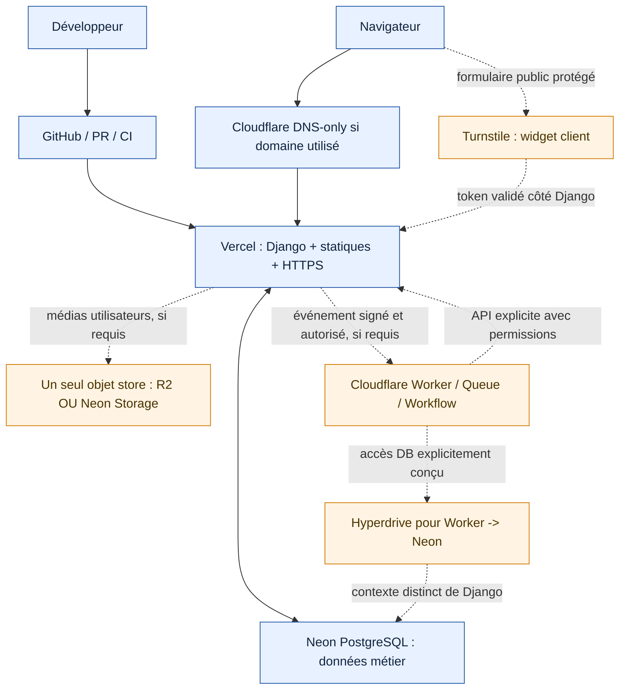
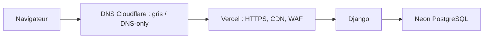
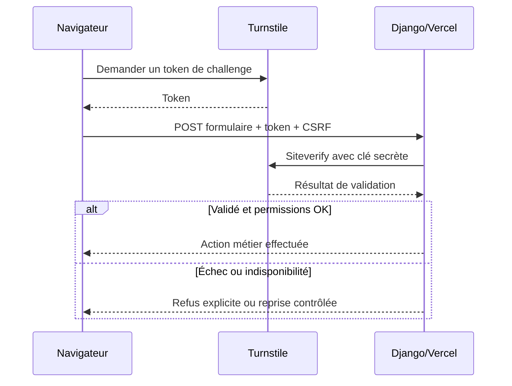
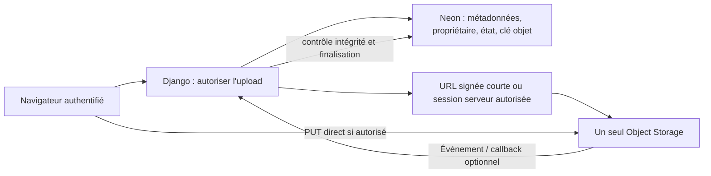
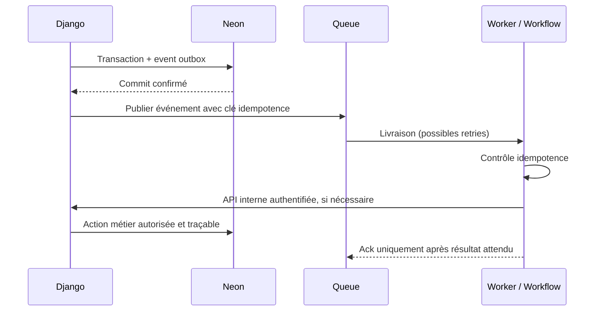

# 08 - Options Cloudflare et trajectoire d'évolution

## Socle Django + GitHub + Vercel + Neon PostgreSQL

| Métadonnée | Valeur |
|---|---|
| Fichier | `08_OPTIONS_CLOUDFLARE_ET_EVOLUTIONS.md` |
| Version | 1.0 |
| Date de référence | 18 novembre 2026 |
| Statut | **Document de décision proposé, à arbitrer ; aucune ressource activée** |
| Domaine | Architecture R4/R5, extensions de sécurité, médias, edge, asynchronisme, observabilité et industrialisation |
| Sources internes | Documents `00` à `07` du même projet |
| MVP de référence | Django 5.2 LTS, Python 3.12, GitHub Actions, Vercel, Neon PostgreSQL ; versions candidates à verrouiller |
| Philosophie | **Ne pas ajouter un service sans besoin mesurable et scénario de retour arrière** |

> Ce document est volontairement **un catalogue de choix conditionnels** et non un cahier d'installation de tous les services Cloudflare. Les services optionnels ne modifient pas rétroactivement les garanties du MVP. Les prix, quotas et disponibilités sont datés et doivent être contrôlés dans les offres réellement souscrites avant activation.

---

## 1. Synthèse exécutive

La stratégie retenue conserve le socle principal suivant :

- **Django** : logique métier, modèles, formulaires, authentification, administration et API éventuelle.
- **GitHub** : code, PR, vérifications CI et contrôle des contributions.
- **Vercel** : hébergement et déploiement automatique du code Django, HTTPS, fonctions et distribution des fichiers statiques.
- **Neon** : source de vérité relationnelle PostgreSQL, gestion des branches de données, restauration selon le plan.
- **Cloudflare** : **DNS-only par défaut** ; produits complémentaires ajoutés seulement sur déclencheur explicite.

### Décision recommandée au 18 novembre 2026

| Choix | Décision | Motif |
|---|---|---|
| Cloudflare DNS-only + Vercel direct | **Conserver si domaine Cloudflare** | Évite de superposer deux CDN/WAF et deux caches |
| Cloudflare Turnstile | **Adopter en cas de formulaire public à protéger** | Fonctionne sans proxy Cloudflare ; validation serveur obligatoire |
| Stockage média | **Comparer R2 et Neon Object Storage, puis en choisir un** | Pas d'utilité à multiplier les buckets sans scénario |
| Cloudflare Workers | **Différer** | Django reste le backend métier, Workers pour une fonction edge séparée seulement |
| Cloudflare Queues / Workflows | **Différer** | Nécessitent un contrat d'événement, d'identité, de retry et de reprise |
| Cloudflare Access | **Évaluer pour une application interne distincte** | Ne remplace pas Django Auth ; la protection d'un hostname nécessite une topologie adaptée |
| Cloudflare WAF via proxy | **Ne pas activer par défaut** | Vercel dispose de protections propres, proxy externe complexifiant l'exploitation |
| Cloudflare Hyperdrive | **Non pertinent pour la connexion Django sur Vercel** | Sert aux accès DB depuis Cloudflare Workers, pas à améliorer directement le pool Django |
| Cloudflare D1 / KV / Durable Objects | **Non retenus pour les données métier Django** | Neon PostgreSQL reste l'autorité métier ; ajouter un autre store exige un besoin distinct |
| IA/analytics/agents Cloudflare | **R&D conditionnelle** | Séparer démonstrateur expérimental et application financière critique |

**Règle de conservation :** aucun service optionnel ne doit affaiblir `CA-01` à `CA-13`, `DATA-INV-01` à `DATA-INV-12`, l'isolation des Previews ou la séparation des migrations du build.

---

## 2. Alignement avec les documents `00` à `07`

| Référence | Contrat existant | Application à R4/R5 |
|---|---|---|
| `00` - Expression du besoin | MVP Django + GitHub + Vercel + Neon, Cloudflare selon nécessité | R4/R5 n'ajoutent aucun critère obligatoire sans changement de périmètre approuvé |
| `01` - Architecture/ADR | `ADR-001` à `ADR-018` | Préserver monolithe, `ADR-010` statiques/médias, `ADR-011` DNS-only, `ADR-012` Turnstile/R2, `ADR-014` workers différés |
| `02` - Backlog | EP-08 (`US-045` à `US-048`) et EP-09 (`US-049` à `US-052`) | N'ouvrir les US P2 que si le déclencheur est démontré |
| `03` - Structure et configuration | Configuration externe, `.env.example`, modules Django | Isoler les configurations Cloudflare et ne pas introduire de secrets dans Git |
| `04` - Implémentation/CI-CD | CI sur PR, Vercel déploie `main`, workflow de migration séparé | Chaque extension dispose de tests CI et d'un plan de release propre |
| `05` - Données et migrations | 12 invariants, 23 tests DB et 10 scénarios ISO | Prévoir données synthétiques, permissions minimales, transactions et compensations |
| `06` - Tests et acceptation | 52 scénarios TST, 13 CA, 15 AT, GO/NO-GO | Ajouter des scénarios ciblés par extension ; ne pas inventer de PASS |
| `07` - Runbook | Release, incidents, rollback, restauration, rotation | Ajouter une fiche d'exploitation pour tout service actif |

### 2.1 Hiérarchie de sécurité

1. Les invariants de données et la protection de Production priment sur la commodité de Preview.
2. Les ADR approuvées priment sur un exemple de documentation ou de code présenté ici.
3. Toute mise en production sensible exige une **preuve exécutée**, pas une infographie, un schéma théorique ou une case cochée par anticipation.
4. Le plan de tarification doit être adapté à la nature réelle de l'application ; le simple fait qu'un produit propose un palier gratuit n'en fait pas un service sans coûts potentiels.

---

## 3. Architecture cible : socle stable et extensions ponctuelles



**Attention à la frontière HTTP :** en DNS-only, la résolution DNS est gérée par Cloudflare, mais les requêtes HTTP vont **directement vers Vercel**. Les fonctions WAF/CDN proxy de Cloudflare **ne s'appliquent pas** à ce trafic. Turnstile, API R2 et des Workers sur leurs propres routes peuvent fonctionner indépendamment.

### 3.1 Trois trajectoires d'évolution

| Trajectoire | Déclencheur | Architecture |
|---|---|---|
| **A - Monolithe renforcé** | Domaine, anti-bot, médias | Django/Vercel/Neon inchangés, DNS-only + Turnstile + stockage ciblé |
| **B - Extensions événementielles** | Tâches détachées, durable retries, ingestion de fichiers | Django = source d'autorité ; événement authentifié -> file/workflow -> résultat idempotent |
| **C - Architecture hybride applicative** | Frontend riche, traitements longs, exigences de performance ou conformité non couvertes | Django reste référentiel métier ; API DRF / frontend séparé / worker Python permanent selon le profil de charge |

---

## 4. Catalogue des services Cloudflare par responsabilité

| Service | Rôle réel | Besoin déclencheur | Sans proxy Cloudflare devant Vercel ? | Décision MVP |
|---|---|---|---|---|
| **DNS** | Résolution nom -> destination | Domaine personnalisé | Oui, DNS-only | Option selon domaine |
| **Turnstile** | Défi anti-bot intégré à un formulaire | Spam / abus | **Oui** | Différer jusqu'au premier formulaire exposé |
| **R2** | Stockage objet S3-compatible | Uploads et fichiers persistants | **Oui**, via SDK/API | Différer |
| **Web Analytics** | Mesure du trafic / RUM selon intégration | Questions UX/traffic | Selon mode de collecte | Différer |
| **Workers** | Logique HTTP/edge distincte | Webhooks, proxy spécialisé, adaptation | Oui, pour Worker sur sa propre route | Différer |
| **Queues** | Tampon asynchrone, retry de messages | Traitements non immédiats | Oui via Worker/API autorisée | Différer |
| **Workflows** | Orchestration durable multistep | Processus reprenant après attente/panne | Oui via Worker/API autorisée | Différer |
| **Cron Triggers** | Déclenchement périodique Worker | Tâche récurrente petite et bornée | Oui | Différer |
| **Hyperdrive** | Pooling DB depuis Worker vers PostgreSQL | Worker interrogeant Neon | Oui, mais Worker nécessaire | Différer |
| **KV** | Lecture clé-valeur à cohérence adaptée | Config distribuée non critique | Oui via Worker | Différer |
| **D1** | SQL SQLite géré par Cloudflare | Domaine de données edge indépendant | Oui via Worker | Éviter en doublon de Neon |
| **Durable Objects** | Coordination par entité, état partagé | Réaltime, verrouillage métier spécifique | Oui via Worker | Différer |
| **Access** | Contrôle d'accès Zero Trust devant des apps | Back-office interne à contrôler | Dépend de la topologie / hostname | Étude dédiée |
| **WAF / Bot Management** | Filtrage HTTP via proxy | Besoin non couvert par Vercel | **Non** pour trafic DNS-only vers Vercel | Non par défaut |
| **Cloudflare Images / Stream** | Pipeline média avancé | Transformations image / vidéo | Selon intégration | Différer |
| **Workers AI / AI Gateway / Vectorize** | Inférence, proxy IA, recherche vectorielle | Fonction IA prouvée | Oui avec API dédiée | R&D conditionnelle |

**Interdit par défaut :** remplacer ou dupliquer Neon par de nouvelles bases sans justification de modèle de cohérence, de droits, de transactions et de coût ; exposer l'API de production depuis un Worker de Preview ; considérer le Worker comme un simple composant Python intégré à Django.

---

## 5. Option CF-01 - Domaine et DNS Cloudflare (US-045)

**Statut : recommandé seulement si un domaine personnalisé est requis.** `ADR-011` demeure la référence.

### 5.1 Choix d'architecture



DNS-only signifie que Cloudflare ne reçoit pas les requêtes HTTP du site et **ne fournit pas son WAF applicatif** pour ce hostname. Ne pas représenter Cloudflare comme une couche de sécurité réseau effectivement traversée par les visiteurs.

### 5.2 Préconditions

- Domaine détenu et autorité DNS identifiée.
- Domaine ajouté au **bon** projet Vercel ; environnement Production identifié.
- Enregistrements et valeurs DNS copiés depuis les instructions actuelles de Vercel ; **ne pas inventer d'IP A ou de CNAME**.
- TTL, domaine apex et sous-domaines pris en compte ; vérifier les enregistrements existants avant remplacement.
- Certificat HTTPS Vercel disponible et valide ; configuration Django `ALLOWED_HOSTS`, `CSRF_TRUSTED_ORIGINS` et éventuels cookies adaptée.
- Plan de retour DNS prévu, avec durée de propagation non garantie.

### 5.3 Procédure CF-DNS-01

1. Inventorier zone, registrar, DNSSEC et éventuels enregistrements critiques (messagerie, SPF, DKIM, DMARC).
2. Ajouter le domaine à Vercel et relever exactement les indications d'enregistrements.
3. Configurer uniquement les entrées nécessaires sur Cloudflare en **DNS-only**.
4. Vérifier résolution avec `dig`/`nslookup`, prise en charge HTTPS, redirection `www`/apex si souhaitée.
5. Vérifier côté Django les hôtes et origines CSRF ; tester connexion, formulaire, cookies et redirections.
6. Relever l'état avant/après et le plan de retour à l'enregistrement précédent.
7. Archiver les preuves dans le runbook `07`.

### 5.4 Critères GO / NO-GO

**GO :** domaine exact répond en TLS valide, bonnes routes Vercel, pas de boucle, sessions et CSRF OK, aucune interruption DNS externe connue. **NO-GO :** mauvais projet pointé, certificat invalide, erreur 403 CSRF, fuite de trafic vers Preview, suppression d'un enregistrement mail essentiel.

### 5.5 Réversibilité

Retour possible aux enregistrements DNS antérieurs **sans présumer d'une bascule instantanée** ; disposer d'un plan de communication si indisponibilité possible.

---

## 6. Option CF-02 - Turnstile dans Django (US-046)

**Statut : option légère prioritaire en présence de formulaires publics abusables.** Aucune activation du proxy Cloudflare n'est requise.

### 6.1 Cas d'usage

- Formulaire contact, inscription, demande de démonstration ou d'accès.
- Limitation d'abus de ressources (faux comptes, spam), en complément des contrôles de débit, des permissions et de la validation métier.
- Protection ciblée de routes, **pas** un remplacement de CSRF, de Django Auth, des limites de débit ou de la vérification d'identité.

### 6.2 Contrat d'intégration

| Objet | Contrat |
|---|---|
| Widget | Chargé sur le formulaire concerné depuis la bibliothèque officielle |
| `TURNSTILE_SITE_KEY` | Clé publique distincte des secrets |
| `TURNSTILE_SECRET_KEY` | **Secret serveur** scoped par environnement, jamais dans HTML ou Git |
| Validation | Appel HTTP serveur `POST https://challenges.cloudflare.com/turnstile/v0/siteverify` |
| Acceptation | `success=true` + vérification de hostname/action si prévues dans la politique |
| Rejet | Token manquant, invalide, expiré, réutilisé, contexte non conforme ou API indisponible selon politique de sécurité définie |
| Délai d'expiration | Token valable 300 s ; flux utilisateur et tests à adapter |
| Vie privée | Minimiser logs/IP, clarifier information aux utilisateurs et conformité |
| Limitation des abus | Appliquer en plus des limites de débit et vérifications métier côté Django |

### 6.3 Schéma de traitement



### 6.4 Exemple Python illustratif

Extrait destiné à éclairer le contrat, **pas un module Django prêt à publier**. Prérequis : `httpx` ajouté au lockfile si retenu ; adapter gestion des exceptions, politique de retry et validation des champs métier.

```python
import httpx

SITEVERIFY_URL = "https://challenges.cloudflare.com/turnstile/v0/siteverify"


def verify_turnstile(*, token: str, secret: str, hostname: str) -> bool:
    if not token or not secret:
        return False
    try:
        with httpx.Client(timeout=5.0) as client:
            response = client.post(
                SITEVERIFY_URL,
                data={"secret": secret, "response": token},
            )
            response.raise_for_status()
            result = response.json()
    except (httpx.HTTPError, ValueError):
        return False  # Fail closed ; expérience utilisateur à prévoir
    return result.get("success") is True and result.get("hostname") == hostname
```

Ne jamais utiliser `result["success"]` seul lorsque l'application a besoin d'un contrôle supplémentaire de domaine ou d'action. La limitation de réutilisation des tokens est de type *eventual consistency* ; prévoir également une protection de l'opération métier contre les doubles soumissions.

### 6.5 Tests CF-TURN

- `CF-TURN-01` : token valide sur domaine autorisé.
- `CF-TURN-02` : aucun token -> refus.
- `CF-TURN-03` : token altéré -> refus.
- `CF-TURN-04` : token expiré / rejoué -> refus attendu ; ne pas dépendre de la détection instantanée pour l'idempotence métier.
- `CF-TURN-05` : hostname ou action non conformes -> refus.
- `CF-TURN-06` : indisponibilité du service -> aucun contournement silencieux ; message de reprise.
- `CF-TURN-07` : même formulaire Preview utilise une clé/config distincte et une base synthétique.
- `CF-TURN-08` : aucune clé secrète dans Git, logs, frontend ou rapport de test.

**GO :** tous les tests pertinents verts, mesure des faux positifs et plan de désactivation du formulaire si abus. **NO-GO :** validation seulement côté navigateur, secret exposé, acceptation en cas de panne API sans décision explicite.

---

## 7. Option CF-03 - Stockage objet : R2 ou Neon Object Storage (US-047)

### 7.1 Déclencheur

Des utilisateurs doivent **déposer, récupérer ou supprimer des fichiers persistants** : facture PDF, justificatif, avatar, export, fichier source d'un pipeline, etc. Cela concerne les médias utilisateurs, pas les fichiers statiques Django déjà distribués via Vercel.

### 7.2 Matrice de choix

| Question | Cloudflare R2 | Neon Object Storage |
|---|---|---|
| Type de stockage | Objet S3-compatible | Objet S3-compatible, intégré à Neon |
| Intégration avec PostgreSQL | Métadonnées à gérer dans Django/Neon | Même environnement Neon ; possibilité de branching du stockage avec la base selon produit |
| Branching Preview | Bucket/prefix/credentials distincts à orchestrer | Le branchement peut reprendre buckets **et objets** de la branche parente |
| Risque de données réelles en Preview | Si bucket partagé ou copie explicite | **Très important** si Preview branche une source Production : données et objets copiés logiquement |
| Couche d'exploitation | Fournisseur stockage distinct | Concentration des ressources chez Neon |
| Publicité des fichiers | Définir des politiques explicites | Définir des politiques explicites |
| Volume/prix | Gratuité standard datée ci-dessous | Offre en vigueur et limites par projet à vérifier |
| Choix suggéré | Si besoin S3, média et coûts/egress justifiés | Si simplicité de configuration et cycle de vie app/DB priment |

**Décision initiale : un seul provider d'objets.** Ne jamais rendre un bucket public par commodité, surtout avec des justificatifs comptables ou documents RH.

### 7.3 Design cible



### 7.4 Contrat pour fichiers utilisateurs

- Identifiant applicatif UUID et clé objet **non prédictible** ; ne pas utiliser un nom de fichier brut comme clé d'autorisation.
- Métadonnées persistées sur Neon : propriétaire, type MIME déclaré et détecté, taille, checksum si requis, date, statut et politique de rétention.
- Bucket privé par défaut ; accès via contrôle Django et URL signée à durée minimale nécessaire.
- Upload direct par URL pré-signée lorsque cela évite les limites des Vercel Functions ; valider taille, type, quota et autorisation côté serveur **avant émission**.
- Configuration CORS précise pour l'origine front ; pas de `*` associé à une politique permissive pour des données privées.
- Vérifier contrôles antivirus / contenu malveillant selon nature des fichiers et besoins, avant mise à disposition.
- Ne jamais exposer `R2_ACCESS_KEY_ID`, `R2_SECRET_ACCESS_KEY` ou credentials Neon objet dans la page web.
- Traiter le décalage objet/DB (upload sans finalisation, DB sans objet, doublons, suppression et retries).
- Prévoir nettoyage des uploads orphelins, expiration des URLs signées, gestion des versions et audit de suppression.
- Prévoir Preview avec **objets synthétiques ou bucket séparé**, y compris si Neon Object Storage est branché.

### 7.5 Variables proposées (uniquement si R2 choisi)

| Nom | Rôle | Sensibilité |
|---|---|---|
| `OBJECT_STORAGE_PROVIDER` | Sélection explicite du backend | Configuration |
| `R2_ENDPOINT_URL` | Endpoint S3 Cloudflare du compte | Configuration |
| `R2_BUCKET_NAME` | Bucket propre à l'environnement | Configuration |
| `R2_ACCESS_KEY_ID` | Identifiant d'accès API R2 | Secret |
| `R2_SECRET_ACCESS_KEY` | Clé secrète R2 | **Secret** |
| `MEDIA_MAX_BYTES` | Limite applicative de taille | Configuration |
| `MEDIA_ALLOWED_TYPES` | Liste blanche applicative | Configuration |
| `MEDIA_URL_TTL_SECONDS` | Durée des URLs signées | Configuration |

Ajouter ces noms à `.env.example` **sans valeurs réelles** et seulement après décision. Le préfixe exact peut évoluer avec la bibliothèque Django retenue.

### 7.6 Tests CF-OBJ

| ID | Contrôle | Résultat attendu |
|---|---|---|
| CF-OBJ-01 | Upload autorisé | Objet privé, métadonnées en DB |
| CF-OBJ-02 | Utilisateur non autorisé | Aucune URL signée émise |
| CF-OBJ-03 | Fichier trop volumineux / type refusé | Échec explicite, aucun objet finalisé |
| CF-OBJ-04 | CORS origine non autorisée | Rejet par politique CORS |
| CF-OBJ-05 | URL signée expirée | Accès refusé |
| CF-OBJ-06 | Preview -> objet Production | Accès impossible |
| CF-OBJ-07 | Suppression avec retry | Pas d'objets orphelins durables ou réconciliation suivie |
| CF-OBJ-08 | Restauration DB | Cohérence avec état objet évaluée ; pas de promesse de restauration atomique implicite |
| CF-OBJ-09 | Journalisation | Aucune clé secrète ni URL signée sensible divulguée |
| CF-OBJ-10 | Grande taille | Transfert direct testé sans passer par le payload HTTP Django |

### 7.7 Prix indicatifs vérifiés au 18 novembre 2026

Sur la classe **R2 Standard**, la grille publique indique une franchise mensuelle de **10 GB-month**, **1 million d'opérations Class A**, **10 millions d'opérations Class B** et un **egress Internet direct gratuit** ; les frais de stockage et d'opérations hors franchise, les différences de classe et les abonnements préalables restent à prendre en compte. Un compte R2 et l'activation de sa souscription peuvent être requis.

Neon indique **5 GB d'Object Storage par projet** sur son Free Plan à la date de référence. Vérifier l'interface actuelle, les éventuelles limites annexes et le caractère adapté au cycle de branches avant de comparer les coûts.

**GO :** accès privés, droits testés, isolation, sauvegarde et réconciliation définies. **NO-GO :** document privé public, copie de données réelles en Preview, politiques de purge absentes.

---

## 8. Option CF-04 - Workers pour des fonctions edge ciblées

**Décision : différer tant qu'une fonction HTTP Python/Django suffit.** Cloudflare Workers ne remplace pas automatiquement une application Django Python ; il s'agit d'un runtime et d'un modèle d'exploitation distincts.

### 8.1 Cas pouvant justifier un Worker

- Adapter un webhook spécifique dont l'origine, le volume ou l'authentification nécessite un point de terminaison dédié.
- Produire des URLs ou réponses temporaires sans exposer un serveur complet.
- Valider une signature, appliquer une règle de routage ou transformer un en-tête dans un **service distinct explicitement spécifié**.
- Alimenter une Queue à partir d'un événement validé.
- Exécuter une fonction low-latency localisée si un benchmark réel l'étaye.

### 8.2 Cas qui ne justifient pas un Worker

- CRUD Django classique, migrations PostgreSQL, Django Admin, permissions métier gérées par Django.
- Ajouter un proxy Cloudflare sur Vercel uniquement pour « optimiser » sans mesure.
- Créer un second moteur d'authentification sans contrat de délégation.
- Implémenter un traitement Python lourd en supposant qu'il tournera tel quel dans le Worker.

### 8.3 Contrat de séparation

- Backend **Django** : source de vérité et décision d'autorisation métier.
- Worker : responsabilité minimale, contrat HTTP versionné, token/mTLS/signature selon modèle de confiance.
- Données : **pas de copie de vérité métier** dans KV/D1 sans ADR et stratégie de cohérence.
- Environnements : Worker Preview/test ne reçoit pas les secrets ni permissions de production.
- Retour arrière : version Worker déployée séparément du code Django ; compatibilité des contrats N/N-1.

**Note outillage :** pour un projet Cloudflare neuf, l'outillage CLI recommandé peut être `cf` plutôt que Wrangler ; choisir en fonction de l'état réel du dépôt et des instructions de la plateforme au moment de l'implémentation. Aucun CLI ou fichier de configuration n'est requis dans le MVP Django.

---

## 9. Option CF-05 - Asynchronisme : Queues, Workflows et Cron

### 9.1 Question préalable

Le besoin est-il de **décharger un pic de messages**, d'**orchestrer plusieurs étapes durables**, de **déclencher périodiquement une opération**, ou d'**exécuter un calcul Python long** ? Ces problèmes ne partagent pas nécessairement la même solution.

| Situation | Candidat | Pourquoi | Alternative à vérifier |
|---|---|---|---|
| Pic de messages, retries, délai toléré | Cloudflare Queues | Tampon entre producteurs et consommateurs | Système de jobs déjà disponible dans l'hébergement |
| Processus multiétape avec attente et reprise | Cloudflare Workflows | État durable et orchestration | Vercel Workflows ou orchestration Python adaptée |
| Petit déclenchement périodique | Cron Triggers | Ordonnancement Worker | GitHub Actions schedule ou scheduler managé |
| Calcul Python gourmand/long | **Worker Python dédié hors edge si nécessaire** | Runtime Python, CPU et mémoire adaptés | Jobs/workers d'une plateforme Python dédiée |
| Batch DB avec forte cohérence | Service applicatif autorisé | Transactions et permissions contrôlées | Orchestrateur de données dédié |

### 9.2 Contrat d'événement minimal

```json
{
  "event_id": "evt-example-123",
  "event_type": "record.created.v1",
  "occurred_at": "2026-11-18T07:00:00Z",
  "origin": "django-prod",
  "aggregate_id": "sample-record-id",
  "correlation_id": "trace-example-123",
  "payload": {
    "record_id": "sample-record-id"
  }
}
```

Ce JSON est **un exemple fictif**. Un événement réel devra être signé ou authentifié, porter une version de contrat, des identifiants de corrélation et aucun secret ni données sensibles superflus.

### 9.3 Invariants asynchrones

1. Au moins une livraison et retries possibles : **idempotence obligatoire** de la fonction consommatrice.
2. Événement produit après transaction DB validée ; utiliser si nécessaire un **outbox pattern** pour éviter l'état « DB modifiée mais message jamais publié ».
3. Dead letter queue / échecs terminaux traités avec propriétaire et fenêtre de rétention claire.
4. Backoff, limites de concurrence et quotas explicités, sans boucle infinie.
5. Observabilité par `event_id` et `correlation_id`, sans mettre des données privées dans les logs.
6. Consommateur Preview ne touche jamais les ressources Production.
7. Traitements de comptabilité ou trésorerie sensibles exigent une preuve de cohérence métier : le succès d'une Queue n'est pas une preuve d'intégrité financière.
8. Les erreurs définitives ne doivent pas créer de doublons de paiement, facturation ou journalisation.

### 9.4 Exemple de flux conditionnel



### 9.5 Limites des offres au 18 novembre 2026

- **Cloudflare Queues** : une franchise documentée de **10 000 opérations par jour** sur Workers Free, contre une allocation mensuelle sur Workers Paid ; rétention Free **24 heures** selon la documentation consultée. Une tentative de livraison peut consommer plusieurs opérations (écriture, lecture, suppression).
- **Cloudflare Workflows** : accessible aux plans Workers Free et Paid, avec facturation/quotas de requêtes, CPU, stockage d'état et étapes. Les limites de durée, rétention d'état, CPU et steps doivent être revalidées par service et plan ; ne pas supposer que l'orchestration durable est une machine Python illimitée.
- Un prototype bas volume ne garantit pas que le plan gratuit couvrira les charges et tentatives de retry futures.

### 9.6 Gate d'adoption

**GO :** un besoin asynchrone mesuré, ordonnanceur/consommateur désignés, idempotence prouvée, retries et reprise documentés, coût simulé. **NO-GO :** évènement non authentifié, accès prod depuis Preview, traitement financier à effets multiples non idempotent, absence de politique de rétention.

---

## 10. Option CF-06 - Hyperdrive, KV, D1 et Durable Objects

### 10.1 Hyperdrive

**Ne l'ajouter que lorsqu'un Cloudflare Worker doit accéder à Neon PostgreSQL.** Hyperdrive sert au pooling/optimisation des connexions depuis le runtime Workers ; il ne remplace pas la configuration d'accès Django/Vercel déjà définie dans `05`.

Questions préalables :

- Pourquoi le Worker parle-t-il directement à PostgreSQL plutôt que d'appeler une API Django autorisée ?
- Quelle est sa frontière de transaction et d'autorisation ?
- Les drivers Worker, les statements et la stratégie de pooling sont-ils compatibles ?
- Comment la configuration preview/prod est-elle isolée ?
- En quoi le bénéfice de latence est-il démontré ?

### 10.2 KV

Lecture à faible latence, configuration/metadata répliquée et autres usages de type clé-valeur compatibles avec le modèle de cohérence du service. **Ne pas y enregistrer** sans design spécifique les soldes, journaux comptables, autorisations critiques ou toute donnée nécessitant des transactions relationnelles garanties.

### 10.3 D1

D1 peut répondre à un **besoin SQL edge distinct**. Il ne faut pas le superposer par défaut à Neon comme second « PostgreSQL ». D1 est basé sur SQLite avec une sémantique distincte. Une adoption exige une frontière de domaine et une politique de synchronisation explicites.

### 10.4 Durable Objects

Coordination d'un état partagé par entité dans un Worker, à envisager pour une session de collaboration temps réel ou une file par entité. **Pas de remplacement implicite** des verrous, transactions, contraintes et audits dans Neon.

### 10.5 Décision

**Différer ces quatre produits** à l'exception éventuelle d'Hyperdrive, uniquement si un Worker déjà accepté a un besoin DB démontré et un contrat d'autorisation validé.

---

## 11. Option CF-07 - Accès interne, WAF et choix du point de protection

### 11.1 Trois problèmes distincts

| Besoin | Solution de premier recours | Pourquoi |
|---|---|---|
| Se connecter au back-office Django | **Django Auth + permissions** | Contrôle applicatif métier existant |
| Limiter les abus HTTP d'une application sur Vercel | **Contrôles Vercel + règles Django + Turnstile** selon besoin | Évite deux proxies sans raison |
| Protéger une application strictement interne devant le réseau | **Étude Cloudflare Access ou protection Vercel adaptée** | Auth amont distincte, hostname et session à définir |

### 11.2 Cloudflare Access

Access peut appliquer une politique d'identité devant une application, mais **son activation sur une application self-hosted publique exige une topologie compatible avec les routes et le plan Cloudflare**. Ne pas présumer qu'Access protège un nom Vercel arbitraire resté DNS-only.

Points à valider :

- Application concernée : Preview privée, administration interne ou service autonome ?
- Domaine/hostname réellement géré par Cloudflare, route du trafic et certificats.
- Politique d'identité, SSO, cycle de vie des membres et sessions.
- Compatibilité avec redirections Django, API, hooks de paiement et webhooks éventuels.
- Identité amont vérifiée de façon cryptographique ; ne pas faire confiance à un en-tête client non signé.
- Contournement potentiel par l'URL directe `*.vercel.app` ; éviter les faux sentiments de protection.

### 11.3 WAF/Proxy Cloudflare devant Vercel

Par défaut : **NON**. Vercel recommande d'éviter un proxy externe sauf besoin spécifique et explicite. Les risques comprennent double cache, HTML périmé, perte de visibilité sur l'IP, configuration TLS et interactions avec les protections anti-bot de Vercel.

En cas d'exigence qui justifierait malgré tout cette architecture :

1. Comparer fonctionnalités précises et coûts WAF Cloudflare / protections natives Vercel.
2. Évaluer **Verified Proxy** et limitations connues selon le plan, sans supposer que toutes les fonctions bot retrouvent leur efficacité.
3. Tester purge de cache, cookies de session, CSRF, téléchargements, mises à jour statiques et compatibilité HTTPS.
4. Mesurer latence, erreurs et expérience anti-bot sur plusieurs régions.
5. Documenter un mécanisme de retour à DNS-only et le comportement du domaine/SSL.
6. N'activer qu'après une ADR dédiée, revue sécurité et exploitation.

### 11.4 Prohibition du cache inapproprié

- Pas de cache partagé de réponse Django authentifiée par défaut.
- Ne pas mettre en cache des pages de compte, des factures privées, des liens signés, des tokens ou des endpoints de paiement.
- Si mise en cache d'un contenu public : définir `Cache-Control`, clé de cache, purge, variation par cookies/headers et tests d'invalidation.

---

## 12. Option CF-08 - Images, Stream, Analytics et IA

| Produit / fonction | Cas à évaluer | Critère d'adoption |
|---|---|---|
| Cloudflare Images | Transformations, redimensionnement, délivrance d'images en volume | Besoin mesurable de plusieurs rendus d'un média |
| Cloudflare Stream | Encodage/hébergement vidéo à la demande | Vidéo devenue une fonction produit, pas seulement documentation |
| Web Analytics | Trafic, performance réelle des pages | Questions produits/UX définies et conformité confidentialité étudiée |
| Workers AI | Inférence proche du Worker | Modèle, qualité, coûts et risques de données évalués |
| AI Gateway | Gouvernance d'appels aux fournisseurs IA | Multi-provider, budget, observabilité et confidentialité nécessaires |
| Vectorize / AI Search | Recherche sémantique ou RAG | Corpus, droits d'accès, pertinence et métrique de qualité définis |

Dans un outil comptable ou CRM, la gouvernance des données, la séparation des comptes et la vérifiabilité des décisions prévalent sur la commodité des nouveaux produits IA. Les règles d'accès par organisation/tenant doivent s'appliquer aux index et aux logs, pas seulement aux vues Django.

---

## 13. Extensions non Cloudflare : Django, API, frontend, workers Python

L'architecture peut évoluer sans nécessairement consommer un produit Cloudflare.

### 13.1 API DRF (US-049)

**Déclencheur :** consommateur REST externe identifié, authentification et modèle d'autorisation définis. Garder les règles de domaine dans des services ou objets Django partageables entre templates et API. Ajouter versionnement, schéma OpenAPI, limites de débit, permissions objets, tests de sécurité. Un `ModelViewSet` par défaut ne définit pas à lui seul une politique de confidentialité.

### 13.2 React / Next.js (US-050)

**Déclencheur :** UX complexe, clients autonomes ou besoins de frontend qui justifient les coûts de maintenance. Évaluer la séparation domaine/API, cookie vs token, protection CSRF, CORS, déploiements et contrats. Garder Django Admin si utile aux équipes d'exploitation.

### 13.3 Jobs Python (US-051)

**Déclencheur :** batchs comptables, OCR, ETL, calculs ou tâches longues. Choisir d'abord un runtime Python adapté aux durées/ressources, à la reprise et au stockage. Un Cloudflare Worker ou Workflows peut orchestrer, mais n'est pas implicitement le moteur d'exécution Python du domaine.

### 13.4 Packages Py**Kit (US-052)

**Déclencheur :** cas d'utilisation réel réclamant un contrat réutilisable déjà stabilisé. La dépendance se justifie par des tests, une API publique éprouvée, une version figée et une valeur supérieure à l'implémentation native Django. Ne pas intégrer des bibliothèques par simple souci d'uniformité de l'écosystème.

### 13.5 Portabilité et stratégie de sortie

Un projet Vercel/Django ayant des dépendances identifiées et une base PostgreSQL indépendante peut envisager un futur hébergement Python conventionnel pour des workloads exigeants. Le plan de sortie doit inventorier : runtime, fichiers statiques, médias, secrets, domaine, job scheduler, observabilité, données SQL, plan de migration et tests de bascule.

---

## 14. Grille de sélection des options et ADR complémentaires

### 14.1 Formule de comparaison

Noter chaque option de 0 à 3 sur les dimensions suivantes, avec preuves. Une note n'est jamais une autorisation automatique de déploiement.

| Dimension | 0 | 1 | 2 | 3 |
|---|---|---|---|---|
| Besoin métier réel | Aucun | Hypothèse | Usage défini | Usage observé ou obligation |
| Gain concret | Aucun | Non chiffré | Gain plausible | Gain mesuré |
| Complexité d'exploitation | Très lourde | Élevée | Gérable | Faible |
| Sécurité / isolation | Inacceptable | Incertain | Contrôles à prouver | Contrôles prouvés |
| Réversibilité | Absente | Difficile | Procédure définie | Exercée |
| Coût prévisionnel | Inconnu | Risque élevé | Estimation plausible | Budget et alerte vérifiés |

**Conditions hors score (bloquantes) :** aucune fuite de secrets, aucune Preview vers Production, confidentialité compatible, retour arrière identifié, responsable nommé.

### 14.2 Propositions d'ADR (non acceptées)

| Réf. nouvelle | Sujet | Proposition initiale | Statut |
|---|---|---|---|
| ADR-019 | DNS Cloudflare et terminaison HTTP | DNS-only, HTTPS/Vercel direct | Proposée |
| ADR-020 | Anti-bot | Turnstile à validation serveur ciblée | Proposée |
| ADR-021 | Stockage média | Un provider objet ; comparaison R2/Neon | Proposée |
| ADR-022 | Fonctions edge | Workers limités à des responsabilités identifiables | Proposée |
| ADR-023 | Asynchronisme | Événements idempotents et outbox si nécessaire | Proposée |
| ADR-024 | Base Worker -> Neon | Hyperdrive seulement si accès DB Worker retenu | Proposée |
| ADR-025 | Protection HTTP | Pas de proxy Cloudflare par défaut devant Vercel | Proposée |
| ADR-026 | Données distribuées | Neon reste source de vérité ; pas de D1/KV substitut | Proposée |
| ADR-027 | Portabilité | Découplage des règles métier des fournisseurs edge | Proposée |

### 14.3 Modèle d'une ADR nouvelle

```markdown
# ADR-0XX - Intitulé

- Statut : Proposed / Accepted / Rejected / Superseded
- Date : YYYY-MM-DD
- Responsable : [rôle]
- Déclencheur : [besoin mesuré]

## Contexte
...

## Options considérées
...

## Décision
...

## Conséquences positives et négatives
...

## Risques et contraintes de données
...

## Tests d'acceptation et preuves
...

## Coûts, réversibilité et plan de retrait
...
```

---

## 15. Backlog R4/R5 proposé : tâches et dépendances

| ID | Epic | Tâche | P | Déclencheur | Preuve de sortie |
|---|---|---|---|---|---|
| CF-T01 | EP-08 | Inventorier domaine et politique DNS | P2 | Domaine demandé | Inventaire expurgé |
| CF-T02 | EP-08 | Configurer domaine Vercel / Cloudflare DNS-only | P2 | CF-T01 | DNS, HTTPS, cookies OK |
| CF-T03 | EP-08 | Analyser le besoin d'anti-bot sur formulaire | P2 | Formulaire public | Risque et métrique établis |
| CF-T04 | EP-08 | Intégrer et tester Turnstile dans Django | P2 | CF-T03 | CF-TURN-01..08 |
| CF-T05 | EP-08 | Définir cas d'usage et classification des fichiers | P2 | Upload métier | Modèle et rétention |
| CF-T06 | EP-08 | Comparer R2 / Neon Object Storage | P2 | CF-T05 | ADR-021 acceptée |
| CF-T07 | EP-08 | Implémenter stockage privé et uploads directs | P2 | CF-T06 | CF-OBJ-01..10 |
| CF-T08 | EP-08 | Justifier ou refuser le proxy Cloudflare | P2 | Besoin WAF non couvert | ADR-025 + comparatif |
| CF-T09 | EP-09 | Spike Worker isolé | P2 | API edge justifiée | Contrat/bench/permissions |
| CF-T10 | EP-09 | Spike Queue / Workflow | P2 | Traitement asynchrone réel | Tests idempotence/retry |
| CF-T11 | EP-09 | Étudier Hyperdrive si Worker vers Neon | P2 | CF-T09 | Benchmark + threat model |
| CF-T12 | EP-09 | Étudier DRF / frontend séparé | P2 | Consommateur API / UX | ADR et test E2E |
| CF-T13 | EP-09 | Étudier worker Python dédié | P2 | Charge longue mesurée | Plan d'exploitation |
| CF-T14 | EP-09 | Évaluer premier Py**Kit dans un cas réel | P2 | Couplage métier prouvé | Tests intégration |
| CF-T15 | EP-09 | Répéter la recette et la revue de coûts | P2 | Avant release extension | Dossier GO/NO-GO |

Ces tâches complètent les user stories existantes : **US-045 (DNS), US-046 (Turnstile), US-047 (objets), US-048 (proxy), US-049 à US-052 (extensions)**. Elles n'introduisent pas de nouveau P0 au MVP.

---

## 16. Matrice de tests des extensions

| ID | Fonction | Vérification clé | Risque couvert |
|---|---|---|---|
| CF-DNS-01 | Domaine | Domaine -> bon déploiement et SSL valide | Routage erroné |
| CF-DNS-02 | Sessions | CSRF et cookies après changement hostname | Session cassée |
| CF-DNS-03 | Rollback DNS | Enregistrements précédents restaurables | Indisponibilité prolongée |
| CF-TURN-01..08 | Turnstile | Validation serveur, erreurs, replay et secrets | Bot/bypass/secret |
| CF-OBJ-01..10 | Médias | Autorisation, privacy, isolation, upload, cleanup | Fuite objet / incohérence |
| CF-WRK-01 | Worker | Requête non authentifiée refusée | Appel usurpé |
| CF-WRK-02 | Worker | Secrets de Preview séparés | Production compromise |
| CF-WRK-03 | Worker | Contrat N/N-1 testé | Déploiements désynchronisés |
| CF-Q-01 | Queue | Livraison doublée n'engendre pas double effet | Idempotence |
| CF-Q-02 | Queue | Retry et DLQ observables | Message perdu |
| CF-Q-03 | Queue | Panne après commit et avant publish | Atomicité outbox |
| CF-Q-04 | Queue | Contrôle coût des retries/volumes | Dérapage facture |
| CF-ACC-01 | Access | Pas de contournement via URL Vercel directe | Protection illusoire |
| CF-PROXY-01 | Proxy | Cohérence des caches et purge | Pages périmées |
| CF-PROXY-02 | Proxy | Sécurité headers/TLS/client IP | Dégradation protection |
| CF-EXIT-01 | Portabilité | Démarrage Django sans services optionnels | Couplage technique |

### 16.1 Stratégie de preuve

Pour chaque option activée : test automatique quand possible, test négatif, journal de release, référence de commit, configuration expurgée, coût et procédure d'arrêt. **Une documentation de test ne vaut pas exécution.**

---

## 17. Sécurité, privacy et risques transversaux

| ID | Risque | Mesure minimale | Blocage |
|---|---|---|---|
| CF-R01 | CDN Cloudflare activé par mégarde devant Vercel | DNS-only, contrôle DNS et analyse chaîne HTTP | Oui si perte de protection/certificat |
| CF-R02 | WAF supposé actif alors que DNS-only | Vérifier parcours HTTP réel | Oui si protection annoncée à tort |
| CF-R03 | Clés R2/Turnstile exposées | Secrets serveur, scopes, scans, rotation | Oui |
| CF-R04 | Bucket public pour justificatifs financiers | Bucket privé, signatures courtes, ACL applicatives | Oui |
| CF-R05 | Branching Neon copie médias réels | Branche parent synthétique, revue de données | Oui |
| CF-R06 | Job asynchrone rejoué avec effets financiers | Idempotence et invariants métier | Oui |
| CF-R07 | Worker échappe aux droits Django | Contrat d'autorisation central et signature | Oui |
| CF-R08 | Proxy détériore protection bot/TLS/cache | Mesure, Verified Proxy si approprié, plan retour | Oui selon sévérité |
| CF-R09 | Plusieurs sources de vérité DB | ADR, frontières transactionnelles, audits | Oui pour domaine critique |
| CF-R10 | Coûts de requêtes, jobs et opérations objet | Budgets, quotas, tests de charge, limites de retry | Selon plafond |
| CF-R11 | Données personnelles en logs d'edge/IA | Minimisation, durées de rétention, région, DPIA si requis | Oui si non conforme |
| CF-R12 | Autorisation tronquée par frontend/API séparés | Tests objets/tenants côté serveur | Oui |

### 17.1 Multi-tenant et usages financiers

Pour une application de type CRM ou comptable, compléter les contrôles : séparation par organisation, autorisation sur chaque fichier et chaque événement, historique d'audit immuable selon besoin, protection contre la double exécution d'opérations financières, rapprochement entre base et objets, suppression et conservation conformes à la politique documentaire. Les obligations réglementaires spécifiques devront être analysées séparément avant usage réel.

---

## 18. Modèle de coûts et gouvernance des offres

### 18.1 Ce qui est inclus, sans supposer « gratuit partout »

| Produit | Information publique datée | Prudence |
|---|---|---|
| DNS Cloudflare | Offre DNS disponible, conditions dépendant du domaine et du plan | Domaine/registrar payants éventuels ; changements DNS à valider |
| Turnstile | Offre gratuite disponible pour de nombreux cas d'usage | Quotas, fonctions enterprise et tarification à confirmer |
| R2 Standard | Franchise de 10 GB-month, 1M Class A, 10M Class B, egress gratuit | Opérations hors forfait, classe IA, abonnements ; calculer par mois |
| Workers Free | Limites journalières de requêtes et CPU | Le fait d'utiliser Queues/Workflows peut consommer des quotas partagés |
| Queues Free | 10 000 opérations/jour, 24 h de rétention | 1 message peut représenter plusieurs opérations |
| Workflows Free | Accessible, limites de steps/CPU/stockage | Durabilité et capacité dépendent des quotas du plan |
| Hyperdrive Free | Disponible avec limitations, selon l'offre | Uniquement pour une architecture Worker/DB réellement justifiée |
| Neon Object Storage | 5 GB/projet annoncé dans offre Free | Branching objets et politique de données à contrôler |
| Vercel | Offre gratuite non nécessairement adaptée à un usage commercial | Vérifier plan et conditions applicables avant SaaS |

### 18.2 Calcul opérationnel à effectuer

Pour chaque option, calculer :

`coût total = abonnements fixes + volume stocké + opérations + compute + retries + transfert taxable éventuel + coût d'exploitation humaine`

Ne pas considérer uniquement le prix d'une requête réussie. En cas d'abus ou de défaut logiciel, les retries, les transformations d'images et les lectures d'objets peuvent dominer.

### 18.3 Fiche de décision budgétaire

| Champ | Valeur à documenter |
|---|---|
| Produit | ... |
| Type de plan réel | ... |
| Pays et région pertinente | ... |
| Usage mensuel attendu | ... |
| Hypothèse de pic | ... |
| Opérations facturables | ... |
| Coût estimé / devise | ... |
| Plafond et mécanisme d'alerte | ... |
| Titulaire de facturation | ... |
| Date de dernière vérification | ... |

---

## 19. Runbooks d'activation et de retrait

### 19.1 RUN-CF-01 - Activer une option

1. Ouvrir une user story conditionnelle et justifier son déclencheur.
2. Lire les offres, limites et dépendances actuelles sur les comptes ciblés.
3. Enregistrer ADR, impacts de données et risque de sécurité.
4. Définir `Local`, `CI`, `Preview`, `Production` et leur isolation ; créer des données de test synthétiques.
5. Définir scopes des tokens, variables d'environnement et interdiction des secrets en PR non fiables.
6. Développer dans une branche, exécuter unitaires/intégration et tests négatifs.
7. Mesurer coûts, performances, erreurs et effet sur le socle.
8. Mettre à jour runbook `07`, politique de rotation et tableau de monitoring.
9. Faire approuver la release par un opérateur autorisé.
10. Activer progressivement si possible ; vérifier sans exposition de données sensibles.
11. Joindre preuves ; clôturer seulement après validation.

### 19.2 RUN-CF-02 - Retirer un service

1. Inventorier consommateurs, secrets, DNS, événements et stockage liés au service.
2. Bloquer les nouvelles écritures **si et seulement si** le plan de migration le permet.
3. Réconcilier messages en attente, objets et métadonnées.
4. Basculer trafic ou contrat applicatif vers l'alternative approuvée.
5. Vérifier accès utilisateur, sessions, données et conformité.
6. Révoquer les tokens devenus inutiles ; conserver les journaux obligatoires.
7. Supprimer les ressources après expiration des périodes de conservation et validation de la restauration.
8. Documenter coûts résiduels, résultats et risques restants.

### 19.3 RUN-CF-03 - Incident Cloudflare alors que Vercel/Neon restent sains

- Déterminer le service réellement touché : DNS, Turnstile, R2, Worker, Queue ou Access.
- Identifier si le trafic HTTP est proxifié ou non avant d'attribuer la panne.
- Évaluer utilisateurs concernés, données accessibles et dépendances.
- Désactiver de façon **réversible et autorisée** la fonctionnalité non critique, si le design le permet ; ne pas neutraliser un contrôle anti-bot en ouvrant un formulaire public sans protection de remplacement.
- Rejouer seulement les opérations idempotentes, avec identifiants et audit.
- Appliquer procédure de restauration/réconciliation pour fichiers ou messages ; ne pas restaurer Neon par réflexe si la DB est saine.
- Reprendre selon le runbook `07` et rédiger le compte rendu.

---

## 20. Portefeuille de décisions par scénario d'application

| Scénario cible | Stack minimale conseillée | Cloudflare éventuellement utile | À éviter au démarrage |
|---|---|---|---|
| Démonstrateur Django CRUD | Django, GitHub, Vercel, Neon | Domaine DNS-only si souhaité | Worker/Queue/D1/R2 inutiles |
| CRM avec portail public | Socle + contrôle des droits | Turnstile pour contact ; R2/Neon Storage si documents | Exposer documents sans ACL |
| Application de facturation | Socle + politique documentaire/audit | Stockage privé, anti-bot ciblé | Eventual consistency sur journal financier critique |
| Comptabilité multi-organisation | Socle renforcé, isolation par tenant, transactions | Edge limité aux fonctions non critiques | Seconde base vérité sans ADR |
| Plateforme d'uploads/rapports | Socle + stockage objet | R2/Neon Storage, URL signée, Queues si traitements | Transfert de gros fichiers via Vercel Function sans test |
| Webhook à fort volume | API signée, idempotence | Worker + Queue si besoin mesuré | Message sans authentification |
| Analyse IA / RAG | Socle + politiques de données/IA | AI Gateway/Vectorize/Workers AI selon charge | Fuite de corpus privés dans index partagé |

**Exemple d'extension pragmatique :** pour un prototype de gestion de documents comptables, démarrer par Django + Neon et un unique stockage objet privé. Ajouter Turnstile sur un formulaire public seulement si nécessaire. Introduire Queues ou un worker Python uniquement lorsque la durée ou le volume des traitements l'exige et que les garanties d'idempotence sont démontrées.

---

## 21. R4/R5 : critères GO / NO-GO

### 21.1 Gate G-CF0 - Justifier l'option

- [ ] Besoin démontré ; propriétaire produit identifié.
- [ ] Alternative simple évaluée (y compris ne rien ajouter).
- [ ] Coûts/quotas et plan compatible confirmés.
- [ ] ADR correspondante proposée et acceptée.

### 21.2 Gate G-CF1 - Design de sécurité

- [ ] Local/CI/Preview/Production isolés.
- [ ] Matrice de secrets établie, accès minimum appliqué.
- [ ] Aucune donnée personnelle ou financière réelle copiée vers Preview.
- [ ] Autorisations, stockage, rétention et traçabilité définies.
- [ ] Plan de sortie/rollback documenté.

### 21.3 Gate G-CF2 - Validation d'intégration

- [ ] Tous les tests de l'option sont exécutés et documentés.
- [ ] Au moins un test négatif pertinent est réussi.
- [ ] Surveillance, coût et erreur applicative observables.
- [ ] Le déploiement automatique Vercel et les migrations Neon restent conformes à `05`.
- [ ] Les treize critères CA initiaux demeurent satisfaits.

### 21.4 Gate G-CF3 - Activation réelle

- [ ] Approbation explicite de l'opérateur habilité.
- [ ] Enregistrement du SHA, de l'environnement et de l'option.
- [ ] Vérifications post-activation exécutées.
- [ ] Runbook `07` enrichi et exercice de retour arrière planifié ou prouvé selon criticité.

**NO-GO immédiat :** trafic protégé supposé alors que le proxy/WAF n'est pas dans le chemin réel, Preview connectée à Production, secret exposé, données privées rendues publiques, migration implicite pendant le build, opérations financières susceptibles d'être doublées par retry, absence de plan compatible avec l'exploitation réelle.

---

## 22. Questions ouvertes à arbitrer

| ID | Question | Proposition | Impact |
|---|---|---|---|
| CF-OA-01 | Un domaine personnalisé est-il déjà nécessaire ? | Non par défaut | CF-01 |
| CF-OA-02 | Quels formulaires sont publics et abusables ? | Aucun imposé dans le démonstrateur | CF-02 |
| CF-OA-03 | Les utilisateurs téléversent-ils des fichiers ? | Non dans MVP | CF-03 |
| CF-OA-04 | Si fichiers, quel provider : R2 ou Neon Storage ? | Choix fondé sur la rétention, le coût et le branching | ADR-021 |
| CF-OA-05 | Quelles tâches dépassent la requête Django ? | Aucune démontrée dans MVP | CF-05 |
| CF-OA-06 | Un Worker doit-il parler directement à Neon ? | Non | CF-06 |
| CF-OA-07 | L'équipe dispose-t-elle d'un besoin Zero Trust interne ? | Non présumé | CF-07 |
| CF-OA-08 | Un WAF externe apporte-t-il un avantage unique ? | Non présumé ; Vercel d'abord | ADR-025 |
| CF-OA-09 | Quels usages IA et quels types de données ? | À documenter par produit | CF-08 |
| CF-OA-10 | Quelles contraintes commerciales/réglementaires ? | À confirmer pour chaque application | Plan et RGPD |
| CF-OA-11 | Quel budget maximum par service ? | À approuver | Activation |
| CF-OA-12 | Premier projet utilisant réellement le starter ? | À choisir après MVP accepté | Réutilisation R5 |

---

## 23. Plan de passage de la documentation à l'implémentation

La série `00` à `08` est désormais suffisante pour **commencer à construire**. La rédaction de nouveaux documents ne doit pas empêcher l'implémentation d'une première vertical slice.

1. **R0 :** résoudre les arbitrages de démarrage `OA-01` à `OA-07` pertinents.
2. **R1 :** créer Django, Auth, Admin, Record, migrations et tests locaux (document `03`).
3. **R2 :** initialiser GitHub, la CI et les déploiements Vercel (document `04`).
4. **R3 :** isoler Neon, contrôler les migrations et exécuter la recette (documents `05` et `06`).
5. **Exploitation :** valider les procédures du runbook `07` par exercices.
6. **R4 :** n'adopter que les options Cloudflare déclenchées par des besoins réels.
7. **R5 :** éprouver la portabilité et la réutilisation sur un second projet.

**Prochain livrable concret recommandé :** dépôt Django fonctionnel, avec README, lockfile, CI et première release testable. Ne pas considérer l'étape R4 comme un prérequis de mise en ligne.

---

## 24. Sources techniques et date de validité

Les liens suivants sont des sources de référence **publiques**, consultées dans le cadre du document au 18 novembre 2026. Ils ne prouvent ni la disponibilité des options sur un compte particulier, ni la compatibilité avec un abonnement personnel.

### Cloudflare

- DNS : https://developers.cloudflare.com/dns/
- Cloudflare Turnstile : https://developers.cloudflare.com/turnstile/get-started/
- Validation serveur Turnstile : https://developers.cloudflare.com/turnstile/get-started/server-side-validation/
- Plans Turnstile : https://developers.cloudflare.com/turnstile/plans/
- R2 - Tarifs : https://developers.cloudflare.com/r2/pricing/
- R2 - URLs présignées : https://developers.cloudflare.com/r2/api/s3/presigned-urls/
- R2 - CORS : https://developers.cloudflare.com/r2/buckets/cors/
- Workers - Tarifs : https://developers.cloudflare.com/workers/platform/pricing/
- Workers - Limites : https://developers.cloudflare.com/workers/platform/limits/
- Cloudflare Queues - Tarifs : https://developers.cloudflare.com/queues/platform/pricing/
- Workflows - Tarifs : https://developers.cloudflare.com/workflows/reference/pricing/
- Hyperdrive Neon : https://developers.cloudflare.com/hyperdrive/examples/connect-to-postgres/postgres-database-providers/neon/
- Cloudflare Access : https://developers.cloudflare.com/cloudflare-one/access-controls/applications/http-apps/
- Cloudflare WAF : https://developers.cloudflare.com/waf/

### Vercel et Neon

- Vercel / proxy externe : https://vercel.com/kb/guide/can-i-use-a-proxy-on-top-of-my-vercel-deployment
- Vercel WAF vs Cloudflare WAF : https://vercel.com/kb/guide/vercel-waf-vs-cloudflare-waf
- Vercel Django : https://vercel.com/docs/frameworks/full-stack/django
- Vercel limite des Functions : https://vercel.com/docs/functions/limitations
- Vercel domaine personnalisé : https://vercel.com/docs/domains/set-up-custom-domain
- Neon : https://neon.com/docs
- Neon Object Storage et autres primitives : https://neon.com/blog/neon-backend-is-ga

### Documentation interne

- `00_DJANGO_GITHUB_VERCEL_NEON_CLOUDFLARE_EXPRESSION_DU_BESOIN.md`
- `01_ARCHITECTURE_ET_DECISIONS.md`
- `02_BACKLOG_ET_USER_STORIES.md`
- `03_STRUCTURE_PROJET_ET_CONFIGURATION.md`
- `04_PLAN_IMPLEMENTATION_ET_CI_CD.md`
- `05_STRATEGIE_DONNEES_ET_MIGRATIONS.md`
- `06_STRATEGIE_TESTS_ET_ACCEPTATION.md`
- `07_RUNBOOK_DEPLOIEMENT_ET_EXPLOITATION.md`

---

## Annexe A - Fiche d'adoption d'un produit Cloudflare

```markdown
# Proposition d'adoption - [produit]

- ID : CF-Txx
- Responsable : [rôle]
- Date : [date]
- Statut : Draft / Reviewed / Accepted / Rejected
- Environnement concerné : [Local/CI/Preview/Production]

## Besoin mesuré
...

## Alternatives dont « ne rien faire »
...

## Architecture / flux et frontières de confiance
...

## Données / secrets / permissions / résidence / rétention
...

## Compatibilité plans et coût total estimé
...

## Tests positifs, négatifs et preuve de recette
...

## Déploiement, réversibilité et runbook
...

## Décision motivée
...
```

## Annexe B - Rapport de test d'une option

| Champ | Valeur |
|---|---|
| ID test | CF-... |
| Fonction | ... |
| Environnement | ... |
| Révision commit / déploiement | ... |
| Exécutant | ... |
| Date UTC | ... |
| Résultat | PASS / FAIL / BLOCKED / NOT RUN |
| Preuve | ... |
| Écart / ticket | ... |
| Données réelles exposées ? | NON obligatoire pour test Preview |
| Décision de release | ... |

## Annexe C - Journal des changements

| Version | Date | Modifications |
|---|---|---|
| 1.0 | 18 novembre 2026 | Catalogue Cloudflare, contrats DNS/Turnstile/objets/edge, alternatives non Cloudflare, neuf propositions d'ADR, backlog conditionnel, tests, risques, runbooks et matrice GO/NO-GO. |

---

**Fin du document.** Aucune option Cloudflare, migration PostgreSQL, ressource Vercel ou changement GitHub n'a été activé par cette spécification.
