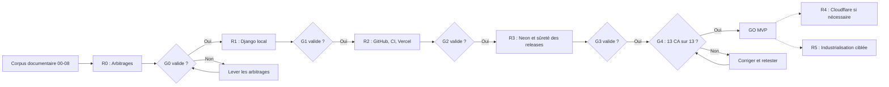

# ROADMAP - Socle Django, GitHub, Vercel, Neon et Cloudflare

> **09 - Roadmap de réalisation, de validation et d'évolution**  
> **Version :** 1.0  
> **Date :** 18 novembre 2026  
> **Statut :** Proposition d'exécution, à approuver  
> **Projet de référence :** `django-cloud-starter` (nom provisoire)  
> **Horizon :** livraison du MVP R0-R3, puis évolutions conditionnelles R4-R5  
> **Origine :** consolidation des documents `00` à `08`

**État constaté au moment de la rédaction :** le corpus documentaire `00` à `08` est produit. **Aucune création de dépôt, configuration des comptes, migration, exécution de CI, mise en ligne ou restauration n'est considérée comme réalisée.** Toute coche technique reste donc vide.

---

## 1. Vision et résultat final attendu

Construire un **socle applicatif Django modulaire, simple à reproduire et suffisamment sûr pour évoluer**, capable d'exécuter le parcours suivant :

```text
Développement local Django
    -> commit et pull request GitHub
    -> GitHub Actions : lint, tests et contrôles de sécurité
    -> Vercel Preview : application et base PostgreSQL isolées
    -> revue et fusion contrôlée sur main
    -> déploiement automatique du code sur Vercel
    -> PostgreSQL Neon : données persistantes
    -> smoke tests, journaux et diagnostic
    -> reprise documentée si incident
```

**Cloudflare** reste facultatif pour le MVP : DNS personnalisé, Turnstile, stockage objet et capacités edge ne sont introduits que lorsqu'une fonctionnalité, un risque ou un volume mesuré les rend nécessaires.

### 1.1 Objectifs non négociables

1. Déployer Django directement sur Vercel, sans structure héritée sous `/api/` par défaut.
2. Conserver une architecture **monolithe Django + templates + Django Admin + Django Auth** pour le premier incrément.
3. Assurer la reproductibilité du projet par Git, lockfile, README, variables explicites et tests.
4. Vérifier que les environnements **Local, CI, Preview et Production** possèdent les frontières de confiance attendues.
5. Ne jamais connecter une Preview à la base PostgreSQL de Production en écriture.
6. Garantir que les données de Preview proviennent de jeux **synthétiques**, pas d'un clone non contrôlé de Production.
7. **Séparer le déploiement du code de la migration du schéma** et vérifier la compatibilité N/N-1.
8. Disposer de preuves de persistance, diagnostic, rollback du code et restauration isolée des données.
9. Valider les **13 critères CA-01 à CA-13** avant de prononcer le GO MVP.
10. Ne pas ajouter React, DRF, workers, Cloudflare avancé ou Py**Kit sans besoin concret démontré.

### 1.2 Deux niveaux de réussite

| Niveau | Définition | Autorité de validation |
|---|---|---|
| **MVP opérationnel** | Application Django et parcours CI/CD/DB sûrs, `CA-01` à `CA-13` tous validés | Responsable du projet, après dossier de preuves |
| **Starter industrialisé** | MVP réutilisé dans un deuxième projet et observé en exploitation | Responsable du projet, à l'issue de R5 |

Une mise en ligne HTTPS seule **ne suffit pas** à qualifier le MVP.

---

## 2. Périmètre et arbitrages

### 2.1 Obligatoire pour le MVP (P0)

- Projet Python/Django reproductible et versionné.
- Module de démonstration `Record`, CRUD, permissions, authentification et administration.
- Dépôt GitHub, pull requests, tests GitHub Actions et garde de fusion adaptée au plan.
- Hébergement Vercel, URL HTTPS et mise à jour automatique liée au commit `main`.
- Base PostgreSQL Neon persistante, comptes et connexions séparés.
- CI avec PostgreSQL de test isolé et Preview qui **ne peut pas** écrire en Production.
- Migrations testées puis autorisées en dehors du build Vercel et des requêtes web.
- Vérification de secrets, sécurité Django, observabilité minimale et reprise.
- Réception sur `CA-01` à `CA-13`, sans défaut critique ou majeur ouvert.

### 2.2 Important, mais non bloquant tant que le risque reste maîtrisé (P1)

- Reproductibilité avec un deuxième clone/projet et extraction du starter.
- Suivi approfondi des performances, de la durée CI et des coûts.
- Réglages de connexion et pooling avancés lorsque des mesures le justifient.
- Monitoring et alertes enrichis selon la criticité réelle.

### 2.3 Facultatif ou déclenché par l'usage (P2)

- Cloudflare DNS pour un domaine personnalisé.
- Cloudflare Turnstile pour les formulaires publics.
- Cloudflare R2 **ou** Neon Object Storage pour les médias utilisateurs.
- Cloudflare WAF/proxy, Workers, Queues, Workflows, Hyperdrive.
- Django REST Framework et frontend React/Next.js séparé.
- Worker Python dédié pour traitements longs.
- Packages Py**Kit justifiés par le cas d'usage.

### 2.4 Exclusions initiales

Aucun microservice imposé, Kubernetes, orchestration de conteneurs obligatoire, deuxième système d'authentification, base D1 substituée à Neon, copie de données réelles en Preview, ni automatisation aveugle de migrations de Production.

---

## 3. Carte des phases et des gates

**Phases de livraison :**

| Phase | Incrément | Objectif observable | Gate de sortie | État initial |
|---|---|---|---|---|
| **R0** | I0 | Décisions, contraintes et périmètre confirmés | **G0** | Non commencé |
| **R1** | I1 | Django local, CRUD, Django Auth/Admin et tests | **G1** | Non commencé |
| **R2** | I2-I3 | GitHub, CI, Vercel, Preview préparée et HTTPS | **G2** | Non commencé |
| **R3** | I4-I5 | Neon, isolation, migrations, preuves et GO MVP | **G3 + G4** | Non commencé |
| **R4** | I6-option | Services Cloudflare retenus sur besoin | **G-CF0 à G-CF3** | Différé |
| **R5** | I6-indus | Réutilisation, mesures et améliorations ciblées | **G5** | Différé |

**Ordre recommandé :** R0 -> R1 -> R2/R3 avec travaux d'intégration coordonnés -> G4. R4 et R5 peuvent être réalisés **indépendamment**, au fil des besoins. R4 n'est pas un passage obligé vers R5.



> **Important :** l'ordre de déploiement de Vercel et des migrations Neon peut nécessiter une orchestration plus fine qu'un simple ordre linéaire. Toute migration incompatible avec l'ancien ou le nouveau code exige un gate effectif de promotion, et non un simple workflow manuel exécuté après la fusion automatique.

---

## 4. R0 - Cadrage exécutable

**But :** fermer uniquement les arbitrages qui bloquent les premières actions techniques.

### R0.1 Décisions à prendre

| ID | Arbitrage | Choix proposé, non encore validé | Bloque |
|---|---|---|---|
| OA-01 | Premier usage et nature de l'exploitation | Démonstrateur personnel avant usage commercial | Choix du plan et du domaine |
| OA-02 | Compte ou organisation GitHub | Dépôt distinct, cible à nommer | Création du dépôt |
| OA-03 | Nom du projet | `django-cloud-starter` | Scripts, dépôt, projets Vercel |
| OA-04 | Fonctionnalité verticale | CRUD `Record` synthétique | R1 |
| OA-05 | Versions et dépendances | Python 3.12, Django 5.2 LTS et `uv`, à confirmer sur le runtime cible | Build et CI |
| OA-06 | Régions | Application et Neon proches, adaptées aux exigences de données | Vercel et Neon |
| OA-07 | Politique Preview | Base indépendante et jeu synthétique ; pas de clone de données réelles | Mise en ligne des PR |
| OA-08 | Exécution migrations Prod | Étape dédiée, approbation et test de compatibilité | Release avec schéma |
| OA-09 | Domaine | URL `vercel.app` initiale | R4 seulement |
| OA-10 | Budget et plan | Vérifier l'usage autorisé et les quotas réels | Première mise en ligne |
| OA-11 | Sauvegarde/restauration | Exercice isolé avant GO | R3/G4 |
| OA-12 | API, frontend, jobs | Hors MVP | R4/R5 seulement |

### R0.2 Travaux prioritaires

- [ ] `US-001` : arrêter le scénario `Record` et les rôles de démonstration.
- [ ] `US-002` : valider runtime Python/Django, `uv` et verrouillage des dépendances.
- [ ] `US-003` : définir dépôt, visibilité, branche de production et accès.
- [ ] `US-004` : confirmer l'usage, les conditions Vercel, la région et le budget.
- [ ] Choisir comment protéger `main` compte tenu des possibilités du dépôt.
- [ ] Consigner les décisions et expliciter les risques acceptés.

**Livrables :** `R0_DECISIONS.md` ou registre ADR actualisé, mini-fiche du cas `Record`, registre des accès sans valeurs sensibles, décision de plan/région.

**G0 - GO si :** les versions, le dépôt, l'usage, les régions et l'isolation Preview sont définis. **NO-GO si :** l'usage commercial est prévu sur une offre ne l'autorisant pas, les frontières de données sont inconnues ou les accès administratifs ne sont pas clarifiés.

---

## 5. R1 - Socle Django local et premier parcours utilisateur

**But :** avoir un projet qui tourne et dont on peut vérifier le comportement avant d'intégrer des services cloud.

### R1.1 Initialisation reproductible

- [ ] `US-005` : créer le monolithe Django modulaire (`config/`, `apps/`, `templates/`, `static/`, `tests/`).
- [ ] `US-006` : mettre en place les settings par environnement et `.env.example` sans secrets.
- [ ] `US-007` : implémenter une page publique avec statiques.
- [ ] `US-017` : documenter installation, lancement et tests depuis un clone vierge.
- [ ] Valider `manage.py`, `wsgi.py`, dépendances et chemin de `collectstatic`.

### R1.2 Vertical slice `Record`

- [ ] `US-008` : modèle et première migration versionnée.
- [ ] `US-010` : Django Auth et Django Admin.
- [ ] `US-009` : affichage, création, modification et suppression avec permissions serveur.
- [ ] `US-011` : tests du modèle, des formulaires, des routes et des erreurs.
- [ ] `US-032` : base des réglages de sécurité Django, dont `check --deploy` à appliquer dans le contexte production.
- [ ] `US-033` : tests d'accès non autorisé, CSRF, permissions et messages d'erreur.

### R1.3 Critères G1

| Contrôle | Preuve attendue |
|---|---|
| Installation neuve | Console / journal de bootstrap sur poste ou CI vierge |
| Django local | Test HTTP de la page publique |
| CRUD complet | Tests automatiques create/read/update/delete |
| Auth/Admin | Tests refus anonyme, refus sans permission, accès autorisé |
| Migrations | Vérification de l'état de migration et versionnement Git |
| Secrets | Scan `.env`, contrôle `.gitignore` et configuration expurgée |

**G1 - GO si :** le premier parcours local est reproductible et sécurisé, sans base Production. Les données locales peuvent être en PostgreSQL local ou Neon Dev distinct ; la cible finale demeure PostgreSQL Neon.

**Stories dominantes :** `US-005` à `US-011`, `US-017`, `US-032`, `US-033`.

---

## 6. R2 - GitHub, qualité et déploiement automatique Vercel

**But :** démontrer un parcours de contribution fiable et une publication automatique du code.

### R2.1 GitHub et CI

- [ ] `US-012` : publier le dépôt sans secrets ni fichiers locaux sensibles.
- [ ] `US-013` : configurer contrôles Ruff, dépendances et détection de secrets.
- [ ] `US-014` : activer `.github/workflows/ci.yml` pour pull requests.
- [ ] `US-015` : tester modèles et migrations sur PostgreSQL CI temporaire/isolé.
- [ ] `US-016` : configurer la politique de fusion et documenter les limites éventuelles du plan.
- [ ] `US-031` : garantir l'absence d'accès CI à Neon Production.
- [ ] `US-034` : définir les permissions GitHub Actions et les scopes de secrets.
- [ ] Tester une PR qui réussit **et** une PR volontairement défaillante.

### R2.2 Intégration Vercel

- [ ] `US-018` : connecter GitHub et le projet Vercel, vérifier la détection Django native.
- [ ] `US-019` : obtenir une URL HTTPS en configuration de production sûre.
- [ ] `US-022` : vérifier `STATIC_ROOT` et les fichiers statiques servis en ligne.
- [ ] `US-023` : relier déploiement, commit SHA et journaux.
- [ ] `US-020` : démontrer qu'une fusion autorisée sur `main` déclenche une version en ligne.
- [ ] Préparer `US-021` (Preview), mais **ne déclarer aucune Preview prête** avant la validation de `US-026` en R3.

### R2.3 Interdictions et garde-fous

- Ne pas donner de secret PostgreSQL de Production au workflow de pull request.
- Ne pas utiliser un `DATABASE_URL` de Production comme fallback dans Preview.
- Ne pas appliquer `migrate` sur Production pendant `build`, `collectstatic`, import Python ou démarrage web.
- Ne pas considérer qu'un build Vercel réussi équivaut à la validation des tests GitHub ; configurer les protections de fusion et contrôles de promotion réellement disponibles.
- Ne pas compter sur le système de fichiers local Vercel pour la persistance.

### R2.4 Critères G2

| Contrôle | Preuve attendue |
|---|---|
| Source GitHub | Dépôt et commit identifié |
| CI positive et négative | Deux exécutions et statuts GitHub Actions |
| Fusion protégée | Capture/configuration ou mesure équivalente documentée |
| Vercel Django | Logs de build expurgés, application HTTPS |
| Fichiers statiques | CSS et autres assets sans 404 |
| Correspondance commit/version | SHA GitHub = révision Vercel |
| Secrets | Aucun secret réel dans Git ou logs |

**G2 - GO si :** les contrôles de contribution sont réellement opérants, le déploiement du code fonctionne et l'environnement cible est cohérent. Une Preview munie d'une URL mais non isolée n'est pas validée.

**Stories dominantes :** `US-012` à `US-016`, `US-018` à `US-023`, `US-031`, `US-034`.

---

## 7. R3 - Neon, isolation, migrations et acceptation MVP

**But :** fiabiliser la donnée et démontrer que le cycle de release ne met pas Production en danger.

### R3.1 PostgreSQL Neon et frontières d'environnement

- [ ] `US-024` : projet Neon, région, bases, rôles et secrets appropriés.
- [ ] `US-025` : connecter Django à Neon avec TLS et politique de connexion documentée.
- [ ] `US-026` : isoler toute Preview de Production et alimenter les bases Preview par données synthétiques.
- [ ] `US-031` : prouver l'isolement PostgreSQL de CI.
- [ ] `US-035` : appliquer une politique de confidentialité / interdiction de données réelles en Preview.
- [ ] `US-030` : observer les connexions/pooling ; corriger avant GO si un risque de stabilité apparaît.
- [ ] Tester une opération sur Preview avec sentinelles pour établir qu'elle n'écrit pas sur Production.

### R3.2 Migrations Django sûres

- [ ] `US-027` : classifier les migrations, valider CI sur PostgreSQL, gérer approbations et logs de release.
- [ ] Séparer le rôle web de celui qui a les privilèges de migration lorsque l'architecture le permet.
- [ ] Tester une évolution additive compatible N/N-1 sur une base non productive.
- [ ] Contrôler le SHA exact et la cible PostgreSQL avant toute mutation Production.
- [ ] Interdire les déploiements incompatibles tant qu'un mécanisme de promotion réellement bloquant n'existe pas.
- [ ] Enregistrer un plan de récupération indépendant du rollback du code.

**Règle de séquencement :**

| Changement de schéma | Politique de release |
|---|---|
| Aucun changement | Déploiement du code automatique après contrôles |
| Migration additive compatible N/N-1 | Migration autorisée dans l'ordre préparé, puis déploiement éligible avec smoke tests |
| Migration de données longue | Procédure spécifique, idempotence, reprise et observation |
| Suppression, renommage incompatible, transformation risquée | **NO-GO** pour une simple fusion + autodeploy ; mettre en place un vrai gate de promotion ou une fenêtre de maintenance appropriée |

### R3.3 Persistance, restauration et exploitation

- [ ] `US-028` : créer un `Record` sur Production, redéployer sans changement destructif, retrouver l'enregistrement.
- [ ] `US-029` : tester une restauration dans une base/branche **isolée** et documenter ce qui peut être récupéré.
- [ ] `US-036` : documenter logs, erreurs et corrélation au déploiement.
- [ ] `US-037` : exercer un rollback applicatif non destructif.
- [ ] `US-038` : vérifier plan, quotas, budget et alertes possibles.
- [ ] `US-043` : disposer d'un runbook utilisable, fondé sur des exercices réels.
- [ ] Exécuter les scénarios PostgreSQL `DB-001` à `DB-023` selon leur matrice de test et archiver les résultats.
- [ ] Contrôler les 12 invariants `DATA-INV-01` à `DATA-INV-12`.

### R3.4 Recette et décision d'acceptation

- [ ] `US-041` : exécuter la campagne de recette `06` avec preuves datées.
- [ ] `US-042` : consolider les `CA-01` à `CA-13`, `AT-01` à `AT-15` et risques.
- [ ] Prononcer explicitement GO ou NO-GO, avec décision traçable.

**G3 - GO si :** données persistantes, CI et Preview isolées, migrations autorisées et séparées du build, restauration isolée exercée, pas de secret exposé.

**G4 - GO MVP si, et seulement si :** `13/13` critères CA en `PASS`, zéro défaut S0 ou S1 ouvert, invariants critiques prouvés, dossier de preuves complet, runbook et responsabilités définis, approbation explicite du responsable.

**Stories dominantes :** `US-021`, `US-024` à `US-031`, `US-035` à `US-038`, `US-041` à `US-043`.

---

## 8. R4 - Cloudflare, activé uniquement sur signal métier

**Statut :** différé, non bloquant pour le GO MVP.

### R4.1 Catalogue par déclencheur

| Option | Déclencheur observable | Backlog | Décision et preuve d'entrée |
|---|---|---|---|
| DNS Cloudflare | Domaine personnalisé voulu | `US-045`, `CF-T01/02` | DNS-only, résolution et TLS Vercel vérifiés |
| Turnstile | Formulaire public sujet aux abus | `US-046`, `CF-T03/04` | Vérification serveur du token et tests négatifs |
| Stockage objet | Fichiers persistants déposés par les utilisateurs | `US-047`, `CF-T05/06/07` | Comparer **R2 ou Neon Object Storage**, accès privé, cycle de vie |
| Proxy/WAF Cloudflare | Besoin de protection non couvert par l'architecture actuelle | `US-048`, `CF-T08` | Analyse double proxy, cache, SSL/TLS, IP réelles |
| Workers | Traitement edge précisément identifié | `CF-T09` | Contrat de responsabilité, coût, sécurité, test |
| Queues / Workflows | Événements/tâches asynchrones fiables nécessaires | `CF-T10` | Idempotence, retries, dead letters/échecs, observabilité |
| Hyperdrive | Worker effectivement connecté à PostgreSQL | `CF-T11` | Mesures et modèle de menace |
| Access | Protection d'une interface interne identifiée | ADR complémentaire | Politique d'accès et test de récupération |
| Images / Stream / AI | Besoin média ou IA identifié | ADR complémentaire | Valeur concrète, coût et confidentialité |

### R4.2 Règles de conception

1. Le DNS Cloudflare **DNS-only** n'intercepte pas les requêtes HTTP : il ne fournit donc pas à lui seul la protection WAF Cloudflare devant Vercel.
2. Vercel continue de servir l'application Django principale et ses statiques ; un second CDN/proxy n'est pas ajouté par défaut.
3. Les fichiers utilisateurs, s'ils existent, sont persistés sur un stockage objet adapté, jamais sur le disque local de la Function.
4. Une option Cloudflare ne doit pas déplacer involontairement la source de vérité métier hors de Neon.
5. Toute nouvelle option doit posséder son propre plan de retrait et son propre dossier de tests.

### R4.3 Gate d'adoption d'une option

- **G-CF0 :** besoin mesuré ou obligation explicite ; alternatives, y compris « ne rien faire », étudiées.
- **G-CF1 :** design, données, secrets, permissions, compatibilité de plan et coûts approuvés.
- **G-CF2 :** tests positifs/négatifs, isolation, observabilité et rollback réussis en non-Production.
- **G-CF3 :** activation autorisée, surveillance, runbook et preuve après déploiement.

**G-CF NO-GO immédiat :** mise en danger des données, responsabilité du cache incertaine, absence de plan de retrait, coût non maîtrisé, duplication injustifiée de la logique applicative.

---

## 9. R5 - Industrialisation et évolution ciblée

**Statut :** différé jusqu'à l'obtention d'une première application opérationnelle ou d'un besoin réel.

### R5.1 Reproductibilité et qualité

- [ ] `US-039` : ajuster la surveillance aux incidents et exigences réels.
- [ ] `US-040` : refaire l'installation depuis un clone vierge et un environnement distinct.
- [ ] `US-044` : extraire un starter Django effectivement réutilisable.
- [ ] Mesurer durées de build, durée CI, temps de réponse, erreurs, connexions Neon et coût réel.
- [ ] Mettre à niveau dépendances et contrôles CI selon les risques observés.
- [ ] Vérifier une nouvelle fois les conditions de l'offre d'hébergement si l'usage change.

### R5.2 Extensions déclenchées par le produit

| Extension | Déclencheur | Stories / tâches | Résultat nécessaire |
|---|---|---|---|
| API DRF | Client API ou intégration identifiée | `US-049`, `CF-T12` | Contrats d'API, tests de permissions |
| React / Next.js | UX nécessitant une interface séparée | `US-050`, `CF-T12` | E2E, CORS/auth/cookies et décisions de repo |
| Jobs Python / Workers | Travail long, reprise ou planification spécifique | `US-051`, `CF-T13` | Retries, idempotence, séparation des ressources |
| Py**Kit | Fonction métier réutilisable prouvée | `US-052`, `CF-T14` | API stable et tests d'intégration |
| Tout changement significatif | Préparation de release | `CF-T15` | Nouvelle recette, revue de sécurité et budget |

### R5.3 Critères G5

- Une seconde application démarre à partir du socle sans réutiliser des secrets, bases ou identifiants du premier projet.
- Les conventions de développement, de release et d'exploitation sont comprises par un autre contributeur ou lors d'un exercice de réinstallation.
- Les améliorations introduites disposent d'une mesure avant/après ou d'un besoin explicite.
- Les coûts, les nouveaux risques et les processus de retrait sont documentés.

---

## 10. Registre d'exécution - jalons et dépendances

| Jalons | Dépendances bloquantes | Sortie vérifiable | Responsable proposé |
|---|---|---|---|
| **M0 : cadre approuvé** | Documents 00-08, décisions OA utiles | G0 signé | Propriétaire technique |
| **M1 : application locale** | M0, environnement Python | G1 + tests CRUD/Auth | Développeur |
| **M2 : dépôt et pipeline** | M1, GitHub | CI verte/rouge + politique PR | Développeur / mainteneur |
| **M3 : déploiement HTTP** | M2, compte Vercel conforme | HTTPS + déploiement SHA | Mainteneur |
| **M4 : isolation données** | M0, Neon, M2/M3 | Tests de sentinelles Preview/CI | Responsable données |
| **M5 : release DB maîtrisée** | M4, workflow de migration | Migration isolée + gate effectif | Opérateur habilité |
| **M6 : MVP validé** | M3, M4, M5 | 13 CA PASS, GO signé | Propriétaire projet |
| **M7 : Cloudflare ciblé** | M6 + besoin justifié | Gate G-CF3 option par option | Propriétaire option |
| **M8 : starter réutilisable** | M6, deuxième cas concret | G5 et dossier de mesures | Mainteneur |

**M2/M3/M4 peuvent être préparés en parallèle**, mais leur validation est ordonnée par les contraintes de sécurité. Le premier déploiement HTTP n'autorise pas l'utilisation de données de Production depuis une Preview non validée.

### 10.1 Backlog minimal d'amorçage

Il n'est pas nécessaire d'ouvrir les 52 user stories simultanément. Première sélection :

1. `US-001` : démonstrateur `Record`.
2. `US-002` : versions et gestion des dépendances.
3. `US-003` : destination et règles du dépôt.
4. `US-004` : usage, plan et région.
5. `US-005` : initialisation Django.
6. `US-006` : settings et secrets.
7. `US-008` : modèle `Record` et migrations locales.
8. `US-010` : Django Admin / Auth.
9. `US-009` : CRUD et permissions.
10. `US-011` : tests du parcours.

**Première démonstration recherchée :** un clone local qui installe et exécute un CRUD Django authentifié avec une suite de tests verte. **Deuxième démonstration :** PR + CI + Vercel + Neon avec Preview sûre.

---

## 11. Matrice de traçabilité des 13 critères d'acceptation

| CA | Réussite attendue | Jalon | Stories principales | État initial |
|---|---|---|---|---|
| CA-01 | Nouveau clone installable par README | M1 | US-005, US-017 | À tester |
| CA-02 | Application Django HTTPS sur Vercel | M3 | US-018, US-019 | À tester |
| CA-03 | CRUD réellement stocké sur Neon | M4/M5 | US-025, US-009 | À tester |
| CA-04 | Données inchangées après redeploy | M6 | US-028, US-020 | À tester |
| CA-05 | CI déclenchée par PR | M2 | US-014 | À tester |
| CA-06 | Contrôles bloquants de `main` définis | M2 | US-016 | À tester |
| CA-07 | Fusion vers `main` -> version Vercel | M3 | US-020 | À tester |
| CA-08 | Aucune écriture Preview -> Production | M4 | US-021, US-026, US-031 | À tester |
| CA-09 | Admin et opérations sensibles protégés | M1/M6 | US-010, US-033 | À tester |
| CA-10 | Aucun secret réel dans le dépôt | M1/M2 | US-006, US-013, US-034 | À tester |
| CA-11 | Migrations traçables et contrôlées | M5 | US-027 | À tester |
| CA-12 | Diagnostic et retour arrière documentés | M6 | US-036, US-037, US-043 | À tester |
| CA-13 | Plan d'hébergement compatible avec l'usage | M0/M6 | US-004, US-038 | À vérifier |

**Contrôle complémentaire de cohérence :** `AT-01` à `AT-15`, `DATA-INV-01` à `DATA-INV-12` et `DB-001` à `DB-023` sont vérifiés conformément aux documents `01`, `05` et `06`. La validation ne se réduit pas à la présente matrice synthétique.

---

## 12. Contraintes transversales de sécurité, qualité et exploitation

### 12.1 Invariants à préserver pendant toutes les phases

- [ ] Credentials Preview et Production différents (`DATA-INV-01`).
- [ ] CI incapable d'accéder à Neon Production (`DATA-INV-02`).
- [ ] Preview incapable d'écrire sur Production (`DATA-INV-03`).
- [ ] Données Preview synthétiques (`DATA-INV-04`).
- [ ] Aucune migration de Production dans build ou requête Vercel (`DATA-INV-05`).
- [ ] Toute migration Production liée à un SHA et à une autorisation (`DATA-INV-06`).
- [ ] Migrations versionnées et testées sur PostgreSQL isolé (`DATA-INV-07`).
- [ ] Rollback de code distinct du rollback de schéma (`DATA-INV-08`).
- [ ] Restauration éprouvée sans mutation destructive de Production (`DATA-INV-09`).
- [ ] Aucun secret versionné, exposé ou partagé entre scopes (`DATA-INV-10`).
- [ ] Aucune persistance métier sur disque Vercel éphémère (`DATA-INV-11`).
- [ ] Déploiement incompatible avec le schéma bloqué ou orchestré (`DATA-INV-12`).

### 12.2 Séparation des environnements

| Environnement | Hébergement applicatif | Données | Règle d'accès |
|---|---|---|---|
| Local | Poste développeur | PostgreSQL local ou Neon Dev | Jamais les credentials Prod par défaut |
| CI | GitHub Actions | Service PostgreSQL temporaire / base de test | Aucun secret Prod |
| Preview | Vercel par PR | Branche/base dédiée, synthétique | Aucune écriture en Prod |
| Production | Vercel principal | Neon Prod | Credentials propres et contrôles de migration |

### 12.3 Règles de preuve

Une preuve d'exécution doit contenir : **identifiant**, date et heure (UTC si pertinent), environnement, version/SHA, action effectuée, résultat, contrôle réussi/échoué, responsable et référence à l'artefact. Aucun mot de passe, jeton, URL DB complète ou donnée personnelle n'y figure.

### 12.4 Absence de calendrier arbitraire

Les durées ne sont pas fixées à l'avance. Les tailles `S`, `M`, `L` du backlog ne représentent pas des jours. Pour estimer et ordonnancer le travail :

1. Réaliser R0 et la première vertical slice Django.
2. Mesurer le temps effectif de bootstrap, de test et de déploiement.
3. Réestimer les stories restantes en fonction des difficultés réellement observées.
4. Fixer des dates uniquement après connaissance de la capacité disponible, des accès et des risques de dépendance.

---

## 13. Risques et mesures de maîtrise

| Risque | Niveau | Prévention | Conséquence sur la roadmap |
|---|---|---|---|
| Preview avec accès DB Production | Critique | Scopes distincts, sentinelles, tests négatifs | Bloque M4 et tout GO |
| Branches Neon copiées depuis des données réelles | Critique | Source synthétique contrôlée | Bloque M4 |
| Migration incompatible lors d'un autodeploy | Critique | Expand/migrate/contract et gate effectif | Bloque M5 |
| Secret exposé | Critique | Scan, rotation, moindre privilège | Incident, suspendre release |
| Usage commercial sur un plan non autorisé | Élevé | Revue des conditions du plan | Bloque M0/M3 |
| Perte de données ou restauration non testée | Élevé | Exercice isolé et runbook | Bloque M6 |
| Protection de `main` indisponible ou inefficace | Élevé | Alternative formalisée, revue explicite | Bloque M2 si contrôle insuffisant |
| Épuisement des connexions PostgreSQL | Moyen à élevé | Tests et mesures de pooling | Traiter avant GO si instable |
| Double proxy Cloudflare/Vercel | Moyen | DNS-only initial, étude préalable | Différer R4 |
| Multiplication de services sans valeur | Moyen | Gate de besoin et comparaison « ne rien faire » | Différer R4/R5 |
| Coûts non surveillés | Moyen | Plan, quotas, alertes, registre | Revue M0 puis M6 |

---

## 14. Registre de suivi et statut global

### 14.1 Convention

- `Non commencé` : aucune preuve d'implémentation.
- `En cours` : actions techniques engagées, artefacts en construction.
- `Bloqué` : précondition ou risque empêche l'avancement.
- `À valider` : travaux réalisés, preuves incomplètes ou revue nécessaire.
- `Validé` : gate satisfait avec preuves et approbation.
- `Différé` : option P1/P2 non déclenchée.

### 14.2 Suivi initial au 18 novembre 2026

| Élément | Statut | Observation / prochaine preuve |
|---|---|---|
| Documents `00` à `08` | **Rédigés** | Révision / acceptation formelle des ADR encore nécessaire |
| R0 / G0 | Non commencé | Relevé d'arbitrages et décision d'usage |
| R1 / G1 | Non commencé | Dépôt local et tests Django |
| R2 / G2 | Non commencé | Exécutions CI et déploiement Vercel |
| R3 / G3 | Non commencé | Bases isolées, migrations et restauration |
| Recette G4 | Non commencé | PV `CA-01` à `CA-13` |
| R4 / Cloudflare | Différé | Déclencheur métier requis |
| R5 / Industrialisation | Différé | Première app utilisatrice requise |

### 14.3 Modèle de revue d'avancement

```markdown
## Revue d'avancement - YYYY-MM-DD

- Phase / milestone : R?/M?
- Statut : Non commencé | En cours | Bloqué | À valider | Validé
- Responsable : [rôle]
- Commits / PR : [références]
- Livrables depuis la dernière revue : ...
- Tests et preuves : ...
- Risques ou incidents : ...
- Décisions prises : ...
- Dépendances bloquantes : ...
- Prochaines actions (max. 3) : ...
- GO / NO-GO : ...
```

---

## 15. Matrice commit -> workflow -> déploiement -> vérification -> résultat

Chaque release doit pouvoir être retracée sur la chaîne complète :

| PR / commit | Workflow | Résultat CI | Vercel Deployment | DB ciblée | Migration | Vérifications post-déploiement | Verdict |
|---|---|---|---|---|---|---|---|
| À renseigner | `ci.yml` | Non exécuté | Non déployé | Non configurée | Non exécutée | Non exécutées | **Indéterminé** |

**Champs obligatoires au moment de l'exécution :** PR, SHA exact, horodatage UTC, identifiant du run, environnement, branche/identifiant DB (sans secret), état de migration, résultat des smoke tests et approbateur.

### 15.1 Règles de clôture d'une release

- [ ] PR et commit identifiés.
- [ ] Contrôles CI obligatoires verts.
- [ ] Prévisualisation isolée vérifiée lorsque applicable.
- [ ] Impacts de schéma et compatibilité N/N-1 examinés.
- [ ] Migrations éventuelles exécutées par procédure autorisée et tracée.
- [ ] Version Vercel publiée conforme au SHA cible.
- [ ] Smoke tests Production réussis.
- [ ] Logs et état Neon inspectés sans divulgation de secrets.
- [ ] Retour arrière du code et plan de reprise des données disponibles.
- [ ] Clôture du rapport de release.

---

## 16. Critères de décision GO / NO-GO

### 16.1 G0 - Autorisation de démarrer

- [ ] Usage, propriétaire, dépôt, versions, régions et plan conformes.
- [ ] Politique de secrets et d'isolation approuvée.
- [ ] Backlog initial suffisamment découpé.

### 16.2 G1 - Application locale

- [ ] Installation et démarrage reproductibles.
- [ ] CRUD, authentification, permissions et tests fonctionnels.
- [ ] Configuration sûre, aucun secret dans le dépôt.

### 16.3 G2 - Livraison CI/CD

- [ ] CI positive/négative prouvée.
- [ ] Fusion contrôlée sur `main`.
- [ ] Déploiement Vercel HTTPS et traçabilité SHA.

### 16.4 G3 - Données et sécurité de release

- [ ] Neon persistant configuré.
- [ ] CI et Preview strictement isolées.
- [ ] Migrations contrôlées, testées, hors build.
- [ ] Test de redéploiement/persistance réussi.
- [ ] Restauration isolée exercée.

### 16.5 G4 - Acceptation officielle du MVP

- [ ] `CA-01` à `CA-13` : **13 PASS / 13**.
- [ ] **0 défaut S0 ou S1 ouvert**.
- [ ] `DATA-INV-01` à `DATA-INV-12` vérifiés sans échec bloquant.
- [ ] Contrôles `AT-01` à `AT-15` et tests DB couverts par le dossier de recette.
- [ ] Dossier de preuves horodaté, sécurité et budget revus.
- [ ] Runbook, diagnostic, rollback et restauration disponibles.
- [ ] Décision GO explicite du responsable.

### 16.6 G5 - Industrialisation / extensions

- [ ] Une nécessité ou une valeur mesurable motive chaque option.
- [ ] ADR, contrat, intégration, coût, sécurité et réversibilité documentés.
- [ ] Nouvelle suite de tests et exploitation préparées.

**NO-GO immédiat** en cas de fuite de secrets, accès Preview/CI à Production, données réelles non autorisées en Preview, migration dangereuse sans contrôle, échec de test bloquant ou incompatibilité de l'offre d'hébergement avec la nature de l'usage.

---

## 17. Décisions ouvertes, responsabilités et autorisations

### 17.1 Gouvernance minimale

| Action | Rôle qui prépare | Rôle qui autorise / valide |
|---|---|---|
| Création du dépôt et projet Vercel | Mainteneur | Propriétaire du projet |
| Création du projet/base Neon | Responsable technique | Propriétaire du projet |
| Mise en place secrets Production | Opérateur habilité | Propriétaire / administrateur |
| Fusion `main` | Développeur / relecteur | Selon protections GitHub actives |
| Migration de schéma Production | Opérateur DB | Responsable de release / approbateur |
| Restauration Production | Opérateur DB | Responsable des données / projet |
| Activation d'un service Cloudflare | Responsable de l'option | Propriétaire après gate G-CF |
| Acceptation du MVP | Équipe de réalisation | Propriétaire du projet |

Ces rôles peuvent être tenus par une seule personne dans un projet individuel, mais le **point d'autorisation et la trace de décision** restent nécessaires pour toute action sensible.

### 17.2 Autorisations non déduites du document

La présente roadmap ne donne **aucune permission d'exécuter** une création d'infrastructure, de publier un dépôt, d'engager des dépenses, de déployer ou de modifier une base. Les comptes et leur configuration actuelle devront être inspectés uniquement dans le cadre de la mise en œuvre autorisée.

---

## 18. Prochaines actions concrètes

### Tranche A - Préparation immédiate, avant code

- [ ] Consigner explicitement les quatre arbitrages les plus bloquants : **usage personnel ou commercial, dépôt cible, module `Record`, versions Python/Django**.
- [ ] Confirmer région, quotas et coûts réels Vercel/Neon.
- [ ] Arrêter la politique CI/Preview avec sources synthétiques.
- [ ] Accepter ou ajuster les ADR `001` à `018` utiles à l'implémentation.

### Tranche B - Première livraison de code

- [ ] Initialiser le squelette Django conformément au document `03`.
- [ ] Installer et verrouiller les dépendances.
- [ ] Implémenter le modèle `Record`, ses migrations locales, l'authentification et l'Admin.
- [ ] Implémenter le CRUD web et les tests d'autorisation.
- [ ] Vérifier les tests depuis un clone neuf.

### Tranche C - Première chaîne cloud

- [ ] Publier le dépôt GitHub autorisé.
- [ ] Activer GitHub Actions et règles de fusion effectives.
- [ ] Connecter Vercel, vérifier HTTPS, les statiques et la traçabilité SHA.
- [ ] Ajouter Neon avec séparation Production/Preview/CI.
- [ ] Exécuter migration contrôlée, persistance E2E, isolation et restauration isolée.
- [ ] Consolider G4 avec 13 critères PASS.

**Premier point de décision :** autoriser la Tranche B après le contrôle G0. **Première valeur visible :** une application CRUD Django qui fonctionne localement et dont les tests sont verts.

---

## 19. Index documentaire `00` à `08`

| Document | Rôle dans la réalisation |
|---|---|
| `00_DJANGO_GITHUB_VERCEL_NEON_CLOUDFLARE_EXPRESSION_DU_BESOIN.md` | Vision, UC, exigences, CA-01 à CA-13 |
| `01_ARCHITECTURE_ET_DECISIONS.md` | Architecture, ADR-001 à ADR-018, OA-01 à OA-12, AT-01 à AT-15 |
| `02_BACKLOG_ET_USER_STORIES.md` | 10 epics, 52 stories US-001 à US-052, priorités, DoR/DoD |
| `03_STRUCTURE_PROJET_ET_CONFIGURATION.md` | Arborescence, modules, Python/Django, variables, configuration |
| `04_PLAN_IMPLEMENTATION_ET_CI_CD.md` | Commandes de démarrage, CI GitHub, Vercel, release de migration |
| `05_STRATEGIE_DONNEES_ET_MIGRATIONS.md` | Neon, 12 invariants DATA-INV, DB-001 à DB-023, restauration |
| `06_STRATEGIE_TESTS_ET_ACCEPTATION.md` | Campagne de recette, preuves, severités, GO/NO-GO |
| `07_RUNBOOK_DEPLOIEMENT_ET_EXPLOITATION.md` | Runbooks de release, incident, rollback, restauration, rotation |
| `08_OPTIONS_CLOUDFLARE_ET_EVOLUTIONS.md` | Options R4/R5, ADR-019 à ADR-027 proposés, CF-T01 à CF-T15 |
| **`ROADMAP.md`** | Ordre d'exécution transversal, jalons et indicateurs de validation |

> **Source de vérité en cas de divergence :** critères et invariants de sécurité acceptés, puis ADR approuvées, puis user stories, plans et gabarits. Cette roadmap ne remplace pas les procédures opératoires détaillées des documents `05` à `07`.

### Sources officielles à recontrôler au moment des actions

- Django : https://docs.djangoproject.com/en/stable/howto/deployment/checklist/
- Vercel pour Django : https://vercel.com/docs/frameworks/full-stack/django
- Vercel GitHub : https://vercel.com/docs/git/vercel-for-github
- Vercel Functions : https://vercel.com/docs/functions/limitations
- Neon : https://neon.com/docs
- Intégration Neon/Vercel : https://vercel.com/marketplace/neon
- Cloudflare : https://developers.cloudflare.com/
- Cloudflare Turnstile : https://developers.cloudflare.com/turnstile/
- Cloudflare R2 : https://developers.cloudflare.com/r2/

Les offres, les quotas, les prix, les politiques et les possibilités de déploiement changent. **Vérifier les conditions réellement applicables avant d'acter une décision engageante.**

---

## 20. Historique et politique de mise à jour

| Version | Date | Modification |
|---|---|---|
| 1.0 | 18 novembre 2026 | Roadmap de référence consolidant `00` à `08`, jalons M0-M8, gates G0-G5 et G-CF0-G-CF3, matrices CA et plan de démarrage. |

### Règle de mise à jour

Actualiser cette roadmap lors d'une **décision majeure**, de l'achèvement d'un gate, d'un changement de plan/région, de l'introduction d'un nouvel environnement ou de la mise en service d'une option Cloudflare. Ne pas changer un statut en `Validé` sans lien vers la preuve correspondante.

---

**Décision de sortie recommandée :** valider les arbitrages R0, puis démarrer le premier incrément Django local. Le prochain livrable utile est un **dépôt initial avec CRUD et tests vérifiés**, plutôt qu'un document supplémentaire.
