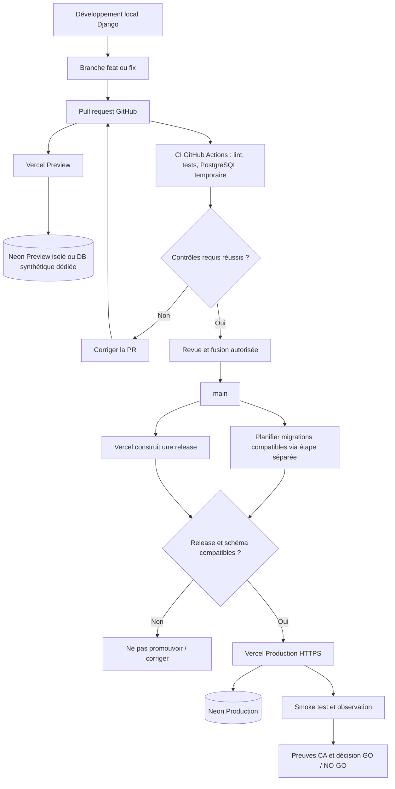

# 04 - Plan d'implémentation et CI/CD (index)

| Champ | Valeur |
|---|---|
| Version | 1.0 |
| Date | 18 novembre 2026 |
| Document d'origine | `docs/specs/04_PLAN_IMPLEMENTATION_ET_CI_CD.md` |
| Périmètre | R0 à R3 : MVP Django, GitHub, Vercel et Neon ; R4/R5 conditionnels |

> Le plan d'origine est découpé par phase. Chaque fichier conserve la numérotation des sections pour préserver les références croisées.

## Socle Django + GitHub + Vercel + Neon + Cloudflare

## Navigation

- [`01_R0_PREPARATION.md`](01_R0_PREPARATION.md) : R0 - Préparation et prérequis
- [`02_R1_SOCLE_LOCAL.md`](02_R1_SOCLE_LOCAL.md) : R1.1 et R1.2 - Socle local
- [`03_R2_GITHUB_CI.md`](03_R2_GITHUB_CI.md) : R2.1 - GitHub et CI
- [`04_R2_VERCEL_DEPLOIEMENT.md`](04_R2_VERCEL_DEPLOIEMENT.md) : R2.2 - Déploiement Vercel
- [`05_R3_NEON_MIGRATIONS.md`](05_R3_NEON_MIGRATIONS.md) : R3.1 et R3.2 - Neon et migrations
- [`06_R3_LIVRAISON_EXPLOITATION.md`](06_R3_LIVRAISON_EXPLOITATION.md) : R3.3 et R3.4 - Livraison et exploitation
- [`07_R4_CLOUDFLARE_INDUSTRIALISATION.md`](07_R4_CLOUDFLARE_INDUSTRIALISATION.md) : R4 et R5 - Cloudflare et industrialisation
- [`08_GATES_GOUVERNANCE.md`](08_GATES_GOUVERNANCE.md) : Gates, gouvernance et risques
- [`09_EXECUTION_LIVRABLES.md`](09_EXECUTION_LIVRABLES.md) : Première tranche et livrables

---

## 1. Résumé des décisions applicables

| Référence | Décision de mise en oeuvre | Conséquence |
|---|---|---|
| ADR-001 | Monolithe Django modulaire | Un seul service Python HTTP pour le MVP |
| ADR-002 | Templates Django + Admin | Pas de frontend React ou API DRF obligatoire |
| ADR-003 | GitHub et pull requests | `main` est la branche de référence |
| ADR-004 | Déploiement Django natif Vercel | Détection de `manage.py`, sans `/api/index.py` historique |
| ADR-005 | PostgreSQL Neon | DB distante persistante hors fonctions web |
| ADR-006 | Isolation stricte des Previews | Aucune Preview ne doit pointer sur Production |
| ADR-007 | Migrations hors build Vercel | Job de migration séparé, autorisé, vérifié |
| ADR-008 | Auth native Django | Autorisations côté serveur et Admin |
| ADR-009 | WSGI initial | `config.wsgi.application`, pas d'ASGI actif par défaut |
| ADR-010 | Statiques depuis CDN Vercel | `STATIC_ROOT` et collecte au build natif |
| ADR-011/012 | Cloudflare selon besoin | DNS-only en cas de domaine ; R2/Turnstile optionnels |
| ADR-013 | Dépendances verrouillées | Python 3.12 / Django 5.2 LTS candidats, `uv.lock` |
| ADR-014/015 | Pas de workers ou Py**Kit imposés | Industrialisation justifiée par l'usage |
| ADR-016/017 | Plan et région conformes | Arbitrage préalable sur usage commercial et résidence des données |
| ADR-018 | Preuves d'acceptation | `CA-01` à `CA-13` avant GO MVP |

### 1.1 Hypothèses R0 encore ouvertes

- `OA-01` : usage personnel/prototype ou commercial, donc plan Vercel adéquat.
- `OA-02/03` : compte GitHub, dépôt, visibilité, nom final.
- `OA-04` : démonstrateur `Record` et règles de permission.
- `OA-05` : versions Python/Django et outil de packaging.
- `OA-06` : régions Vercel et Neon.
- `OA-07` : stratégie Preview avec **données synthétiques**.
- `OA-08` : étape de migration Production et politique de promotion.
- `OA-09/10` : domaine, coûts et enveloppe budgétaire.
- `OA-11/12` : capacités de restauration, fonctionnalités différées.

**Valeurs de départ proposées :** dépôt `django-cloud-starter`, Python 3.12, Django 5.2 LTS, `uv`, modèle `Record`, domaine Vercel natif, DB PostgreSQL Neon et données synthétiques. Ces valeurs restent à **valider** avant des actions externes.

---

## 2. Résultat observable et chaîne de livraison



**Nuance :** en configuration Git/Vercel standard, Vercel peut créer le déploiement dès le push, indépendamment du statut CI. Les règles de fusion de `main` sont le premier garde-fou. Si un véritable blocage **avant exposition** est requis, configurer et tester des *Deployment Checks* Vercel ou une autre politique de promotion disponible sur le plan choisi. Une CI verte sur la PR ne suffit pas, à elle seule, à garantir qu'une production n'exposera jamais un mauvais commit.

### 2.1 Deux modes de livraison

**Mode A - MVP sans modification incompatible de schéma :** première migration Neon effectuée avant l'exposition de l'application ; ensuite, code sur `main` -> Vercel Production automatiquement ; chaque évolution de schéma suit une procédure séparée et compatible avant/après la publication.

**Mode B - Contrôle de promotion renforcé :** Vercel construit une release candidate ; tests de déploiement et migration compatible sont vérifiés avant que la release ne soit promue. Ce mode **n'est activé qu'après vérification des fonctionnalités et du plan Vercel réellement disponibles**. En son absence, ne pas prétendre que le déploiement est bloqué par un contrôle qu'aucun service n'applique.

---

## 3. Plan de réalisation par jalons

| Jalon | Résultat concret | Stories majeures | Dépendance | Preuve de sortie |
|---|---|---|---|---|
| **R0 - Cadrage** | Hypothèses et plan d'hébergement arbitrés | US-001 à US-004 | Documents `00` à `03` | Registre OA validé |
| **R1.1 - Bootstrap** | Django démarre, projet versionné localement | US-005 à US-007, US-017 | R0 | `runserver`, page HTML, `check` |
| **R1.2 - Vertical slice** | `Record` + Admin + Auth + CRUD + tests | US-008 à US-011, US-033 | R1.1 | Tests d'usage et de permissions |
| **R2.1 - GitHub/CI** | PR avec statut qualité bloquant | US-012 à US-016, US-031 | R1.2 | Runs vert/rouge, règle de fusion |
| **R2.2 - Vercel HTTP** | Django, statiques et HTTPS en ligne | US-018 à US-020, US-022/023 | R2.1 | URL et SHA de production |
| **R3.1 - Neon** | Configuration PostgreSQL isolée et durable | US-024/025, US-031/034 | R0, R1.2 | Connexion sécurisée |
| **R3.2 - Previews** | Environnements PR sans données Production | US-021/026, US-035 | R2.2, R3.1 | Test sentinelles |
| **R3.3 - Release DB** | Migrations contrôlées, persistance prouvée | US-027 à US-030 | R3.1/R3.2 | Migration test, données après redeploy |
| **R3.4 - Exploitation** | Sécurité, rollback, recette, runbook | US-032, US-036 à US-043 | R2/R3 | `CA-01` à `CA-13` + GO |
| **R4 - Cloudflare** | Domaine, Turnstile ou stockage si besoin | US-045 à US-048 | R3 + besoin | Test du service ajouté |
| **R5 - Réutilisation** | Starter réutilisable, améliorations utiles | US-039/040/044, US-049 à US-052 | MVP validé | Deuxième bootstrap, ADR évolutives |

Aucun délai arbitraire n'est attribué à ces jalons. Un jalon est clos sur des **preuves**, pas au terme d'une semaine prédéterminée.

---

## 21. Documents suivants et limites

### 21.1 Documentation à produire au bon moment

| Document | Rôle | Avant quelle activité ? |
|---|---|---|
| `05_STRATEGIE_DONNEES_ET_MIGRATIONS.md` | Détail des branches Neon, contrats de données, rôles, opérations de migration, reprise et tests de restauration | Avant R3 et toute migration Production |
| `06_STRATEGIE_TESTS_ET_ACCEPTATION.md` | Cas de tests, jeux de données, preuves et recette `CA-01` à `CA-13` | Avant la recette GO / NO-GO |
| `07_RUNBOOK_DEPLOIEMENT_ET_EXPLOITATION.md` | Exploitation réelle, déploiements, incidents, rollback, coûts et contact d'astreinte si applicable | Avant le GO MVP |
| `08_OPTIONS_CLOUDFLARE_ET_EVOLUTIONS.md` | Arbitrage DNS, Turnstile, stockage objet et évolution de l'architecture | Au besoin R4/R5 |

Le présent plan **ne crée pas automatiquement** le dépôt, les projets Vercel/Neon, les secrets, les protections GitHub ou le code Django. Il précise leur ordre de mise en oeuvre et les preuves nécessaires pour les déclarer livrés.

### 21.2 Critère de réussite du document

Ce plan est prêt à être utilisé si le mainteneur peut :

- Sélectionner le prochain travail sans ambiguïté.
- Associer une tâche à une user story et à un critère CA.
- Savoir quelle variable appartient à quel environnement.
- Expliquer pourquoi **CI réussie**, **déploiement créé**, **promotion Production** et **migration appliquée** sont des événements différents.
- Détecter un risque critique de Preview ou de migration avant de déployer.
- Consigner une preuve et arrêter une release en NO-GO lorsque nécessaire.

---

## Annexe A - Exemples de commandes de recette

```bash
# Sur une machine de développement propre
uv sync --locked
uv run python manage.py check
uv run python manage.py makemigrations --check --dry-run
uv run python manage.py test
uv run ruff check .
uv run ruff format --check .

# Depuis un environnement dédié de recette, avec les variables appropriées
uv run python manage.py migrate --plan
uv run python manage.py showmigrations --plan

# Exemple de consultation HTTP : remplacer l'URL par un domaine vérifié
curl -I https://<DOMAINE_VERIFIE>/
curl -I https://<DOMAINE_VERIFIE>/static/css/app.css
```

**Précaution :** les placeholders `<...>` ne sont pas des URL réelles. Ne pas substituer des secrets ni des URL PostgreSQL dans des lignes de commande conservées dans un historique public.

## Annexe B - Sources techniques vérifiées au 18 novembre 2026

1. **Django sur Vercel** : https://vercel.com/docs/frameworks/full-stack/django
   - Détection de Django avec `manage.py`, WSGI/ASGI et collecte automatique des fichiers statiques si `STATIC_ROOT` est défini.
2. **Runtime Python Vercel** : https://vercel.com/docs/functions/runtimes/python
   - Versions Python prises en charge et `pyproject.toml`/`uv.lock`.
3. **Intégration Git Vercel** : https://vercel.com/docs/git/vercel-for-github
   - Déploiements sur commits et pull requests.
4. **Vercel Deployment Checks** : https://vercel.com/docs/deployment-checks
   - Possibilité de retenir la promotion jusqu'à validation de checks GitHub, avec contraintes de configuration.
5. **Neon Native Vercel Integration** : https://neon.com/blog/neon-vercel-native-integration
   - Branches de prévisualisation, options de connexion et risques liés au parent des branches.
6. **Neon Branching & Data Privacy** : https://neon.com/blog/branching-environments-anonymized-pii
   - Les branches peuvent reproduire les données et le schéma du parent ; anonymisation possible sous conditions.
7. **Django deployment checklist** : https://docs.djangoproject.com/en/5.2/howto/deployment/checklist/
   - Vérifications sécurité avant déploiement, `manage.py check --deploy`.
8. **GitHub Actions PostgreSQL service** : https://docs.github.com/en/actions/tutorials/use-containerized-services/create-postgresql-service-containers
   - PostgreSQL de CI via conteneur de service.
9. **uv dans GitHub Actions** : https://github.com/astral-sh/setup-uv
   - Installation de `uv` et options de cache.
10. **Vercel Hobby** : https://vercel.com/docs/plans/hobby
   - Vérifier les conditions d'utilisation de l'offre choisie avant toute activité commerciale.

**Politique d'actualité :** les fonctionnalités des plans, limites, intégrations et prérequis des GitHub Actions évoluent. Revalider ces documents lors de l'implémentation et avant toute modification sur des comptes réels.

## Annexe C - Journal des versions

| Version | Date | Changement |
|---|---|---|
| 1.0 | 18 novembre 2026 | Plan R0-R5, workflow CI PostgreSQL temporaire, modèle de migration manuelle et autorisée, politique de promotion, tests et gates. |
