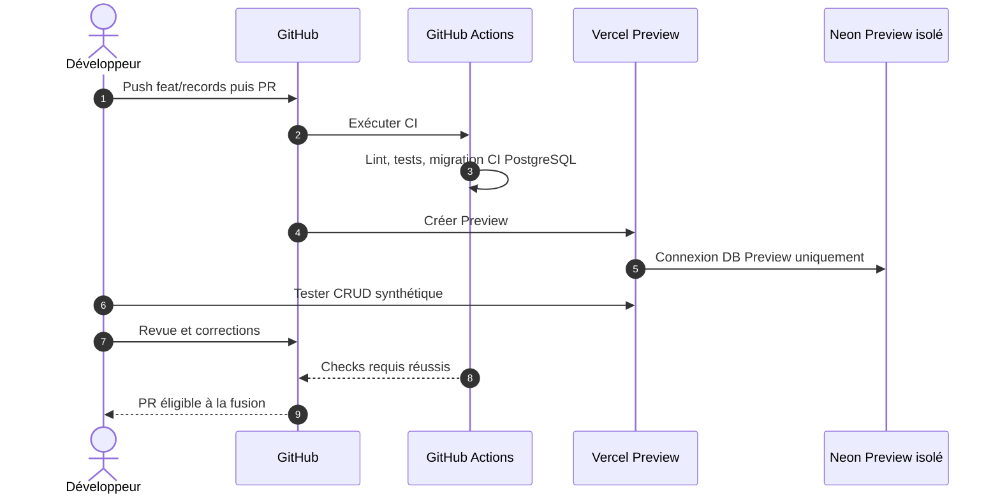
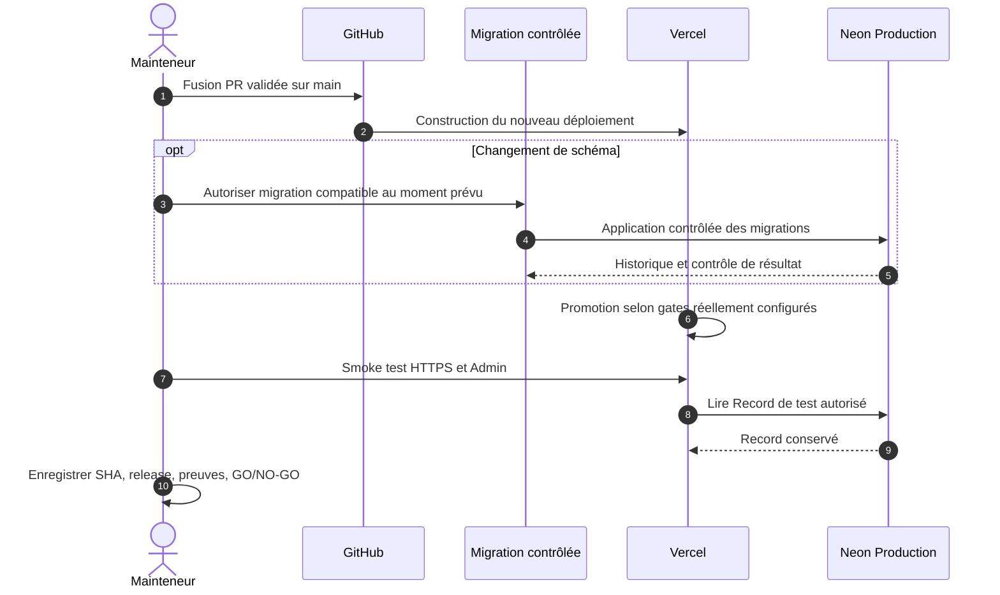

# Plan 04 - R3.3 et R3.4 - Livraison et exploitation

> Extrait de `docs/specs/04_PLAN_IMPLEMENTATION_ET_CI_CD.md`. Retour à l'index : [`00_INDEX.md`](00_INDEX.md).

## 12. R3.3 - Pipeline de livraison et smoke tests

### 12.1 Scénario de pull request de référence



### 12.2 Scénario de production de référence



> Le diagramme illustre une séquence de release **coordonnée**, pas la garantie qu'une intégration standard Vercel attendra le job de migration. En cas de changement incompatible, la promotion doit être effectivement contrôlée avant que le domaine cible ne pointe vers le nouveau code.

### 12.3 Smoke tests obligatoires

| ID | Scénario | Attendu |
|---|---|---|
| SM-01 | `GET /` en HTTPS | HTTP 200 et page HTML attendue |
| SM-02 | Asset `/static/css/app.css` | HTTP 200, ressource CSS |
| SM-03 | `GET /admin/` anonyme | Redirection/authentification, aucune donnée ouverte |
| SM-04 | Connexion avec compte test autorisé | Session fonctionne et cookies adaptés |
| SM-05 | Création d'un `Record` fictif | Persistance sur Neon correspondant à l'environnement |
| SM-06 | Redéploiement d'une version compatible | Même Record retrouvé sans changement inattendu |
| SM-07 | Preview modifie son Record | Aucune modification ni lecture non autorisée en Production |
| SM-08 | Logs et version | SHA et erreurs consultables sans secret |
| SM-09 | Mise en échec de CI | Fusion normale refusée |
| SM-10 | Mauvaise release contrôlée sur environnement de test | Procédure de rollback code démontrée |

Les scénarios qui créent des données doivent utiliser des environnements et des comptes dédiés à la recette, ou des données explicitement autorisées, sans risque de pollution de la production réelle.

### 12.4 Preuves de déploiement

Pour chaque tentative de release, conserver au minimum :

```text
Release ID :
Date / heure :
GitHub PR :
SHA Git :
CI GitHub Actions : PASS / FAIL
Vercel Deployment ID :
Environnement : Preview / Production
Neon branch / database (identifiant NON secret) :
Migrations requises : OUI / NON
Migration job / approbateur :
Smoke tests : PASS / FAIL
Anomalies :
Décision : GO / NO-GO
```

Ne jamais consigner des URL de connexion PostgreSQL contenant un mot de passe dans ce registre.

---

## 13. R3.4 - Exploitation, observabilité et retour arrière

### 13.1 Journaux et traçabilité

- Relier chaque release à un SHA GitHub et à l'identifiant de déploiement Vercel.
- Collecter les logs de build, de fonction Django et de tests CI dans leurs interfaces respectives.
- Ne pas journaliser les `DATABASE_URL`, `DJANGO_SECRET_KEY`, cookies, tokens ou données métier sensibles.
- Prévoir des diagnostics de connexion PostgreSQL, erreurs HTTP et erreurs de migrations.
- Mesurer progressivement les quotas de fonctions, les connexions DB et les coûts.

### 13.2 Retour arrière applicatif

1. Identifier le dernier déploiement sain et les éventuelles migrations effectuées entre-temps.
2. Déterminer si le schéma actuel reste compatible avec l'ancienne version du code.
3. Utiliser le mécanisme de rollback/promotion Vercel autorisé pour revenir au code sain.
4. Réexécuter les smoke tests et contrôler les écritures.
5. Si le schéma n'est pas compatible, appliquer le **plan de reprise des données prévu**, ne pas improviser un `migrate <ancienne_version>` ou une suppression de tables.
6. Documenter l'incident, le responsable, les pertes ou risques et les mesures correctives.

### 13.3 Sauvegarde et reprise des données

- Connaître les capacités de restauration associées au **plan Neon réellement choisi**, la fenêtre de récupération et les restrictions.
- Tester une restauration sur une base **non productive** et comparer les données attendues.
- Ne jamais supposer qu'un rollback Vercel restaure la base PostgreSQL : **les deux opérations sont indépendantes**.
- Définir la responsabilité de décision sur tout écrasement ou perte de données.

### 13.4 Budget et quotas

Le tableau de suivi reprend les plans réellement souscrits, les quotas consommés et la date de dernière vérification. Une application commerciale doit utiliser une offre et des conditions d'exploitation compatibles avec son usage, même si un prototype technique fonctionnerait avec des quotas gratuits.

---
