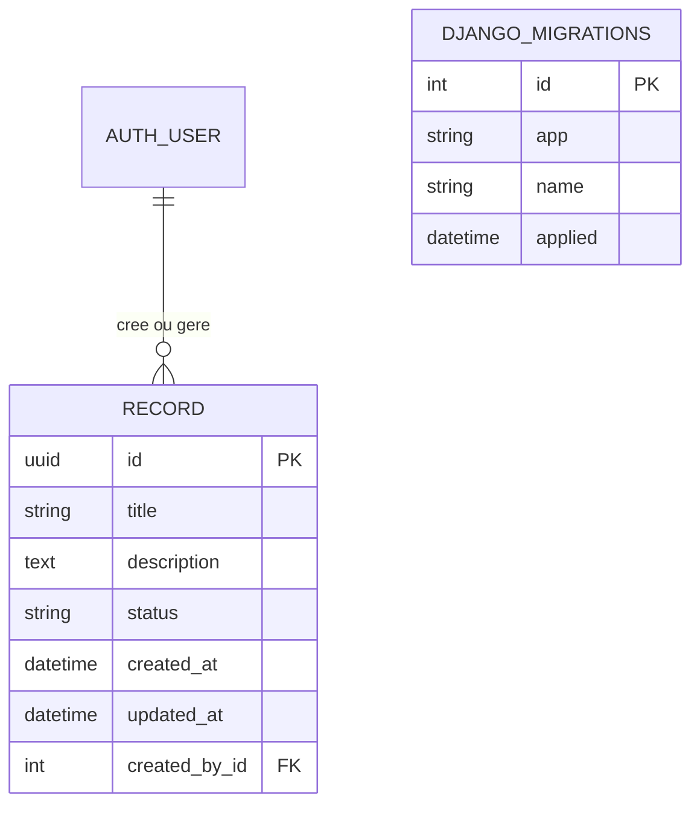
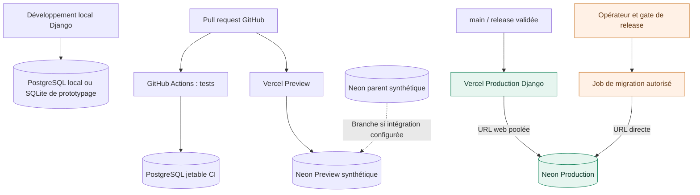
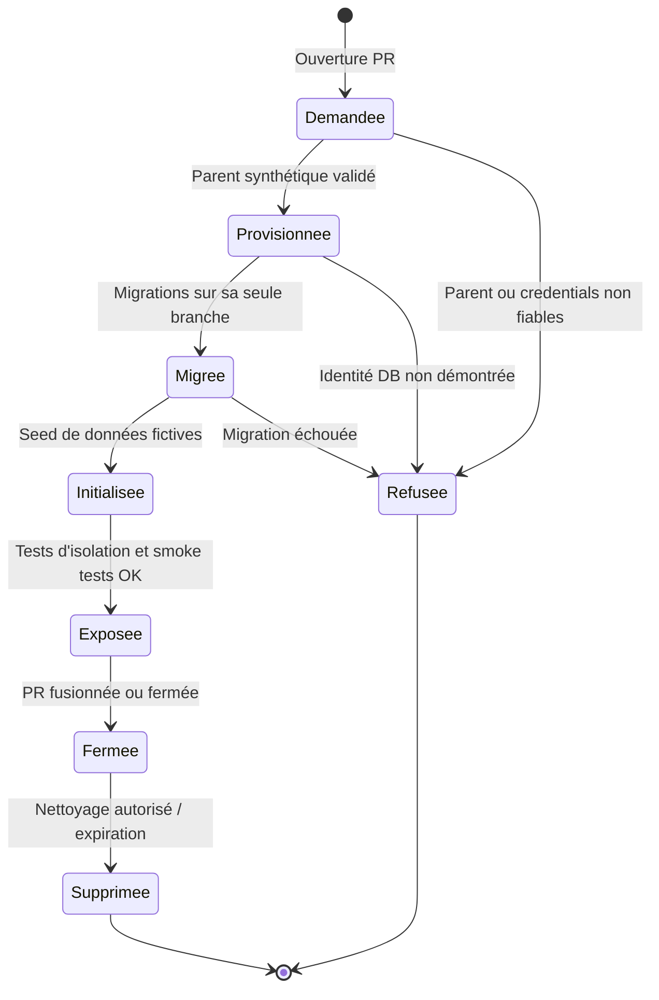
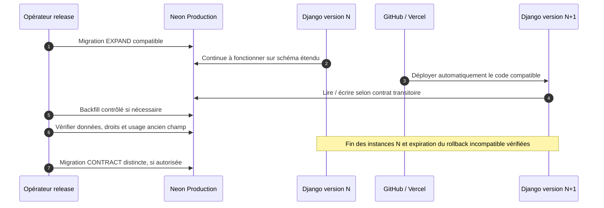
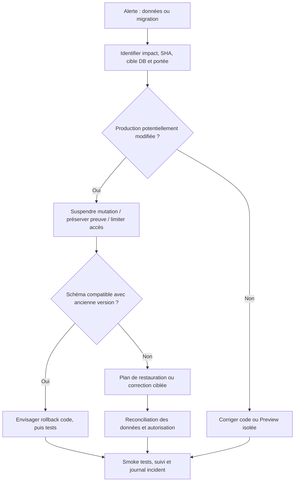

# 05 - Stratégie de données et de migrations

## Django + GitHub + Vercel + Neon PostgreSQL, avec Cloudflare en option

| Métadonnée | Valeur |
|---|---|
| Document | `05_STRATEGIE_DONNEES_ET_MIGRATIONS.md` |
| Version | 1.0 |
| Date | 18 novembre 2026 |
| Statut | **Proposition de conception et de procédures, non implémentée** |
| Périmètre | R3 du socle Django, plus contraintes de sécurité R0-R2 et exploitation R5 |
| Architecture de référence | Django 5.2 LTS, Python 3.12, `uv`, GitHub Actions, Vercel, Neon PostgreSQL |
| Public cible | Développeur, mainteneur, responsable des données et opérateur de release |
| Classification | Document d'architecture sans secrets, ni identifiants réels, ni données utilisateurs |
| Références amont | Documents `00`, `01`, `02`, `03` et `04` de la présente série |

> **Objet du document :** définir comment les données sont créées, connectées, isolées, modifiées, migrées, sauvegardées et restaurées, sans compromettre la production lors des déploiements automatiques sur Vercel.
>
> **Principe non négociable :** le déploiement automatique du **code** et la migration du **schéma PostgreSQL** sont deux processus distincts. Une Preview ne doit jamais avoir la possibilité de modifier la base de production.
>
> **État réel :** aucune ressource Neon, Vercel ou GitHub n'a été provisionnée ou modifiée lors de la rédaction. Les commandes et workflows ci-dessous sont des gabarits à adapter, à exécuter d'abord sur des bases non productives et à autoriser explicitement avant toute opération sur Production.

---

## 1. Positionnement dans la documentation

| Document | Contrat transmis à ce fichier |
|---|---|
| `00_DJANGO_GITHUB_VERCEL_NEON_CLOUDFLARE_EXPRESSION_DU_BESOIN.md` | Persistance, sécurité, isolation et critères `CA-03`, `CA-04`, `CA-08`, `CA-10`, `CA-11`, `CA-12` |
| `01_ARCHITECTURE_ET_DECISIONS.md` | `ADR-005` Neon, `ADR-006` Preview, `ADR-007` migrations, `ADR-008` Auth Django, `ADR-010` médias, `ADR-017` résidence, `ADR-018` recette |
| `02_BACKLOG_ET_USER_STORIES.md` | `US-008`, `US-015`, `US-021`, `US-024` à `US-031`, `US-034` à `US-038`, `US-041` à `US-043` |
| `03_STRUCTURE_PROJET_ET_CONFIGURATION.md` | Arborescence, dépendances, settings et variables, convention `DATABASE_URL` / `DATABASE_URL_UNPOOLED` |
| `04_PLAN_IMPLEMENTATION_ET_CI_CD.md` | Séquençage R3, `ci.yml`, `release-migrate.yml`, publication Vercel et gates de release |
| **Présent document** | Politique de données, procédures détaillées, preuves, scénarios de défaillance, récupération et GO / NO-GO |
| `06_STRATEGIE_TESTS_ET_ACCEPTATION.md` (à produire) | Campagne de recette, oracles de tests, archivage des preuves |
| `07_RUNBOOK_DEPLOIEMENT_ET_EXPLOITATION.md` (à produire) | Procédures d'exploitation exécutables et escalade incident |

### 1.1 Décisions retenues et décisions encore ouvertes

**Retenues pour le MVP :** une application Django monolithique ; la base persistante Neon sur Production ; CI PostgreSQL jetable ; Preview avec données synthétiques ; schémas gérés par migrations Django versionnées ; migration Production hors build et hors démarrage Vercel ; sauvegarde/restauration évaluées par exercice non destructif.

**À confirmer avant toute action externe :** projet, plan et région Neon ; nom de la branche principale ; mode d'intégration Neon/Vercel ; stratégie exacte des branches Preview ; droits et compte de migration ; protection réellement disponible pour le dépôt GitHub ; fenêtre de restauration ; exigences RPO/RTO ; rythme de purge des environnements temporaires.

---

## 2. Objectifs, invariants et hors périmètre

### 2.1 Objectifs vérifiables

1. Persister les données applicatives malgré le redéploiement ou la mise à l'échelle de Vercel.
2. Permettre des évolutions de schéma Django traçables et rejouables sur PostgreSQL.
3. Empêcher tout accès non autorisé à Production depuis CI et Preview.
4. Empêcher la fuite de données personnelles dans les environnements non productifs.
5. Rendre auditable la correspondance entre code applicatif, état du schéma et release.
6. Réduire le risque de verrouillage, d'interruption de service et de régression lors d'une migration.
7. Établir des procédures réalistes de diagnostic, de restauration et de retour arrière.
8. Préparer l'évolutivité vers des applications métier sans charger le MVP de contraintes non encore nécessaires.

### 2.2 Invariants DATA-INV

| ID | Invariant | Nature | Preuve attendue |
|---|---|---|---|
| **DATA-INV-01** | Production et Preview ne partagent jamais les credentials applicatifs | Bloquant | Revue expurgée des scopes et des rôles |
| **DATA-INV-02** | CI n'accède pas à Neon Production | Bloquant | Workflow sans secret Production + permissions |
| **DATA-INV-03** | Aucune Preview n'a de capacité d'écriture sur Production | Bloquant | Test de sentinelles et vérification des rôles |
| **DATA-INV-04** | Les Previews MVP ne contiennent pas de données réelles ou personnelles | Bloquant | Provenance synthétique, inspection ciblée |
| **DATA-INV-05** | Une migration Production ne s'exécute jamais dans un build ou dans une requête web Vercel | Bloquant | Inspection CI et Vercel, test de non-exécution |
| **DATA-INV-06** | Toute migration Production est liée à une révision vérifiée et autorisée | Bloquant | SHA, ticket de release, run et approbateur |
| **DATA-INV-07** | Les migrations Django sont versionnées et testées sur PostgreSQL isolé | Bloquant | CI `makemigrations`, `migrate`, tests |
| **DATA-INV-08** | Un rollback de code n'est jamais assimilé à un rollback du schéma | Bloquant | Plan de reprise distinct |
| **DATA-INV-09** | La capacité de restaurer est testée sans action destructive sur Production | Bloquant pour GO | Compte rendu de restauration isolée |
| **DATA-INV-10** | Les secrets de connexion ne sont pas versionnés, journalisés ni partagés entre scopes | Bloquant | Scan, matrice des secrets |
| **DATA-INV-11** | Les données persistantes ne résident pas sur le disque éphémère de Vercel | Bloquant | Test après redéploiement |
| **DATA-INV-12** | La promotion de code incompatible avec le schéma est empêchée, ou explicitement organisée | Bloquant | Scénarios N/N-1 et procédure de promotion |

### 2.3 Hors périmètre initial

- Multi-tenant comptable, consolidation financière réglementée et gestion de données de paiement réelles.
- Réplication multi-région et garantie de haute disponibilité contractuelle.
- Architecture analytique, data warehouse, ETL et data lake.
- Moteur de jobs longue durée, CDC et event sourcing.
- Neon Auth, authentification externe et unification des identités.
- Gestion des médias : R2 ou Neon Object Storage ne sont ajoutés que si un usage de fichiers persiste.
- Restauration automatique destructrice déclenchée par l'application ou la CI.

> Un futur usage pour SYNQENTRA, la comptabilité ou des données clients réelles nécessitera un **audit de classification et de conformité supplémentaire** : ce starter MVP ne vaut ni certification, ni validation réglementaire, ni preuve de capacité à traiter des données financières sensibles.

---

## 3. Cartographie des données

### 3.1 Domaines et propriétaires

| Domaine | Source de vérité | MVP | Propriétaire fonctionnel | Observations |
|---|---|---|---|---|
| `Record` de démonstration | Tables Django dans Neon | Oui | Application Django | Données synthétiques en Preview/CI |
| Utilisateurs et permissions | `django.contrib.auth` dans PostgreSQL | Oui | Module Identity natif Django | Pas de seconde source d'identité |
| Sessions applicatives | Stockage de sessions Django configuré pour Production | Oui | Application Django | Ne pas supposer la persistance en mémoire/disque local |
| Historique du schéma | `django_migrations` | Oui | Migrations Django | La table n'est pas un mécanisme de verrouillage concurrent |
| Logs de déploiement | GitHub Actions / Vercel | Oui | Exploitation | Référencer SHA et environnement ; pas de contenu sensible |
| Secrets | Vercel/GitHub/gestionnaire de secrets retenu | Oui | Administrateur habilité | Jamais dans le dépôt |
| Fichiers statiques | Git + artefact build Vercel | Oui | Frontend Django | Ne sont pas des données utilisateur |
| Documents téléversés | Stockage objet externe à sélectionner | Non | À définir | Ne pas utiliser PostgreSQL pour des blobs massifs par défaut |
| Traces d'audit métier | Modèle dédié à concevoir si requis | Non | Métier | Séparer logs techniques et journal probant |

### 3.2 Modèle minimal proposé : `Record`



Le modèle est une **hypothèse de démonstration**. La clé étrangère `created_by` et la granularité des autorisations sont à fixer dans la vertical slice R1. Le diagramme distingue la table de suivi des migrations, qui relève du framework et non du domaine métier.

### 3.3 Typologie de données et sensibilité

| Classe | Exemples | Preview/CI | Production | Rétention |
|---|---|---|---|---|
| D0 - Publique | Pages, textes génériques | Autorisée | Autorisée | Selon code |
| D1 - Fictive | Faux comptes et faux `Record` | **Autorisée** | Possible pour test explicite | Courte, documentée |
| D2 - Interne non personnelle | Métadonnées techniques expurgées | Sous contrôle | Autorisée | Selon besoin |
| D3 - Personnelle | E-mail, identité, historique d'utilisation | Interdite par défaut | Si usage et gouvernance validés | Politique spécifique |
| D4 - Sensible/confidentielle | Finances, justificatifs, données réglementées, secrets | **Interdite** | Après étude dédiée | Politique stricte et obligations applicables |

Une anonymisation efficace doit être vérifiée ; un simple changement de noms ou la pseudonymisation ne rend pas nécessairement un corpus anonyme au sens des obligations applicables.

### 3.4 Principes de modélisation PostgreSQL

- Définir clés primaires, relations, contraintes d'unicité, `NOT NULL`, `CHECK` et index sur un besoin mesurable.
- Utiliser les types PostgreSQL/Django appropriés ; pour les montants financiers futurs, préférer `Decimal`/`NUMERIC` avec échelle, devise et invariants, pas `float`.
- Stocker les dates en UTC côté stockage et configurer la gestion des fuseaux Django (`USE_TZ`).
- Différencier suppression métier, suppression technique et rétention réglementaire lorsque le domaine le nécessite.
- Ne pas créer de colonne ``tenant_id`` sans avoir défini une stratégie de cloisonnement et d'autorisations ; l'ajout est un projet distinct.
- Éviter les accès SQL directs dispersés : privilégier l'ORM pour le MVP, compléter par SQL contrôlé lorsque nécessaire.

---

## 4. Architecture des environnements et des branches

### 4.1 Cartographie de référence



**Lecture :** les flèches représentent uniquement des accès autorisés. Il n'existe **aucune** flèche de CI/Preview vers Neon Production. Cloudflare n'intervient pas dans le chemin transactionnel PostgreSQL du MVP.

### 4.2 Matrice de séparation

| Environnement | Compute | Source PostgreSQL | Données | Secret DB | Migrations | Durée de vie |
|---|---|---|---|---|---|---|
| **Local** | Ordinateur | PostgreSQL local ou DB dédiée | Fictives | `.env` local non commité | Développeur | À discrétion |
| **CI** | GitHub Actions | Service PostgreSQL jetable | Fictives | Job CI seulement | À chaque test | Durée du job |
| **Preview** | Vercel Preview | Branche Neon issue d'une source synthétique, ou DB de test dédiée | Fictives | Scope Preview uniquement | Dans le pipeline Preview isolé | PR / expiration définie |
| **Staging** (facultatif) | Vercel environnement dédié si disponible | Branche dédiée assainie | Fictives / anonymisées contrôlées | Scope staging | Procédure validée | Selon besoins |
| **Production** | Vercel Production | Branche principale Neon | Données validées pour exploitation | Scope Production | Job de release | Pérenne |

### 4.3 Topologie Neon recommandée

**Option A - MVP le plus simple (recommandée si peu de PR simultanées)**

- Un projet Neon avec une branche Production dédiée.
- Une **source de Preview synthétique**, sans filiation avec Production contenant des données réelles.
- Une base/branche Preview dédiée ou des branches PR dérivées de cette source synthétique.
- Des tests CI via le service PostgreSQL local au runner GitHub, sans appel à Neon.
- Les migrations Preview sont exécutées sur la base de Preview uniquement.

**Option B - Branching automatique par Preview (si configuration contrôlée)**

- Installer et configurer explicitement l'intégration Neon/Vercel compatible avec le projet.
- Vérifier le mécanisme réel de création/suppression de branches et les scopes des variables injectées.
- Configurer **une source parente synthétique**, ou un mécanisme de création sans données de production prouvé.
- Associer chaque déploiement Preview à sa propre branche afin d'éviter les collisions de schéma entre PR.
- Contrôler que les credentials associés ne possèdent pas d'autorisation de modification des ressources Production.

**Option C - Projets Neon entièrement séparés**

- Projet Neon Production distinct d'un projet Neon de développement/Preview.
- Séparation forte des ressources, des rôles et des politiques de facturation/accès.
- À privilégier si le fournisseur ou le mode d'intégration ne permet pas de garantir un parent synthétique sûr dans le même projet.

La séparation par projet est plus simple à raisonner sur certains risques, mais génère davantage d'administration. Le choix final dépend des capacités et quotas du plan réellement activé.

### 4.4 Pourquoi une branche Neon n'est pas un environnement anonymisé

Les branches Neon reposent sur un mécanisme de type *copy-on-write*. Une branche enfant peut débuter avec **les données et le schéma de son parent**. Elle est indépendante pour ses modifications, mais elle peut déjà contenir des données confidentielles au moment de sa création.

**Conséquences :**

1. Créer une branche depuis Production pour une PR n'est **pas** autorisé par défaut si Production contient des données personnelles.
2. Masquer les informations **après** avoir créé la branche ne garantit pas qu'elles n'ont pas été exposées pendant l'intervalle précédant le masquage.
3. Un parent synthétique contrôlé ou un projet non productif séparé est la règle MVP.
4. La fonction éventuelle de branchement anonymisé n'est utilisable qu'après validation de sa disponibilité, de son résultat, de sa fenêtre d'exposition et des droits d'accès.
5. Les rôles et extensions éventuellement hérités de la branche doivent aussi être inspectés.

### 4.5 Cycle de vie d'une branche Preview



**Point de contrôle :** une Preview peut être construite automatiquement avant que la base et les migrations soient prêtes. Sa disponibilité technique ne suffit pas à en faire une Preview **autorisée** pour tester le CRUD.

### 4.6 Éviter les collisions entre PR

Avec une branche Preview partagée, deux PR peuvent tester des migrations incompatibles l'une avec l'autre. Pour éviter ce problème :

- Préférer une branche isolée par PR quand le besoin de parallélisme apparaît.
- Sinon, sérialiser tests et migrations Preview ; signaler explicitement que la Preview commune n'offre pas une isolation par PR.
- Nettoyer les branches obsolètes et vérifier les limites et coûts liés aux endpoints/branches.
- Ne jamais déclencher une migration Production à partir d'un événement PR.

---

## 5. Accès, identités, permissions et secrets

### 5.1 Séparation des responsabilités

| Acteur | Lecture/écriture métier Production | DDL / migration Production | Gestion Neon | CI/Preview |
|---|---|---|---|---|
| Application Django Production | Permissions minimales sur ses tables | **Non** si séparation de rôles effectivement réalisée | Non | Non |
| Opérateur de release habilité | Selon nécessité | Oui, par procédure contrôlée | Limité au besoin | Non |
| GitHub Actions CI | Non | Non | Non | PostgreSQL jetable uniquement |
| Vercel Preview | Non | Non | Uniquement sa branche/base autorisée | Oui, données fictives |
| Développeur local | Non par défaut | Non | Non par défaut | Local/test |
| Administrateur Neon | Selon mandat exceptionnel | Selon mandat | Oui | Contrôle et audit |

Une séparation stricte entre rôle applicatif et rôle de migration est **cible**, à tester avec les objets et permissions Django : les objets créés par des migrations appartiennent généralement au rôle exécutant la DDL. Il faut accorder explicitement les droits nécessaires au rôle web sur les tables, séquences et futurs objets, puis valider les migrations et le fonctionnement applicatif après séparation. **Ne pas déclarer cette séparation opérationnelle tant que la CI et les tests de permissions ne la prouvent pas.**

**Mode transitoire MVP :** un rôle partagé peut être toléré uniquement après arbitrage et réduction des privilèges, mais c'est un risque résiduel documenté. Les identifiants Preview et Production restent de toute façon distincts.

### 5.2 Variables d'environnement

| Variable | Environnement | Catégorie | Rôle |
|---|---|---|---|
| `APP_ENV` | Tous | Non secret | `local`, `ci`, `preview`, `production` |
| `DATABASE_URL` | Tous | **Secret** | URL de connexion utilisée par l'application, potentiellement poolée |
| `DATABASE_URL_UNPOOLED` | Migration / admin | **Secret renforcé** | Connexion directe pour opérations de migration autorisées |
| `DJANGO_SECRET_KEY` | Tous | **Secret** | Secret Django propre à chaque scope |
| `DJANGO_ALLOWED_HOSTS` | Preview/Production | Configuration | Liste de domaines approuvés |
| `DJANGO_CSRF_TRUSTED_ORIGINS` | Preview/Production | Configuration | Origines HTTPS autorisées |
| `DJANGO_DEBUG` | Tous | Configuration | `false` hors Local |
| `DB_TARGET_ID` | Release/diagnostic | Identifiant interne non suffisant seul | Référence du projet/branche attendus, sans mot de passe |
| `DB_MIGRATION_APPROVED_SHA` | Job de release | Contrôle | Commit autorisé à migrer |

Les noms `DB_TARGET_ID` et `DB_MIGRATION_APPROVED_SHA` sont des **conventions proposées**. Ils ne sont pas fournis automatiquement par Neon. Ils ne dispensent pas d'une vérification effective de la cible.

### 5.3 Règles de conservation et de divulgation

- Une URL Postgres contenant utilisateur et mot de passe est un **secret**, même dans un exemple de commande `psql`.
- Ne pas afficher `env`, `printenv`, `set`, `settings.DATABASES` ou le contenu d'un `.env` dans les logs de CI.
- Ne pas inclure l'URL de connexion complète dans une issue, une capture d'écran ou un ticket de support.
- Utiliser des identifiants distincts par environnement et, si possible, des rôles de droits minimaux.
- Mettre en place une rotation/remplacement en cas d'exposition, avec revue des accès et logs.
- Limiter les droits des workflows GitHub ; ne pas fournir de secrets Production aux exécutions de PR ou aux forks.
- Vérifier les fonctions de protection de déploiement offertes par **le plan GitHub réel** : certains mécanismes d'approbation ne sont pas disponibles dans tous les contextes de dépôt privé.
- Si l'approbation native n'est pas réellement disponible, ne pas prétendre que `environment: production-db` suffit. Prévoir un processus manuel externe, un runner restreint ou un dispositif de promotion offrant une vraie séparation d'autorité.

### 5.4 Contrôles défensifs avant chaque mutation

1. Vérifier le SHA du code destiné à être livré.
2. Vérifier le compte, le projet, la branche, l'endpoint et la base Neon de destination, sans imprimer le secret.
3. Vérifier l'identité des credentials et les privilèges effectifs du rôle.
4. Vérifier le statut de la sauvegarde et la fenêtre de restauration.
5. Vérifier qu'aucune autre migration Production n'est en cours.
6. Exiger l'autorisation opérateur adaptée au risque.
7. Journaliser le résultat de l'opération, pas les clés ou les données personnelles.

**Ne pas se fier uniquement à** `APP_ENV`, au préfixe de l'URL, au nom de la base ou à une sentinelle copiée lors du branching. La preuve robuste combine inventaire Neon/API ou console, endpoint réel, secrets cloisonnés, rôles et tests de données.

---

## 6. Connexion Django à Neon PostgreSQL

### 6.1 Clients et configuration

**Hypothèse initiale :** Django 5.2 LTS, Python 3.12, driver `psycopg` compatible et paramètres de connexion parsés avec la bibliothèque réellement retenue dans `03` (`django-environ` ou équivalent, sans duplication des mécanismes).

```python
# Exemple illustratif de config/settings/base.py, à adapter au code réel.
import environ

env = environ.Env()
DATABASES = {"default": env.db("DATABASE_URL")}

# Approche conservatrice en contexte serverless ; à mesurer avant évolution.
DATABASES["default"]["CONN_MAX_AGE"] = 0
```

**Important :** l'option `CONN_MAX_AGE=0` ferme les connexions Django en fin de requête ; elle évite de présumer de la stabilité des connexions persistantes dans un runtime serverless. La combinaison avec le pooler Neon, le nombre de processus et les performances réelles doit être **testée**, pas figée par principe. Le code n'est pas une configuration complète de sécurité Django.

### 6.2 Connexion poolée et directe

| Usage | Connexion | Justification |
|---|---|---|
| Requêtes HTTP Django | URL poolée Neon si compatible | Limiter la pression exercée par les instances serverless sur PostgreSQL |
| Job de migration | URL directe non poolée | Supporter les opérations DDL et comportements de session requis |
| `pg_dump` / outils d'administration | URL directe selon l'outil | Compatibilité avec sessions et opérations administratives |
| CI | URL Postgres éphémère locale au runner | Zéro dépendance et zéro privilège Production |
| Preview | URL Preview spécifique | Isoler données et schéma |

Le pooler Neon s'appuie sur PgBouncer en mode *transaction pooling*. Certains mécanismes liés à une session PostgreSQL nécessitent une validation explicite : état de session, transactions particulières, prepared statements, tables temporaires et verrous de session. Les capacités exactes évoluent avec PostgreSQL, le driver et PgBouncer.

### 6.3 TLS, régions et contraintes opérationnelles

- Exiger TLS et utiliser les chaînes fournies par Neon selon ses recommandations à jour.
- Conserver, lorsque pertinent, compute Vercel et base Neon dans des régions proches, sous réserve des contraintes de résidence.
- Vérifier les limites de connexions, de calcul, de mise en veille/reprise et les délais de la plateforme.
- Mesurer les erreurs de connexion, latences et pics de concurrence ; définir une stratégie de retry limitée et sûre.
- Éviter les tentatives de reconnexion infinies dans un middleware ou un endpoint.
- Ne pas contourner une erreur de connexion avec une bascule SQLite implicite sur Preview/Production.

### 6.4 Test de connexion non destructif

Les tests de `SELECT 1` et d'interrogation des métadonnées constituent des **tests de santé**, pas des preuves suffisantes de bonne isolation :

```sql
SELECT current_database() AS database_name,
       current_user       AS database_role,
       current_setting('server_version') AS postgresql_version;
```

On conserve dans le rapport uniquement des valeurs non sensibles. Le projet, la branche et l'endpoint effectifs doivent être rapprochés de l'inventaire Neon approuvé.

---

## 7. Gouvernance des migrations Django

### 7.1 Sources de vérité

- Le **code** définit les modèles Django attendus et les fichiers de migration committés.
- Django construit un **graphe de dépendances** entre migrations ; l'ordre de simple tri des noms de fichiers n'est pas l'oracle.
- La table `django_migrations` retrace les migrations enregistrées comme appliquées dans une base.
- L'**état réel du schéma PostgreSQL** peut diverger de ces fichiers et de cette table en cas de SQL manuel ou d'exécution partielle ; la recette doit détecter cette dérive.
- Une migration Django n'est pas systématiquement réversible et l'option `--fake` n'est pas une réparation normale.

### 7.2 Politique de versionnement

- Versionner tous les fichiers `apps/*/migrations/*.py` nécessaires au déploiement.
- Interdire la modification a posteriori d'une migration déjà appliquée sur un environnement partagé, sauf procédure de correction explicitement approuvée.
- Préférer une **nouvelle migration corrective** à une réécriture de l'historique diffusé.
- Inclure dans la PR les migrations correspondant à toute évolution de modèle.
- Inspecter les opérations générées : `AddField`, `AlterField`, `RemoveField`, `RunPython`, `RunSQL`, index et contraintes.
- Signaler les migrations irréversibles, les gros volumes, les créations d'index bloquantes ou les risques de lock.

### 7.3 Commandes de contrôle locales / CI

```bash
# Exemples sans données sensibles. CI utilise PostgreSQL jetable.
uv run --frozen python manage.py makemigrations --check --dry-run
uv run --frozen python manage.py showmigrations --plan
uv run --frozen python manage.py migrate --plan
uv run --frozen python manage.py migrate --noinput
uv run --frozen python manage.py test
```

**Attention :** `migrate --plan` est une vue d'intention ; il n'est pas une garantie de durée, de réussite ou d'absence de blocage. `migrate --noinput` modifie **réellement** la base connectée. Il est réservé aux bases de développement, CI, Preview validées ou au job Production explicitement autorisé.

### 7.4 CI obligatoire

Sur chaque PR modifiant les modèles ou migrations :

1. Installer les dépendances verrouillées et une version Python compatible.
2. Démarrer PostgreSQL jetable sur le runner.
3. Exécuter `makemigrations --check --dry-run` pour détecter des changements de modèle non versionnés.
4. Construire le schéma depuis une base vide avec `migrate --noinput`.
5. Exécuter les tests de modèles, permissions, vues et parcours CRUD.
6. Tester une montée de version depuis un schéma représentatif si la PR contient une migration non triviale.
7. Conserver l'ID du run, le SHA, la version PostgreSQL et les résultats expurgés.

**Limite importante :** une base CI neuve ne démontre pas à elle seule la compatibilité d'une migration avec une base volumineuse déjà peuplée. Les migrations `P1/P2/P3` doivent aussi être validées sur un corpus synthétique **représentatif en volume et structure**.

### 7.5 Relecture de code spécifique aux migrations

- Vérifier contraintes, valeurs par défaut, nullabilité et index existants.
- Examiner l'effet sur les requêtes de l'ancienne et de la nouvelle version du code.
- Vérifier l'impact d'un `UPDATE` massif, d'un index ou d'un `ALTER TABLE`.
- Vérifier le comportement en cas d'échec et la capacité à reprendre sans double-écriture incorrecte.
- Identifier les opérations irréversibles et les dépendances métier.
- Contrôler les changements de permissions SQL si plusieurs rôles DB sont utilisés.
- Refuser `--fake`, `flush`, `dropdb`, `DROP ...` sans justification et procédure adaptée.

---

## 8. Classification des migrations et niveau d'autorisation

| Classe | Exemple | Niveau | Stratégie par défaut | GO attendu |
|---|---|---|---|---|
| **M0 - Initiale** | Création des tables sur DB vide | Normal en environnement neuf | Migration autorisée avant mise en service | Tests de base et droits |
| **M1 - Additive** | Nouvelle table, champ nullable | Faible à moyen | Expand compatible, test N et N-1 | Contrôle des verrous et des valeurs |
| **M2 - Évolution de données** | Remplir un champ calculé | Moyen à élevé | Backfill idempotent et éventuellement batché | Comptages et tests de reprise |
| **M3 - Potentiellement bloquante** | Index important, contrainte, type de colonne | Élevé | Étude de lock, durée et fenêtre | Test représentatif et procédure spéciale |
| **M4 - Destructive** | `DROP COLUMN`, suppression de table, perte d'historique | Critique | Contract différé, sauvegarde et approbation renforcée | GO explicite, plan de reprise |
| **M5 - Sécurité/identités** | Permissions, données de compte, séparation de tenants | Critique | Revue sécurité spécifique | Contrôles d'accès et audit |

Les étiquettes sont des conventions du projet ; elles n'ont pas d'effet natif dans Django. Une opération additive n'est pas nécessairement sans verrou, ni sans consommation de ressources.

### 8.1 Niveau d'assurance attendu

| Vérification | M0/M1 | M2 | M3/M4/M5 |
|---|---|---|---|
| CI PostgreSQL neuve | Obligatoire | Obligatoire | Obligatoire |
| Test depuis schéma antérieur | Recommandé | Obligatoire | Obligatoire |
| Dataset représentatif | Selon données | Obligatoire | Obligatoire |
| Plan de reprise | Bref | Détaillé | Détaillé et approuvé |
| Vérification des verrous | Si risque | Oui si backfill | Oui, avec budget opérationnel |
| Validation avant release | Responsable | Responsable + relecture | Appropriation explicite du risque |
| Suppression de données | Non | Éviter | Contract séparé et autorisé |

---

## 9. Pattern de livraison : expand - migrate - contract

### 9.1 Principe

Il ne faut pas présumer que toutes les instances HTTP passent immédiatement à la nouvelle version, ni qu'une release précédente est devenue totalement inactive à l'instant d'un merge GitHub.

- **Expand** : modifier le schéma pour accepter simultanément ancien code et nouveau code.
- **Migrate** : mettre le code à jour, déplacer ou enrichir les données, vérifier la complétude.
- **Contract** : retirer les éléments anciens **après** la fin prouvée de la transition et de la fenêtre de rollback code.



### 9.2 Exemple concret : renommer `Record.title` en `Record.name`

**Mauvaise séquence :** supprimer `title`, déployer immédiatement le code qui utilise `name`, puis espérer qu'une migration Production suive le build. Le code N peut tomber en panne et les requêtes anciennes échouer.

**Séquence compatible proposée :**

1. `Expand` : ajouter `name` nullable, sans supprimer `title`.
2. Déployer un code transitoire capable de lire les deux champs et de remplir `name` à chaque nouvelle écriture, si la logique métier le permet.
3. Backfill idempotent de `name` pour les enregistrements existants, sans bloquer des requêtes trop longtemps.
4. Vérifier que les versions encore en service n'utilisent plus exclusivement `title`.
5. Passer `name` en obligatoire lorsque tous les enregistrements le satisfont et que la compatibilité le permet.
6. `Contract` : supprimer `title` dans une **release ultérieure** explicitement autorisée.

**Risque de double-écriture :** durant la transition, deux champs portant la même sémantique peuvent diverger. Prévoir une source de vérité claire, des transactions cohérentes et des contrôles de comparaison ; ne pas improviser deux mises à jour séparées.

### 9.3 Exemple de backfill Django avec `RunPython`

Exemple **pédagogique**, qui suppose l'existence des champs `title` et `name` dans le modèle historique au point de migration. Il convient à un jeu réduit de démonstration. Pour de grands volumes, construire un job de backfill batché, contrôlé et redémarrable plutôt qu'une grosse transaction de migration.

```python
from django.db import migrations


def backfill_record_name(apps, schema_editor):
    Record = apps.get_model("records", "Record")
    db_alias = schema_editor.connection.alias
    queryset = Record.objects.using(db_alias).filter(name__isnull=True)
    for record in queryset.iterator(chunk_size=500):
        Record.objects.using(db_alias).filter(pk=record.pk, name__isnull=True).update(
            name=record.title
        )


class Migration(migrations.Migration):
    dependencies = [
        ("records", "000X_add_name"),  # Remplacer par le nom réel.
    ]
    operations = [
        migrations.RunPython(backfill_record_name, migrations.RunPython.noop),
    ]
```

**Limites :**

- La boucle peut être lente et maintenir une transaction ouverte sur PostgreSQL selon le caractère atomique de la migration.
- Le `RunPython.noop` inverse ne restaure pas la donnée d'origine et ne représente **pas une vraie réversibilité métier**.
- La migration ne doit pas importer le modèle courant, mais utiliser `apps.get_model` et l'alias fourni par `schema_editor`.
- En cas de modifications concurrentes, le backfill nécessite des contrôles additionnels pour éviter d'écraser des valeurs récentes.
- Si la volumétrie est significative, traiter le backfill via un processus dédié idempotent, avec checkpoints et métriques, plutôt que ce code d'exemple.

### 9.4 Index et contraintes à fort volume

- La création d'index PostgreSQL peut bloquer des opérations selon sa forme ; examiner `CREATE INDEX CONCURRENTLY` lorsque c'est pertinent, avec les contraintes d'exécution hors transaction correspondantes.
- Une migration Django contenant des opérations non transactionnelles demande une revue spécifique des états partiels et de la reprise.
- Les modifications de type, contraintes `NOT NULL` et renommages peuvent avoir des coûts variables selon version de PostgreSQL et schéma réel.
- Définir les valeurs de `lock_timeout` et `statement_timeout` pour une opération **en tenant compte de son contexte**, après tests et non par copier-coller aveugle.
- Prévoir une fenêtre de maintenance si l'impact ne peut être raisonnablement atténué.

---

## 10. Orchestration des migrations de Production

### 10.1 La règle de compatibilité avec `main`

Vercel peut publier automatiquement tout nouveau commit éligible sur `main`. Cette propriété **ne constitue pas un gate de schéma**. Elle impose une contrainte sur l'ordre des changements :

**Chemin A - Évolutions compatibles (par défaut MVP)**

1. La PR fournit les migrations et les tests N/N-1.
2. L'opérateur examine le plan et autorise l'`expand` compatible **avant** ou au moment prévu, alors que le code N continue de fonctionner.
3. Le commit validé est fusionné, Vercel déploie N+1 automatiquement.
4. Les smoke tests et contrôles de persistance passent.
5. Le `contract` éventuel est reporté à une autre release.

**Chemin B - Évolutions incompatibles**

- **NO-GO avec simple autodeploy sur `main`** si la nouvelle application peut rencontrer un schéma incompatible.
- Prévoir une véritable barrière de promotion : déploiement candidat, migration autorisée, promotion manuelle ou automatique contrôlée, ou fenêtre de maintenance selon les capacités/plan vérifiés.
- Si le mécanisme de promotion réellement protecteur n'existe pas, revoir l'architecture de release ou s'abstenir de la modification incompatible.

### 10.2 Contrat de la procédure `release-migrate.yml`

Le workflow d'exemple décrit dans `04_PLAN_IMPLEMENTATION_ET_CI_CD.md` constitue un **point de départ**, non un système de promotion atomique complet. Il doit être encadré par les préconditions suivantes :

| Contrôle | Condition |
|---|---|
| Déclenchement | `workflow_dispatch` manuel ou release orchestrée et autorisée ; **jamais** une simple PR |
| Branche | Référence approuvée, normalement `main`, liée à la release cible |
| Révision | SHA Git exact approuvé et comparé au commit exécuté |
| Cible | Projet/branche/endpoint Neon Production vérifiés depuis un inventaire fiable |
| Secret | URL **directe** dédiée, non accessible à la CI PR |
| Permissions | Environnement protégé **si et seulement si** les règles existent réellement sur le plan GitHub utilisé |
| Tests | CI verte ; schéma compatible ; résultat de migration non productive probant |
| Sécurité | Plan de restauration, fenêtre de changement, absence de migration concurrente |
| Journal | Opérateur, SHA, heure, opérations prévues, résultat, vérifications |
| Échec | Arrêt, analyse, pas de rerun aveugle, décision de reprise documentée |

### 10.3 Pourquoi GitHub Actions `concurrency` ne suffit pas

`concurrency` peut sérialiser des runs GitHub utilisant la même clé, mais ne verrouille pas toutes les opérations lancées hors GitHub (console Neon, ordinateur d'un opérateur, autre repo). En outre, la table `django_migrations` ne protège pas, à elle seule, contre toutes les migrations concurrentes ou états partiels.

La politique cible impose :

- **Un seul opérateur/processus de migration Production** à la fois, défini organisationnellement.
- Restriction des credentials DDL à un canal d'exécution identifié.
- Option de verrouillage PostgreSQL contrôlée si un mécanisme d'exécution fiable peut le garantir de bout en bout.
- Inventaire et vérification des activités de migration en cours avant mutation.
- Interdiction des scripts manuels non suivis sur Production.

### 10.4 Améliorations minimales du workflow `04`

**Sans changer automatiquement la configuration GitHub réelle :**

1. Ajouter une saisie du **SHA attendu** à la demande de migration.
2. Effectuer `test "$(git rev-parse HEAD)" = "$EXPECTED_SHA"` avant toute connexion avec privilèges de migration.
3. Vérifier l'identité de la branche Neon par un contrôle indépendant de `APP_ENV`.
4. Conserver un rapport `migrate --plan` et des approbations, sans secrets.
5. Placer la vérification du plan **avant** la demande de mutation et une revue explicite des opérations destructives.
6. Refuser une release nécessitant un schéma incompatible si aucune barrière de promotion n'est active.
7. Ne pas exécuter sur forks ou branches non approuvées.
8. Limiter les rôles du job et protéger le dépôt contre toute modification non revue du workflow de release lui-même.

Exemple de garde SHA à intégrer à un job contrôlé :

```yaml
# Extrait seulement. Ce n'est PAS un workflow exécutable autonome.
- name: Verify approved commit
  shell: bash
  env:
    EXPECTED_SHA: ${{ inputs.expected_sha }}
  run: |
    set -euo pipefail
    test -n "$EXPECTED_SHA"
    test "$(git rev-parse HEAD)" = "$EXPECTED_SHA"
```

**Attention aux expressions GitHub dans un template :** un input fourni par un utilisateur ne doit pas être interpolé directement dans un script shell ; l'utilisation d'une variable d'environnement et d'une comparaison citée limite ce risque. Il faut également vérifier la provenance du SHA et les protections de branche.

### 10.5 Étapes opératoires d'une migration Production

#### Avant

- [ ] Identifier la classe M0-M5 et le SHA approuvé.
- [ ] Examiner `showmigrations --plan` et `migrate --plan` sur une cible représentative non productive.
- [ ] Confirmer la compatibilité du code N et N+1 avec le schéma courant et cible.
- [ ] Revoir les opérations SQL/DDL à risque et les verrous prévisibles.
- [ ] Vérifier explicitement les rôles et credentials, cible Neon et isolation.
- [ ] Vérifier l'absence d'autre migration active.
- [ ] Documenter fenêtre de récupération, procédure de reprise et impacts acceptables.
- [ ] Obtenir l'autorisation appropriée.

#### Pendant

- [ ] Lancer **une** exécution avec code et cible approuvés.
- [ ] Conserver le SHA, l'identifiant du run et le journal expurgé.
- [ ] Ne jamais republier ou restaurer automatiquement la base si une erreur apparaît.
- [ ] Surveiller erreurs, durée, contention et disponibilité selon le niveau de risque.

#### Après

- [ ] Vérifier `showmigrations`, schéma et droits.
- [ ] Vérifier le CRUD et les permissions sur la version effectivement exposée.
- [ ] Vérifier les données sentinelles et, si applicable, les comptes de lignes.
- [ ] Contrôler erreurs de requêtes, latences et connexions.
- [ ] Mettre à jour registre de release, anomalies et décisions.

### 10.6 Registre minimal de migration

| Champ | Exemple fictif ou règle |
|---|---|
| `release_id` | `REL-YYYYMMDD-NN` |
| `approved_sha` | SHA complet du commit destiné à la release |
| `migration_set` | Liste exacte des noms `app.migration` |
| `class` | `M0`, `M1`, `M2`, `M3`, `M4` ou `M5` |
| `target_environment` | `production` ou `preview-pr-xxx` |
| `neon_project_branch` | Identifiants non sensibles, selon politique interne |
| `executed_by` | Identité opérateur/job habilité |
| `approved_by` | Autorité distincte si nécessaire |
| `started_at` / `ended_at` | Horodatages UTC |
| `result` | `SUCCESS`, `FAILED`, `PARTIAL`, `CANCELLED` |
| `checks` | Tests CI, compatibilité et vérification après migration |
| `recovery_reference` | Référence du plan de reprise et de la fenêtre de restauration |

Le registre peut débuter en Markdown ou dans un ticket de release. Un journal d'audit immuable est à étudier en cas d'application réglementée.

---

## 11. Tests d'isolation CI / Preview / Production

### 11.1 Trois couches de preuve indépendantes

**Couche A - Configuration :** scopes Vercel distincts, secrets GitHub limités, rôles PostgreSQL séparés, branche Neon connue, permissions minimales.

**Couche B - Ressource :** projet, branche, endpoint et identifiants effectifs vérifiés par rapport à un inventaire approuvé, sans divulguer les secrets.

**Couche C - Comportement :** test de sentinelles et tests d'autorisations démontrant l'absence de visibilité et de mutation croisées.

La preuve d'une couche ne remplace pas les deux autres.

### 11.2 Scénario de sentinelles avec données fictives

**Préconditions :** environnements neufs et contrôlés ; ne jamais utiliser de `Record` personnel ni de donnée réelle. Les inserts sont faits via l'application et des credentials appropriés, sans donner à Preview les identifiants Production.

1. Créer dans Production un `Record` fictif `PROD_ONLY_<identifiant_aleatoire>`.
2. Créer dans Preview un `Record` fictif `PREVIEW_ONLY_<autre_identifiant>`.
3. Lire depuis Preview : `PREVIEW_ONLY` visible, `PROD_ONLY` absent.
4. Modifier puis supprimer un `Record` fictif Preview.
5. Relire Production avec son **propre** compte autorisé : `PROD_ONLY` intact, aucun effet du test Preview.
6. Vérifier que les rôles Preview n'ont aucun droit sur la branche Production selon les contrôles disponibles.
7. Consigner les résultats expurgés et les identifiants de branche, puis nettoyer les sentinelles selon procédure.

**Point subtil :** si la branche Preview a été créée depuis Production, elle peut contenir la sentinelle `PROD_ONLY` dès sa création ; ce test permet précisément de détecter une mauvaise provenance. L'absence d'écriture croisée n'est pas une garantie d'absence de lecture de données privées.

### 11.3 Cas négatifs à démontrer

| ID | Tentative | Résultat attendu |
|---|---|---|
| ISO-01 | Lancer la CI sans base Neon | Réussite sur PostgreSQL jetable |
| ISO-02 | Injecter une URL Production dans Preview | Configuration ou publication refusée avant usage du CRUD |
| ISO-03 | Créer une Preview depuis un parent contenant une sentinelle Production | Test de provenance/visibilité en échec, Preview non validée |
| ISO-04 | Exécuter une migration depuis PR | Aucun accès Production ni rôle DDL |
| ISO-05 | CI exécutée depuis un fork non fiable | Aucun secret Production disponible |
| ISO-06 | Deux PR modifiant le schéma | Bases isolées ou sérialisation documentée |
| ISO-07 | Preview supprimée ou expirée | Pas de dépendance sur Production ; nettoyage du secret temporaire |
| ISO-08 | Déployer un commit avec migration absente | CI rouge (`makemigrations --check`) |
| ISO-09 | Schéma PostgreSQL Production momentanément indisponible | L'application échoue de façon maîtrisée, sans SQLite de repli |
| ISO-10 | Réutiliser un secret de Production en Preview | Revue des scopes / politique bloque avant GO |

### 11.4 Scénario BDD

```gherkin
Feature: Cloisonnement des bases
  Scenario: Une Preview ne voit ni ne modifie Production
    Given une base Production avec un Record fictif PROD_ONLY
    And une source Preview synthétique indépendante
    And des credentials Preview sans privilège Production
    When une pull request crée une Preview avec son propre endpoint Neon
    And la Preview crée, lit, modifie puis supprime un Record fictif
    Then le Record PROD_ONLY reste absent de la Preview
    And le Record PROD_ONLY demeure inchangé en Production
    And l'identité de la branche Preview est vérifiée
    And aucune donnée réelle n'est copiée depuis Production
```

---

## 12. Persistance, cohérence et transactions

### 12.1 Persistance après déploiement

Test transversal exigé par `CA-03` / `CA-04` :

1. Appliquer le schéma initial sur Neon Production via la procédure autorisée.
2. Créer un `Record` fictif, puis conserver son identifiant et ses valeurs attendues.
3. Fusionner une PR de changement de présentation ou de code compatible.
4. Constater le nouveau SHA sur Vercel Production.
5. Relire le même enregistrement via Django.
6. Vérifier que l'application ne dépend d'aucun fichier SQLite local ou dossier éphémère.
7. Confirmer que la DB utilisée est toujours l'environnement Production inventorié.

### 12.2 Transactions applicatives

- Utiliser les transactions Django pour les opérations métier devant être atomiques.
- Ne pas ouvrir de transaction longue pendant une requête HTTP ou un backfill volumineux.
- Tester les conflits de mises à jour, l'idempotence de commandes et la gestion d'un timeout.
- Ne pas mélanger une mutation SQL et une action externe irréversible en prétendant les rendre atomiques sans mécanisme adapté.
- Pour un futur moteur de comptabilité, définir séparément des contraintes d'équilibrage, d'immuabilité, d'audit et de réconciliation : elles ne découlent pas automatiquement de PostgreSQL ou de Django.

### 12.3 Cohérence des versions de code et de schéma

Définir un contrat de compatibilité explicite :

| Version code | Ancien schéma | Schéma expand | Schéma contract |
|---|---|---|---|
| N (ancienne) | Fonctionne | **Doit fonctionner** | Peut échouer ; ne pas restaurer code N après contract |
| N+1 transitoire | Selon conception | **Doit fonctionner** | À tester, pas présumé |
| N+2 finale | Peut échouer | Doit fonctionner si contract non encore réalisé | Fonctionne après tests |

Cette table est un **objectif de conception**, pas une garantie universelle : chaque release contenant une migration doit le prouver avec des tests adaptés.

---

## 13. Sauvegardes, restauration et objectifs de reprise

### 13.1 Vocabulaire

- **RPO (Recovery Point Objective)** : perte maximale de données acceptable, exprimée comme écart temporel.
- **RTO (Recovery Time Objective)** : temps cible maximal de retour à un service utilisable.
- **PITR (Point-in-Time Recovery)** : reconstruction de l'état de base à un instant permis par l'historique disponible.
- **Snapshot** : état capturé selon les capacités de l'offre.
- **Rollback du code** : retour à une version applicative précédente, **sans restauration implicite de PostgreSQL**.

Aucun RPO ni RTO contractuel n'est déclaré pour le MVP expérimental. Ils devront être **mesurés** puis définis avant toute charge critique ou données financières réelles.

### 13.2 Capacités Neon et limites à contrôler

Neon propose des mécanismes de branching, d'historique, de restauration à un instant antérieur et, selon l'offre, des fonctionnalités de snapshots/sauvegardes. La période de rétention, les opérations de restauration, les garanties et les limitations dépendent **du plan, de l'état du projet et de la configuration au moment de l'usage**.

**Il est interdit** de déduire la restaurabilité d'une simple présence du bouton « Restore » dans la console. Un exercice réaliste doit être exécuté.

### 13.3 Stratégie de reprise recommandée

| Niveau | Usage | Mesure |
|---|---|---|
| **Niveau 0 - MVP expérimental** | Données fictives, risque faible | Restauration testée sur branche/base isolée, limites connues |
| **Niveau 1 - Projet utilisé** | Utilisateurs et données non triviales | RPO/RTO cibles, suivi d'échecs, sauvegarde complémentaire si nécessaire |
| **Niveau 2 - Application métier sensible** | Comptabilité, clients, justificatifs | Politique de sauvegarde et de conservation formalisée, contrôle d'accès, exercices périodiques, audit et conformité |

### 13.4 Procédure de restauration non destructive

1. Choisir une base de test ou un environnement isolé dont la destruction ne présente aucun risque.
2. Insérer des données sentinelles fictives avec plusieurs instants de référence.
3. Créer un point de restauration ou identifier un instant PITR admissible dans l'outil Neon effectivement disponible.
4. **Restaurer dans une nouvelle branche/base de vérification**, si le mécanisme et le plan le permettent, sans écraser Production.
5. Comparer les identifiants, valeurs, schéma, migrations Django et droits avant/après.
6. Lancer les tests Django sur l'état restauré.
7. Mesurer la durée et identifier les données qui auraient été perdues.
8. Nettoyer la base de vérification après archivage des preuves.

**Ne jamais** lancer une restauration in-place de Production comme exercice initial. Une restauration réelle en incident peut nécessiter une coupure d'écriture, un choix de point dans le temps, une reconstruction de l'URL, une rotation de secret et une réconciliation des écritures postérieures au point de restauration.

### 13.5 Export logique complémentaire avec `pg_dump`

Un export logique PostgreSQL peut être utilisé pour les exercices ou comme mécanisme complémentaire, selon les besoins et les conditions de sécurité.

```bash
# Exemple pour une BASE DE TEST exclusivement.
# PG* et l'URL de connexion sont injectés via un environnement sécurisé.
# Ne pas coller un mot de passe dans l'historique shell.
pg_dump --format=custom --no-owner --no-privileges \
  --file=./backup_test.dump "$DATABASE_URL_UNPOOLED"
```

**Précautions :**

- Vérifier que `DATABASE_URL_UNPOOLED` pointe bien sur une **base de test** avant exécution ; la commande lit des données, elle n'est donc pas neutre pour la confidentialité.
- Stocker les dumps chiffrés et avec accès restreint ; ne jamais les committer ni les téléverser sur un espace public.
- `pg_dump` produit un export logique, **pas une sauvegarde PITR continue** et n'inclut pas tous les objets externes à PostgreSQL.
- Vérifier la compatibilité entre la version des outils client `pg_dump` et celle du serveur PostgreSQL.
- Ne pas lancer `pg_restore --clean` ni toute autre restauration destructive sans procédure approuvée.
- Tester la restauration dans une base **isolée** et consigner vérification et suppression de l'archive.

### 13.6 Cloudflare R2 et fichiers utilisateurs

Si le produit ajoute des fichiers métiers, leur sauvegarde et rétention doivent être **séparées** de celle de Neon. Restaurer uniquement une base PostgreSQL peut laisser des références vers des objets supprimés, ou des objets devenus orphelins. La stratégie d'export/restauration doit inclure cohérence des identifiants d'objets, droits, versions et réconciliation, selon le fournisseur retenu.

---

## 14. Retour arrière et incidents de données

### 14.1 Matrice d'incidents

| Incident | Réaction initiale | Action interdite | Reprise / vérification |
|---|---|---|---|
| Nouvelle version Django défaillante, schéma compatible | Identifier SHA, rollback code Vercel selon mécanisme disponible | Restaurer la DB sans diagnostic | Smoke test + compatibilité schéma |
| Migration SQL échouée | Stopper toute autre migration, relever l'état réel | Relancer aveuglément `migrate` | Analyse transactionnelle, réparation ciblée approuvée |
| Base indisponible | Vérifier service Neon, connexion, région, quotas | Activer SQLite en Production | Rétablir connectivité, retester persistance |
| Preview connectée à Production | Suspendre Preview, révoquer accès, préserver éléments utiles d'enquête | Continuer la Preview | Audit des lectures/écritures, rotation, notification si applicable |
| Suppression accidentelle de données | Stopper les écritures selon plan, capturer l'état | Écraser Production sans analyse | PITR ou branche isolée, comparaison et réconciliation |
| Migration lente / verrou bloquant | Diagnostiquer verrous et transactions | Terminer au hasard une session PostgreSQL | Plan DBA de résolution et reprise |
| Secret de connexion exposé | Révoquer/rotation, isoler accès | Publier l'URL dans un ticket | Contrôle d'accès et recherche d'usage non autorisé |
| Corruption logique progressive | Définir horizon, impact et point sain | Restaurer au hasard le premier point disponible | Échantillon de branches PITR et comparaison métier |

### 14.2 Cas particulier : schéma modifié et rollback code

**Scénario :** code N+1 a utilisé un nouveau champ. Le déploiement échoue et Vercel remet le code N.

- Si l'ancien code N fonctionne sur le schéma `expand`, le rollback du code est généralement une voie de reprise envisageable, sous réserve des tests réels.
- Si le nouveau schéma a supprimé ou modifié une structure attendue par N, le rollback code peut aggraver l'incident.
- La restauration PostgreSQL peut faire perdre des écritures récentes et nécessite donc une **décision sur les données**, distincte de la décision sur le code.

### 14.3 Procédure d'urgence résumée



### 14.4 Observabilité et audit minimal

- Corréler les migrations au SHA Git, à la release Vercel et aux logs du job.
- Mesurer durée, échecs, utilisation des connexions et blocages importants.
- Conserver les logs suffisamment longtemps pour diagnostiquer un incident, sans y inclure les contenus ou credentials sensibles.
- Documenter l'identité des acteurs ayant autorisé ou exécuté une migration.
- Prévoir des métriques sur l'utilisation du stockage et sur le nombre de branches.

---

## 15. Coûts, quotas et entretien du cycle de vie

Le MVP peut utiliser des offres gratuites **si elles autorisent l'usage prévu** et si les quotas sont compatibles. Les offres changent : ne pas figer dans cette spécification des limites de CU, de stockage, de branchement ou de rétention sans vérification du compte réellement utilisé.

### 15.1 Risques de coûts spécifiques

- Branches Preview abandonnées ou endpoints actifs inutilement.
- Projets Neon multiples et utilisation de CPU supérieure à l'enveloppe attendue.
- Exécution répétée de tests de charge ou de migrations sur bases distantes.
- Historique de données et capacité de restauration plus courts que l'objectif métier.
- Export logique volumineux, stockage externe, trafic réseau et services d'observation.
- Configuration Vercel inadéquate au caractère commercial de l'application.

### 15.2 Politique d'entretien

1. Fixer le propriétaire de chaque projet/branche Neon et de chaque environnement Vercel.
2. Réconcilier régulièrement les PR fermées et les branches Preview restantes.
3. Activer une expiration automatique si disponible, testée et adaptée ; éviter de supprimer une branche encore utilisée.
4. Contrôler usage, quota, coût et historique de restauration selon la cadence retenue.
5. Révoquer les identifiants inutilisés à la fermeture d'un environnement.
6. Archiver le rapport de nettoyage sans garder les secrets.

---

## 16. Plan d'implémentation R3 : tâches et dépendances

| Ordre | ID | Action | Préconditions | Preuve de sortie |
|---|---|---|---|---|
| 1 | DATA-T01 | Valider le plan, la région et l'usage réel | R0, US-004 | Décision signée |
| 2 | DATA-T02 | Inventorier Production, rôles et secrets | DATA-T01 | Schéma d'accès expurgé |
| 3 | DATA-T03 | Configurer `DATABASE_URL` côté Django | US-005/006/008 | Test de connexion séparé |
| 4 | DATA-T04 | Tester les migrations sur PostgreSQL CI jetable | US-014/015 | CI positive et négative |
| 5 | DATA-T05 | Créer une source Preview synthétique | DATA-T01/02 | Provenance documentée |
| 6 | DATA-T06 | Associer Vercel Preview à sa DB isolée | DATA-T05 | Contrôle scopes et endpoint |
| 7 | DATA-T07 | Exécuter et prouver ISO-01 à ISO-10 | DATA-T06 | Matrice d'isolation |
| 8 | DATA-T08 | Mettre en place l'étape de migration autorisée | DATA-T02/04 | Workflow testé sur non-prod |
| 9 | DATA-T09 | Appliquer la migration initiale en Production | DATA-T07/08, accord opérateur | SHA + rapport migration |
| 10 | DATA-T10 | Vérifier persistance après redeploy | DATA-T09, US-020 | Avant/après enregistré |
| 11 | DATA-T11 | Exercer la restauration sur une base isolée | DATA-T02/09 | Rapport RPO/RTO observé |
| 12 | DATA-T12 | Consolider runbook et acceptation | DATA-T07 à T11 | Gate R3 GO/NO-GO |

### 16.1 Dépendances GitHub / Vercel / Neon

- `DATA-T04` doit pouvoir se dérouler **sans Neon** grâce au service PostgreSQL GitHub Actions.
- `DATA-T06` dépend de la décision de branchement Preview, pas simplement de l'activation de l'intégration Marketplace.
- `DATA-T09` ne doit pas être déclenchée par une PR, par le build Vercel ou par un environnement non protégé présenté à tort comme protégé.
- `DATA-T10` valide la persistance et non seulement la disponibilité HTTP.
- `DATA-T11` doit être terminé **avant** l'introduction de données critiques ou la déclaration de restaurabilité.

### 16.2 Correspondance avec les user stories

| Story | Sous-ensemble du document | Preuve principale |
|---|---|---|
| US-008 | Modèle `Record` et migrations | Schéma + tests |
| US-015 | CI PostgreSQL | Recréation DB jetable |
| US-021 | Preview Vercel | URL reliée à DB isolée |
| US-024 | Neon | Projet/branche/rôles inventoriés |
| US-025 | Django vers Neon | Requêtes sur DB dédiée |
| US-026 | Isolation Preview | ISO-02/03, sentinelles et scopes |
| US-027 | Migration contrôlée | Job autorisé, logs, SHA |
| US-028 | Persistance | Record inchangé après redeploy |
| US-029 | Restaurabilité | Exercice isolé |
| US-030 | Pooling/performance | Mesures et décision de connexion |
| US-031 | Base CI isolée | Zero accès Production |
| US-034/035 | Secrets et confidentialité | Matrice, scan, politique D3/D4 |
| US-036/037 | Diagnostic/rollback | Simulation et runbook |
| US-041/042/043 | Recette/GO/runbook | PV de décision et preuves |

---

## 17. Matrice de recette et gates GO / NO-GO

### 17.1 Critères documentaires et fonctionnels

| Référence | Validation attendue | État initial |
|---|---|---|
| CA-03 | Django lit et écrit les `Record` dans Neon | **Non testé** |
| CA-04 | Un redéploiement ne fait pas perdre le `Record` | **Non testé** |
| CA-08 | Preview sans capacité d'affecter Production | **Non testé** |
| CA-10 | Aucun secret réel présent dans Git | **Non testé** |
| CA-11 | Migrations distinctes du build et contrôlées | **Non testé** |
| CA-12 | Diagnostic et retour arrière documentés et exercés | **Non testé** |
| AT-05 | Sentinelles et isolation des branches prouvées | **Non testé** |
| AT-07 | Persistance après déploiement prouvée | **Non testé** |
| AT-09 | Politique de secrets appliquée | **Non testé** |
| AT-11 | Migration testée sur PostgreSQL isolé | **Non testé** |
| AT-13 | Exercice de reprise effectué | **Non testé** |

### 17.2 Bloquants absolus

Prononcer **NO-GO** si au moins l'une des conditions suivantes est vraie :

- [ ] Une Preview a accès à des credentials ou une base Production.
- [ ] Une branche Preview contient des données personnelles héritées d'une source non assainie.
- [ ] Un build ou un runtime Vercel exécute une migration Production.
- [ ] Le code déployé et le schéma ne sont pas compatibles.
- [ ] Le workflow de migration possède des secrets Production sans contrôle d'accès conforme au risque et à la capacité réelle du plan GitHub.
- [ ] Les migrations sont absentes du dépôt ou échouent sur PostgreSQL isolé.
- [ ] L'application dépend de SQLite ou du disque local de Vercel pour persister les données.
- [ ] La restauration est supposée possible sans test ou sans connaître la fenêtre du plan.
- [ ] Le plan du fournisseur n'est pas compatible avec le type d'exploitation, notamment commercial le cas échéant.

### 17.3 Preuves à conserver

```text
release-evidence/
  REL-YYYYMMDD-NN/
    release-summary.md          # SHA, opérateur, contexte, décisions
    ci-results.md               # URL du run, tests, migrations
    preview-isolation.md        # identifiants NON sensibles, sentinelles
    migration-plan.md           # plan et classification M0-M5
    migration-execution.md      # logs expurgés, résultat, horodatage
    persistence-check.md        # avant/après redeploy
    restore-drill.md            # exercice isolé, résultats observés
    go-no-go.md                 # décision finale et risques résiduels
```

Ne jamais enregistrer dans ce répertoire les clés, les dumps non chiffrés, les URLs contenant un mot de passe, les données personnelles ou la configuration intégrale des secrets.

---

## 18. Plan de tests détaillé par catégories

### 18.1 Tests de schéma

| ID | Cas | Oracle |
|---|---|---|
| DB-001 | Base PostgreSQL vide reçoit toutes les migrations | `migrate` et tests OK |
| DB-002 | Changement de modèle sans migration versionnée | CI échoue |
| DB-003 | Migrations `Record` appliquées et historique traçable | `showmigrations` conforme |
| DB-004 | Deux mises en œuvre depuis clone vierge | Schéma équivalent, pas de dépendance locale cachée |
| DB-005 | Évolution additive sur schéma antérieur | Ancien et nouveau code testés |
| DB-006 | Migration de données interrompue sur base de test | Reprise documentée sans double mutation |
| DB-007 | Migration destructive | Refus sans approbation / gate |

### 18.2 Tests de connexion et sécurité

| ID | Cas | Oracle |
|---|---|---|
| DB-008 | Secrets absents en Production | Démarrage ou opération concernée échoue explicitement |
| DB-009 | URL DB Preview égale à Production | Refus et incident documenté |
| DB-010 | Rôle web sans privilèges DDL | DDL refusée si séparation de rôles activée |
| DB-011 | Rôle CI | N'accède pas à Neon Production |
| DB-012 | Session et connexion poolée | Pas d'erreurs fonctionnelles sur parcours représentatif |
| DB-013 | Secrets mal typés ou exposés dans logs | CI/security check échoue |
| DB-014 | Tests depuis fork non approuvé | Aucun secret Production exposé |

### 18.3 Tests de persistance et exploitation

| ID | Cas | Oracle |
|---|---|---|
| DB-015 | Redeploy de code | Record conservé |
| DB-016 | Erreur d'écriture transitoire | Échec contrôlé, pas de doublon après retry maîtrisé |
| DB-017 | Échec de migration test | Aucun rerun aveugle, état partiel détecté |
| DB-018 | Restauration non destructive | Base isolée consultable et cohérente |
| DB-019 | Rollback code après expand | Ancien code fonctionne sur schéma expand |
| DB-020 | Schéma contract incompatible | Promotion refusée sans séquence de reprise |
| DB-021 | Fermeture de PR | Branche/secret Preview nettoyé ou expiré selon règle |
| DB-022 | Pic de connexions | Comportement mesuré et limite documentée |
| DB-023 | Permissions utilisateur Django | Refus d'accès non autorisé inchangé après migration |

### 18.4 Scénario BDD de restauration

```gherkin
Feature: Reprise des données
  Scenario: Vérifier un point de restauration sans écraser Production
    Given une base de test Neon avec des Record fictifs datés
    And une fenêtre d'historique de restauration documentée
    When l'opérateur crée une base de récupération isolée à un instant admissible
    Then le schéma attendu est présent
    And les Record attendus sont retrouvés
    And les Record créés après l'instant de reprise ne sont pas présumés conservés
    And la Production originale n'a pas été modifiée
    And l'écart RPO/RTO observé est consigné
```

---

## 19. Registre des risques propres aux données

| ID | Risque | Gravité | Mesure | Responsable proposé |
|---|---|---|---|---|
| DATA-R01 | Preview connectée à Production | Critique | Scopes, rôles, test sentinelles, stop | Responsable technique |
| DATA-R02 | Copie de données réelles depuis parent Neon | Critique | Source synthétique séparée, contrôle provenance | Responsable données |
| DATA-R03 | Migration hors release et conflits concurrents | Critique | DDL via opérateur/job unique | Opérateur release |
| DATA-R04 | Exposition d'URL et secrets DB | Élevée | Secret management, scan, rotation | Administrateur |
| DATA-R05 | Code N et schéma N+1 incompatibles | Critique | Expand/migrate/contract + promotion | Développeur / release |
| DATA-R06 | Restauration causant perte d'écritures | Critique | RPO, exercice, réconciliation et autorisation | Responsable données |
| DATA-R07 | Migrations longues ou verrous | Élevée | Test volume, plan SQL et fenêtres | Développeur / DBA |
| DATA-R08 | Surcharge des connexions | Élevée | Pooling, observation, limites | Exploitation |
| DATA-R09 | Historique PITR insuffisant | Élevée | Vérifier plan et stratégie complémentaire | Responsable données |
| DATA-R10 | Branches et endpoints oubliés | Moyenne | Expiration/nettoyage et quotas | Exploitation |
| DATA-R11 | Tests CI trop artificiels | Moyenne | Jeux représentatifs, tests d'upgrade | Développeur |
| DATA-R12 | Droits web excessifs | Élevée | Séparation rôles + tests | Responsable sécurité |
| DATA-R13 | Médias hors sauvegarde DB | Élevée si médias | Plan objet + réconciliation | Produit / exploitation |

---

## 20. Questions ouvertes avant R3

| Réf. | Décision | Hypothèse de départ | Impact |
|---|---|---|---|
| DATA-OA-01 | Quel projet Neon et quelle région ? | Un projet MVP dédié, région proche du compute | Latence, conformité, coûts |
| DATA-OA-02 | Quelle stratégie Preview ? | Source synthétique, branche par PR si disponible | Confidentialité |
| DATA-OA-03 | Quel mode d'intégration Vercel/Neon ? | Marketplace uniquement si correctement configuré | Branching/variables |
| DATA-OA-04 | Rôle de migration distinct du rôle web ? | Cible souhaitable, à éprouver | Permissions |
| DATA-OA-05 | Quelles protections GitHub utilisables réellement ? | Vérification plan/repo préalable | Autorisation DDL |
| DATA-OA-06 | Migration Production avant ou après merge ? | Expand compatible avant exposition | Ordonnancement |
| DATA-OA-07 | Quelle conservation des données de Preview ? | Minimale, expiration après PR | Coût/confidentialité |
| DATA-OA-08 | Quelle stratégie RPO/RTO ? | Exercice MVP puis définition avant données réelles | Résilience |
| DATA-OA-09 | Stockage de fichiers requis ? | Non pour MVP | Sauvegardes croisées |
| DATA-OA-10 | Quels utilisateurs et données autorisés en Production ? | Démonstrateur fictif d'abord | Réglementation et plan |
| DATA-OA-11 | Quel seuil de migration bloquante ? | Étude par opération, pas de seuil arbitraire | Indisponibilité |
| DATA-OA-12 | Comment prouver la bonne cible DB au-delà du nom ? | Inventaire Neon + endpoint + rôles + sentinelles | Sécurité |

---

## 21. Références techniques et état de vérification

Les documents suivants ont été consultés ou recoupés **le 18 novembre 2026** pour établir les principes. Ils devront être vérifiés au moment de l'implémentation, car les plans, APIs, comportements d'intégration et fonctions d'administration évoluent.

### 21.1 Django

1. [Migrations Django 5.2](https://docs.djangoproject.com/en/5.2/topics/migrations/) : graphe de migrations, opérations et état historique.
2. [How to write migrations - Django 5.2](https://docs.djangoproject.com/en/5.2/howto/writing-migrations/) : migrations de données, modèles historiques et transactions.
3. [Django migration operations 5.2](https://docs.djangoproject.com/en/5.2/ref/migration-operations/) : `RunPython`, `RunSQL`, opérations de schéma.
4. [Django deployment checklist](https://docs.djangoproject.com/en/5.2/howto/deployment/checklist/) : vérifications de configuration avant exposition.

### 21.2 Neon

5. [Neon branching](https://neon.com/docs/introduction/branching) : principe de branchement et isolation des écritures.
6. [Neon connection pooling](https://neon.com/docs/connect/connection-pooling) : PgBouncer, URL poolée et contraintes.
7. [Neon backups](https://neon.com/docs/postgres/backup-restore/backups) : possibilités actuelles de sauvegarde selon offre.
8. [Practical Guide to Database Branching](https://neon.com/blog/practical-guide-to-database-branching) : la branche reprend le schéma **et les données** du parent.
9. [Create Environments with Masked Production Data](https://neon.com/blog/environments-masked-production-data) : approche d'assainissement nécessitant validation.
10. [Neon snapshots](https://neon.com/blog/announcing-neon-snapshots-a-smoother-path-to-recovery) : différences entre snapshots et PITR.

### 21.3 Vercel et GitHub

11. [Vercel Django](https://vercel.com/docs/frameworks/full-stack/django) : hébergement Django natif.
12. [Neon for Vercel](https://vercel.com/marketplace/neon) : possibilité de branche par Preview si intégration correctement configurée.
13. [Vercel deployment environments](https://vercel.com/docs/deployments/environments) : portée des variables et environnements.
14. [GitHub Actions environments](https://docs.github.com/en/actions/how-tos/deploy/configure-and-manage-deployments/manage-environments) : règles et limites de protection selon plan/dépôt.
15. [Vercel - Why migrations should not run on container startup](https://vercel.com/i/database-migrations-container-startup) : motivation de la séparation du déploiement et des migrations.

**Note sur les sources :** les exemples de code de ce document sont des **conceptions proposées**, pas des extraits officiels garantis compatibles avec chaque version de `uv`, Django, Neon ou GitHub Actions. Les tests et les décisions de sécurité doivent précéder leur utilisation sur un système réel.

---

## 22. Livrables attendus en sortie de R3

- [ ] Architecture des environnements choisie, avec projet/branches et rôles documentés.
- [ ] Configuration Django -> Neon testée et adaptée au serverless.
- [ ] Aucune donnée personnelle dans CI ou Preview.
- [ ] Tests d'isolation ISO exécutés avec preuves.
- [ ] Migration initiale et migrations suivantes traçables par SHA.
- [ ] Procédure de release Production protégée selon le plan GitHub réel.
- [ ] `expand - migrate - contract` éprouvé sur un exemple de migration contrôlée.
- [ ] Données conservées après redéploiement Vercel.
- [ ] Restauration testée dans une base isolée, capacités et limites documentées.
- [ ] Logs, monitoring élémentaire, suivi coûts et purge des branches définis.
- [ ] Runbook enrichi, critères GO / NO-GO évalués.

**Définition de terminé du présent document :** les règles sont suffisamment explicites pour écrire les tests et les workflows de migration, mais elles ne sont **validées opérationnellement** qu'après les vérifications R3 et la recette `06`.

### Prochain document

`06_STRATEGIE_TESTS_ET_ACCEPTATION.md` : matrice exhaustive des tests techniques et de bout en bout, stratégie d'automatisation, campagnes de recette, collecte des preuves et décision GO / NO-GO du MVP.

---

## Annexe A - Checklist d'une pull request avec migration

- [ ] Les modèles et fichiers de migration sont cohérents.
- [ ] Le chemin de migration depuis une ancienne base représentative a été testé.
- [ ] La classe M0-M5 et les opérations non triviales sont documentées.
- [ ] Les anciennes et nouvelles versions sont compatibles avec le schéma au point de promotion retenu.
- [ ] Aucun `DROP`, `--fake`, `RunSQL` ou `RunPython` non revu n'est introduit.
- [ ] Pas de migration dans `settings.py`, `wsgi.py`, `asgi.py`, les vues, `collectstatic` ou build Vercel.
- [ ] La CI utilise sa base PostgreSQL jetable.
- [ ] La Preview utilise une branche/base synthétique indépendante.
- [ ] Les secrets et données privées ne figurent pas dans la PR ni dans les logs.
- [ ] Le plan de reprise est proportionné au risque.
- [ ] Les preuves et le SHA sont associés à la PR.

## Annexe B - Checklist avant migration Production

- [ ] Le plan d'hébergement permet l'usage réel de l'application.
- [ ] Le SHA de la release cible est approuvé et la compatibilité vérifiée.
- [ ] L'environnement GitHub/procédure d'approbation a effectivement les protections requises.
- [ ] L'URL **directe** de Production reste secrète et hors Preview/CI.
- [ ] Le projet et la branche Neon cibles ont été vérifiés indépendamment.
- [ ] Les migrations et données fictives ont été testées sur un schéma représentatif.
- [ ] La fenêtre PITR/backup réelle est connue.
- [ ] Les risques de verrouillage, timeout et indisponibilité ont été analysés.
- [ ] Il n'y a pas de migration concurrente.
- [ ] Le mainteneur possède un plan d'arrêt, d'incident et de vérification après release.
- [ ] L'opération est explicitement autorisée.

## Annexe C - Modèle de compte rendu de migration

```markdown
# Migration report - REL-YYYYMMDD-NN

- Date UTC :
- Environnement :
- Projet / branche DB (identifiants non sensibles) :
- SHA Git approuvé :
- Version du code effectivement exécutée :
- Migrations Django prévues :
- Classe de risque M0-M5 :
- Compatibilité code N/N+1 :
- Approbation et opérateur :
- Référence du backup / plan de reprise :
- Début / fin UTC :
- Résultat (SUCCESS/FAILED/PARTIAL) :
- Historique `showmigrations` vérifié :
- Permissions vérifiées :
- Smoke tests effectués :
- Persistances / sentinelles vérifiées :
- Erreurs ou anomalies :
- Décision finale GO/NO-GO :
```

## Annexe D - Historique des versions

| Version | Date | Évolution |
|---|---|---|
| 1.0 | 18 novembre 2026 | Première version : gouvernance des environnements et des données, branching Neon synthétique, stratégie Django des migrations, release Vercel, restauration, sécurité, preuves, gates et plan R3. |
